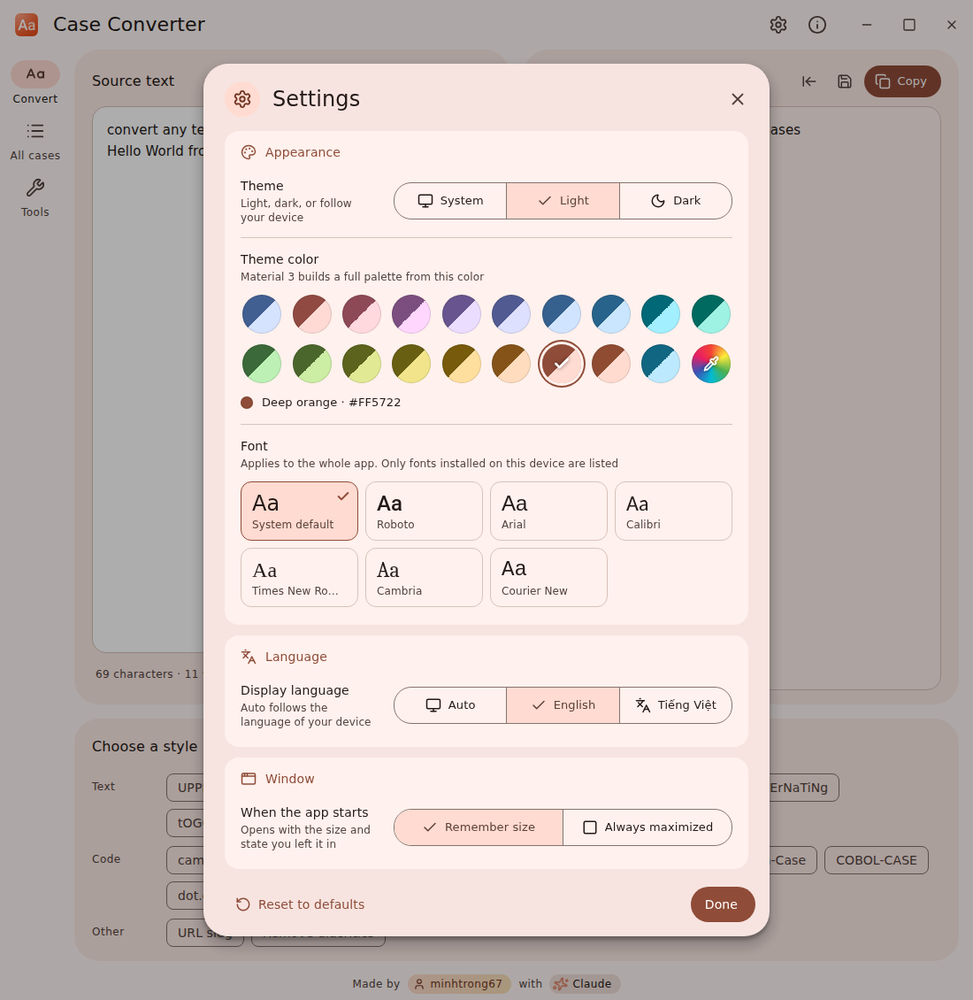
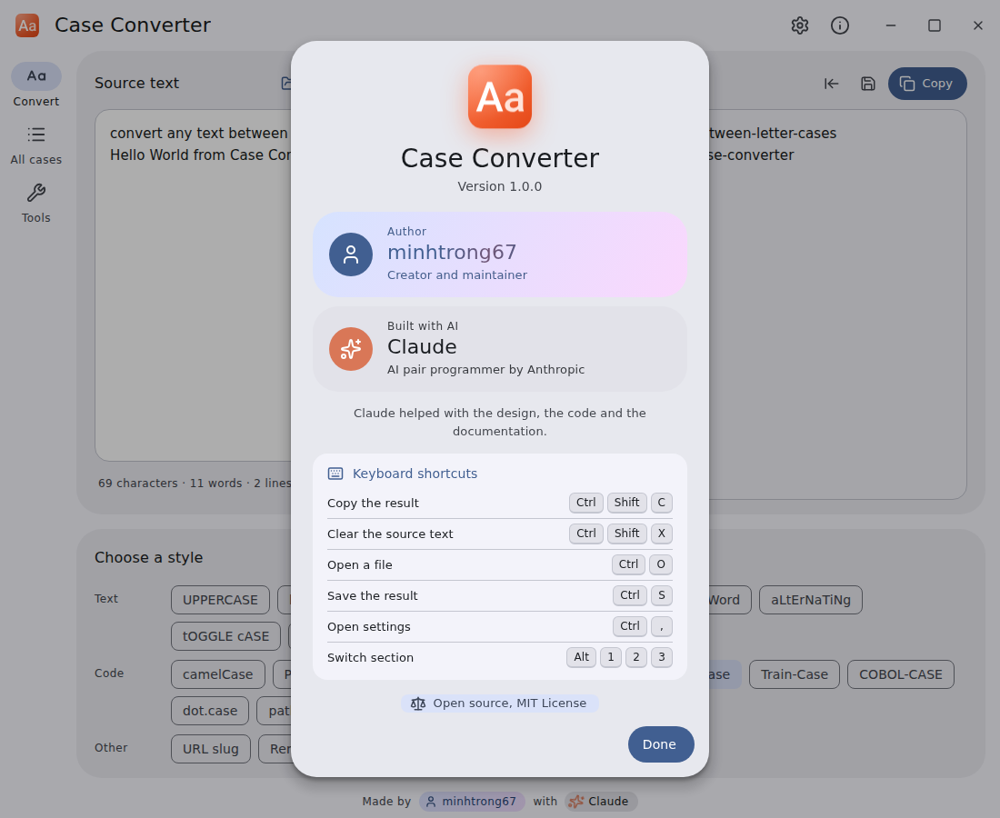

<div align="center">


# Case Converter

**Convert text between 19 letter cases, with handy text tools. Fast, offline and beautiful.**

Material Design 3 · Light, dark and system themes · English and Vietnamese · [Landing page](index.html)


Made by **minhtrong67** with the assistance of **Claude** (Anthropic)

</div>

## Introduction

Case Converter turns any text into the style you need: `UPPERCASE`, `Title Case`, `camelCase`, `snake_case`, URL slugs and more. It also cleans up lists of lines (sort, remove duplicates, number lines). Everything runs locally on your computer, and the interface follows Material Design 3 with a color palette you can customize.

## Screenshots

| | |
| :---: | :---: |
|  |  |
|  |  |
|  |  |

> The images in `screenshots/` are previews of the interface. Replace them with your own captures (keep the names `image01`, `image02`, ...) at any time.

## Features

**Convert** (19 styles, updated live as you type)
- Text: UPPERCASE, lowercase, Title Case (with an optional smart mode that keeps small words such as a, an, the), Sentence case, Capitalize Each Word, aLtErNaTiNg, tOGGLE cASE, Reverse text
- Code: camelCase, PascalCase, snake_case, CONSTANT_CASE, kebab-case, Train-Case, COBOL-CASE, dot.case, path/case
- Other: URL slug and Remove diacritics (Vietnamese aware, including the letter đ)
- Code styles work line by line and understand existing formats such as `XMLHttpRequest`

**All cases**: see every conversion at once and click a row to copy it.

**Tools**: remove duplicate lines, sort A to Z or Z to A (natural order, Vietnamese aware), reverse line order, remove empty lines, trim lines, collapse extra spaces, join lines, number lines.

**Workflow**
- One click copy or `Ctrl` + `Shift` + `C`; use the result as the new source text to chain operations
- Open a text file (UTF-8 or UTF-16, up to 10 MB), drag and drop a file onto the window, paste from the clipboard, save the result as `.txt`
- Undo for Clear and for "Use result as source text"
- Character, word and line counters; your draft and settings are remembered

**Layout**
- Source text and result sit side by side; the style picker spans the full width underneath, so the flow is always: type, choose, copy
- The result card names the active style, and the Smart Title Case switch only appears when Title Case is selected
- A "Try a sample" button fills an empty editor

**Material Design 3 experience**
- Light, dark and system themes
- Theme color: the default Material theme, 18 Material palette colors, or any custom color. A full tonal palette (primary, secondary, tertiary, surfaces) is generated with Material Color Utilities
- Font: the system UI font by default, or pick a popular font (Roboto, Segoe UI, Arial, Calibri, Verdana, Tahoma, Georgia, Consolas and more). Only fonts installed on the device are listed
- Tidy Settings dialog with one card per topic and a "Reset to defaults" button
- English and Vietnamese, detected automatically from your device language (you can also pick one in Settings)
- Window startup option: **remember the window size** or **always start maximized**
- Smooth animations: ripple and state layers, animated chips, switches, dialogs, snackbars and a startup reveal. Reduced motion settings are respected
- Responsive layout: navigation rail with two columns on wide windows, stacked cards on medium ones, bottom navigation bar on narrow ones
- Custom Material title bar, [Lucide](https://lucide.dev) icons, and an orange (`#FF5722`) app icon, installer icon and uninstaller icon

### Keyboard shortcuts

| Shortcut | Action |
| --- | --- |
| `Ctrl` + `Shift` + `C` | Copy the result |
| `Ctrl` + `Shift` + `X` | Clear the source text |
| `Ctrl` + `O` / `Ctrl` + `S` | Open a file / save the result |
| `Ctrl` + `,` | Open Settings |
| `Alt` + `1` / `2` / `3` | Convert, All cases, Tools |

## Installation

**Download the installer** from the Releases page of the repository and run `Case Converter_1.0.0_x64-setup.exe`. It installs for the current user, so no administrator rights are needed. Uninstall from Windows Settings, Apps.

**Or build it yourself**: see [Development](#development) and [Build](#build).

## Tech stack

- [Tauri 2](https://tauri.app): small Rust core and the WebView2 runtime that ships with Windows, so no browser engine is bundled
- Vanilla HTML, CSS and JavaScript (ES modules), no runtime framework
- [Material Color Utilities](https://github.com/material-foundation/material-color-utilities) (bundled in `src/vendor/mcu.js`) for dynamic color
- [Lucide](https://lucide.dev) icons (ISC license), bundled as inline SVG
- System UI font by default; Roboto is bundled offline (Latin, Latin Extended and Vietnamese) as an optional font
- Rust crates: `tauri-plugin-dialog`, `serde`, `serde_json`

## Development

Prerequisites on Windows 10 or 11:

- [Node.js](https://nodejs.org) 18 or later
- [Rust](https://rustup.rs) (stable toolchain)
- Microsoft C++ Build Tools ("Desktop development with C++")
- Microsoft Edge WebView2 Runtime (already included in Windows 11 and current Windows 10)

Keep this folder inside your shared Cargo workspace (for example `D:\tauri-apps\`) so every Tauri project reuses one `target` cache. The workspace `Cargo.toml` picks it up through `members = ["*/src-tauri"]`.

```bash
npm install
npm run dev
```

The first run compiles the Rust dependencies and takes a few minutes. Later runs are fast, and edits to files in `src/` reload automatically.

## Build

```bash
npm run build
```

The installer is written to `<workspace>\target\release\bundle\nsis\`.

To regenerate the icons and installer images (optional, needs Python 3 with `cairosvg`, `fonttools`, `brotli` and `pillow`):

```bash
python scripts/generate-icons.py
```

After replacing icons, run `cargo clean -p case-converter` once so Cargo re-embeds them.

## Project structure

```
case-converter/
  index.html              Landing page (single file, Material Design 3, SEO and social meta tags)
  download/               Put the setup file here; the landing page links to it
  screenshots/            README and landing page images (image01, image02, ...)
  scripts/
    generate-icons.py     Generates app, setup and uninstall icons and installer images
  src/                    Frontend
    index.html
    styles.css            Material 3 components, motion and responsive rules
    js/
      app.js              UI, events, settings, window integration
      engine.js           Conversion engine and text tools
      i18n.js             English and Vietnamese strings, language detection
      theme.js            Material 3 theming and color presets
      theme-default.js    Default scheme exported from Material Theme Builder
      icons.js            Lucide icons (including the settings cog wheel)
      fonts.js            Font choices and installed-font detection
    vendor/               Roboto fonts and Material Color Utilities
    assets/               logo.svg and og-image.png (social preview)
  src-tauri/
    src/lib.rs            Rust core: files, save dialog, window size memory
    src/main.rs           Entry point
    tauri.conf.json       Window, security and bundle settings
    capabilities/         Permissions granted to the main window
    installer/hooks.nsh   Uninstaller icon and header for the NSIS installer
    icons/                Application, setup and uninstall icons, installer images
  package.json
  LICENSE
```

Window preferences are stored in `window.json` inside the app config folder (`%APPDATA%\com.minhtrong67.caseconverter`).

## Landing page

`index.html` in the project root is a standalone landing page (one file, no build step). It follows Material Design 3, supports light/dark, a live theme color picker, English and Vietnamese (auto detected), and is responsive down to phones. To publish it:

1. Build the app and copy the installer to `download/Case Converter_1.0.0_x64-setup.exe`.
2. Host the project root (for example with GitHub Pages).
3. In `index.html`, replace `https://minhtrong67.github.io/case-converter/` (canonical, Open Graph and Twitter tags, JSON-LD) with your real address.

## Credits

Designed and maintained by **minhtrong67**. Built with the assistance of **Claude**, an AI assistant made by Anthropic, which helped with design, implementation and documentation. Icons by [Lucide](https://lucide.dev).

## License

This project is public and open source, released under the [MIT License](LICENSE).
