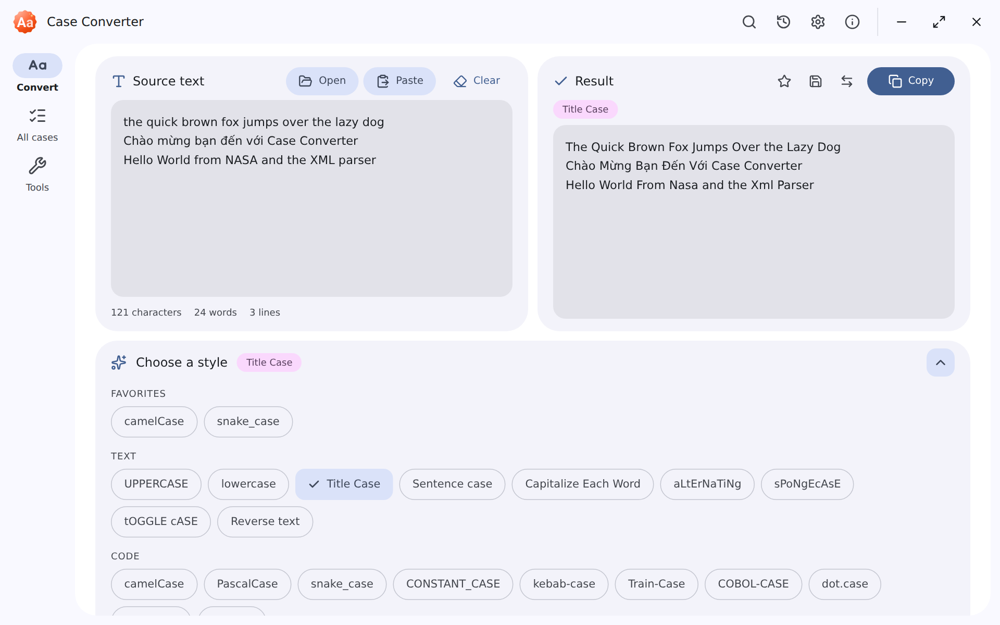
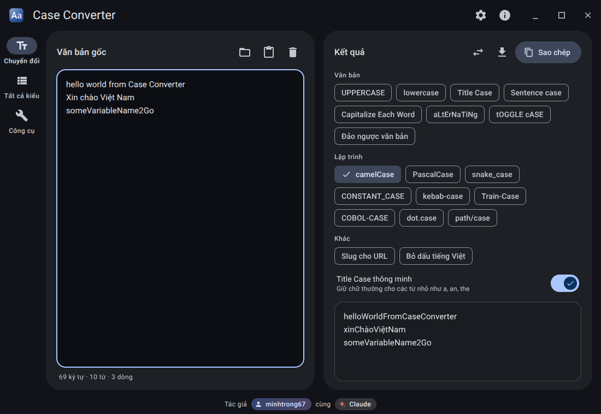
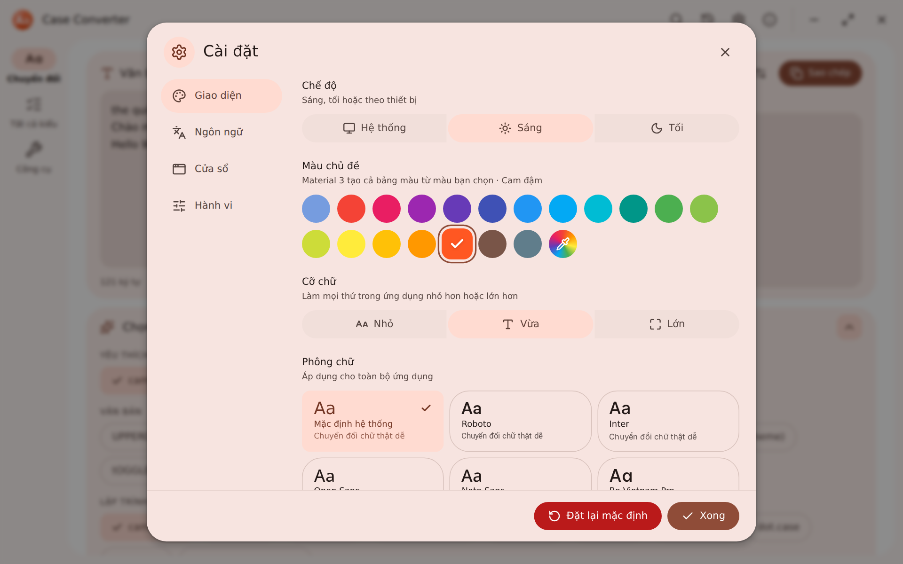
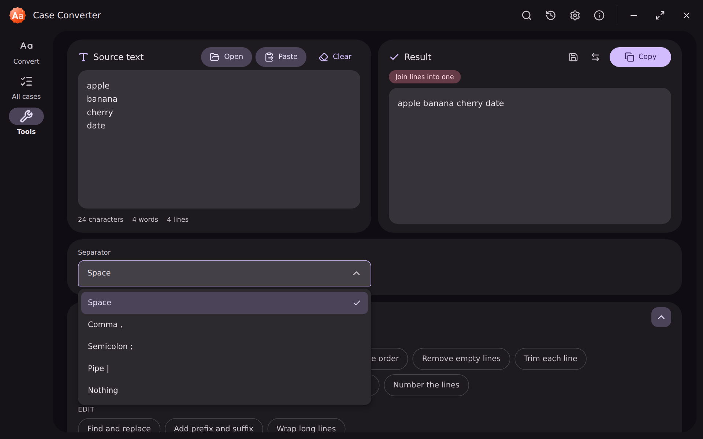

<div align="center">


# Case Converter

**Change text case in one click.**
21 letter cases, 22 text tools, 19 theme colors. A fast, private and offline desktop app with a Material 3 Expressive design.

[](LICENSE)


[Download](download/) · [Landing page](index.html) · [Report an issue](https://github.com/minhtrong67/my-tauri-apps/issues)

</div>

---

## Introduction

Case Converter turns any text into the style you need (UPPERCASE, Title Case, camelCase, snake_case, URL slug and more) and ships with a set of everyday text tools: sort and deduplicate lines, find and replace with regular expressions, Base64, URL and JSON helpers, word frequency and so on.

It is built with [Tauri](https://tauri.app), so it is small, quick to start and fully offline. Your text never leaves your computer. The interface follows **Material 3 Expressive** (spring motion, shape morphing, large rounded shapes) and is available in **English** and **Vietnamese**, with careful handling of Vietnamese diacritics.

## Screenshots

| | |
|:--:|:--:|
|  |  |
| *Convert with 21 styles (light)* | *Every style at a glance (dark)* |
|  |  |
| *Settings in Vietnamese with a custom theme color* | *22 text tools with a custom dropdown* |

## Features

**Conversion**
- 21 letter cases: UPPERCASE, lowercase, Title Case (smart or plain), Sentence case (can keep acronyms), Capitalize Each Word, aLtErNaTiNg, sPoNgEcAsE, tOGGLE cASE, Reverse text, camelCase, PascalCase, snake_case, CONSTANT_CASE, kebab-case, Train-Case, COBOL-CASE, dot.case, path/case, no case, URL slug, Remove diacritics.
- "All cases" view with every result at once, click a row to copy it.
- Favorites, history (copy, reuse or delete earlier results) and optional automatic copy.

**22 text tools**
- Lines: remove duplicates, sort A-Z / Z-A (locale aware, numeric), reverse, remove empty lines, trim, collapse spaces, join, split, number lines.
- Edit: find and replace (with regex), add prefix and suffix, wrap long lines.
- Encode: Base64 encode and decode, URL encode and decode, JSON prettify and minify.
- Analyze: extract emails, extract links, word frequency.

**Experience**
- Large source and result boxes on top, with a collapsible (accordion) style and tool picker below them.
- Command palette (`Ctrl+K`), keyboard shortcuts, drag and drop text files, open and save `.txt`.
- Material 3 Expressive UI with spring animations, ripples, custom tooltips, custom dropdowns, toasts (info, success, warning, error), confirm dialogs and a back-to-top button.
- Settings: light, dark or system theme; 19 Material theme colors plus any custom color; small, medium or large text; English or Vietnamese; font (System, Roboto, Inter, Open Sans, Noto Sans, Be Vietnam Pro); window behavior (remember size or always open maximized).
- Custom frameless window, responsive from 360 px wide, reduced-motion friendly.

**Keyboard shortcuts**

| Shortcut | Action |
|---|---|
| `Ctrl+K` | Command palette |
| `Ctrl+Shift+C` | Copy the result |
| `Ctrl+Shift+X` | Clear the source text |
| `Ctrl+O` / `Ctrl+S` | Open a file / Save the result |
| `Ctrl+H` | History |
| `Ctrl+,` | Settings |
| `Alt+1` `Alt+2` `Alt+3` | Convert / All cases / Tools |

## Installation

1. Download `Case Converter_1.1.0_x64-setup.exe` from the [download](download/) folder (or from the landing page).
2. Run the installer and follow the steps. It installs for the current user, no administrator rights needed.
3. Open **Case Converter** from the Start menu.

Requirements: Windows 10 or 11 (64-bit) with the WebView2 runtime (already included in Windows 11 and recent Windows 10 updates; the installer fetches it when missing).

## Tech stack

| Area | Technology |
|---|---|
| Desktop shell | [Tauri 2](https://tauri.app) (Rust) with the dialog and clipboard plugins |
| UI | React 19, TypeScript (strict), Vite |
| Styling | Tailwind CSS 4 with Material 3 color roles as CSS variables |
| Color | `@material/material-color-utilities` (tonal palettes from any seed color) |
| Icons | [Lucide](https://lucide.dev) |
| Fonts | System font by default, optional bundled Roboto, Inter, Open Sans, Noto Sans and Be Vietnam Pro (via Fontsource) |

## Development

Prerequisites: [Node.js 20+](https://nodejs.org), [Rust](https://rustup.rs) and the [Tauri prerequisites](https://tauri.app/start/prerequisites/) for Windows (Microsoft C++ Build Tools and WebView2).

This project is a member of a shared Cargo workspace (see the `Cargo.toml` one level up), so every project in the folder reuses one `target` build cache.

```bash
npm install     # install dependencies
npm run dev     # start the desktop app with hot reload
```

Handy extras:

```bash
npm run web:dev      # run only the UI in a browser at http://127.0.0.1:1420 (add ?frame to see the window buttons)
npm run web:build    # type-check and build the UI into ./dist
npm run icons        # regenerate every app, setup and uninstall icon (needs Python: cairosvg, fonttools, brotli, pillow)
```

## Build

```bash
npm run build
```

The Windows installer is created in `<workspace>/target/release/bundle/nsis/` as `Case Converter_1.1.0_x64-setup.exe`. Copy it into the [`download/`](download/) folder so the landing page download button works.

## Project structure

```text
case-converter/
├── index.html               # Landing page (single file: themes, EN/VI, smooth scroll)
├── download/                # Put the installer here (linked from the landing page)
├── screenshots/             # image01.png ... image04.png (README and landing page)
├── scripts/
│   ├── generate-icons.py    # Material 3 Expressive app, setup and uninstall icons, installer images
│   └── take-screenshots.py  # Captures the four screenshots
├── src/                     # React + TypeScript UI (Vite root)
│   ├── index.html
│   ├── main.tsx · App.tsx
│   ├── styles/index.css     # Tailwind + Material 3 tokens + motion
│   ├── lib/                 # engine.ts (conversions), i18n.ts, theme*.ts, settings.tsx, history.ts, tauri.ts
│   ├── components/ui/       # Button, Modal, Confirm, Select, Toast, Tooltip, controls
│   ├── components/features/ # TitleBar, Nav, Workspace, SettingsDialog, HistorySheet, CommandPalette, ...
│   └── assets/              # logo.svg, og-image.png
├── src-tauri/               # Rust side (window, file access, clipboard, installer config)
│   ├── src/lib.rs
│   ├── capabilities/
│   ├── icons/               # icon.ico, setup.ico, uninstall.ico, PNGs, installer BMPs
│   ├── installer/hooks.nsh
│   └── tauri.conf.json
├── package.json · vite.config.ts · tsconfig.json
└── LICENSE
```

## License

Released under the [MIT License](LICENSE). The project is public and open source: <https://github.com/minhtrong67/my-tauri-apps>.

---

<div align="center">

Made by **minhtrong67** with **Claude** (AI by Anthropic).

</div>
