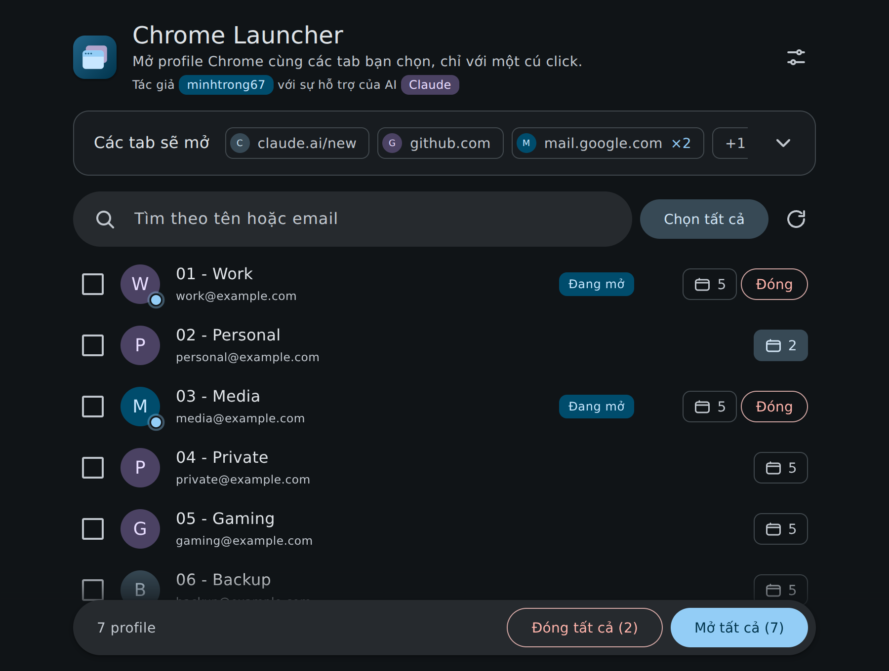
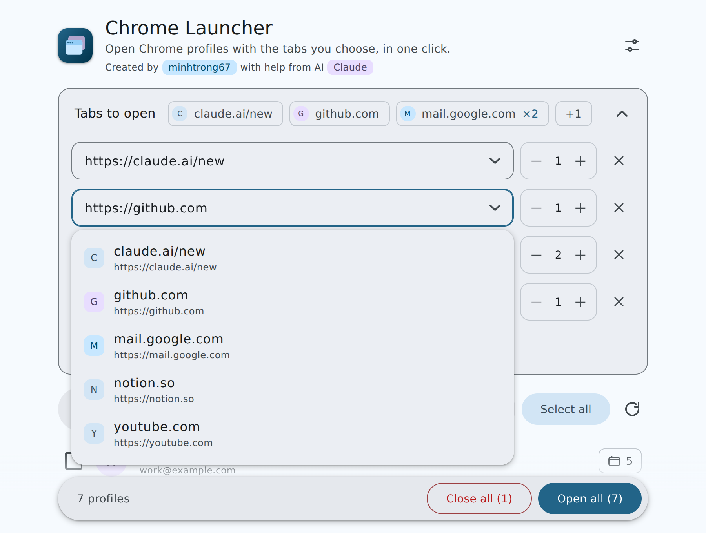
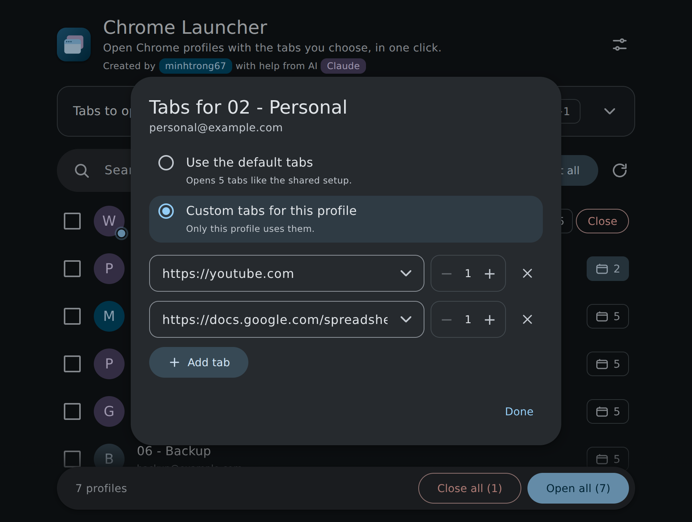
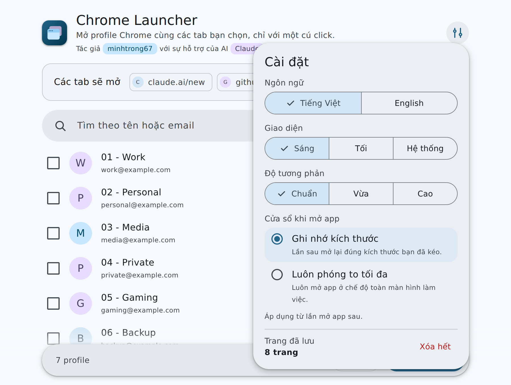

<div align="center">


# Chrome Launcher

**Mở và đóng các profile Chrome chỉ với một cú click, mỗi profile kèm các tab bạn chọn.**


[English](README.md) · Tiếng Việt

</div>

Tác giả **minhtrong67**, với sự hỗ trợ của AI **Claude**.

## Giới thiệu

Nếu bạn dùng nhiều profile Chrome (công việc, cá nhân, giải trí, dự phòng...), việc mở từng profile rồi tải lại các trang quen thuộc rất tốn thời gian. **Chrome Launcher** đọc danh sách profile Chrome của bạn, rồi mở một hoặc nhiều profile cùng lúc với các trang web bạn chọn đã sẵn trong các tab. Ứng dụng cũng đóng được profile và cho biết profile nào đang chạy.

Đây là một ứng dụng native nhỏ gọn: backend Rust, giao diện React, dung lượng chỉ vài MB.

## Ảnh chụp màn hình

<table>
  <tr>
    <td></td>
    <td></td>
  </tr>
  <tr>
    <td></td>
    <td></td>
  </tr>
</table>

> Ảnh là bản render của giao diện thật với dữ liệu profile mẫu.

## Tính năng

- **Material Design 3.** Toàn bộ màu sắc lấy từ file `material-theme.json` đi kèm (xuất từ Material Theme Builder), cùng bo góc, state layer, hiệu ứng ripple và chuyển động theo chuẩn Material.
- **Trang web tùy ý, số tab tùy ý.** Tự tạo danh sách tab sẽ mở: thêm trang web và chọn mở bao nhiêu tab của trang đó (từ 1 đến 20). Để trống danh sách thì chỉ mở profile.
- **Dropdown các trang đã lưu.** Mọi địa chỉ bạn nhập hoặc đã mở đều được ghi nhớ và gợi ý trong dropdown ở lần sau, dùng được bằng bàn phím. Xóa từng trang, hoặc xóa hết trong Cài đặt. Chỉ cần gõ `github.com`, app tự thêm `https://`.
- **Tab riêng cho từng profile.** Mỗi profile dùng danh sách tab chung hoặc danh sách riêng. Nút tab trên mỗi dòng cho biết profile đó sẽ mở bao nhiêu tab.
- **Mở nhanh.** Click một profile để mở. Chọn nhiều profile để mở cùng lúc, hoặc mở tất cả.
- **Đóng profile.** Đóng một profile, các profile đã chọn hoặc tất cả profile đang chạy. Chrome nhận yêu cầu đóng cửa sổ bình thường nên vẫn khôi phục được tab ở lần sau.
- **Trạng thái trực tiếp.** Chấm xanh và nhãn "Đang mở" cho biết profile nào đang chạy; danh sách tự cập nhật khi cửa sổ đang hiển thị.
- **Tìm kiếm và phím tắt.** Lọc theo tên hoặc email. `Ctrl+F` để tìm, `Ctrl+A` chọn tất cả, `Esc` để xóa tìm kiếm, bỏ chọn hoặc đóng bảng.
- **Giao diện sáng, tối hoặc theo hệ thống**, kèm ba mức tương phản (chuẩn, vừa, cao), chuyển mượt mà. Thanh tiêu đề gốc cũng đổi theo.
- **Tiếng Việt và tiếng Anh**, đổi bất cứ lúc nào.
- **Cửa sổ khi mở app.** Chọn *ghi nhớ kích thước* bạn đã kéo, hoặc *luôn phóng to tối đa*.
- **Mượt và nhẹ.** Hiệu ứng xuất hiện lần lượt, khung chờ khi tải, ảnh profile chỉ tải khi cần, hỗ trợ giảm chuyển động.
- **Bộ cài có thương hiệu.** Icon app, setup và uninstall vẽ theo bảng màu của theme, đủ kích thước chuẩn Windows (16 đến 256 px), kèm hình nền trình cài đặt, trình cài đặt có tiếng Việt và tiếng Anh.

## Cài đặt

### Yêu cầu

- Windows 10 hoặc 11 (đóng profile chỉ hỗ trợ Windows; mở profile chạy được cả macOS và Linux)
- Google Chrome
- Microsoft Edge WebView2 Runtime (Windows 11 đã có sẵn)

### Cài bằng file setup

1. Build bộ cài (xem phần [Build](#build)) hoặc tải từ trang releases của bạn.
2. Chạy `Chrome Launcher_0.1.0_x64-setup.exe`. Bộ cài cài cho người dùng hiện tại, không cần quyền quản trị.
3. Mở **Chrome Launcher** từ Start menu.

Không muốn cài? Chép `target/release/chrome-launcher.exe` ra bất kỳ đâu và chạy.

> Các trang cần đăng nhập sẽ mở ở trạng thái chưa đăng nhập, trừ khi profile đó đã đăng nhập sẵn.

## Công nghệ sử dụng

| Lớp | Công nghệ |
| --- | --- |
| Khung ứng dụng | [Tauri 2](https://tauri.app) (Rust) |
| Giao diện | React 18, Vite 6 |
| Thiết kế | Material Design 3, token sinh từ `material-theme.json` |
| Style | CSS thuần, hai giao diện sáng và tối với ba mức tương phản |
| Backend | Rust, `serde_json`, gọi trực tiếp Win32 (`user32`, `kernel32`) |
| Bộ cài | NSIS, cài theo người dùng |

## Phát triển

Yêu cầu: [Node.js](https://nodejs.org) 18+, [Rust](https://rustup.rs) (stable) và [điều kiện cần của Tauri trên Windows](https://tauri.app/start/prerequisites/) (Microsoft C++ Build Tools).

```bash
npm install     # cài thư viện
npm run dev     # chạy app ở chế độ phát triển, có hot reload
```

### Tùy chỉnh theme

App đọc `material-theme.json` lúc build. Muốn đổi phong cách, hãy xuất theme mới từ [Material Theme Builder](https://material-foundation.github.io/material-theme-builder/), thay file này rồi chạy lại `npm run dev`. App dùng cả giao diện sáng, tối và các mức tương phản vừa, cao.

Project nằm trong một Cargo workspace (`members = ["*/src-tauri"]`) nên các bản build Rust dùng chung thư mục `target` của workspace.

## Build

```bash
npm run build
```

Kết quả, tính từ thư mục gốc của workspace:

- `target/release/chrome-launcher.exe`: file chạy độc lập
- `target/release/bundle/nsis/`: bộ cài

Nếu Chrome cài ở vị trí khác thường, chỉnh hàm `chrome_path()` trong `src-tauri/src/main.rs`.

### Cách hoạt động

Khi mở, app chạy `chrome.exe --profile-directory=<thư mục> --new-window <các địa chỉ...>`, nên mỗi địa chỉ trở thành một tab của một cửa sổ mới. Khi đóng, app theo dõi các cửa sổ Chrome do chính nó mở, đồng thời nhận ra cửa sổ có tiêu đề kết thúc bằng tên profile (Chrome hiển thị tên này khi bạn dùng nhiều profile). Chỉ cửa sổ thuộc `chrome.exe` mới bị tác động. Cài đặt và các trang đã lưu được lưu cục bộ trong app.

## Cấu trúc project

```
chrome-launcher/
├── src/
│   ├── components/
│   │   ├── Avatar.jsx          # ảnh profile, dự phòng bằng chữ cái
│   │   ├── Combo.jsx           # ô nhập địa chỉ kèm dropdown trang đã lưu
│   │   ├── Controls.jsx        # nút chọn dạng phân đoạn và tùy chọn radio
│   │   ├── Fav.jsx             # ký hiệu màu của trang web
│   │   ├── Icons.jsx           # logo và icon
│   │   ├── Row.jsx             # một dòng profile
│   │   ├── SettingsPanel.jsx   # ngôn ngữ, giao diện, cửa sổ, trang đã lưu
│   │   ├── TabsCard.jsx        # tab mặc định: chip tóm tắt + trình chỉnh sửa
│   │   ├── TabsEditor.jsx      # danh sách trang web và số tab
│   │   └── TabsModal.jsx       # tab riêng cho một profile
│   ├── App.jsx                 # màn hình chính và logic
│   ├── i18n.js                 # chuỗi tiếng Việt và tiếng Anh
│   ├── main.jsx                # điểm khởi chạy
│   ├── ripple.js               # hiệu ứng ripple của Material
│   ├── settings.js             # lưu cài đặt
│   ├── sites.js                # tiện ích xử lý địa chỉ
│   ├── styles.js               # CSS Material 3
│   ├── theme.js                # tạo biến màu từ material-theme.json
│   └── tauri.js                # lớp bọc Tauri API
├── src-tauri/
│   ├── capabilities/           # quyền của cửa sổ
│   ├── icons/                  # icon app, setup, uninstall, ảnh trình cài đặt
│   ├── src/main.rs             # liệt kê, mở, đóng và dò profile
│   ├── Cargo.toml
│   └── tauri.conf.json
├── screenshots/                # image01.png ... image04.png
├── index.html
├── material-theme.json         # bảng màu Material 3 (nguồn của mọi màu)
├── package.json
├── vite.config.js
├── LICENSE
└── README.md
```

## Giấy phép

Phát hành theo [Giấy phép MIT](LICENSE). Bản quyền © 2026 **minhtrong67**.

---

<div align="center">

Thực hiện bởi **minhtrong67** · với sự hỗ trợ của AI **Claude**

</div>
