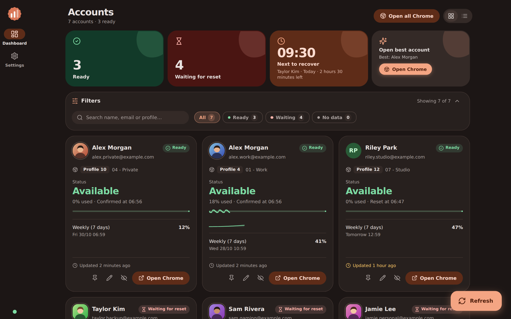
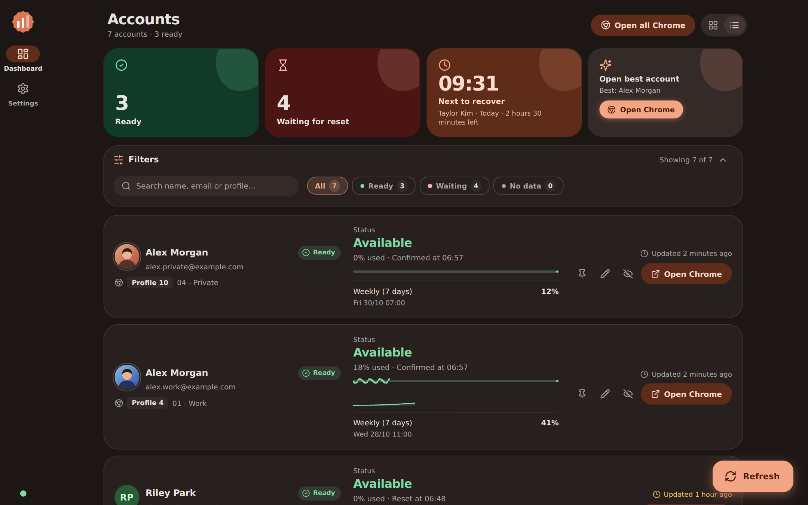
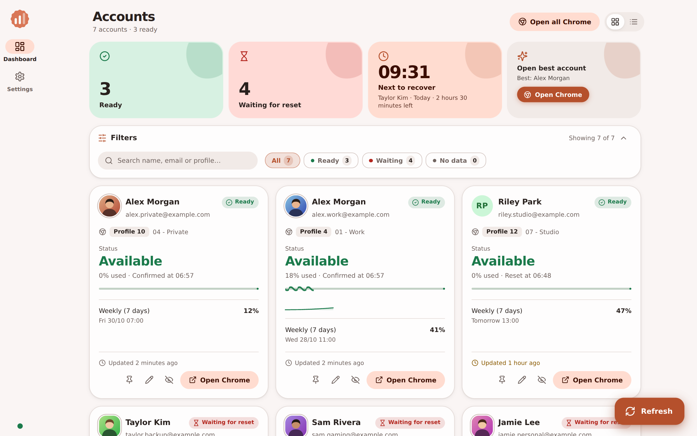
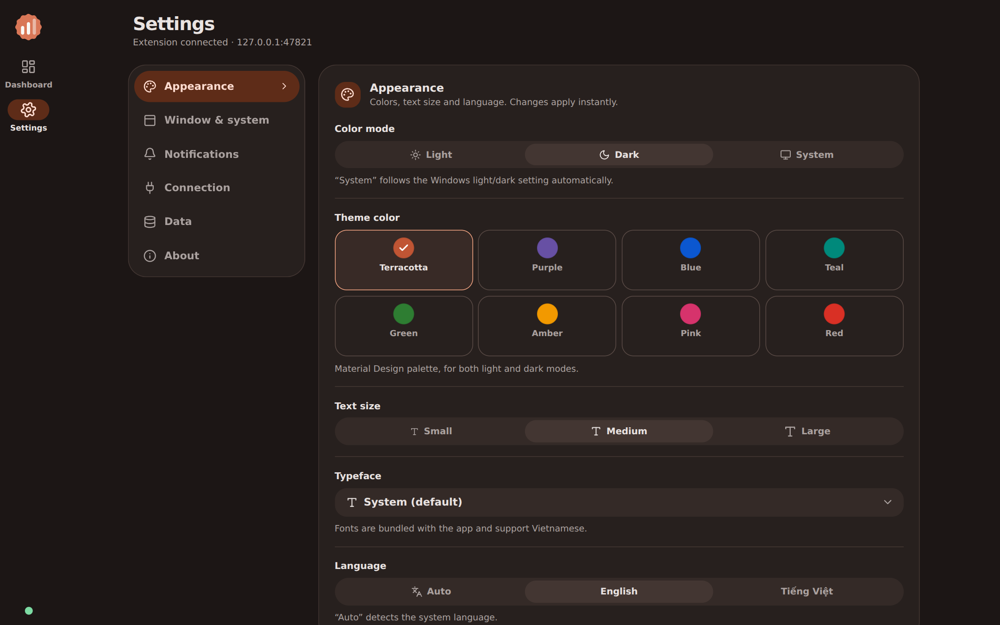

<div align="center">


# Claude Tracker

**Biết tài khoản Claude nào dùng được — trước khi mở Chrome.**

Dashboard Windows miễn phí, mã nguồn mở, theo dõi giới hạn sử dụng và giờ reset của Claude trên nhiều Chrome Profile.

[](LICENSE)


[Tải về](downloads/) · [Landing page](index.html) · [English](README.md)

</div>

---

## Giới thiệu

Nếu bạn dùng nhiều tài khoản Claude, mỗi tài khoản một Chrome Profile, rất dễ quên tài khoản nào còn lượt và khi nào các tài khoản khác hồi lại. **Claude Tracker** gom tất cả vào một nơi: extension Chrome báo giới hạn của từng profile về app desktop chạy hoàn toàn trên máy bạn; dashboard hiển thị đếm ngược trực tiếp, tiến độ tới lúc reset và mở đúng Chrome Profile chỉ với một cú nhấp.

> Claude Tracker là dự án độc lập, không liên kết hay được Anthropic bảo trợ.

## Ảnh chụp màn hình

| Dạng lưới (tối) | Dạng danh sách (tối) |
| :---: | :---: |
|  |  |
| **Dạng lưới (sáng)** | **Cài đặt** |
|  |  |

Toàn bộ ảnh dùng dữ liệu demo.

## Tính năng

- **Một dashboard cho mọi profile.** Mỗi thẻ hiện tài khoản Claude, Chrome Profile (`Profile 4 · 01 - Work`) và tài khoản Google đang đăng nhập trong profile đó. Không cắt chữ.
- **Ô tổng quan.** Sẵn sàng, đang chờ, hồi sớm nhất — bấm vào ô để lọc — cùng nút **Mở tài khoản tốt nhất** (chọn tài khoản sẵn sàng có mức dùng thấp nhất).
- **Đếm ngược reset trực tiếp** với thanh tiến độ *gợn sóng* của Material 3 Expressive; thời gian còn lại viết đầy đủ ("2 giờ 31 phút"). Thẻ có hiệu ứng chúc mừng khi tài khoản vừa hồi.
- **Lịch sử mức dùng và dự báo.** Biểu đồ nhỏ theo từng tài khoản và dự đoán "dự kiến chạm giới hạn lúc 15:40" theo tốc độ dùng gần đây. Xuất lịch sử ra CSV.
- **Thông báo thông minh.** Cảnh báo khi mức dùng chạm ngưỡng, báo đúng giờ dự kiến reset và có giờ yên lặng.
- **Sắp xếp.** Ghim, đổi tên, ghi chú; ẩn tài khoản (khôi phục được, không tự hiện lại); dạng lưới hoặc danh sách; bộ lọc và tìm kiếm.
- **Avatar thật của Chrome profile**, đọc từ ảnh Chrome đã lưu (không có thì dùng chữ cái đầu).
- **Mở tất cả Chrome** bằng một cú nhấp, hoặc chỉ tài khoản tốt nhất.
- **Khay hệ thống.** Tooltip động ("3 sẵn sàng · 2 đang chờ · sớm nhất 15:40"), menu nhanh, tuỳ chọn khởi động cùng Windows (thu nhỏ) và chỉ cho chạy một bản.
- **Giao diện.** Sáng, tối hoặc theo hệ thống; tám màu chủ đề Material; ba cỡ chữ; sáu phông chữ (mặc định font hệ thống, kèm Roboto, Inter, Be Vietnam Pro, Noto Sans, Open Sans đóng gói sẵn); icon [Lucide](https://lucide.dev).
- **Tiếng Việt và English**, tự nhận diện và đổi bất cứ lúc nào (cả extension).
- **Cửa sổ.** Ghi nhớ kích thước/vị trí lần trước, hoặc luôn mở phóng to tối đa.
- **Phím tắt.** `Ctrl+R` làm mới · `Ctrl+F` tìm kiếm · `Ctrl+1` dashboard · `Ctrl+,` cài đặt.
- **Riêng tư.** Không đám mây, không đăng nhập. App chỉ lắng nghe `127.0.0.1`, yêu cầu token bí mật, từ chối origin của trang web và ghi dữ liệu an toàn (atomic).
- **Responsive và mượt.** Navigation rail trên cửa sổ rộng, navigation bar trên cửa sổ hẹp; tooltip, dropdown, toast và dialog tuỳ biến cho cả sáng/tối; animation tôn trọng `prefers-reduced-motion`.

### Trạng thái tài khoản

| Trạng thái | Điều kiện |
| --- | --- |
| Sẵn sàng | Chưa chạm giới hạn, hoặc đã qua giờ reset: tài khoản tự chuyển sang Sẵn sàng |
| Đang chờ reset | Đã chạm giới hạn, chưa tới giờ reset: đếm ngược |
| Chưa có dữ liệu | Extension chưa gửi usage |

Khi qua giờ reset, thẻ tự đổi sang **Sẵn sàng / Dùng được** (mức dùng hiện 0%) và ghi giờ đã reset; lần báo tiếp theo của extension sẽ thay bằng số liệu thật.

## Cài đặt

### 1. Cài app

Tải `ClaudeTracker-Setup.exe` trong thư mục [`downloads/`](downloads/) (hoặc trang Releases) rồi chạy. Windows 10/11 đã có sẵn WebView2. Đóng cửa sổ sẽ thu app xuống khay hệ thống; chọn **Thoát** ở menu khay để tắt hẳn.

### 2. Thêm extension (một lần cho mỗi Chrome Profile)

1. Mở `chrome://extensions` trong profile, bật **Developer mode**.
2. Chọn **Load unpacked** và trỏ vào thư mục [`extension/`](extension/).
3. Mở cài đặt của extension, nhập **cổng** và **token** hiện trong app ở **Cài đặt → Kết nối**, rồi bấm **Lưu & kết nối**.
4. Profile cần đăng nhập claude.ai và đăng nhập Chrome (tài khoản Google) để app tự gán đúng Chrome Profile.

### Giới hạn đã biết

- Endpoint usage của claude.ai là nội bộ và có thể đổi. Nếu thanh usage trống, xem **Cài đặt → Kết nối → Chẩn đoán dữ liệu thô**, rồi chỉnh `parse_usage` trong `src-tauri/src/main.rs` và `getJson` trong `extension/background.js`.
- App phải đang chạy (kể cả dưới khay) mới nhận dữ liệu và gửi thông báo.
- Tài khoản Free được nhận diện qua banner trên trang, cần có tab claude.ai đang mở trong profile đó.

## Tech stack

Tauri 2 (Rust) · `tiny_http` · React 18 + TypeScript + Vite 5 + Tailwind CSS 3 · lucide-react · token Material 3 Expressive (CSS variables) · font đóng gói bằng @fontsource · Chrome MV3 · NSIS.

## Phát triển

Yêu cầu: Node.js 18+, Rust (MSVC) và WebView2.

```bash
npm install
npm run dev        # app Tauri, hot reload
npm run dev:mock   # chỉ giao diện trên trình duyệt, dữ liệu giả (không cần Rust)
npm run build:web  # kiểm tra kiểu + build giao diện
```

Icon sinh bằng `npm run icons` (cần Python + Pillow): app icon, setup icon, uninstall icon đủ kích thước desktop.

## Build

```bash
npm run build         # tạo bộ cài NSIS
npm run release:copy  # chép vào downloads/ClaudeTracker-Setup.exe
```

Bộ cài nằm ở `src-tauri/target/release/bundle/nsis/`. Icon gỡ cài đặt riêng cần Tauri CLI mới (`@tauri-apps/cli` ≥ 2.8).

## Cấu trúc project

Xem phần *Project structure* trong [README.md](README.md#project-structure).

## License

Phát hành theo [MIT License](LICENSE). © 2026 minhtrong67.
