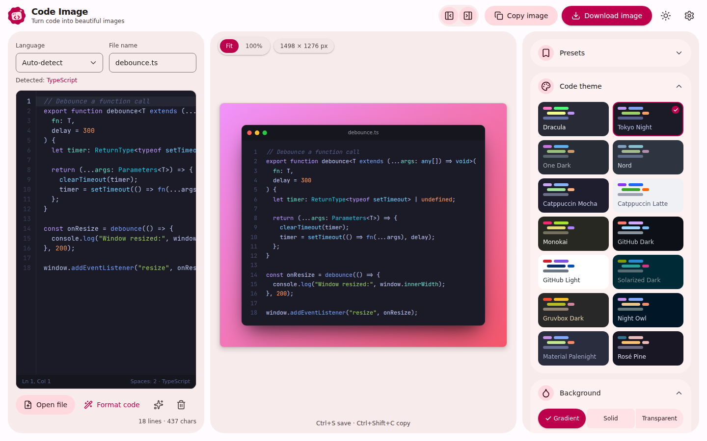
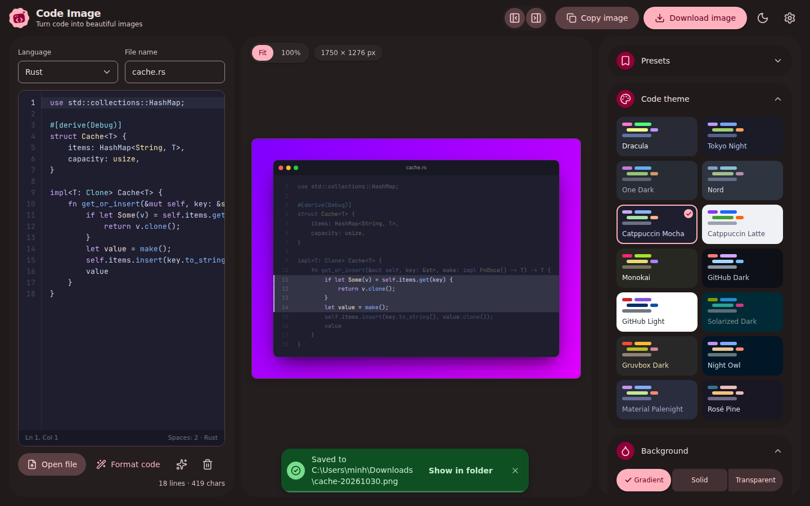
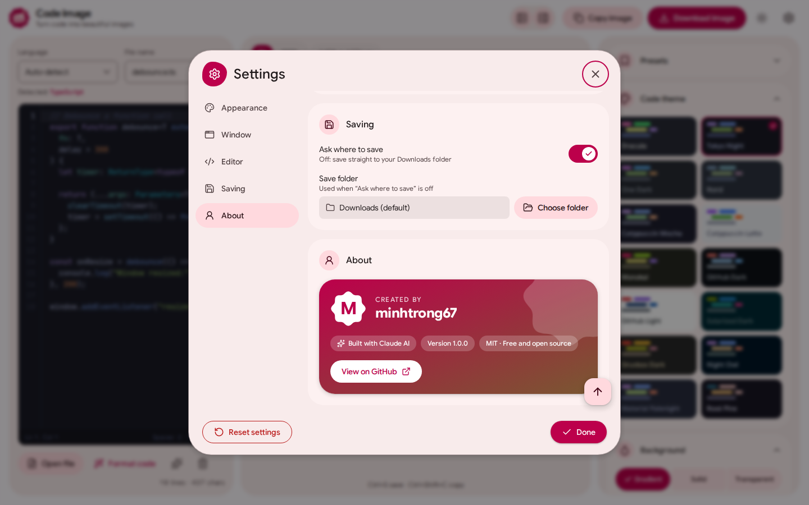
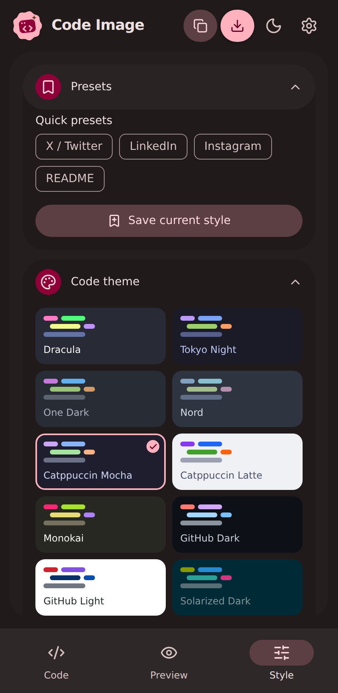

<div align="center">


# Code Image

**Biến code của bạn thành những hình ảnh đẹp mắt, sẵn sàng chia sẻ.**
*Turn your code into beautiful, shareable images.*

Ứng dụng desktop miễn phí, mã nguồn mở — xây dựng với Tauri, React và Material 3 Expressive.


</div>

---

## Giới thiệu

**Code Image** biến đoạn code thành một bức ảnh đẹp để chia sẻ lên mạng xã hội, bài viết, slide hay tài liệu.
Dán code, chọn theme, tuỳ chỉnh nền và khung cửa sổ rồi xuất ảnh PNG / JPG / SVG sắc nét chỉ với một cú nhấp.
Mọi thứ chạy hoàn toàn trên máy của bạn: không cần tài khoản, không tải code lên đâu cả.

> **In short:** paste code → pick a theme → export a crisp image. 100% local and private.

Giao diện theo phong cách **Material 3 Expressive (2026)**: bo góc hữu cơ, hình khối "cookie", chuyển động spring và bảng màu động sinh ra từ một màu chủ đạo.

## Screenshot

| | |
|---|---|
|  |  |
| **Giao diện chính** — soạn thảo, xem trước trực tiếp và bảng tuỳ chỉnh | **Chế độ tối** — làm nổi bật dòng, thông báo thành công |
|  |  |
| **Cài đặt** — giao diện, màu, font, thư mục lưu, tác giả | **Responsive** — cửa sổ hẹp, preset |

## Tính năng

**Tạo ảnh**
- 14 theme code (Dracula, Tokyo Night, Nord, Catppuccin, GitHub, Monokai, Gruvbox…) có xem trước thu nhỏ ngay trong bảng chọn.
- Nền gradient (12 mẫu + màu/góc tuỳ chỉnh), màu đặc hoặc trong suốt.
- Tỉ lệ cho mạng xã hội: Auto, 16:9, 4:3, 1:1, 3:2, 2:1, 21:9, 4:5, 9:16 — có tự động thu vừa khung.
- 10 font code, bật/tắt ligature, cỡ chữ, padding, bo góc, đổ bóng, số dòng, watermark.
- Khung cửa sổ macOS / Windows / không khung, hiển thị tên tệp.
- Tự nhận diện hơn 35 ngôn ngữ; hỗ trợ **diff** (+/− xanh đỏ), **đánh dấu dòng** và **chế độ tập trung** (làm mờ dòng còn lại).
- **Preset**: có sẵn X/Twitter, LinkedIn, Instagram, README; lưu và dùng lại phong cách riêng.

**Trình soạn thảo**
- Editor thật sự: tô màu cú pháp theo theme đang chọn, số dòng, làm nổi dòng hiện tại, tự thụt dòng khi xuống dòng, `Tab` / `Shift+Tab` thụt/lùi, thanh trạng thái `Ln, Col`.
- **Tự định dạng khi dán** bằng Prettier (JS/TS, JSON, CSS/SCSS, HTML, Markdown, YAML) — ngôn ngữ khác sẽ được dọn dẹp và căn lề. Có nút **Định dạng code** (`Shift+Alt+F`); tắt/bật trong Cài đặt.
- Ẩn/hiện **khung code** (`Ctrl+B`) và **bảng tuỳ chỉnh** (`Ctrl+Alt+B`) để xem ảnh rõ hơn ở khu vực chính.
- Nhắc **lưu / không lưu / huỷ** khi đóng app lúc còn thay đổi chưa xuất ảnh.

**Xuất ảnh**
- PNG, JPG, SVG, độ phân giải 1×–4×; sao chép ảnh vào clipboard; **mở thư mục** ngay sau khi lưu.
- Kéo thả hoặc mở tệp code (`Ctrl+O`), phím tắt `Ctrl+S` lưu, `Ctrl+Shift+C` sao chép, `Ctrl+,` mở cài đặt.

**Cài đặt**
- Giao diện sáng / tối / theo hệ thống; **18 màu chủ đề** Material (kèm chọn màu tuỳ ý).
- Font giao diện: System, Google Sans Flex, Roboto Flex, Roboto, Arial, Inter, Be Vietnam Pro; cỡ chữ nhỏ / vừa / lớn.
- Ngôn ngữ tiếng Việt / English; thư mục lưu tuỳ chỉnh; mở app ghi nhớ kích thước hoặc luôn phóng to tối đa.

**Trải nghiệm**
- Tooltip tuỳ biến, toast 4 mức (info / success / warning / error) cho cả sáng và tối, dropdown tuỳ biến có cuộn, nút lên đầu trang, hộp thoại xác nhận có icon + màu rõ ràng.
- Chỉ dùng toast cho việc thật sự cần (lưu/sao chép ảnh, lỗi, cảnh báo).
- Hiệu năng: highlight dùng chung một lần cho editor và canvas, `useDeferredValue`, lưu cài đặt có debounce.

## Cài đặt

**Cách 1 — Dùng bản cài đặt (Windows 10/11, 64-bit)**

1. Tải `Code Image_1.0.0_x64-setup.exe` trong thư mục [`download`](download/) (hoặc trang Releases).
2. Chạy tệp cài đặt và làm theo hướng dẫn. Gỡ cài đặt qua *Settings → Apps*.

**Cách 2 — Tự build từ mã nguồn:** xem phần [Development](#development) và [Build](#build).

## Tech stack

| Thành phần | Công nghệ |
|---|---|
| Desktop shell | [Tauri 2](https://tauri.app) (Rust) |
| Giao diện | React 18 + TypeScript 5 |
| Build tool | Vite 5 |
| Style | Tailwind CSS 3 + Material 3 Expressive (`@material/material-color-utilities`) |
| Icon | [Lucide](https://lucide.dev) |
| Tô màu code | highlight.js |
| Xuất ảnh | html-to-image |
| State | Zustand (persist) |
| Font | `@fontsource/*` (Google Sans Flex, Roboto Flex, Inter, Be Vietnam Pro, JetBrains Mono…) |

## Development

Yêu cầu: [Node.js](https://nodejs.org) ≥ 18, [Rust](https://rustup.rs) và [các phụ thuộc của Tauri](https://tauri.app/start/prerequisites/).

```bash
npm install     # cài đặt dependencies
npm run dev     # chạy app desktop ở chế độ phát triển (Tauri + Vite)
```

> Dự án nằm trong Cargo workspace chung: mọi project dùng chung thư mục `target` ở gốc workspace.
> Chỉ muốn xem giao diện trên trình duyệt? Chạy `npm run web:dev`.

## Build

```bash
npm run build   # đóng gói bản cài đặt
```

Tệp cài đặt NSIS nằm ở `target/release/bundle/nsis/` (thư mục `target` của workspace). Đặt tệp `Code Image_1.0.0_x64-setup.exe` vào thư mục `download/` để nút **Download** trên landing page hoạt động.

## Cấu trúc project

```
code-image/
├── index.html              # Landing page (1 file, Material 3 Expressive)
├── og-image.png            # Ảnh chia sẻ mạng xã hội
├── download/               # Đặt tệp cài đặt .exe tại đây
├── screenshots/            # image01 … image04 (dùng cho README + landing)
├── src/                    # Frontend (Vite root)
│   ├── components/         # AppBar, EditorPanel, StylePanel, Preview, CodeCanvas,
│   │                       # SettingsDialog, Toaster, ui (Btn, Tooltip, Modal, Select…)
│   ├── lib/                # store, i18n, material, highlight, export, toast, tauri, constants
│   ├── App.tsx · main.tsx · index.css
├── src-tauri/              # Backend Tauri (Rust)
│   ├── src/                # lib.rs, main.rs
│   ├── capabilities/       # Quyền của cửa sổ
│   ├── icons/              # Bộ icon app + ảnh NSIS (header, sidebar)
│   └── tauri.conf.json
├── package.json · vite.config.ts · tailwind.config.js · tsconfig.json
└── LICENSE
```

## License

Dự án **public và mã nguồn mở**, phát hành theo giấy phép [MIT](LICENSE).
Mã nguồn chung của các ứng dụng Tauri: **[github.com/minhtrong67/my-tauri-apps](https://github.com/minhtrong67/my-tauri-apps)**

---

<div align="center">

Tác giả **[minhtrong67](https://github.com/minhtrong67)** · xây dựng với sự hỗ trợ của **Claude AI** ✨

</div>
