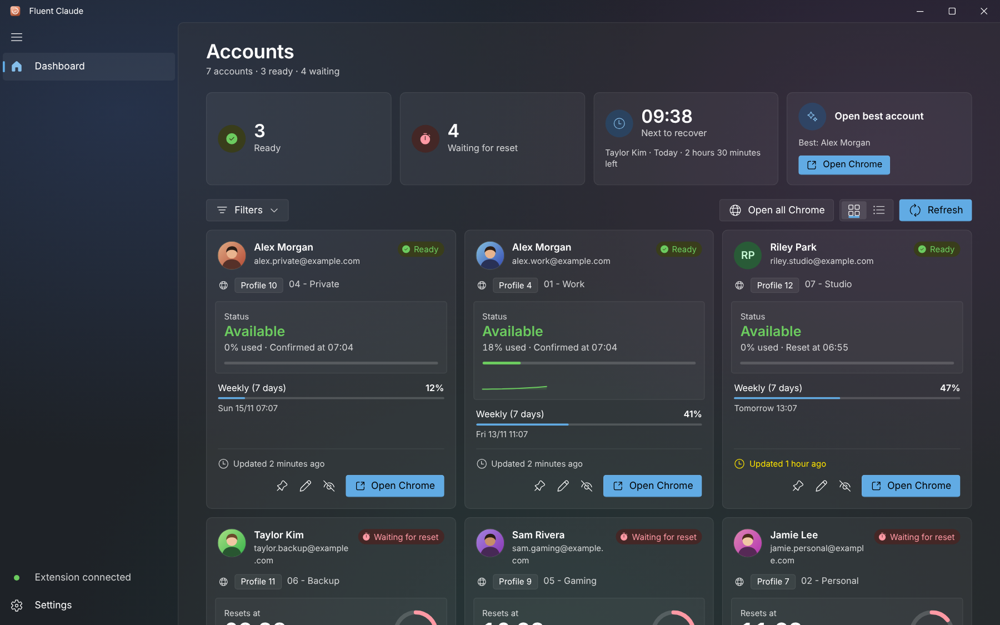
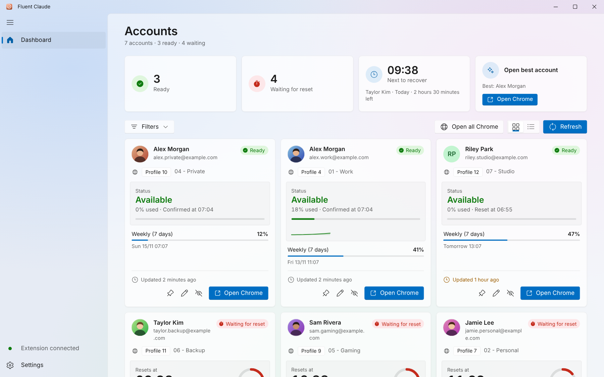
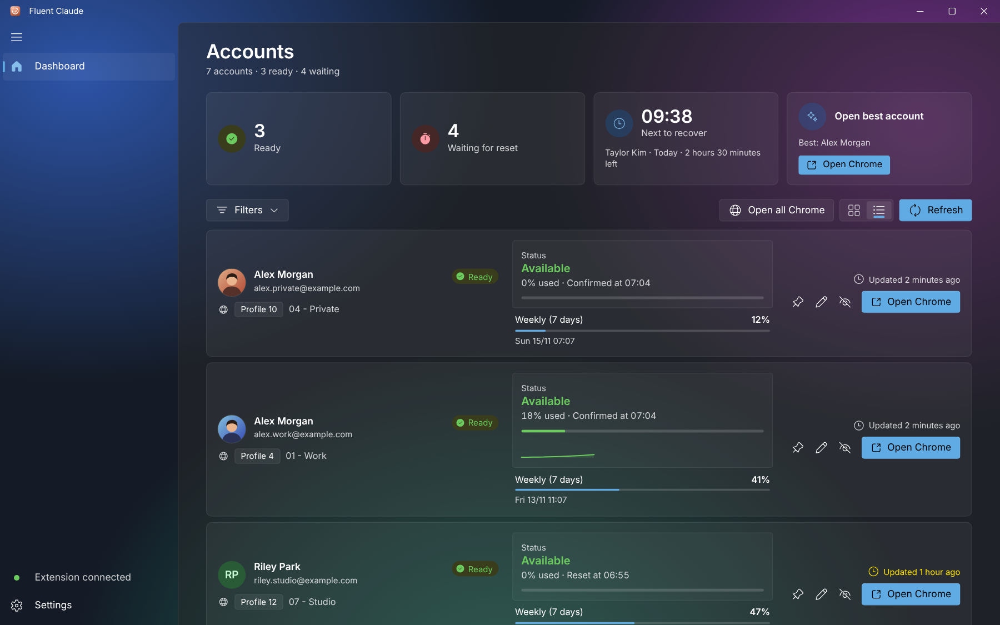
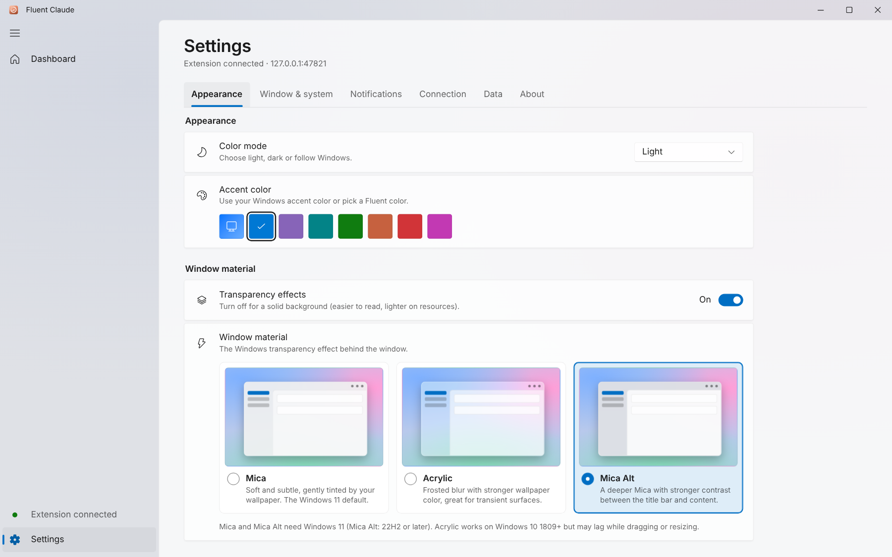

<div align="center">


# Fluent Claude

**Know which Claude account is ready — before you open Chrome.**

A free, open-source Windows dashboard that tracks Claude usage limits and reset times across all your Chrome profiles — designed in **Microsoft Fluent Design** with Mica, Acrylic and Mica Alt window materials.

[](LICENSE)


[Tiếng Việt](README.vi.md)

</div>

---

## Introduction

If you juggle several Claude accounts, one per Chrome profile, you quickly lose track of which one still has capacity and when the others come back. **Fluent Claude** puts them all in one place: a small Chrome extension reports each profile's limits to a desktop app that runs entirely on your PC, and the dashboard shows live countdowns, progress toward each reset, usage forecasts, notifications and one-click access to the right Chrome profile.

> Fluent Claude is an independent project. It is not affiliated with or endorsed by Anthropic or Microsoft.

## Screenshots

| Mica · dark | Mica · light |
| :---: | :---: |
|  |  |
| **Acrylic · list view** | **Mica Alt · settings** |
|  |  |

Screenshots use demo data. A browser has no real Mica, so `npm run dev:mock` paints a simulated Windows wallpaper behind the window.

## Fluent Design

- **Window materials.** Pick **Mica** (default), **Acrylic** or **Mica Alt** under **Settings → Appearance → Window material**, with live previews, plus a *Transparency effects* switch for a solid background. If your Windows version does not support the choice (Mica needs Windows 11, Mica Alt needs 22H2+), the app falls back automatically and tells you.
- **WinUI-style shell.** Custom title bar with Windows 11 caption buttons, a collapsible *NavigationView* with a sliding accent indicator, and a content layer with the signature rounded corner.
- **Fluent controls.** ToggleSwitch, ComboBox, Slider, ProgressBar and ProgressRing, InfoBar toasts, ToolTips, ContentDialog, Pivot tabs and Windows 11 *SettingsCard* rows — all in light and dark.
- **Fluent System Icons** and **Segoe UI Variable** (bundled fonts remain selectable), Fluent motion curves, a double-ring keyboard focus visual.
- **Windows accent color** or seven Fluent accent colors.
- **New app icon** in the Fluent style: a soft squircle with glass highlights, a usage ring and three usage bars.

## Features

- **One dashboard for every profile.** Each card shows the Claude account, the Chrome profile (`Profile 4 · 01 - Work`) and the Google account signed in to that profile.
- **Overview tiles.** Ready, waiting, next to recover — click a tile to filter — plus **Open best account**.
- **Live reset countdown** with a progress ring and time left spelled out in full. A card highlights the moment an account recovers.
- **Usage history and forecast.** Sparklines per account and a "limit expected at 15:40" prediction. History can be exported to CSV.
- **Smart notifications** at a usage threshold and at the expected reset time, with quiet hours.
- **Organize.** Pin, rename and annotate accounts; hide and restore; grid or list view; filters and search.
- **Real Chrome profile avatars**, **Open all Chrome**, **system tray** with a live tooltip, optional start with Windows, single instance.
- **English and Tiếng Việt**, six typefaces, three text sizes, optional animations.
- **Window behavior.** Remember size and position, or always open maximized.
- **Keyboard shortcuts.** `Ctrl+R` refresh · `Ctrl+F` search · `Ctrl+1` dashboard · `Ctrl+,` settings · `Ctrl+B` navigation.
- **Private by design.** No cloud and no sign-in. The app listens only on `127.0.0.1`, requires a secret token and rejects web-page origins.

### Account states

| State | Condition |
| --- | --- |
| Ready | Limit not reached, or the reset time has passed (switches automatically) |
| Waiting for reset | Limit reached and the reset time has not passed: live countdown |
| No data | The extension has not reported usage yet |

## Installation

### 1. Build and install the app

The repository ships source only (no installer binary). Build it as described in [Build](#build), then run the generated NSIS installer. Windows 10/11 already includes WebView2. Closing the window sends the app to the system tray (can be turned off in Settings); choose **Quit** in the tray menu to exit.

> Upgrading from *Claude Tracker*? On first launch Fluent Claude copies your accounts and token from the old data folder, so the extension keeps working.

### 2. Add the extension (once per Chrome profile)

1. Open `chrome://extensions` in the profile and turn on **Developer mode**.
2. Choose **Load unpacked** and select the [`extension/`](extension/) folder.
3. Open the extension's settings and enter the **port** and **token** shown in the app under **Settings → Connection**, then press **Save & connect**.
4. Make sure the profile is signed in to claude.ai and to Chrome so the app can match the right Chrome profile automatically.

### How it works

```
Chrome profiles                                Fluent Claude (Windows)
┌──────────────────────────┐   POST /ingest   ┌────────────────────────────────┐
│ extension/ (MV3)         │  127.0.0.1:47821 │ Rust: tiny_http (loopback)     │
│ reuses the claude.ai     │ ───────────────► │  ├─ parses usage → tracker.json│
│ session already signed in│   x-tracker-token│  ├─ watcher: notifications     │
└──────────────────────────┘                  │  ├─ window-vibrancy: Mica/…    │
                                              │  └─ launches chrome.exe profile│
                                              │ React UI: Fluent dashboard     │
                                              └────────────────────────────────┘
```

### Known limitations

- The claude.ai usage endpoint is internal and may change. If a bar is empty, check **Settings → Connection → Raw data diagnostics** and adjust `parse_usage` in `src-tauri/src/main.rs` and `getJson` in `extension/background.js`.
- The app must be running (the tray counts) to receive data and send notifications.
- Window materials need Windows 10 1809+ (Acrylic) or Windows 11 (Mica, Mica Alt). The window has a custom title bar, so Windows 11 snap-layout flyouts on the maximize button are not available. Acrylic on Windows 10 can lag while dragging or resizing.

## Tech stack

| Layer | Technology |
| --- | --- |
| Desktop shell | [Tauri 2](https://tauri.app) (Rust) |
| Window materials | [`window-vibrancy`](https://crates.io/crates/window-vibrancy) (Mica, Acrylic, Mica Alt) |
| Local API | `tiny_http` on `127.0.0.1`, `serde`, `chrono`; single-instance, autostart and notification plugins |
| UI | React 18, TypeScript, Vite 5, hand-written CSS with Fluent tokens |
| Icons | [Fluent System Icons](https://github.com/microsoft/fluentui-system-icons) (`@fluentui/react-icons`) |
| Browser extension | Chrome Manifest V3 |
| Installer | NSIS (via Tauri bundler) |

## Development

Requirements: [Node.js](https://nodejs.org) 18+, [Rust](https://rustup.rs) (MSVC toolchain) and WebView2.

```bash
npm install
npm run dev        # Tauri app with hot reload
npm run dev:mock   # UI only, in the browser, with demo data (no Rust needed)
npm run build:web  # type-check + production build of the UI
```

`npm run dev:mock` serves the interface at `http://localhost:1420` with a fake backend (`app/src/mock/`) and a simulated wallpaper, handy for UI work and screenshots (`npm run screenshots`, needs `npm i -D playwright`).

Icons are generated from one geometry by `npm run icons` (requires Python and Pillow).

## Build

```bash
npm run build
```

The NSIS installer is written to `src-tauri/target/release/bundle/nsis/` (or the shared `target/` folder when the project lives in a Cargo workspace). The custom uninstaller icon requires a recent Tauri CLI (`@tauri-apps/cli` ≥ 2.8).

## Project structure

```
fluent-claude/
├─ app/                    # React UI (Vite root)
│  ├─ index.html
│  ├─ public/              # favicon
│  └─ src/
│     ├─ App.tsx           # shell: navigation, overview tiles, command bar, shortcuts
│     ├─ TitleBar.tsx      # custom Fluent title bar + caption buttons
│     ├─ AccountCard.tsx   # account card (grid + list), progress ring, forecast
│     ├─ EditDialog.tsx    # rename / note dialog
│     ├─ SettingsView.tsx  # appearance + window material, system, notifications, connection, data, about
│     ├─ ui.tsx            # logo, avatar, tooltip, combobox, switch, infobar, dialogs, progress, sparkline
│     ├─ i18n.tsx          # English / Vietnamese strings
│     ├─ prefs.ts, fonts.ts, accents.ts
│     ├─ lib.ts            # state analysis, forecast, countdown formatting
│     ├─ styles.css        # Fluent tokens, materials and layout
│     └─ mock/             # fake backend for `npm run dev:mock`
├─ extension/              # Chrome extension (MV3, EN/VI)
├─ src-tauri/              # Rust backend, Tauri config, icons
├─ screenshots/            # image01.png … image04.png
├─ assets/                 # logo
├─ scripts/                # icons, screenshots
└─ LICENSE
```

## License

Released under the [MIT License](LICENSE). © 2026 minhtrong67.
