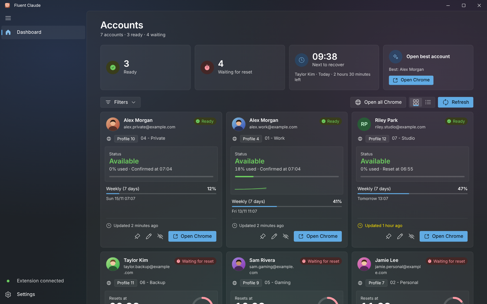
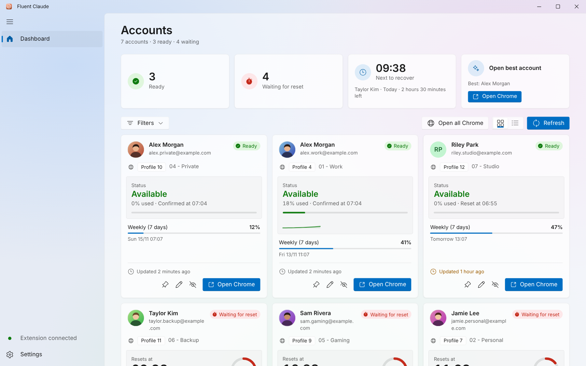
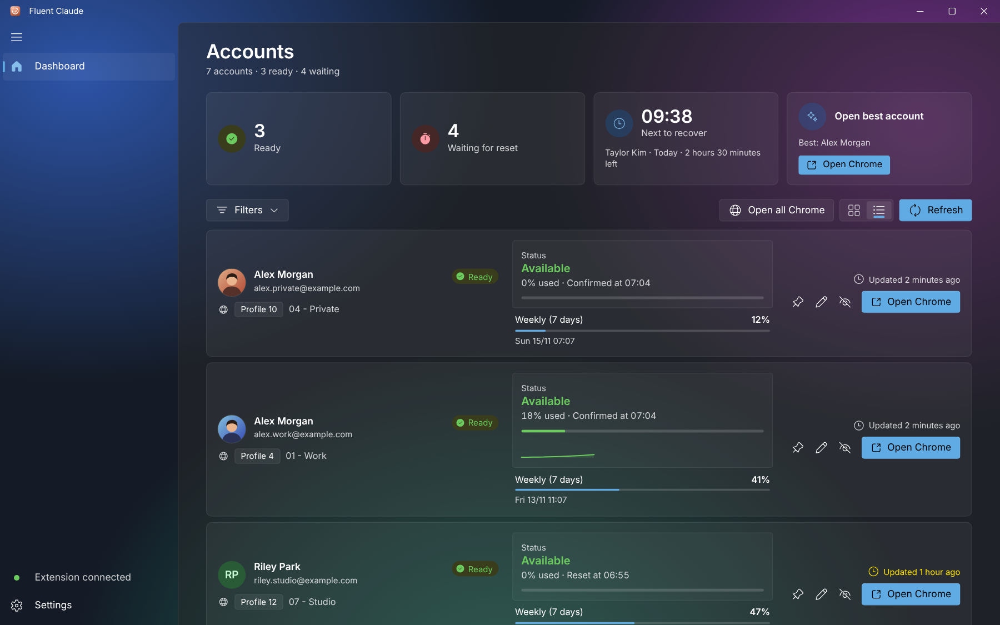
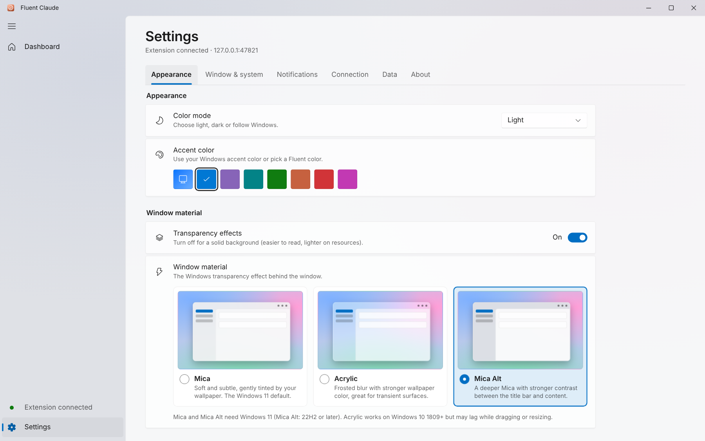

<div align="center">


# Fluent Claude

**Biết ngay tài khoản Claude nào đã sẵn sàng — trước khi mở Chrome.**

Bảng điều khiển Windows miễn phí, mã nguồn mở, theo dõi giới hạn sử dụng và thời điểm reset của Claude trên mọi Chrome Profile — thiết kế theo **Microsoft Fluent Design** với chất liệu cửa sổ Mica, Acrylic và Mica Alt.

[](LICENSE)


[English](README.md)

</div>

---

## Giới thiệu

Nếu bạn dùng nhiều tài khoản Claude, mỗi tài khoản một Chrome Profile, rất dễ quên tài khoản nào còn lượt và khi nào các tài khoản khác hồi lại. **Fluent Claude** gom tất cả vào một nơi: extension Chrome nhỏ báo giới hạn của từng profile về app desktop chạy hoàn toàn trên máy bạn; dashboard hiển thị đếm ngược trực tiếp, tiến độ tới lần reset, dự báo mức dùng, thông báo và mở đúng Chrome Profile chỉ với một cú nhấp.

> Fluent Claude là dự án độc lập, không liên kết hay được bảo trợ bởi Anthropic hoặc Microsoft.

## Ảnh chụp

| Mica · tối | Mica · sáng |
| :---: | :---: |
|  |  |
| **Acrylic · dạng danh sách** | **Mica Alt · cài đặt** |
|  |  |

Ảnh dùng dữ liệu giả. Trình duyệt không có Mica thật nên `npm run dev:mock` tự vẽ hình nền Windows mô phỏng phía sau cửa sổ.

## Fluent Design

- **Chất liệu cửa sổ.** Chọn **Mica** (mặc định), **Acrylic** hoặc **Mica Alt** tại **Cài đặt → Giao diện → Chất liệu cửa sổ**, có xem trước trực quan, kèm công tắc *Hiệu ứng trong suốt* để dùng nền đặc. Nếu bản Windows không hỗ trợ (Mica cần Windows 11, Mica Alt cần 22H2+), app tự lùi về lựa chọn phù hợp và báo cho bạn.
- **Khung kiểu WinUI.** Thanh tiêu đề riêng với nút Windows 11, *NavigationView* thu gọn được có chỉ báo màu nhấn trượt, lớp nội dung bo góc đặc trưng.
- **Điều khiển Fluent.** ToggleSwitch, ComboBox, Slider, ProgressBar, ProgressRing, InfoBar, ToolTip, ContentDialog, Pivot và các hàng *SettingsCard* như Cài đặt Windows 11 — đủ sáng/tối.
- **Fluent System Icons**, **Segoe UI Variable** (vẫn chọn được các phông đóng gói sẵn), đường cong chuyển động Fluent, vòng focus kép cho bàn phím.
- **Màu nhấn của Windows** hoặc bảy màu nhấn Fluent.
- **App icon mới** kiểu Fluent: ô vuông bo mềm, highlight kính, vòng mức dùng và ba cột.

## Tính năng

- **Một dashboard cho mọi profile.** Mỗi thẻ hiện tài khoản Claude, Chrome Profile (`Profile 4 · 01 - Work`) và tài khoản Google đăng nhập trong profile đó.
- **Ô tổng quan.** Sẵn sàng, đang chờ, sắp hồi gần nhất — nhấp để lọc — cùng **Mở tài khoản tốt nhất**.
- **Đếm ngược reset trực tiếp** với vòng tiến độ, thời gian còn lại ghi đầy đủ. Thẻ nổi bật khi tài khoản vừa hồi.
- **Lịch sử và dự báo.** Biểu đồ nhỏ từng tài khoản, dự báo "dự kiến chạm giới hạn lúc 15:40"; xuất lịch sử ra CSV.
- **Thông báo thông minh** khi đạt ngưỡng và khi tới giờ reset, có giờ yên tĩnh.
- **Sắp xếp.** Ghim, đổi tên, ghi chú; ẩn/khôi phục; dạng lưới hoặc danh sách; lọc và tìm kiếm.
- **Ảnh đại diện Chrome thật**, **Mở tất cả Chrome**, **khay hệ thống** có tooltip động, tự chạy cùng Windows, chặn mở nhiều bản.
- **Tiếng Việt và English**, sáu phông chữ, ba cỡ chữ, tuỳ chọn hiệu ứng chuyển động.
- **Cửa sổ.** Nhớ kích thước/vị trí hoặc luôn mở phóng to.
- **Phím tắt.** `Ctrl+R` làm mới · `Ctrl+F` tìm kiếm · `Ctrl+1` dashboard · `Ctrl+,` cài đặt · `Ctrl+B` thanh điều hướng.
- **Riêng tư.** Không đám mây, không đăng nhập. App chỉ lắng nghe `127.0.0.1`, yêu cầu token bí mật và từ chối request từ trang web.

### Trạng thái tài khoản

| Trạng thái | Điều kiện |
| --- | --- |
| Sẵn sàng | Chưa chạm giới hạn, hoặc đã qua thời điểm reset (tự chuyển) |
| Đang chờ reset | Đã chạm giới hạn và chưa tới giờ reset: đếm ngược trực tiếp |
| Chưa có dữ liệu | Extension chưa báo mức dùng |

## Cài đặt

### 1. Build và cài app

Repo chỉ chứa mã nguồn (không kèm file cài đặt). Hãy build theo mục [Build](#build) rồi chạy bộ cài NSIS vừa tạo. Windows 10/11 đã có sẵn WebView2. Đóng cửa sổ sẽ thu app xuống khay hệ thống (tắt được trong Cài đặt); chọn **Thoát** ở menu khay để thoát hẳn.

> Nâng cấp từ *Claude Tracker*? Lần đầu chạy, Fluent Claude tự chép tài khoản và token từ thư mục dữ liệu cũ nên extension vẫn hoạt động.

### 2. Thêm extension (một lần cho mỗi Chrome Profile)

1. Mở `chrome://extensions` trong profile và bật **Developer mode**.
2. Chọn **Load unpacked** rồi trỏ tới thư mục [`extension/`](extension/).
3. Mở cài đặt extension, nhập **cổng** và **token** hiển thị trong app tại **Cài đặt → Kết nối**, bấm **Lưu & kết nối**.
4. Đảm bảo profile đã đăng nhập claude.ai và Chrome để app tự khớp đúng Chrome Profile.

### Giới hạn đã biết

- Endpoint dùng của claude.ai là nội bộ và có thể thay đổi. Nếu thanh trống, xem **Cài đặt → Kết nối → Chẩn đoán dữ liệu thô** và chỉnh `parse_usage` trong `src-tauri/src/main.rs` cùng `getJson` trong `extension/background.js`.
- App phải đang chạy (chạy dưới khay cũng được) mới nhận dữ liệu và gửi thông báo.
- Chất liệu cửa sổ cần Windows 10 1809+ (Acrylic) hoặc Windows 11 (Mica, Mica Alt). Do dùng thanh tiêu đề riêng nên không có khung gợi ý Snap Layout của Windows 11 trên nút phóng to. Acrylic trên Windows 10 có thể giật khi kéo/đổi cỡ cửa sổ.

## Công nghệ

| Lớp | Công nghệ |
| --- | --- |
| Vỏ desktop | [Tauri 2](https://tauri.app) (Rust) |
| Chất liệu cửa sổ | [`window-vibrancy`](https://crates.io/crates/window-vibrancy) (Mica, Acrylic, Mica Alt) |
| API cục bộ | `tiny_http` trên `127.0.0.1`, `serde`, `chrono`; plugin single-instance, autostart, notification |
| Giao diện | React 18, TypeScript, Vite 5, CSS thuần với token Fluent |
| Icon | [Fluent System Icons](https://github.com/microsoft/fluentui-system-icons) (`@fluentui/react-icons`) |
| Extension | Chrome Manifest V3 |
| Bộ cài | NSIS (qua Tauri bundler) |

## Phát triển

Yêu cầu: [Node.js](https://nodejs.org) 18+, [Rust](https://rustup.rs) (toolchain MSVC) và WebView2.

```bash
npm install
npm run dev        # app Tauri, hot reload
npm run dev:mock   # chỉ giao diện trên trình duyệt, dữ liệu giả (không cần Rust)
npm run build:web  # kiểm tra kiểu + build giao diện
```

`npm run dev:mock` phục vụ giao diện tại `http://localhost:1420` với backend giả (`app/src/mock/`) và hình nền mô phỏng, tiện làm UI và chụp ảnh (`npm run screenshots`, cần `npm i -D playwright`).

Icon sinh từ một hình học chung bằng `npm run icons` (cần Python và Pillow).

## Build

```bash
npm run build
```

Bộ cài NSIS nằm ở `src-tauri/target/release/bundle/nsis/` (hoặc thư mục `target/` dùng chung nếu project nằm trong Cargo workspace). Icon tuỳ chỉnh cho trình gỡ cài đặt cần Tauri CLI mới (`@tauri-apps/cli` ≥ 2.8).

## Cấu trúc dự án

```
fluent-claude/
├─ app/                    # Giao diện React (gốc Vite)
│  └─ src/                 # App, TitleBar, AccountCard, SettingsView, ui, i18n, styles.css, mock/
├─ extension/              # Extension Chrome (MV3, EN/VI)
├─ src-tauri/              # Backend Rust, cấu hình Tauri, icon
├─ screenshots/            # image01.png … image04.png
├─ assets/                 # logo
├─ scripts/                # icon, ảnh chụp
└─ LICENSE
```

## Giấy phép

Phát hành theo [MIT License](LICENSE). © 2026 minhtrong67.
