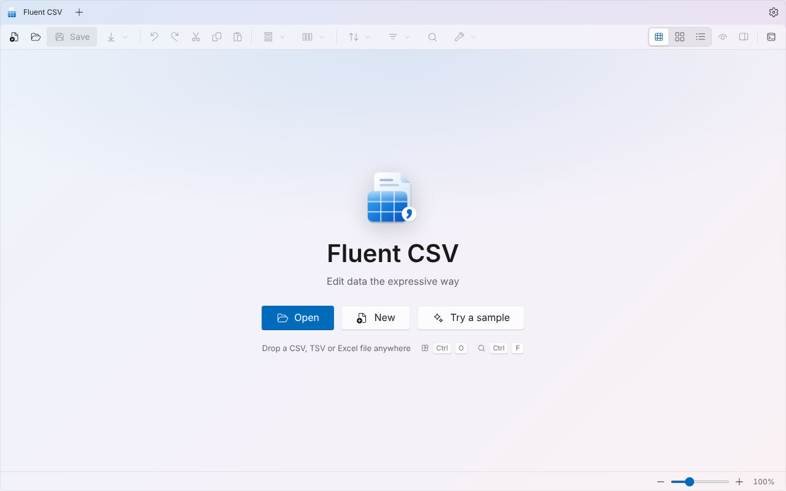
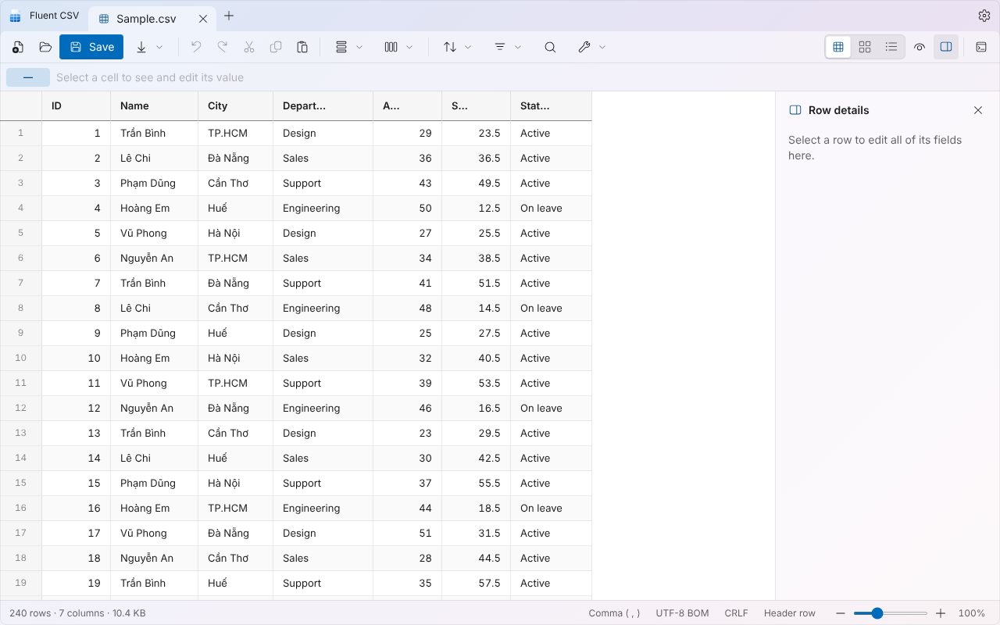
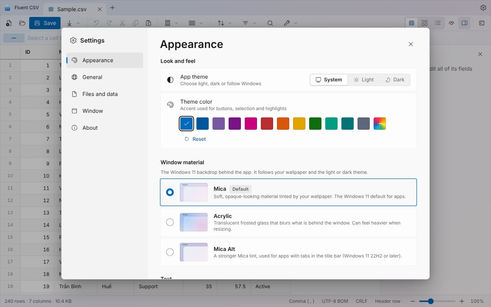
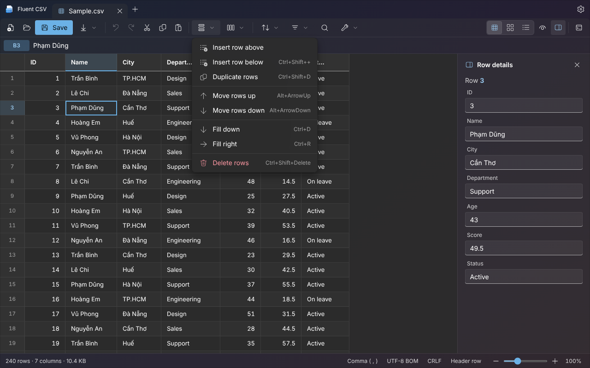

# Fluent CSV

A fast, full-featured **CSV editor for Windows**, built with **Tauri 2 + React + TypeScript + Tailwind** and styled with **Microsoft Fluent Design** (Windows 11 look and feel).

| | |
|---|---|
|  |  |
|  |  |

## Features

- Spreadsheet-style editing: virtual grid, multi-cell selection, formula bar, fill down/right, copy/paste with Excel, undo/redo
- Open CSV, TSV, TXT, XLSX, XLS, XLSM, ODS; export to CSV, TSV, JSON, Excel, Markdown, HTML
- Sort, quick filters, advanced filters, find & replace (case, whole word, regex), go to row, column statistics
- Tabs, drag & drop, row details pane, table / cards / list views, freeze first column, hide/show columns
- Encoding, delimiter and line-ending control, crash recovery for unsaved tabs
- Command palette (`Ctrl+Shift+P`), keyboard shortcuts (`F1`), English and Vietnamese

## Fluent Design

- Windows 11 title bar with tabs and caption buttons, command bar, WinUI-style controls, flyouts, content dialogs and InfoBar toasts
- Fluent System Icons (inlined SVG, no icon package at runtime) and a new Fluent app icon
- Light / dark / system theme with Windows accent colours or any custom colour
- **Window material** (Settings → Appearance): **Mica** (default), **Acrylic** or **Mica Alt**
  - Mica and Mica Alt need Windows 11 (Mica Alt: 22H2 or later); Acrylic works on Windows 10 1903+ and Windows 11.
  - On unsupported systems the app falls back to a solid background automatically.
  - Acrylic can feel laggy while resizing or dragging the window: this is a Windows limitation.

## Run

Requirements: Node.js 20+, [pnpm](https://pnpm.io), Rust and the [Tauri prerequisites for Windows](https://tauri.app/start/prerequisites/).

```bash
pnpm install
pnpm dev      # desktop app with hot reload
pnpm build    # Windows installer (NSIS)
```

The installer is written to `target/release/bundle/nsis/` (shared Cargo workspace target folder).
`pnpm web:dev` runs only the web UI in a browser (the window material is simulated there).

## Layout

```
src/            React UI (components, lib: store, theme, csv, io, ops ...)
src-tauri/      Rust side (file IO, window state, single instance) and installer config
public/         Favicon, logo, Excel reader
brand/          Logo sources (SVG)
screenshots/    README images
```

## Author

`minhtrong67` · built with the help of Claude (Anthropic) · MIT License
