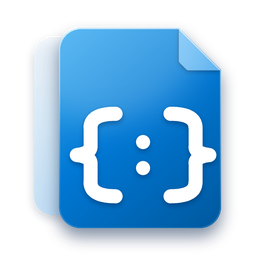

<div align="center">



# Fluent JSON

**A fast, full-featured JSON editor and toolbox for Windows — designed with Microsoft Fluent Design.**

Tree view · JSONPath · Diff · Schema validation · Format converters · Command palette · Mica / Acrylic / Mica Alt

[](LICENSE)
[](https://tauri.app)
[](https://fluent2.microsoft.design)
[](#installation)

</div>

---

## Introduction

**Fluent JSON** is a free and open-source desktop app for working with JSON. Open a file or paste some text and you can format, repair, explore, query, compare, validate and convert it — all offline, in a small and snappy native app ([Tauri](https://tauri.app)) that looks and feels like a Windows 11 app: a navigation pane, a tab view, a command bar, setting cards, flyouts and content dialogs, with a real **Mica**, **Mica Alt** or **Acrylic** window backdrop.

## Window material

Settings → Appearance → **Window material**

| Material | What it looks like | Needs |
|---|---|---|
| **Mica** *(default)* | Subtle backdrop tinted by your wallpaper | Windows 11 |
| **Mica Alt** | Stronger tint, made for apps with tabs | Windows 11 22H2+ |
| **Acrylic** | Frosted glass that blurs what is behind the window | Windows 10 1809+ / 11 |

The effect is applied natively (Rust `set_effects`) and follows the app theme (light / dark / system). If your version of Windows does not support the chosen material the app falls back to solid Fluent surfaces and tells you so. The accent colour defaults to your **Windows accent colour** and can be changed to any Windows accent or a custom colour.

## Features

**Editor**
- CodeMirror 6: syntax highlighting, line numbers, folding, bracket matching, find & replace, undo/redo
- Live error markers with exact line and column; the status bar shows the **JSONPath of the cursor** (click to copy)
- Multiple tabs, unsaved dots, drag & drop, recent files, session restore, "Open with" support
- **Format**, **Minify**, **Sort keys**, **Repair** (comments, trailing commas, single quotes, unquoted keys…), escape / unescape
- Edits touch only the text that really changed, so scroll position, folds and the undo history stay intact
- Big numbers are preserved exactly — no precision loss when formatting

**Tools**
- **Tree view** – lazy rendering, search keys & values, copy path / value, inline edit, **add keys / array items**, delete, click to select in the editor
- **JSONPath** – `$`, `..`, `[*]`, `[0]`, `[-1]`, `[0:3]`, filters such as `[?(@.price < 10)]`, query history, jump to match
- **Compare** – structural change list and side-by-side line diff, optional "ignore key order"
- **Schema** – validate against JSON Schema draft-07 / 2019-09 / 2020-12 (Ajv) or generate a schema from your data
- **Convert** – JSON → YAML, CSV, XML, TypeScript, JSON Schema; and YAML, CSV, XML → JSON
- **Command palette** (`Ctrl+K`) for every action (including switching the window material), plus document **statistics**

**Personalisation**
- Light / Dark / System theme with a circular reveal animation
- Fluent accent colours (Windows accent, 20 Windows swatches or custom) with automatic contrast-safe text colours
- Collapsible **navigation pane** (hamburger button), remembered between sessions
- UI fonts: **System (Segoe UI Variable)**, Segoe UI, Inter, Roboto, Be Vietnam Pro, Arial; 3 font sizes; 8 **code fonts** (Cascadia, JetBrains Mono, Fira Code, Source Code Pro, Roboto Mono, IBM Plex Mono, Consolas or the system default)
- English and Vietnamese (auto-detected, switchable)
- Window behaviour: **remember size & position** or **always start maximized**
- Animations can be switched off — `prefers-reduced-motion` is respected

**Keyboard shortcuts**

| Action | Shortcut |
|---|---|
| New / Open / Save / Save as / Close tab | `Ctrl+N` / `Ctrl+O` / `Ctrl+S` / `Ctrl+Shift+S` / `Ctrl+W` |
| Command palette | `Ctrl+K` |
| Next / previous tab | `Ctrl+Tab` / `Ctrl+Shift+Tab` |
| Format / Minify | `Alt+Shift+F` / `Alt+Shift+M` |
| Find & replace | `Ctrl+F` |
| Switch view (Editor, Query, Compare, Convert, Schema) | `Ctrl+1` … `Ctrl+5` |
| Settings | `Ctrl+,` |

## Installation

Build the installer yourself (see below), run `Fluent JSON_2.0.0_x64-setup.exe` and follow the wizard (installs per-user, no administrator rights needed). Requires Windows 10 or 11 with the WebView2 runtime (preinstalled on Windows 11).

## Tech stack

| Layer | Technology |
|---|---|
| Shell | [Tauri 2](https://tauri.app) (Rust) with the dialog and single-instance plugins; native Mica / Acrylic via `set_effects` |
| UI | TypeScript + [Vite](https://vitejs.dev), hand-written Fluent CSS (no UI framework) |
| Editor | [CodeMirror 6](https://codemirror.net) |
| Icons | [Lucide](https://lucide.dev) |
| Fonts | [Fontsource](https://fontsource.org) packages (bundled for offline use) |
| Validation | [Ajv](https://ajv.js.org) + ajv-formats |
| Conversion | [js-yaml](https://github.com/nodeca/js-yaml) and custom CSV / XML / type-inference code |

## Development

**Prerequisites:** [Node.js](https://nodejs.org) 18+, [Rust](https://rustup.rs) (stable) and the [Tauri prerequisites](https://tauri.app/start/prerequisites/) for your OS.

This project is a member of a shared Cargo workspace (`members = ["*/src-tauri"]`), so all projects reuse one `target/` cache. Keep the folder next to the workspace `Cargo.toml`.

```bash
npm install     # install dependencies
npm run dev     # start the desktop app in development mode (hot reload)
```

```bash
npm run vite:dev                   # frontend only, in the browser (http://localhost:1420, solid surfaces, no native material)
npm run vite:build                 # type-check + production build of the frontend
python scripts/generate-icons.py   # regenerate every icon (needs: pip install pillow)
```

## Build

```bash
npm run build
```

The Windows installer is created in the workspace `target/release/bundle/nsis/` folder.

## Project structure

```text
fluent-json/
├── index.html              # app shell
├── public/                 # static assets (icon)
├── scripts/
│   └── generate-icons.py   # builds app / installer / uninstaller icons and NSIS banners
├── src/
│   ├── main.ts             # bootstrap, navigation pane, toolbar, tabs, status bar, shortcuts
│   ├── docs.ts             # open documents, session, dialogs
│   ├── editor.ts           # CodeMirror wrapper
│   ├── json.ts, jsonpath.ts, convert.ts, diff.ts
│   ├── palette.ts, tooltip.ts
│   ├── theme.ts            # accent colours, light/dark, window material sync
│   ├── settings.ts         # persisted preferences
│   ├── i18n.ts             # English / Vietnamese strings
│   ├── ui.ts, icons.ts     # dialogs, flyouts, info bars, Lucide icons
│   ├── tauri.ts            # native window / file / material helpers (time-boxed calls)
│   ├── views/              # tree, query, compare, convert, schema, settings
│   └── styles/             # base (tokens), app (shell + controls), views, fonts
└── src-tauri/              # Rust shell (set_window_material, system_accent_color), icons, installer config
```

## License

Fluent JSON is public and open source, released under the [MIT License](LICENSE).

---

<div align="center">

Made by **[minhtrong67](https://github.com/minhtrong67)** with the support of **Claude** (AI).

</div>
