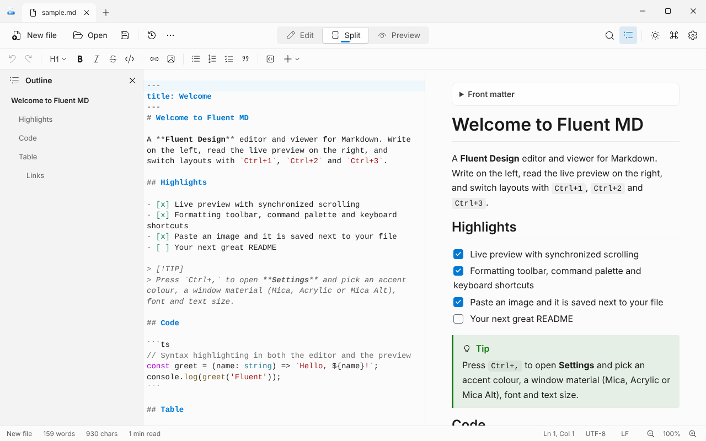
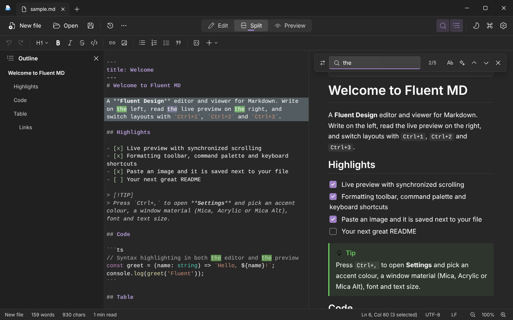
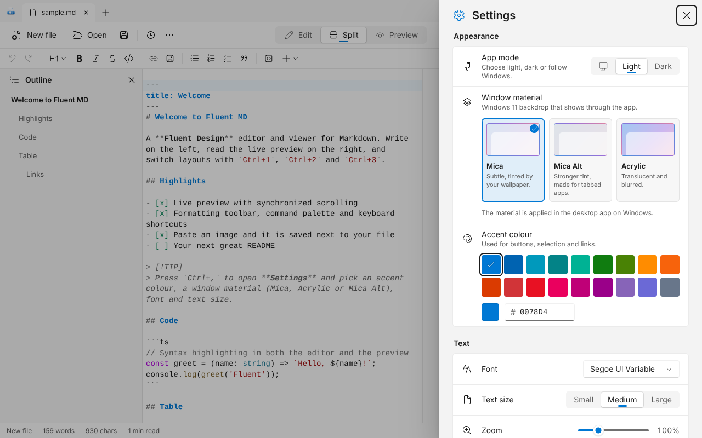
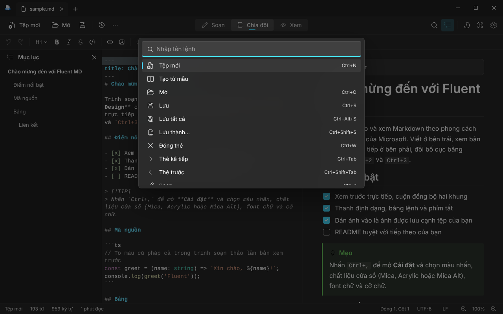

<div align="center">


# Fluent MD

**Write, preview and polish Markdown the Windows 11 way.**

A fast, friendly desktop editor and viewer for Markdown in Microsoft Fluent Design, with Mica, Acrylic and Mica Alt window materials. Built with Tauri 2, React and TypeScript.

[](package.json)
[](#installation)
[](https://tauri.app)
[](LICENSE)

[English](README.md) · [Tiếng Việt](README.vi.md)

</div>

## Introduction

Fluent MD is a desktop app to read, write and live-preview Markdown files. It pairs a CodeMirror 6 editor with a block-by-block live preview, so long documents stay smooth, and wraps them in a native-feeling Windows 11 interface: tabs in the title bar, a command bar, Segoe UI Variable, Fluent System Icons and a settings page made of Fluent setting cards.

It is part of the [my-tauri-apps](https://github.com/minhtrong67/my-tauri-apps) collection and works fully offline: your files never leave your computer.

## Screenshots

| | |
| :---: | :---: |
|  |  |
| **Split view** · tabs in the title bar, outline, live preview | **Dark theme** · purple accent, find with highlights |
|  |  |
| **Settings** · Mica, Mica Alt, Acrylic and 18 accent colours | **Tiếng Việt** · fully translated, with the command palette |

> The screenshots come from the web build, so they use solid colours. In the desktop app on Windows the backdrop shows through the title bar and panels.

## Window materials: Mica, Acrylic, Mica Alt

Open **Settings** (`Ctrl+,`) and choose **Window material**. The default is **Mica**.

| Material | Look | Needs |
| --- | --- | --- |
| **Mica** (default) | Subtle, tinted by your wallpaper | Windows 11 |
| **Mica Alt** | Stronger tint, made for apps with tabs | Windows 11 22H2 or later |
| **Acrylic** | Translucent and blurred | Windows 10 or 11 |

The window is transparent and Windows paints the material behind the app; the interface then uses Fluent layer colours on top, in light and dark. If a material is not available on your system, the app falls back to Mica, then to solid colours, and Settings tells you which one is active.

## Features

**Writing**
- Three layouts: Edit, Split and Preview, with synchronized scrolling and a draggable divider (double-click to reset).
- Formatting toolbar and shortcuts for headings, bold, italic, strikethrough, code, links, images, lists, task lists, quotes, tables and rules.
- Paste or drop an image: it is saved to an `assets` folder beside your file and linked for you. Paste a URL over selected text to make a link.
- Templates (README, API reference, changelog, meeting notes), shields.io badges and a generated table of contents.
- Find and replace with case, regular expression and match counter, in both the editor and the preview.
- Right-click menu in the editor, command palette (`Ctrl+Shift+P`) and a full set of shortcuts (`F1`).

**Reading**
- GitHub-style rendering: tables, task lists, front matter, alerts (`> [!NOTE]`), syntax-highlighted code with a copy button.
- Click a checkbox in the preview to tick or untick the task in your Markdown.
- Outline pane that follows your position, local images, relative links to other `.md` files.
- Export to a standalone HTML file, or print to PDF.

**Tabs, safety and workflow**
- Tabs live in the title bar: drag to reorder, middle-click to close, right-click for Close others, Close all, Copy path and Reveal.
- Save all (`Ctrl+Alt+S`), autosave, session restore (tabs and unsaved drafts) and a prompt when a file changes on disk.
- Drag and drop to open files, `.md` file association and single-instance handling.
- Atomic saves, line-ending detection (LF or CRLF) and a warning for files that are not valid UTF-8.
- Focus mode (`F11`, leave with `F11` or `Esc`).

**Personalization** (Settings, `Ctrl+,`)
- Mode: system, light or dark.
- The Windows 11 accent palette (18 colours) or any custom hex colour.
- Fonts: Segoe UI Variable (default), Segoe UI, Inter, Roboto, Be Vietnam Pro and Arial.
- Text size, zoom, language (English, Tiếng Việt or automatic).
- Window on startup: remember the last size, or always open maximized.
- Default save folder, autosave, restore session, word wrap, line numbers, spell check.

## Installation

### Build the installer

Fluent MD ships as source. Follow [Development](#development) and [Build](#build) to create the Windows installer (`Fluent MD_1.0.0_x64-setup.exe`). It installs for the current user and does not need administrator rights.

Requires Windows 10 or 11 (64-bit) with Microsoft Edge WebView2, which is already present on current Windows versions.

## Tech stack

| Area | Technology |
| --- | --- |
| Shell | [Tauri 2](https://tauri.app) (Rust), window effects through `set_effects` |
| UI | React 19, TypeScript, Vite, Tailwind CSS 4 |
| Design | Microsoft Fluent 2 / WinUI tokens, Windows 11 accent palette |
| Icons | [Fluent System Icons](https://github.com/microsoft/fluentui-system-icons) |
| Editor | CodeMirror 6 |
| Markdown | marked, DOMPurify, highlight.js |
| State | Zustand |
| Fonts | Segoe UI Variable from Windows; bundled Roboto, Inter and Be Vietnam Pro (latin, latin-ext, vietnamese) |

## Development

Requirements: [Node.js](https://nodejs.org) 20 or newer, [pnpm](https://pnpm.io), [Rust](https://rustup.rs) (stable) and the [Tauri prerequisites](https://tauri.app/start/prerequisites/) for your system.

```bash
pnpm install   # install dependencies
pnpm dev       # start the desktop app with hot reload
```

You can also work on the interface alone in a browser with `pnpm web:dev` (file dialogs fall back to the browser, and window materials are not applied).

## Build

```bash
pnpm build     # type-check, bundle the UI and create the installer
```

The installer is written to `target/release/bundle/nsis/` in the Cargo workspace root (or `src-tauri/target/...` when used on its own).

Handy scripts:

| Command | What it does |
| --- | --- |
| `pnpm web:build` | Type-check and build only the UI into `dist/` |
| `node tools/fonts/make-fonts.mjs` | Rebuild the trimmed font subsets |
| `node tools/icons/make-icons.mjs` | Regenerate the app icon, uninstall icon and installer images (needs `sharp` and Python Pillow) |

## Project structure

```text
fluent-md/
├── app/                    Desktop UI (Vite root)
│   ├── index.html
│   ├── public/             Favicon and icon
│   └── src/
│       ├── main.tsx, App.tsx
│       ├── components/     Chrome (title bar, tabs, command bar), Workspace, Sheets, Hosts, base widgets
│       ├── lib/            controller, editor, markdown, theme, material, i18n, settings, tauri bridge
│       ├── styles/         app.css (Fluent tokens), markdown.css, fonts.css
│       └── assets/fonts/   Bundled font subsets
├── src-tauri/              Rust backend (set_window_effect), tauri.conf.json, capabilities, icons
├── screenshots/            image01 to image04
├── assets/                 App icon sources and favicon
├── tools/                  Generators for fonts and icons
├── package.json
└── LICENSE
```

## Author

Made by **minhtrong67** with **Claude** as AI support.

## License

Fluent MD is public and open source under the [MIT License](LICENSE).
Project home: <https://github.com/minhtrong67/my-tauri-apps>
