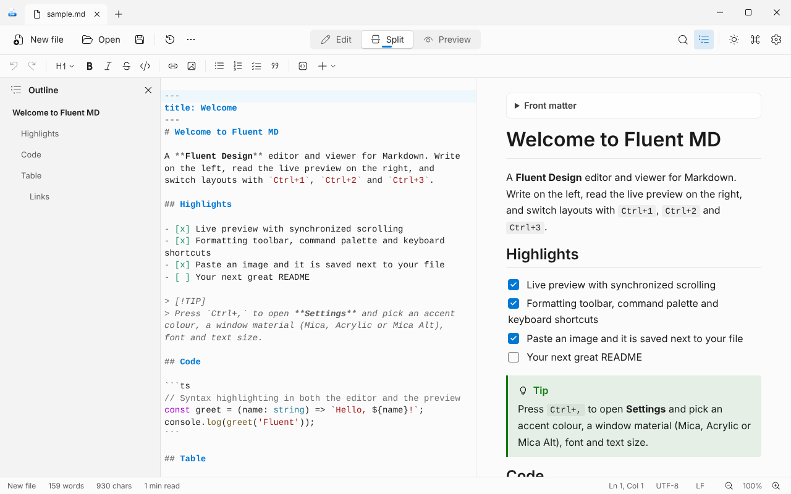
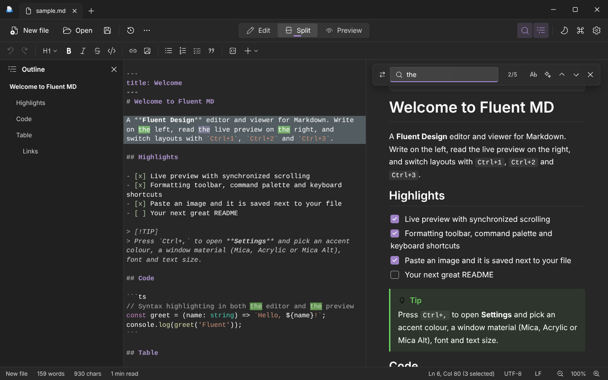
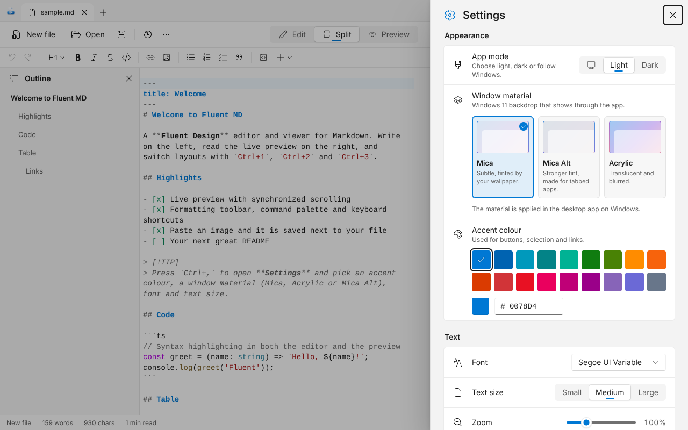
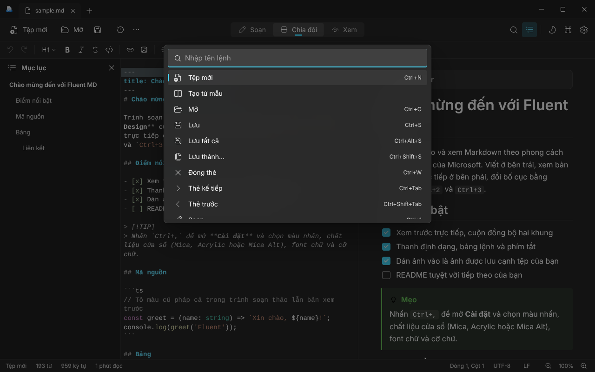

<div align="center">


# Fluent MD

**Viết, xem trước và hoàn thiện Markdown theo phong cách Windows 11.**

Trình soạn thảo và xem Markdown cho máy tính theo Microsoft Fluent Design, với các chất liệu cửa sổ Mica, Acrylic và Mica Alt. Xây dựng bằng Tauri 2, React và TypeScript.

[](package.json)
[](#cài-đặt)
[](https://tauri.app)
[](LICENSE)

[English](README.md) · [Tiếng Việt](README.vi.md)

</div>

## Giới thiệu

Fluent MD là ứng dụng desktop để đọc, viết và xem trước trực tiếp các tệp Markdown. Ứng dụng kết hợp trình soạn thảo CodeMirror 6 với bản xem trước theo từng khối nên tài liệu dài vẫn mượt, trong giao diện đậm chất Windows 11: thẻ nằm trên thanh tiêu đề, thanh lệnh, font Segoe UI Variable, bộ icon Fluent System Icons và trang cài đặt dạng thẻ Fluent.

Ứng dụng thuộc bộ sưu tập [my-tauri-apps](https://github.com/minhtrong67/my-tauri-apps) và hoạt động hoàn toàn ngoại tuyến: tệp của bạn không rời khỏi máy.

## Ảnh chụp màn hình

| | |
| :---: | :---: |
|  |  |
| **Chia đôi** · thẻ trên thanh tiêu đề, mục lục, xem trước trực tiếp | **Giao diện tối** · màu nhấn tím, tìm kiếm có tô sáng |
|  |  |
| **Cài đặt** · Mica, Mica Alt, Acrylic và 18 màu nhấn | **Tiếng Việt** · dịch đầy đủ, kèm bảng lệnh |

> Ảnh chụp từ bản web nên dùng màu nền đặc. Trong ứng dụng desktop trên Windows, hiệu ứng nền sẽ xuyên qua thanh tiêu đề và các khung.

## Chất liệu cửa sổ: Mica, Acrylic, Mica Alt

Mở **Cài đặt** (`Ctrl+,`) và chọn **Chất liệu cửa sổ**. Mặc định là **Mica**.

| Chất liệu | Hiệu ứng | Yêu cầu |
| --- | --- | --- |
| **Mica** (mặc định) | Tinh tế, ngả màu theo hình nền | Windows 11 |
| **Mica Alt** | Đậm hơn, dành cho ứng dụng nhiều thẻ | Windows 11 22H2 trở lên |
| **Acrylic** | Trong mờ và làm nhòe nền | Windows 10 hoặc 11 |

Cửa sổ được làm trong suốt và Windows vẽ chất liệu phía sau ứng dụng; giao diện phủ các lớp màu Fluent lên trên, cả sáng lẫn tối. Nếu hệ thống chưa hỗ trợ chất liệu đã chọn, ứng dụng lùi về Mica rồi đến màu nền đặc, và Cài đặt cho biết chất liệu đang dùng.

## Tính năng

**Soạn thảo**
- Ba chế độ: Soạn, Chia đôi và Xem, cuộn đồng bộ và thanh chia kéo được (bấm đúp để đặt lại).
- Thanh định dạng và phím tắt cho tiêu đề, đậm, nghiêng, gạch ngang, mã, liên kết, ảnh, danh sách, việc cần làm, trích dẫn, bảng và đường kẻ.
- Dán hoặc thả ảnh: ảnh được lưu vào thư mục `assets` cạnh tệp và tự chèn liên kết. Dán URL lên đoạn văn bản đang chọn để tạo liên kết.
- Mẫu (README, tài liệu API, nhật ký thay đổi, ghi chú họp), huy hiệu shields.io và mục lục tự động.
- Tìm và thay thế có phân biệt hoa thường, biểu thức chính quy và đếm kết quả, cả trong trình soạn thảo lẫn bản xem trước.
- Menu chuột phải trong trình soạn thảo, bảng lệnh (`Ctrl+Shift+P`) và bộ phím tắt đầy đủ (`F1`).

**Đọc**
- Hiển thị kiểu GitHub: bảng, danh sách việc, front matter, cảnh báo (`> [!NOTE]`), mã tô màu cú pháp có nút sao chép.
- Bấm vào ô chọn trong bản xem trước để tích hoặc bỏ tích việc cần làm trong Markdown.
- Mục lục theo dõi vị trí đọc, ảnh cục bộ, liên kết tương đối tới các tệp `.md` khác.
- Xuất ra tệp HTML độc lập hoặc in ra PDF.

**Thẻ, an toàn và quy trình**
- Thẻ nằm trên thanh tiêu đề: kéo để đổi thứ tự, bấm chuột giữa để đóng, chuột phải để Đóng các thẻ khác, Đóng tất cả, Sao chép đường dẫn và Mở thư mục.
- Lưu tất cả (`Ctrl+Alt+S`), tự động lưu, khôi phục phiên (thẻ và bản nháp chưa lưu) và nhắc khi tệp bị thay đổi trên đĩa.
- Kéo thả để mở tệp, liên kết tệp `.md` và chỉ chạy một cửa sổ.
- Lưu an toàn, nhận diện kiểu xuống dòng (LF hoặc CRLF) và cảnh báo khi tệp không phải UTF-8 hợp lệ.
- Chế độ tập trung (`F11`, thoát bằng `F11` hoặc `Esc`).

**Cá nhân hóa** (Cài đặt, `Ctrl+,`)
- Chế độ: hệ thống, sáng hoặc tối.
- Bảng màu nhấn của Windows 11 (18 màu) hoặc màu hex tùy chỉnh.
- Font: Segoe UI Variable (mặc định), Segoe UI, Inter, Roboto, Be Vietnam Pro và Arial.
- Cỡ chữ, thu phóng, ngôn ngữ (English, Tiếng Việt hoặc tự động).
- Cửa sổ khi khởi động: nhớ kích thước lần trước hoặc luôn mở toàn màn hình.
- Thư mục lưu mặc định, tự động lưu, khôi phục phiên, tự xuống dòng, số dòng, kiểm tra chính tả.

## Cài đặt

Fluent MD được phát hành dưới dạng mã nguồn. Làm theo [Phát triển](#phát-triển) và [Đóng gói](#đóng-gói) để tạo bộ cài Windows (`Fluent MD_1.0.0_x64-setup.exe`). Bộ cài cài cho người dùng hiện tại và không cần quyền quản trị.

Yêu cầu Windows 10 hoặc 11 (64-bit) có Microsoft Edge WebView2, vốn đã có sẵn trên các bản Windows hiện nay.

## Công nghệ

| Lĩnh vực | Công nghệ |
| --- | --- |
| Lõi | [Tauri 2](https://tauri.app) (Rust), hiệu ứng cửa sổ qua `set_effects` |
| Giao diện | React 19, TypeScript, Vite, Tailwind CSS 4 |
| Thiết kế | Token Microsoft Fluent 2 / WinUI, bảng màu nhấn Windows 11 |
| Icon | [Fluent System Icons](https://github.com/microsoft/fluentui-system-icons) |
| Trình soạn thảo | CodeMirror 6 |
| Markdown | marked, DOMPurify, highlight.js |
| Trạng thái | Zustand |
| Font | Segoe UI Variable của Windows; đóng gói Roboto, Inter và Be Vietnam Pro (latin, latin-ext, vietnamese) |

## Phát triển

Yêu cầu: [Node.js](https://nodejs.org) 20 trở lên, [pnpm](https://pnpm.io), [Rust](https://rustup.rs) (stable) và [điều kiện cần của Tauri](https://tauri.app/start/prerequisites/) cho hệ điều hành của bạn.

```bash
pnpm install   # cài đặt thư viện
pnpm dev       # chạy ứng dụng desktop với hot reload
```

Bạn cũng có thể chỉ làm giao diện trong trình duyệt bằng `pnpm web:dev` (hộp thoại tệp dùng của trình duyệt và chất liệu cửa sổ không được áp dụng).

## Đóng gói

```bash
pnpm build   # kiểm tra kiểu, đóng gói giao diện và tạo bộ cài
```

Bộ cài nằm trong `target/release/bundle/nsis/` ở thư mục gốc Cargo workspace (hoặc `src-tauri/target/...` khi dùng riêng).

Các lệnh tiện dụng:

| Lệnh | Tác dụng |
| --- | --- |
| `pnpm web:build` | Kiểm tra kiểu và chỉ build giao diện vào `dist/` |
| `node tools/fonts/make-fonts.mjs` | Tạo lại các bộ font rút gọn |
| `node tools/icons/make-icons.mjs` | Tạo lại icon ứng dụng, icon gỡ cài đặt và ảnh bộ cài (cần `sharp` và Python Pillow) |

## Cấu trúc dự án

```text
fluent-md/
├── app/                    Giao diện desktop (gốc Vite)
├── src-tauri/              Backend Rust (set_window_effect), tauri.conf.json, quyền, icon
├── screenshots/            image01 đến image04
├── assets/                 Nguồn icon ứng dụng và favicon
├── tools/                  Công cụ tạo font và icon
├── package.json
└── LICENSE
```

## Tác giả

Thực hiện bởi **minhtrong67** với **Claude** là trợ lý AI.

## Giấy phép

Fluent MD là mã nguồn mở theo [Giấy phép MIT](LICENSE).
Trang dự án: <https://github.com/minhtrong67/my-tauri-apps>
