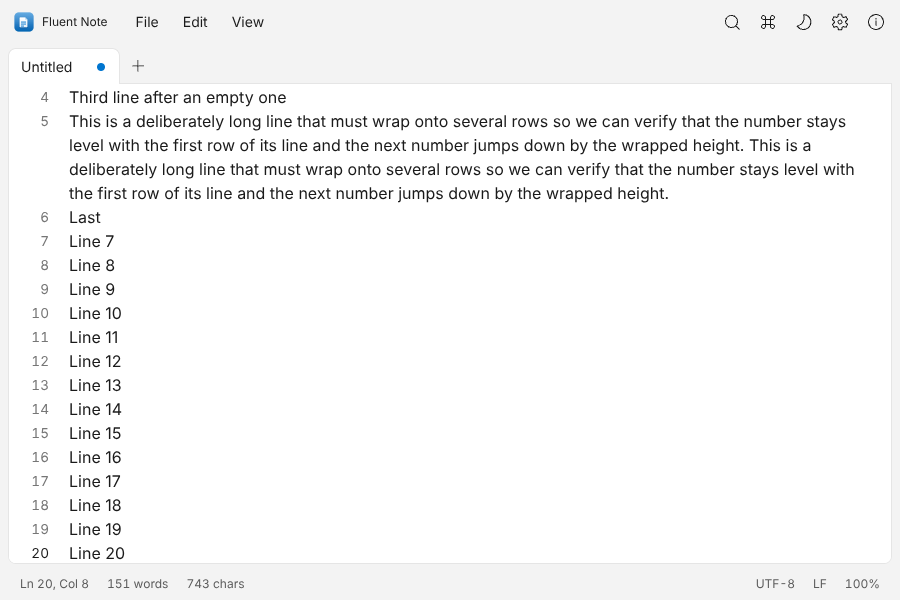
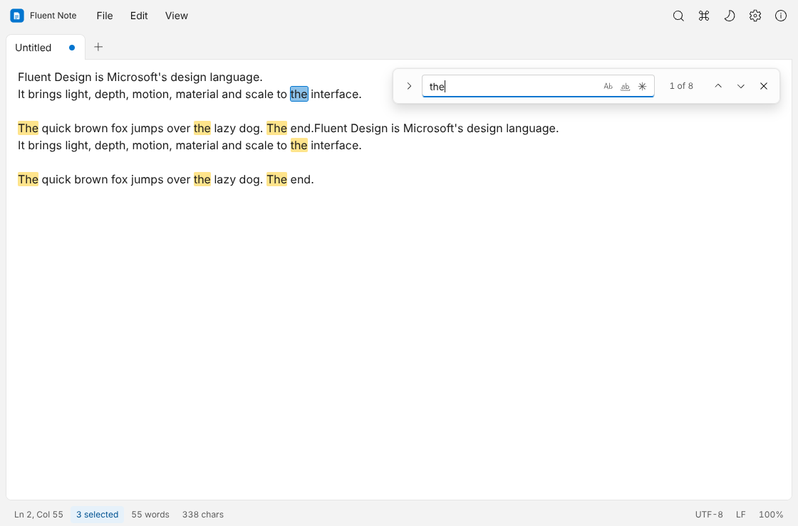
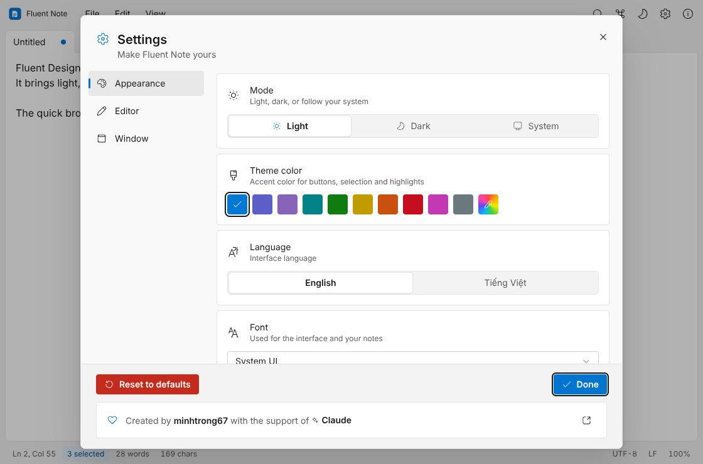
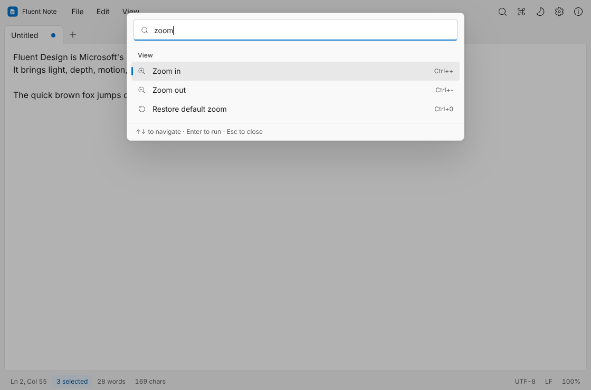

<div align="center">


# Fluent Note

**A fast, tabbed notepad in Microsoft Fluent Design.**
Tabs · Find & replace · Command palette · Themes · English & Vietnamese

[](LICENSE)


[Tiếng Việt](README.vi.md)

</div>

---

## Introduction

Fluent Note is a lightweight desktop notepad built with **Tauri**, **React** and **TypeScript**. It starts instantly, stays out of your way, and looks like a native Windows 11 app (Microsoft Fluent 2): the native Mica backdrop, 4 px controls, text fields with an accent underline, acrylic flyouts, Fluent elevation and calm motion, plus an accent colour you can set to any colour you like.

It is part of the open-source collection [my-tauri-apps](https://github.com/minhtrong67/my-tauri-apps).

## Screenshots

| | |
|---|---|
|  |  |
|  |  |

## Features

- **Tabs that remember** – drag to reorder, middle-click to close, horizontal or vertical layout; open files, cursor, scroll position and even unsaved text are restored on the next launch.
- **Find & replace** – live highlights, match case, whole word, regular expressions, match counter, replace all.
- **Command palette** – `Ctrl+Shift+P` runs any action by name.
- **Encodings & safe saving** – UTF-8 (with/without BOM), UTF-16, Windows-125x, Shift-JIS, GBK and more; line-ending toggle (LF/CRLF); atomic saves; warning when a file changes on disk.
- **Editing helpers** – go to line, duplicate/delete line, upper/lower case, insert time/date, zoom with `Ctrl+Wheel`, word wrap, focus mode, full screen, print.
- **Auto save** for files that already have a name, automatic session recovery, and a configurable **default save folder**.
- **Settings** – light / dark / system, 10 Windows-style accent colours plus a custom colour picker, 14 fonts (System UI, Google Sans Flex, Roboto Flex, Roboto, Arial, Inter, Be Vietnam Pro, Open Sans, Noto Sans, Source Sans 3, Lora, JetBrains Mono, Cascadia Code, Consolas), line numbers, a window effect (Mica / Acrylic / Mica Alt), Small / Medium / Large text, English and Vietnamese, and the window start behaviour (remember size or always maximised).
- **Polished UX** – custom tooltips, custom dropdowns, 4-variant toasts (info, success, warning, error), icon + label + colour on every dialog action, back-to-top buttons, drag & drop files, single instance.
- **Open files from Explorer** – `.txt`, `.md`, `.log`, `.json`, `.csv` and more.

### Keyboard shortcuts

| Action | Shortcut | Action | Shortcut |
|---|---|---|---|
| New tab | `Ctrl+N` | Find / Replace | `Ctrl+F` / `Ctrl+H` |
| Open / Save | `Ctrl+O` / `Ctrl+S` | Go to line | `Ctrl+G` |
| Save as | `Ctrl+Shift+S` | Command palette | `Ctrl+Shift+P` |
| Close tab | `Ctrl+W` | Settings | `Ctrl+,` |
| Next / previous tab | `Ctrl+Tab` / `Ctrl+Shift+Tab` | Focus mode | `Ctrl+Shift+Enter` |

## Installation

1. Build the installer (see [Build](#build)) or download it from your releases page.
2. Run it. It installs for the current user, no administrator rights needed.
3. Start **Fluent Note** from the Start menu, or right-click a text file and choose *Open with*.

> Requires Windows 10 / 11 (64-bit). On Windows 11 the window uses the native **Mica** material; on Windows 10 it falls back to a solid Fluent background.
> The app uses the WebView2 runtime that ships with Windows 11 and is installed automatically on Windows 10.

## Tech stack

| Layer | Technology |
|---|---|
| Desktop shell | [Tauri 2](https://tauri.app) (Rust) |
| UI | React 18 · TypeScript · Vite · Tailwind CSS 4 |
| State | Zustand |
| Design | Microsoft Fluent 2 (Windows 11), accent ramp derived from one seed colour with WCAG contrast checks |
| Icons | [Fluent System Icons](https://github.com/microsoft/fluentui-system-icons) |
| Fonts | Google Sans Flex, Roboto Flex, Roboto, Inter, Be Vietnam Pro, Open Sans, Noto Sans, Source Sans 3, Lora, JetBrains Mono (bundled, offline) |

## Development

Prerequisites: [Node.js](https://nodejs.org) 20+, [Rust](https://rustup.rs) and the [Tauri prerequisites](https://tauri.app/start/prerequisites/) for your OS.

This project lives in a Cargo workspace folder (see the root `Cargo.toml`: every `*/src-tauri` is a member and all projects share one `target` cache).

```bash
pnpm install     # install dependencies
pnpm dev      # start the desktop app with hot reload
```

Useful extras:

```bash
pnpm web:dev    # the UI alone in a browser (http://127.0.0.1:1420)
pnpm icons      # regenerate every app / installer icon (needs Python + Pillow)
```

## Build

```bash
pnpm build
```

The installers are written to `target/release/bundle/` (NSIS `.exe` and WiX `.msi`).

## Project structure

```
fluent-note/
├─ app/                    Frontend (Vite root)
│  ├─ index.html
│  └─ src/
│     ├─ components/       AppBar, TabStrip, Editor, FindBar, StatusBar, dialogs …
│     │  └─ ui/            Button, Select, Popover/Menu, Dialog, Toast, Tooltip …
│     ├─ lib/              actions, commands, find, session, theme, i18n, tauri …
│     ├─ store/            Zustand stores: settings, documents, UI
│     └─ index.css         Tailwind + Fluent 2 tokens, controls & motion
├─ src-tauri/              Rust side (file I/O, encodings, single instance)
│  ├─ src/main.rs · files.rs
│  └─ icons/               App icons + installer / uninstaller artwork
├─ tools/                  Icon generator
├─ screenshots/            image01 … image04
└─ package.json
```

## License

Fluent Note is open source software released under the [MIT License](LICENSE).

Created by **minhtrong67** with the support of **Claude**.
Project home: <https://github.com/minhtrong67/my-tauri-apps>
