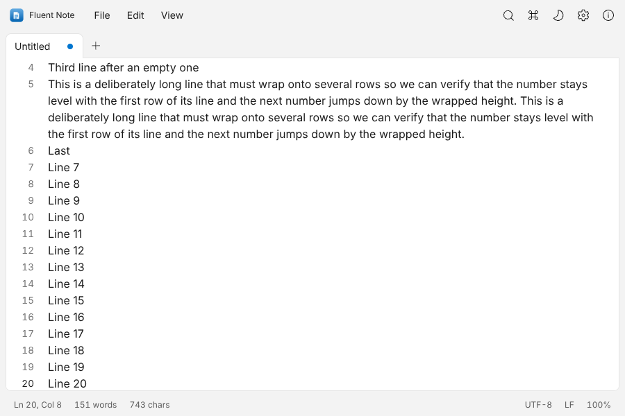
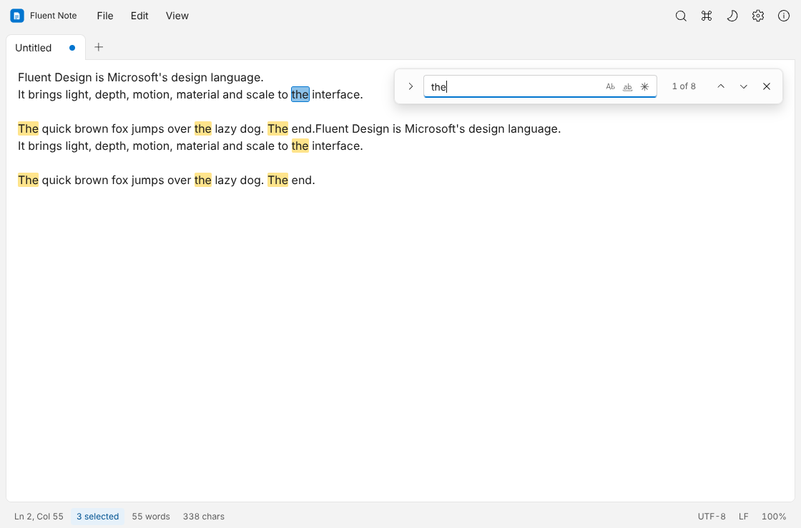
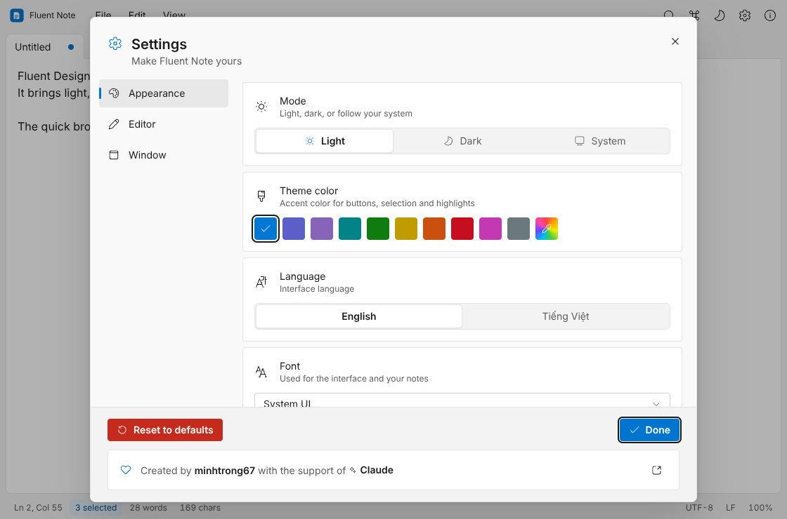
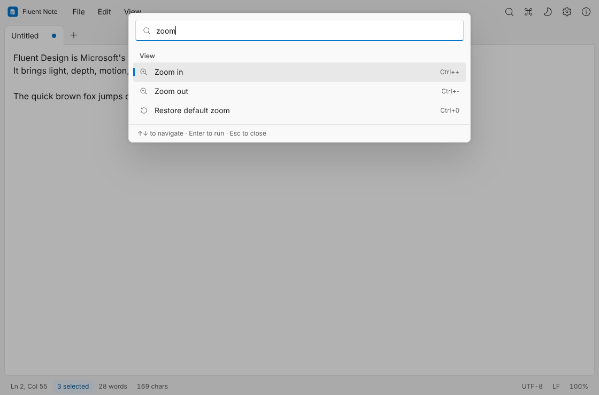

<div align="center">


# Fluent Note

**Ứng dụng ghi chú nhanh, nhiều tab, theo phong cách Microsoft Fluent Design.**
Nhiều thẻ · Tìm & thay thế · Bảng lệnh · Giao diện tuỳ chỉnh · Tiếng Anh & Tiếng Việt

[English](README.md)

</div>

---

## Giới thiệu

Fluent Note là ứng dụng ghi chú gọn nhẹ cho máy tính, xây dựng bằng **Tauri**, **React** và **TypeScript**. Mở lên là chạy, không vướng tay và mang giao diện Windows 11 (Microsoft Fluent 2): nền Mica gốc, nút bo 4 px, ô nhập có gạch nhấn dưới, menu acrylic, đổ bóng Fluent, chuyển động nhẹ nhàng và màu nhấn tuỳ chọn.

Dự án thuộc bộ sưu tập mã nguồn mở [my-tauri-apps](https://github.com/minhtrong67/my-tauri-apps).

## Ảnh màn hình

| | |
|---|---|
|  |  |
|  |  |

## Tính năng

- **Thẻ nhớ phiên làm việc** – kéo thả sắp xếp, nhấn chuột giữa để đóng, thẻ ngang hoặc dọc; tự khôi phục tệp đang mở, vị trí con trỏ, vị trí cuộn và cả nội dung chưa lưu.
- **Tìm & thay thế** – tô sáng trực tiếp, phân biệt hoa thường, cả từ, biểu thức chính quy, bộ đếm kết quả, thay tất cả.
- **Bảng lệnh** – `Ctrl+Shift+P` chạy mọi thao tác theo tên.
- **Bảng mã & lưu an toàn** – UTF-8 (có/không BOM), UTF-16, Windows-125x, Shift-JIS, GBK…; đổi kiểu xuống dòng LF/CRLF; lưu nguyên tử; cảnh báo khi tệp bị đổi trên ổ đĩa.
- **Tiện ích soạn thảo** – đi tới dòng, nhân đôi/xoá dòng, chữ hoa/thường, chèn giờ/ngày, thu phóng bằng `Ctrl+Cuộn`, tự xuống dòng, chế độ tập trung, toàn màn hình, in.
- **Tự động lưu** cho tệp đã có tên, tự khôi phục phiên làm việc và **thư mục lưu mặc định** tuỳ chỉnh.
- **Cài đặt** – sáng / tối / hệ thống, 10 màu nhấn kiểu Windows và bộ chọn màu tuỳ ý, 14 phông chữ (System UI, Google Sans Flex, Roboto Flex, Roboto, Arial, Inter, Be Vietnam Pro, Open Sans, Noto Sans, Source Sans 3, Lora, JetBrains Mono, Cascadia Code, Consolas), hiển thị số dòng, hiệu ứng cửa sổ (Mica / Acrylic / Mica Alt), cỡ chữ Nhỏ / Vừa / Lớn, tiếng Anh và tiếng Việt, cách cửa sổ mở (ghi nhớ kích thước hoặc luôn phóng to tối đa).
- **Cảm giác Windows 11** – thanh tiêu đề tích hợp với nút cửa sổ (hoặc thanh gốc), màu nhấn theo Windows, menu chuột phải kiểu Fluent trong vùng soạn thảo và trên tab, ghim tab, điều hướng menu bằng phím Alt, bấm hoặc kéo trên số dòng để chọn dòng.
- **Phiên làm việc an toàn hơn** – các tab đang mở và bản nháp chưa lưu được lưu thành tệp trong thư mục dữ liệu của app (không bị giới hạn dung lượng trình duyệt). Cài đặt có thể tìm kiếm, xuất và nhập.
- **Trải nghiệm trau chuốt** – tooltip và dropdown tự thiết kế, toast 4 loại (thông tin, thành công, cảnh báo, lỗi), nút hành động luôn có icon + nhãn + màu, nút lên đầu trang, kéo thả tệp, chỉ chạy một cửa sổ.

## Cài đặt

1. Tạo bộ cài (xem mục [Build](#build)) hoặc tải từ trang releases của bạn.
2. Chạy bộ cài (cài cho người dùng hiện tại, không cần quyền quản trị).
3. Mở **Fluent Note** từ Start, hoặc nhấn chuột phải vào tệp văn bản và chọn *Open with*.

> Yêu cầu Windows 10 / 11 (64-bit). Trên Windows 11 cửa sổ dùng chất liệu **Mica** gốc; Windows 10 tự chuyển sang nền đặc kiểu Fluent.

## Công nghệ

Tauri 2 (Rust) · React 18 · TypeScript · Vite · Tailwind CSS 4 · Zustand · Fluent System Icons · phông Google Sans Flex, Roboto Flex, Roboto, Inter, Be Vietnam Pro, Open Sans, Noto Sans, Source Sans 3, Lora, JetBrains Mono (kèm sẵn, dùng offline).

## Phát triển

```bash
pnpm install     # cài thư viện
pnpm dev     # chạy ứng dụng desktop (hot reload)
```

Thêm: `pnpm web:dev` (chỉ giao diện trên trình duyệt), `pnpm icons` (tạo lại toàn bộ icon).

## Build

```bash
pnpm build
```

Bộ cài nằm ở `target/release/bundle/`.

## Cấu trúc dự án

Xem sơ đồ trong [README.md](README.md#project-structure).

## Giấy phép

Mã nguồn mở theo [giấy phép MIT](LICENSE).

Tạo bởi **minhtrong67** với sự hỗ trợ của **Claude** · <https://github.com/minhtrong67/my-tauri-apps>
