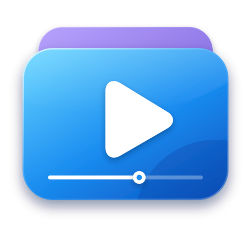

<div align="center">



# Fluent Video

**Trình phát video đầy đủ tính năng cho Windows, giao diện Microsoft Fluent Design với chất liệu cửa sổ Mica / Acrylic.**


[English](README.md) · Tiếng Việt

</div>

---

## Mục lục

1. [Giới thiệu](#giới-thiệu)
2. [Ảnh chụp màn hình](#ảnh-chụp-màn-hình)
3. [Tính năng](#tính-năng)
4. [Tải về](#tải-về)
5. [Cài đặt](#cài-đặt)
6. [Công nghệ](#công-nghệ)
7. [Phát triển](#phát-triển)
8. [Build](#build)
9. [Cấu trúc dự án](#cấu-trúc-dự-án)
10. [Giấy phép](#giấy-phép)

---

## Giới thiệu

**Fluent Video** là trình phát video cho Windows, xây dựng bằng [Tauri](https://tauri.app), React và Rust. Lõi native nhẹ (vài MB, ít tốn bộ nhớ) kết hợp giao diện đúng chất Windows 11:

- **Microsoft Fluent Design** – thanh điều hướng NavigationView, các lớp bề mặt, điều khiển bo 4 px và flyout bo 8 px, bảng cỡ chữ WinUI, bộ icon Fluent System Icons, nút cửa sổ kiểu Windows 11 và chuyển động kiểu decelerate.
- **Chất liệu cửa sổ** – chọn **Mica** (mặc định), **Acrylic** hoặc **Mica Alt** trong *Cài đặt → Giao diện*; nền tự đổi tông theo chế độ sáng / tối.
- **Màu nhấn** – 18 màu nhấn của Windows hoặc màu tùy chọn, ở chế độ **sáng**, **tối** hoặc **theo hệ thống**.
- Giao diện **tiếng Anh và tiếng Việt**, đổi bất cứ lúc nào.
- **Segoe UI Variable mặc định**, kèm bộ chọn phông chữ (Inter, Roboto, Open Sans, Noto Sans, Nunito, Montserrat, Source Sans 3, Be Vietnam Pro và các phông Windows phổ biến).
- **Thư viện cá nhân** tự quét thư mục *Videos* của Windows, nhớ chỗ bạn xem dở và tạo ảnh thu nhỏ.
- Đủ những gì một trình phát nghiêm túc cần: danh sách phát, phụ đề, đổi tốc độ, lặp A-B, chụp ảnh, trình phát mini và phím tắt.

> ✨ Thiết kế và phát triển bởi **minhtrong67** — với sự hỗ trợ của trợ lý AI **Claude** (Anthropic).

## Ảnh chụp màn hình

Đặt ảnh chụp vào thư mục `screenshots/` (`image01.png` … `image04.png`) rồi hiển thị ở đây:

| Thư viện | Trình phát |
|:---:|:---:|
|  |  |

| Danh sách phát | Cài đặt |
|:---:|:---:|
|  |  |

## Tính năng

### Fluent Design
- NavigationView với thanh bên thu gọn được (Trang chủ, Thư viện, Cài đặt) và lớp nội dung bo góc để chất liệu cửa sổ xuyên qua.
- Trang cài đặt dùng **SettingsCard** và **Expander**, công tắc ToggleSwitch, thanh chọn, ô chọn dạng radio và ô nhập có vạch nhấn khi focus.
- **Fluent System Icons** (viền cho trạng thái thường, tô đặc cho mục đang chọn), menu ngữ cảnh, hộp thoại và thông báo kiểu WinUI.
- Nút cửa sổ kiểu Windows 11 (thu nhỏ, phóng to / khôi phục, đóng màu đỏ) và biểu tượng ứng dụng theo phong cách Fluent.
- Chuyển động theo đường cong decelerate của Fluent (167 – 333 ms); tự giảm khi Windows tắt hiệu ứng động.

### Chất liệu cửa sổ (hiệu ứng trong suốt)
- **Mica** (mặc định) – chất liệu tinh tế, ánh màu từ hình nền.
- **Acrylic** – kính mờ trong suốt.
- **Mica Alt** – Mica đậm hơn, các lớp tương phản rõ hơn.
- Áp dụng ngay, được nhớ giữa các lần mở và đổi tông khi bạn chuyển sáng / tối. Mica và Mica Alt cần Windows 11; trên hệ cũ hơn ứng dụng tự chuyển (Mica Alt → Mica → Acrylic → màu đặc) và báo trong phần Cài đặt.

### Thư viện
- **Tự quét thư mục Videos của Windows** khi mở, gồm cả thư mục con như *Captures* và *Screen Recordings*.
- **Làm mới** (đầu trang Home, tab Thư viện hoặc `F5`): thêm tệp mới, cập nhật tệp đổi, bỏ tệp đã xóa. Nhập lại một tệp không tạo bản trùng.
- An toàn: ổ đĩa hoặc thư mục tạm thời ngoại tuyến thì video vẫn được giữ lại.
- Thêm thư mục thư viện trong *Cài đặt → Thư viện*; tìm kiếm, sắp xếp theo ngày / tên / dung lượng, dạng **danh sách / lưới**.
- Ảnh thu nhỏ tạo lười cho video đang hiện, lưu cache trên đĩa, có hiệu ứng shimmer khi đang tải.

### Phát video
- Mở tệp hoặc thư mục, kéo thả, hoặc **Open with** từ Explorer; mở lần hai dùng lại cửa sổ đang chạy.
- Danh sách phát kéo thả đổi thứ tự, trộn, lặp (tắt / tất cả / một); mở một tệp sẽ thêm các video cùng thư mục (tùy chọn).
- **Xem tiếp từ vị trí cũ** với mục *Tiếp tục xem*, tốc độ **0,25× – 4×**, qua từng khung hình, **lặp A-B**, dấu trang.
- Thanh tua có **ảnh xem trước khi rê chuột** và vùng đã đệm, cuộn chuột chỉnh âm lượng, **tăng âm tới 200 %**, **chế độ ban đêm**, nhấp đúp trái / phải để tua và ở giữa để toàn màn hình.
- Hẹn giờ tắt (15 – 120 phút hoặc sau video hiện tại).

### Bảng danh sách phát & menu ngữ cảnh
- Bảng bên có **ô tìm kiếm**, nút chuyển **danh sách / lưới**, kéo thả đổi thứ tự, menu cho từng mục và luôn giữ video đang phát trong tầm nhìn.
- **Chuột phải lên video**: phát / tạm dừng, tua, tốc độ, danh sách phát, phụ đề, âm thanh, hình ảnh, lặp A-B, chụp ảnh, toàn màn hình, trình phát mini, luôn ở trên cùng, thao tác tệp.

### Hình ảnh
- Vừa khung / lấp đầy / kéo giãn, phóng to tới 400 % và kéo để di chuyển, xoay 90°, lật, độ sáng / tương phản / bão hòa / sắc độ.
- **Chụp ảnh** khung hình hiện tại, lưu PNG vào `Pictures\Fluent Video`.

### Phụ đề
- Tự tìm `.srt`, `.vtt`, `.ass`, `.ssa` cạnh video (hoặc trong thư mục `Subs` / `Subtitles`), ưu tiên ngôn ngữ giao diện; nạp tệp bất kỳ hoặc kéo thả vào cửa sổ.
- Tự nhận diện bảng mã (BOM, UTF-8, Windows-1258, Windows-1252); chỉnh độ trễ (`G` / `H`), cỡ chữ, màu, nền, độ mờ và vị trí.

### Tích hợp Windows
- **Cửa sổ khi mở ứng dụng** (*Cài đặt → Cửa sổ*): **Nhớ kích thước** hoặc **Luôn mở phóng to**.
- Thanh tiêu đề Fluent không viền, toàn màn hình, **trình phát mini** luôn ở trên cùng, phím media và lớp phủ media của hệ thống, liên kết tệp (do bộ cài thiết lập).

### Hiệu năng
- Cửa sổ chỉ hiện sau khi khung hình đầu tiên **và** chất liệu cửa sổ đã sẵn sàng (không nháy trắng hay trong suốt); chủ đề gần nhất được áp dụng trước khi vẽ khung đầu.
- **Tua nhanh với video lớn** – tệp được stream từ đĩa qua máy chủ range nội bộ; thanh tua và đồng hồ cập nhật không qua re-render của React; ảnh xem trước chỉ tải khi rê chuột.
- Ảnh thu nhỏ tạo lười, ghi đĩa nhỏ và có trì hoãn, màn hình lỗi dựng sẵn với nút *Tải lại*.

### Định dạng hỗ trợ

Việc phát dùng nền tảng media của **Microsoft Edge WebView2**, nên phụ thuộc vào codec có trên máy.

| Container | Codec thường gặp | Ghi chú |
|---|---|---|
| MP4 / M4V / MOV | H.264 + AAC | Chạy ở mọi nơi |
| WebM | VP8 / VP9 / AV1 + Vorbis / Opus | AV1 có thể cần *AV1 Video Extension* |
| MKV | H.264 / VP9 + AAC / Opus / MP3 | Chạy khi codec bên trong được hỗ trợ |
| HEVC / H.265 | – | Cần *HEVC Video Extensions* từ Microsoft Store |
| AVI, WMV, FLV, MPG | – | Thường không hỗ trợ – trình phát đề xuất **Mở bằng ứng dụng mặc định** |

### Phím tắt

| Phím | Chức năng | Phím | Chức năng |
|---|---|---|---|
| `Space` / `K` | Phát / tạm dừng | `M` | Tắt tiếng |
| `←` / `→` | Tua (5 / 10 / 15 giây) | `F` / `F11` | Toàn màn hình |
| `J` / `L` | Tua 10 giây | `[` / `]` | Chậm hơn / nhanh hơn |
| `↑` / `↓` | Âm lượng | `,` / `.` | Khung hình trước / sau |
| `Shift+N` / `Shift+P` | Video tiếp / trước | `C` / `V` | Đổi / bật tắt phụ đề |
| `G` / `H` | Độ trễ phụ đề − / + | `A` | Lặp A-B |
| `S` | Chụp ảnh | `Q` | Danh sách phát |
| `R` | Xoay 90° | `T` | Trình phát mini |
| `0` – `9` | Nhảy tới 0 – 90 % | `I` | Thông tin video |
| `Ctrl+O` | Mở tệp (`Shift`: thư mục) | `Esc` | Thoát toàn màn hình / mini |
| `F5` | Làm mới thư viện | Chuột phải | Menu ngữ cảnh |

## Tải về

Tải bộ cài mới nhất ở trang **Releases** của repo (`Fluent Video_1.2.0_x64-setup.exe`). Mã nguồn không chứa sẵn bộ cài – tự build bằng `npm run build` (xem [Build](#build)).

| | |
|---|---|
| Hệ điều hành | Khuyên dùng Windows 11 (Mica / Mica Alt). Windows 10 1809+ chạy được với Acrylic hoặc màu đặc |
| Runtime | Microsoft Edge WebView2 (có sẵn trên Windows 11 và Windows 10 đã cập nhật) |

## Cài đặt

1. Chạy bộ cài. Bộ cài cài theo từng người dùng nên **không cần quyền quản trị**.
2. Nếu Windows SmartScreen hiện *"Windows protected your PC"* (bộ cài chưa ký số), bấm **More info → Run anyway**.
3. Mở **Fluent Video** từ Start menu; thư mục **Videos** được quét tự động. Thêm thư mục khác trong *Cài đặt → Thư viện*.

**Mở video từ Explorer** – chuột phải vào video → *Open with* → *Fluent Video*.
**Gỡ cài đặt** – *Settings → Apps → Installed apps → Fluent Video → Uninstall*. Cài đặt và lịch sử nằm ở `%APPDATA%\com.minhtrong67.fluent-video`, ảnh thu nhỏ ở `%LOCALAPPDATA%\com.minhtrong67.fluent-video`.

**Khắc phục sự cố**

| Vấn đề | Cách xử lý |
|---|---|
| *"Không phát được video này"* | Codec không được WebView2 hỗ trợ. Cài *HEVC Video Extensions* hoặc bấm **Mở bằng ứng dụng mặc định**. |
| Cửa sổ không trong suốt | Xem *Cài đặt → Giao diện → Chất liệu cửa sổ* để biết đang áp dụng gì. Mica cần Windows 11; Acrylic cần Windows 10 1809+. |
| Kéo cửa sổ bị giật khi dùng Acrylic | Acrylic nặng GPU trên một số driver – hãy chuyển sang Mica. |
| Biểu tượng cũ sau khi cài lại | Windows cache icon – khởi động lại Explorer. |

## Công nghệ

| Lớp | Công nghệ |
|---|---|
| Lõi desktop | [Tauri 2](https://tauri.app) (Rust) – single-instance, hộp thoại, asset protocol, liên kết tệp, [`window-vibrancy`](https://github.com/tauri-apps/window-vibrancy) cho Mica / Acrylic / Mica Alt |
| Giao diện | [React 18](https://react.dev) + [TypeScript 5](https://www.typescriptlang.org) |
| Công cụ build | [Vite 5](https://vitejs.dev) |
| Styling | [Tailwind CSS 3](https://tailwindcss.com) với design token Fluent Design (lớp, viền, màu nhấn, bảng cỡ chữ) |
| Design system | Microsoft Fluent Design – [Fluent System Icons](https://github.com/microsoft/fluentui-system-icons) (`@fluentui/react-icons`), Segoe UI Variable + phông [Fontsource](https://fontsource.org) đi kèm |
| State | [Zustand](https://zustand-demo.pmnd.rs) |
| Phát video | HTML5 `<video>` trên WebView2 + Web Audio API |
| Bộ cài | NSIS (qua Tauri bundler) |

## Phát triển

**Yêu cầu:** Windows 10 / 11 có WebView2, [Node.js](https://nodejs.org) 18+, [Rust](https://rustup.rs) (stable) cùng *Desktop development with C++*, và [điều kiện của Tauri](https://tauri.app/start/prerequisites/).

```bash
cd fluent-video
npm install
npm run dev
```

| Lệnh | Tác dụng |
|---|---|
| `npm run dev` | Chạy ứng dụng desktop (Tauri) với hot reload |
| `npm run build` | Build bộ cài Windows |
| `npm run vite:dev` | Chỉ chạy giao diện trên trình duyệt tại `http://localhost:1420` (không có tính năng Tauri; dùng màu đặc thay cho Mica) |
| `npm run fonts` | Tạo lại `src/fonts.css` sau khi đổi danh sách phông |
| `npx tsc --noEmit` | Kiểm tra kiểu phần giao diện |
| `cargo check` (trong `src-tauri`) | Kiểm tra kiểu phần Rust |

**Tùy biến**

| Nội dung | Vị trí |
|---|---|
| Màu nhấn / chất liệu cửa sổ mặc định | `defaultSettings` trong `src/lib/types.ts` |
| Token Fluent (lớp, viền, màu chữ) | `:root` / `:root.dark` trong `src/index.css` |
| Logic chất liệu cửa sổ | `set_backdrop` trong `src-tauri/src/lib.rs`, `applyBackdrop` trong `src/lib/window.ts` |
| Thêm ngôn ngữ | thêm từ điển trong `src/lib/i18n.ts` |
| Kích thước cửa sổ mặc định | `app.windows` trong `src-tauri/tauri.conf.json` |

**Dữ liệu người dùng:** `%APPDATA%\com.minhtrong67.fluent-video\state.json` (cài đặt, thư viện, lịch sử), `window.json` (kích thước cửa sổ), ảnh thu nhỏ ở `%LOCALAPPDATA%\com.minhtrong67.fluent-video\thumbs`.

## Build

```bash
npm install
npm run build
```

| Sản phẩm | Đường dẫn |
|---|---|
| Bộ cài | `src-tauri/target/release/bundle/nsis/Fluent Video_1.2.0_x64-setup.exe` |
| File chạy trực tiếp | `src-tauri/target/release/fluent-video.exe` |

Icon nằm ở `src-tauri/icons` (`icon.ico` cho ứng dụng và thanh tác vụ, `installer.ico` cho setup / uninstall, PNG 32 – 256 px).

## Cấu trúc dự án

```
fluent-video/
├─ index.html                 điểm vào ứng dụng (Vite)
├─ public/icon.png            logo dùng trong giao diện
├─ screenshots/               ảnh chụp dùng trong README
├─ src/
│  ├─ index.css               token Fluent, slider, ô nhập, thanh cuộn, chuyển động
│  ├─ components/             ui.tsx (nút, công tắc, menu, hộp thoại), NavView, TitleBar, Player, Controls, SeekBar, QueuePanel
│  ├─ views/                  Home.tsx, Settings.tsx
│  └─ lib/                    theme.ts (màu nhấn + phông), window.ts (chất liệu cửa sổ), store.ts, i18n.ts, engine.ts
└─ src-tauri/                 backend Rust, tauri.conf.json, capabilities, icons
```

## Giấy phép

[MIT](LICENSE) © minhtrong67. Thiết kế và phát triển bởi **minhtrong67** với sự hỗ trợ của trợ lý AI **Claude** (Anthropic).
