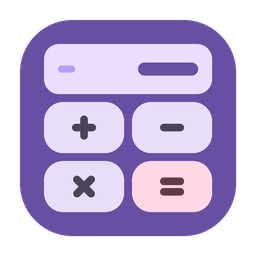
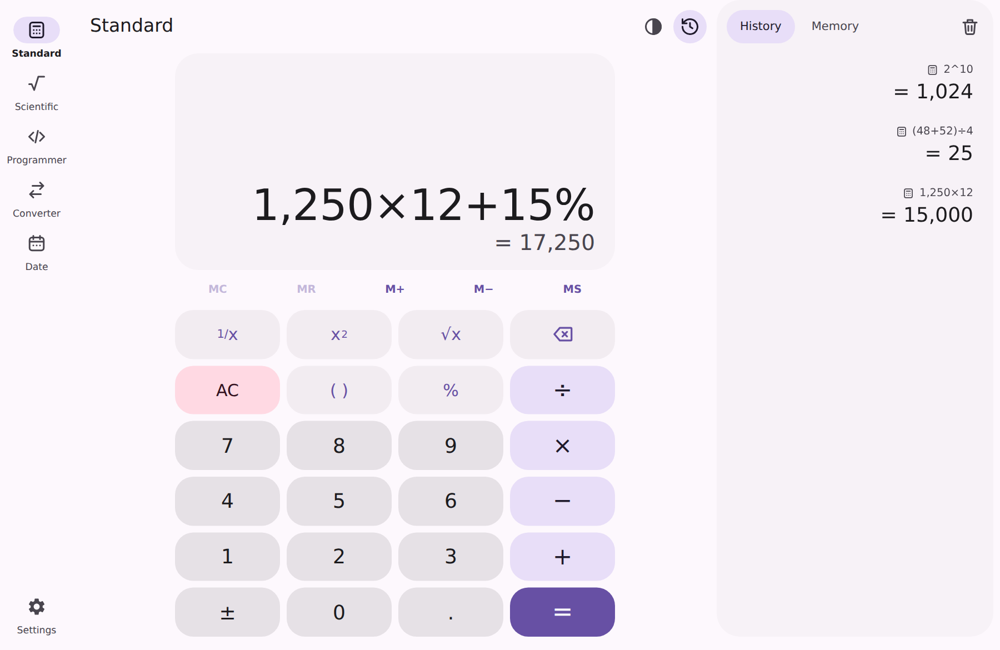
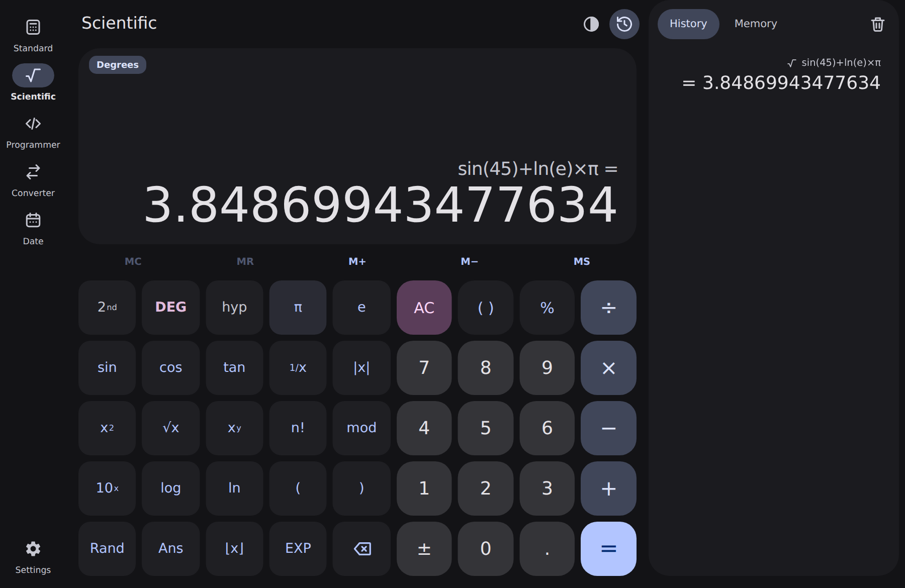
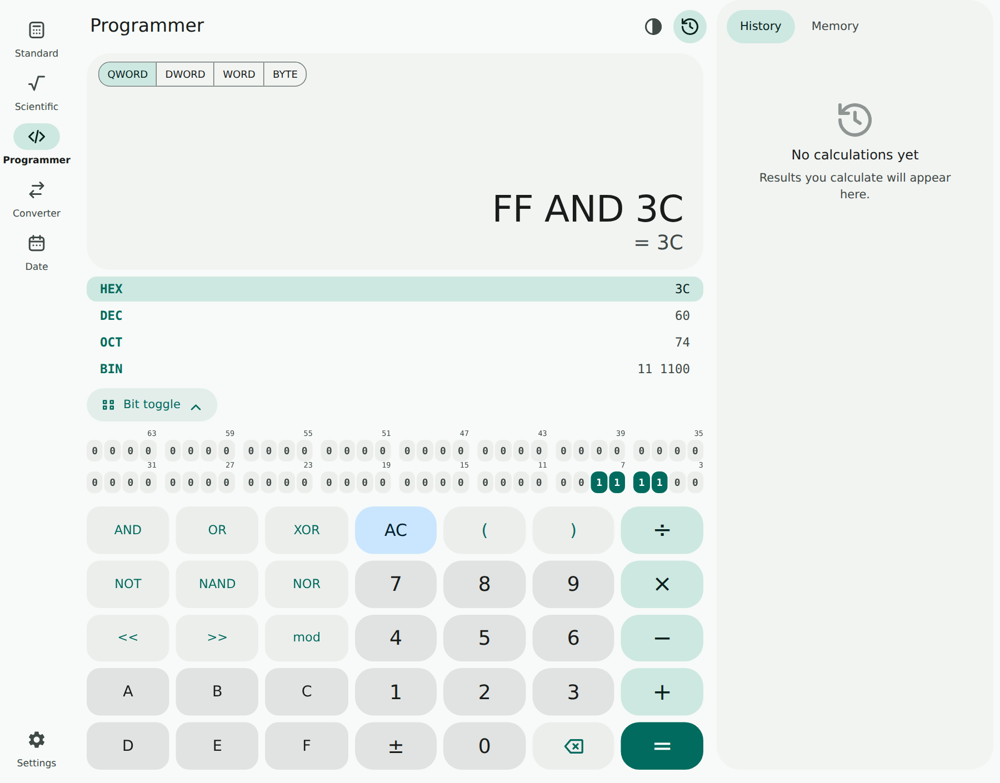
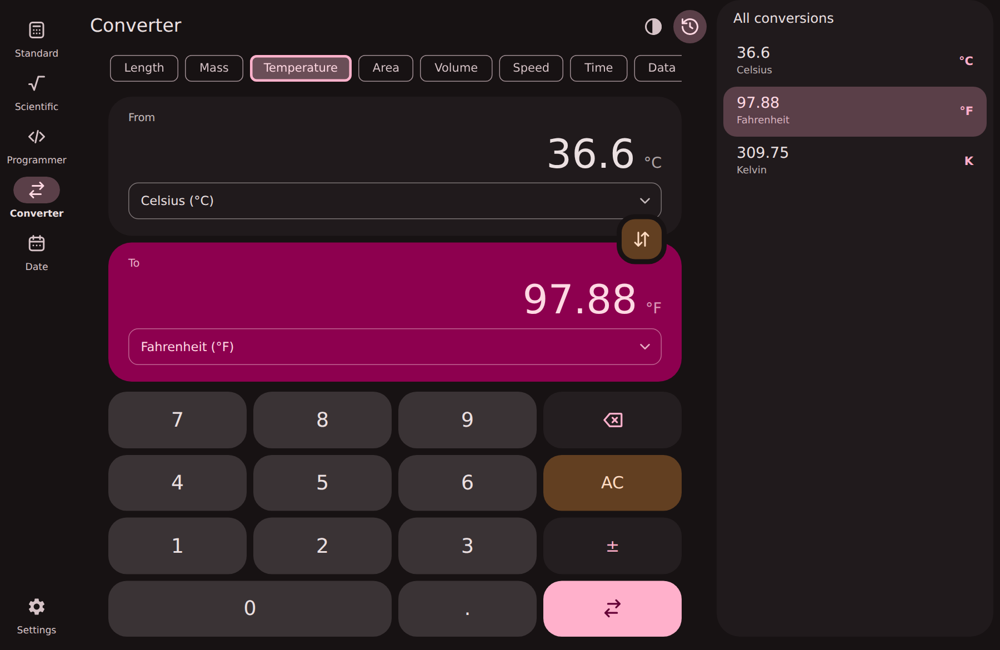
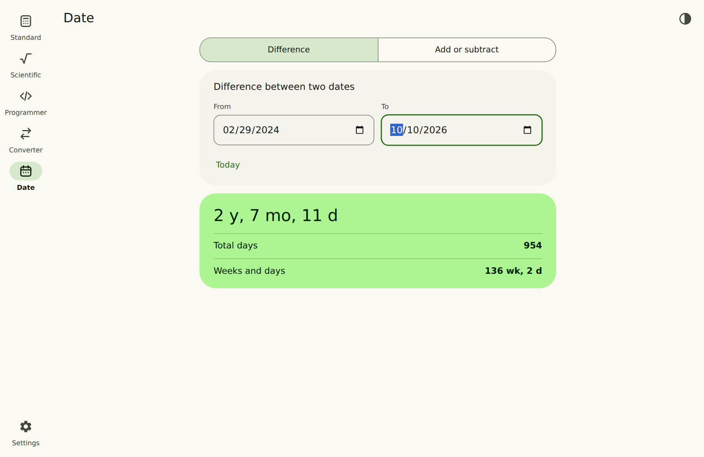
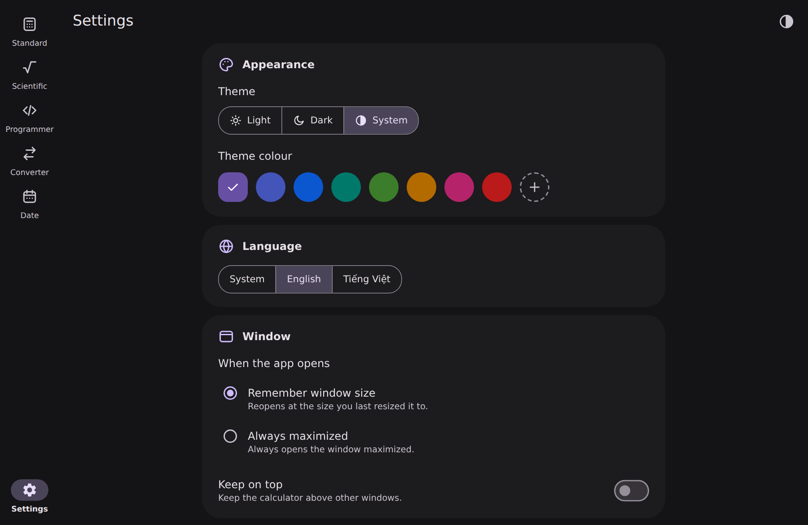

<div align="center">



# Material Calculator

**A fast, full-featured desktop calculator in Material Design 3.**
Standard · Scientific · Programmer · Unit converter · Date calculator


Made by **`minhtrong67`** with the help of **`Claude`** (AI by Anthropic)

</div>

---

## Introduction

Material Calculator is a lightweight desktop app built with [Tauri 2](https://tauri.app). It follows
Material Design 3 closely: dynamic colour generated from any seed colour, tonal surfaces, state layers,
ripples, shape morphing and a navigation rail that adapts to a bottom bar on narrow windows.

The expression engine is written from scratch (tokenizer, recursive-descent parser, evaluator) and never uses
`eval`. The programmer mode uses `BigInt`, so 64-bit arithmetic is exact.

## Screenshots

| | |
| :---: | :---: |
|  |  |
| Standard with history panel | Scientific, dark theme |
|  |  |
| Programmer with bit toggling | Unit converter |
|  |  |
| Date calculator | Settings |

## Features

**Calculators**
- **Standard**: live result preview while typing, smart `( )` key, `%` that understands `100 + 10%`, `1/x`, `x²`, `√x`, `±`.
- **Scientific**: trigonometric and hyperbolic functions with inverses (`2nd` / `hyp`), `log`, `ln`, `log₂`, `10ˣ`, `eˣ`,
  `x³`, `∛x`, `xʸ`, `n!` (including non-integers), `mod`, `|x|`, `⌊x⌋` / `⌈x⌉`, `π`, `e`, `Rand`, `Ans`, `EXP`,
  and DEG / RAD / GRAD angle units.
- **Programmer**: HEX / DEC / OCT / BIN shown at the same time, QWORD / DWORD / WORD / BYTE word sizes,
  `AND OR XOR NOT NAND NOR << >> mod`, parentheses with correct precedence and a clickable bit grid.
- **Converter**: 12 categories (length, mass, temperature, area, volume, speed, time, data, energy, power, pressure,
  angle) with an "all conversions" side list.
- **Date**: difference between two dates (years / months / days / total days / weeks) and add or subtract time.

**Productivity**
- Searchable-style history (click to reload, use result, copy, delete) saved between sessions.
- Memory stack with `MC MR M+ M− MS` and a memory list.
- Full keyboard support, copy with `Ctrl+C`, smart paste with `Ctrl+V` (understands `1.234,56` and `1,234.56`).
- Keep-on-top (pin) option.

**Look and feel**
- Light, dark and system theme, with a native title bar that follows the theme.
- Theme colour: 8 presets plus a custom colour picker (Material dynamic colour).
- Animations: ripple, key shape morphing, animated navigation indicator, view transitions, result pop,
  error shake. Can be set to Auto (follows system reduced-motion), On or Off.
- System UI font (`system-ui`).

**Window**
- Choose how the window opens: **remember the size you last resized it to**, or **always open maximized**.

**Languages**: English and Tiếng Việt (switch instantly, or follow the system language).

### Keyboard shortcuts

| Key | Action |
| --- | --- |
| `0-9` `.` `,` `+ - * / ^ ( ) % !` | Enter an expression |
| `Enter` / `=` | Calculate |
| `Backspace` / `Esc` | Delete / clear all |
| `Ctrl+C` / `Ctrl+V` | Copy result / paste |
| `Ctrl+1` … `Ctrl+5` | Switch calculator |
| `Ctrl+H` | Toggle history panel |
| `Ctrl+,` | Open or close settings |

## Installation

Download the installer for your platform from the **Releases** page, or build it yourself (see [Build](#build)).

- **Windows**: run the `Material Calculator_x.y.z_x64-setup.exe` installer (English and Vietnamese setup languages,
  branded setup and uninstall icons). Uses the system WebView2 runtime.
- **macOS**: open the `.dmg` and drag the app to Applications.
- **Linux**: install the `.deb` / `.rpm`, or run the `.AppImage`.

## Tech stack

| Layer | Technology |
| --- | --- |
| Shell | [Tauri 2](https://tauri.app) (Rust) |
| UI | Vanilla JavaScript (ES modules), CSS custom properties, no UI framework |
| Bundler | [Vite](https://vitejs.dev) |
| Colour | [`@material/material-color-utilities`](https://github.com/material-foundation/material-color-utilities) |
| Window API | [`@tauri-apps/api`](https://www.npmjs.com/package/@tauri-apps/api) |

## Development

### Prerequisites

- [Node.js](https://nodejs.org) 18 or newer
- [Rust](https://www.rust-lang.org/tools/install) (stable) and the [Tauri prerequisites](https://v2.tauri.app/start/prerequisites/)
  for your OS (on Windows: Microsoft C++ Build Tools and WebView2)

### Workspace

This project is meant to live inside a Cargo workspace whose root `Cargo.toml` contains
`members = ["*/src-tauri"]`, so every Tauri project in the folder shares one build cache (`./target`):

```text
your-workspace/
├── Cargo.toml            <- workspace root
├── target/               <- shared build cache
└── material-calculator/  <- this project
```

### Run

```bash
npm install
npm run dev
```

`npm run dev` starts Vite and opens the Tauri window with hot reload. To preview only the UI in a browser use
`npm run dev:web` (window features such as remembered size are disabled there).

## Build

```bash
npm run build
```

Installers are written to `target/release/bundle/` inside the workspace (for example `nsis/` on Windows,
`dmg/` on macOS, `deb/`, `rpm/` and `appimage/` on Linux). The release profile is tuned for size
(`opt-level = "s"`, LTO, stripped symbols).

### Regenerating icons

Artwork is generated by a script so every size stays crisp:

```bash
pip install pillow
python tools/make_icons.py                                     # app / setup / uninstall artwork + installer bitmaps
npx tauri icon src-tauri/icons-src/app-icon.png -o src-tauri/icons   # all platform icon sizes
```

## Project structure

```text
material-calculator/
├── index.html
├── package.json
├── vite.config.js
├── public/                  # favicon / in-app logo
├── screenshots/             # image01.png ... image06.png
├── tools/
│   └── make_icons.py        # icon + installer artwork generator
├── src/
│   ├── main.js              # app shell: navigation, panel, keyboard, boot
│   ├── styles/              # tokens, base, shell, calc, views (Material 3)
│   └── js/
│       ├── engine.js        # tokenizer, parser, evaluator
│       ├── calc.js          # standard / scientific state machine
│       ├── programmer.js    # BigInt programmer engine
│       ├── units.js         # converter data
│       ├── theme.js         # Material dynamic colour
│       ├── i18n.js          # English + Vietnamese
│       ├── tauri.js         # window size / maximize / always-on-top
│       ├── store.js, history.js, panel.js, ui.js, icons.js
│       └── views/           # calculator, programmer, converter, date, settings
└── src-tauri/
    ├── Cargo.toml
    ├── tauri.conf.json
    ├── capabilities/default.json
    ├── src/                 # main.rs, lib.rs
    ├── icons/               # app icons (png, ico, icns)
    ├── icons-src/           # source artwork (app, setup, uninstall)
    └── installer/           # setup.ico, uninstall.ico, sidebar.bmp, header.bmp
```

## License

Released under the [MIT License](LICENSE).

<div align="center">

Crafted by **minhtrong67** · with the help of **Claude**

</div>
