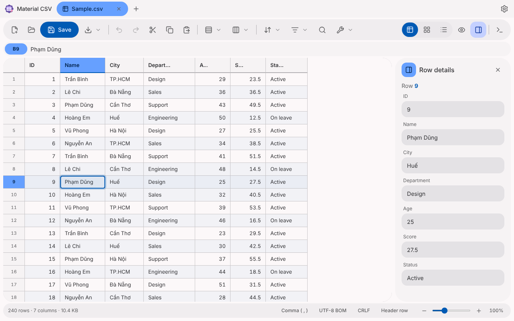
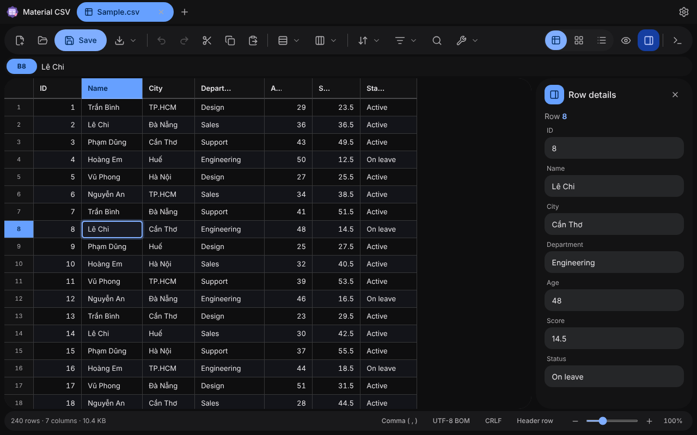
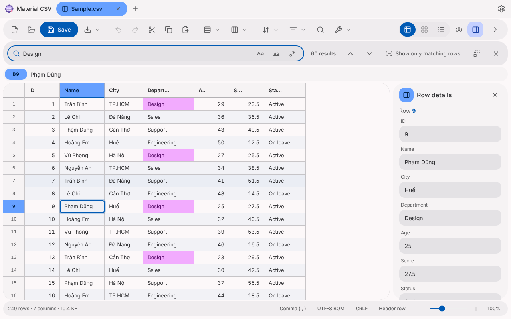
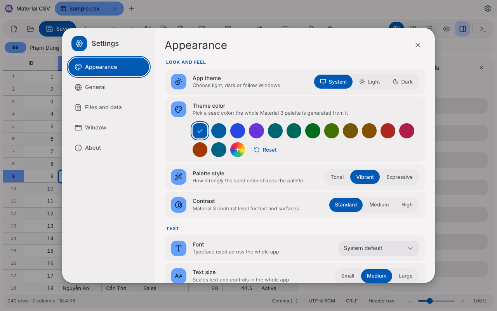

<div align="center">


# Material CSV

**A fast, free desktop editor for CSV, TSV and Excel files, with a Material 3 Expressive interface.**

[](LICENSE)
[](https://tauri.app)
[](https://react.dev)
[](https://www.typescriptlang.org)
[](https://tailwindcss.com)

</div>

## Introduction

Material CSV opens your delimited and spreadsheet files in a smooth, spreadsheet-style grid. Edit cells, find and replace with regular expressions, filter, sort, undo and redo, then export to the format you need. The interface follows Material 3 Expressive: dynamic color from any seed, shape morphing, spring motion and large, friendly controls. It runs natively on Windows through Tauri, so the installer is small and startup is fast.

## Screenshots

| Table view | Dark theme |
| :---: | :---: |
|  |  |
| **Find & replace** | **Settings** |
|  |  |

## Features

- **Spreadsheet-style grid**: virtualized rendering for large files, tabs, frozen first column, drag selection, column resize, row details panel and a formula bar.
- **Open and save**: CSV, TSV, TXT, XLSX, XLS and ODS; encoding detection (UTF-8, UTF-16, Windows-1252 and more), BOM and line-ending control.
- **Editing tools**: undo and redo, copy, cut and paste, insert, delete and move rows and columns, remove duplicates and empty rows, conditional highlights.
- **Find and replace**: case, whole-word and regular-expression modes, match navigation and a "show only matching rows" filter.
- **Filter and sort**: per-column filters, view-only sorting or sorting applied to the data.
- **Export**: CSV, TSV, JSON, Excel, Markdown and HTML.
- **Draft recovery**: unsaved work is restored after a crash or an unexpected close.
- **Material 3 Expressive theming**: light, dark or system mode, 12 seed colors plus a custom color picker, Tonal, Vibrant and Expressive palettes, and three contrast levels.
- **Personalization**: 7 fonts (System, Google Sans Flex, Roboto Flex, Roboto, Arial, Inter, Be Vietnam Pro), three text sizes, English and Vietnamese, and a window option to remember the last size or always start maximized.
- **Polished details**: custom tooltips, custom dropdowns, light and dark toasts (info, success, error, warning), scroll-to-top buttons and reduced-motion support.

## Installation

### Windows installer

1. Download `Material CSV_3.0.0_x64-setup.exe` from the [`download`](download) folder or the landing page.
2. Run the installer. It installs for the current user and does not need administrator rights.
3. Open a `.csv` or `.tsv` file with Material CSV, or launch it from the Start menu.

### Build from source

See [Development](#development) and [Build](#build).

## Tech stack

| Layer | Technology |
| --- | --- |
| Desktop shell | [Tauri 2](https://tauri.app) (Rust) |
| UI | [React 19](https://react.dev) + [TypeScript](https://www.typescriptlang.org) |
| Bundler | [Vite 7](https://vite.dev) |
| Styling | [Tailwind CSS 4](https://tailwindcss.com) with Material 3 color roles as CSS variables |
| Color | [`@material/material-color-utilities`](https://github.com/material-foundation/material-color-utilities) |
| Icons | [Lucide](https://lucide.dev) |
| Fonts | [Fontsource](https://fontsource.org) (Google Sans Flex, Roboto Flex, Roboto, Inter, Be Vietnam Pro) |

## Development

Prerequisites: [Node.js](https://nodejs.org) 20+, the [Rust toolchain](https://rustup.rs) and the [Tauri prerequisites](https://tauri.app/start/prerequisites/) for your platform (WebView2 and the MSVC build tools on Windows).

This project is a member of a Cargo workspace (`members = ["*/src-tauri"]`), so keep it in the workspace root next to the shared `Cargo.toml`.

```bash
npm install     # install dependencies
npm run dev     # start the desktop app in development mode (hot reload)
```

Useful extras:

```bash
npm run web:dev       # run only the web UI in a browser (http://127.0.0.1:1420)
npm run web:build     # type-check and build the web UI into ./dist
```

## Build

```bash
npm run build
```

The NSIS installer is written to `target/release/bundle/nsis/` in the workspace. Copy it to `download/` so the landing page download button works.

## Project structure

```text
material-csv/
├─ index.html            # landing page (single file, no build step)
├─ app/                  # desktop app UI (Vite root)
│  ├─ index.html
│  └─ src/
│     ├─ components/     # Titlebar, CommandBar, Grid, Settings, Dialogs, UI kit
│     ├─ lib/            # store, ops, io, find, theme, i18n, commands
│     ├─ index.css       # Material 3 tokens and component styles
│     └─ main.tsx
├─ src-tauri/            # Rust backend, config, capabilities and icons
├─ public/               # static assets (favicon, vendor/xlsx parser)
├─ brand/                # logo sources and social image
├─ screenshots/          # image01.png ... image04.png
├─ download/             # put the Windows installer here
├─ package.json
└─ vite.config.ts
```

## License

Material CSV is open source and released under the [MIT License](LICENSE). The source lives at [github.com/minhtrong67/my-tauri-apps](https://github.com/minhtrong67/my-tauri-apps).

Created by **minhtrong67** with the help of AI, **Claude** (Anthropic).
