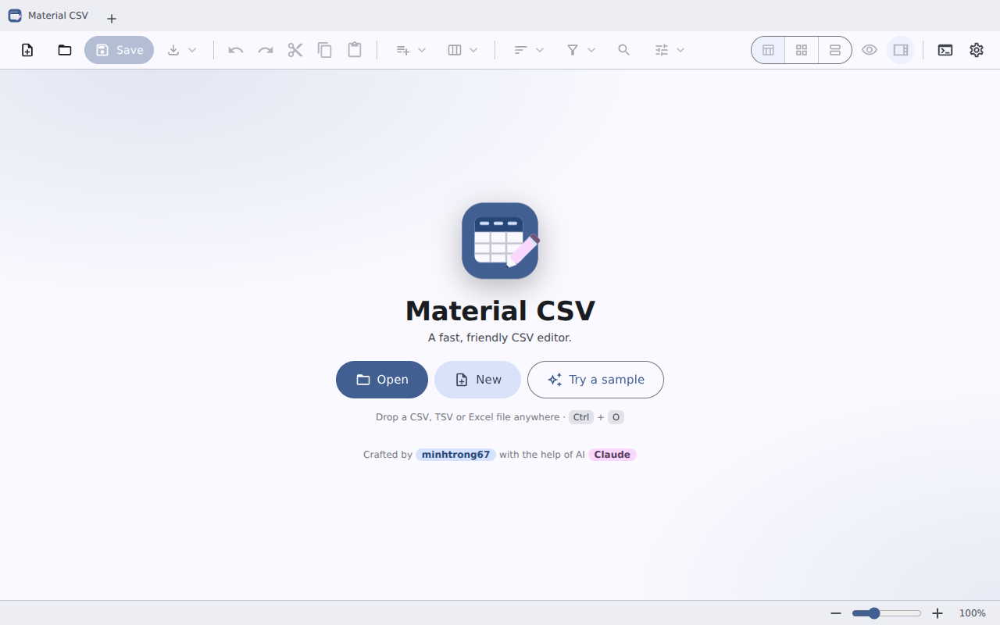
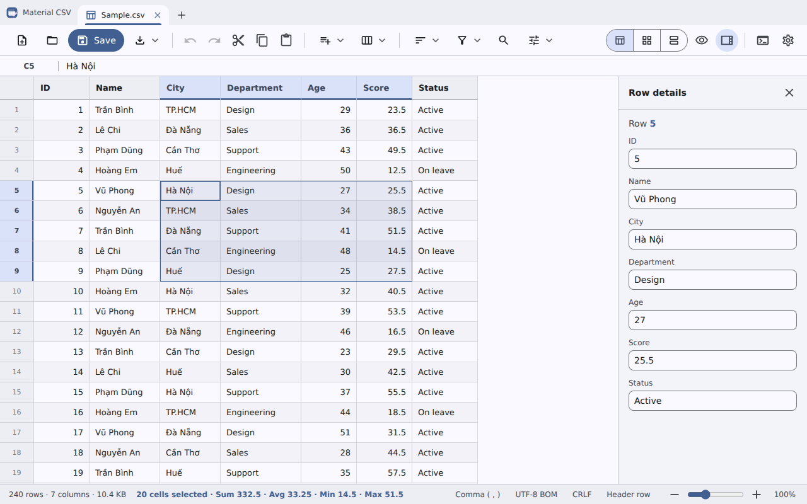
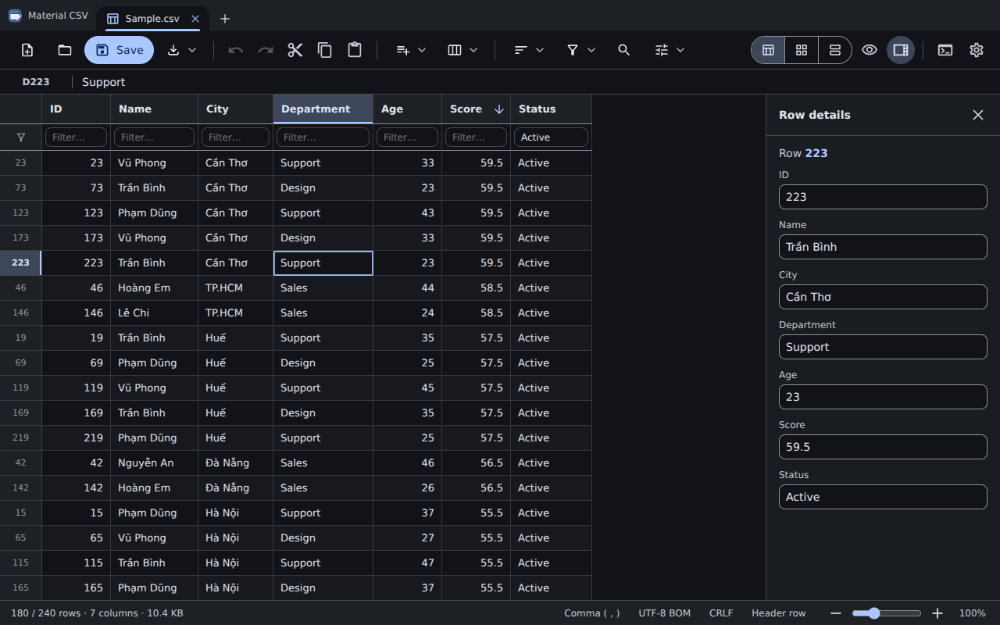
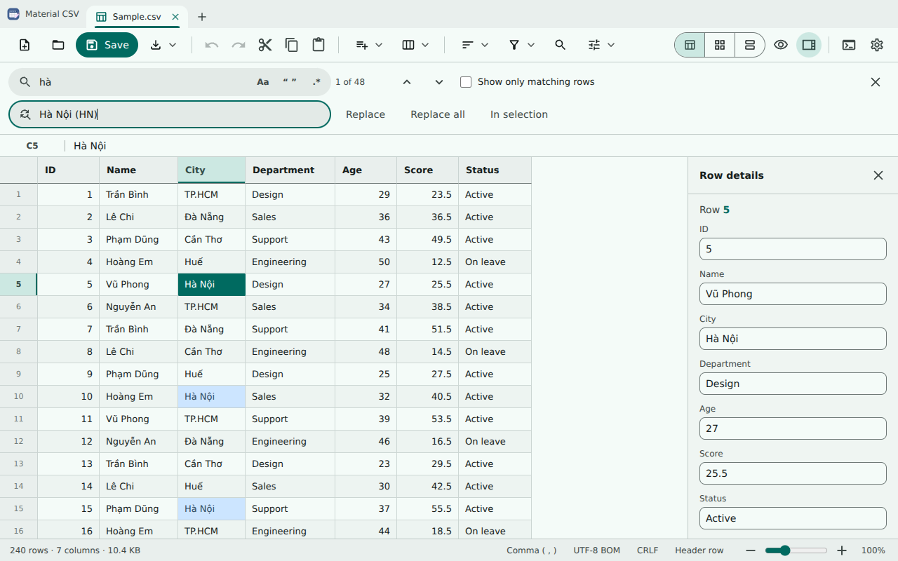
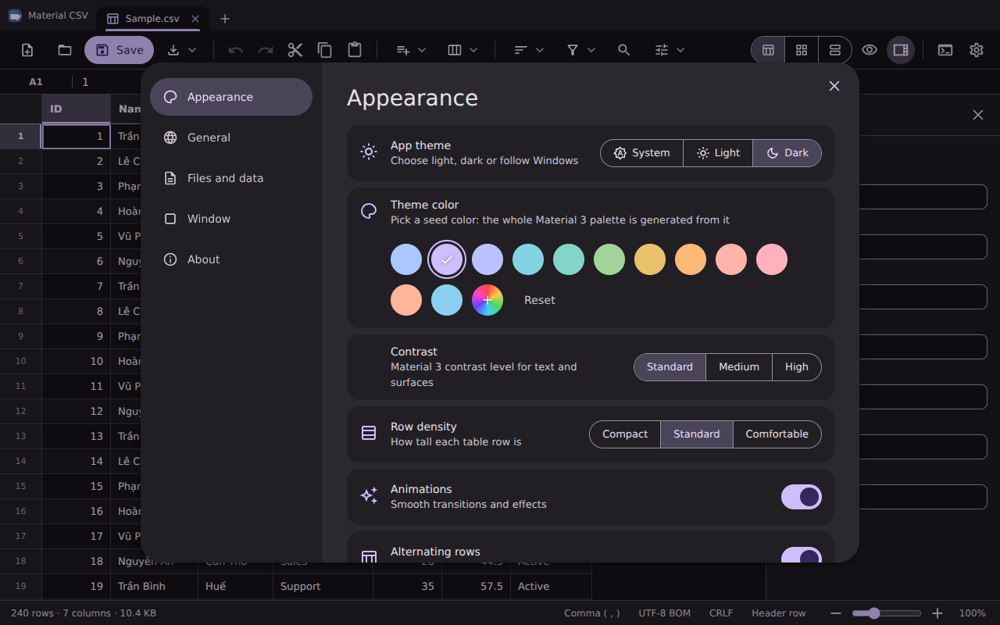
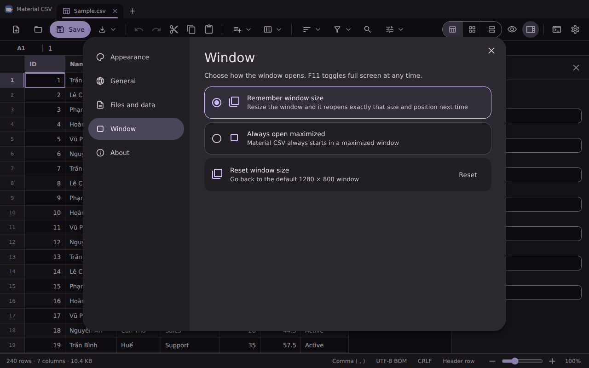
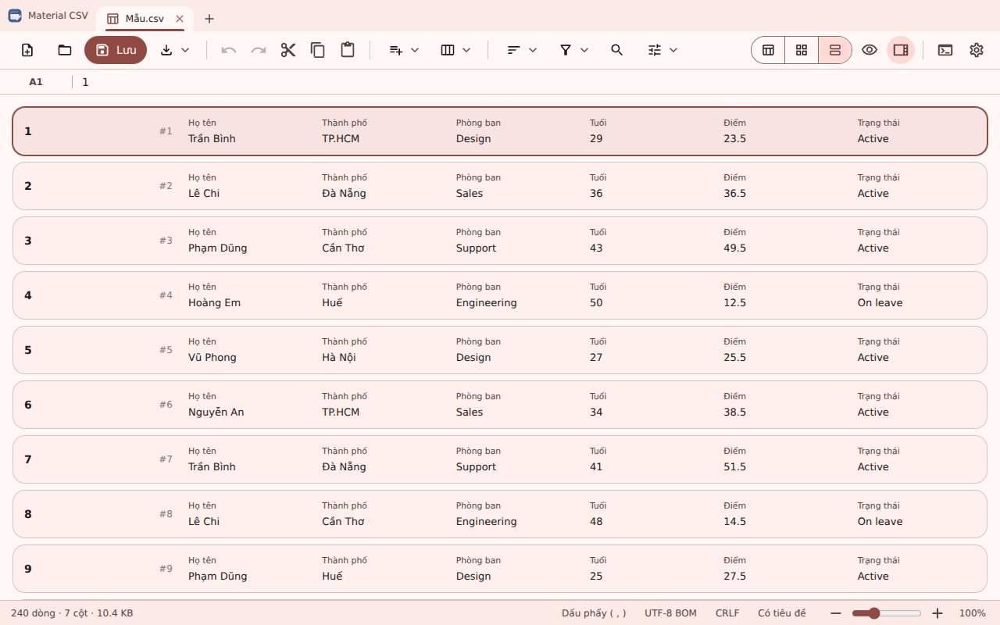

<div align="center">


# Material CSV

**A fast, full-featured CSV editor with a Material Design 3 interface.**

Edit cells like a spreadsheet, sort, filter, find and replace, undo everything, and export to CSV, TSV, JSON, Excel, Markdown or HTML.


Crafted by **[minhtrong67](https://github.com/minhtrong67)** with the help of AI: **Claude** (Anthropic)

</div>

---

## Introduction

Material CSV started as a CSV *viewer* and is now a complete CSV *editor*. It opens large files instantly (virtualised rendering, 300,000 rows open in under a second), lets you edit any cell, restructure rows and columns, clean data with one click and save back with the encoding, delimiter and line endings you choose. The interface follows **Material Design 3**: dynamic color generated from a seed color (the default palette is the project's Material Theme Builder export), tonal surfaces, state layers, ripples and Material motion, inside a tabbed title bar.

## Screenshots

| | |
|---|---|
|  |  |
|  |  |
|  |  |
|  | |

## Features

**Editing**
- Spreadsheet-style grid: click, drag, `Shift`+click selection, `F2` / double-click / just start typing to edit, `Enter` / `Tab` navigation, formula bar for long values
- Undo / redo for every action (200 steps), unsaved-change tracking per tab
- Cut, copy, paste (Excel-compatible TSV), fill down / right, clear cells
- Insert, delete, duplicate and move rows and columns; rename, hide and auto-fit columns; resize by dragging
- Editable **row details** side panel (form view of the selected row)

**Data tools**
- Find & replace with match case, whole cell, **regular expressions**, "in selection" and "show only matching rows"
- Quick filter row, advanced multi-condition filter, view sorting and permanent sorting
- Trim spaces, UPPER / lower / Title Case, remove duplicate rows, remove empty rows, header row toggle
- Column statistics (unique values, min / max / avg / sum, most frequent values) and live selection sum / average

**Files**
- Open CSV, TSV, TXT and Excel (`.xlsx`, `.xls`, `.ods`) files, drag & drop, multiple files in **tabs**, recent files
- Automatic delimiter, encoding (UTF-8, UTF-16, Windows-125x, GBK, Shift_JIS, ...) and line ending detection; change them from the status bar
- Save, Save as, export to **CSV, TSV, JSON, Excel, Markdown and HTML**
- Register as the default app for `.csv` / `.tsv` files; single instance (new files open as tabs)

**Experience**
- Light, dark or system theme, Material 3 **dynamic color** from 12 seed colors or any custom color, three contrast levels (standard / medium / high)
- English and Vietnamese (follows the system or choose manually)
- Command palette (`Ctrl`+`Shift`+`P`), context menus, full keyboard shortcuts (`F1`)
- Zoom (`Ctrl` + mouse wheel), three row densities, table / cards / list views
- Window option: **remember the window size and position** or **always open maximized** (`F11` toggles full screen)
- Animations and effects (ripples, state layers, shared-axis menus, theme cross-fade) that can be switched off

## Download

Grab the latest installer (`Material CSV_x.y.z_x64-setup.exe`) from the **Releases** page or from the [landing page](index.html) (it links to the `download/` folder), or [build it yourself](#build).

> **Landing page:** open `index.html` in the project root (single file, Material Design 3, responsive, English / Vietnamese). Put the installer in `download/` using the file name described in `download/README.md`.

## Installation

1. Download and run the setup `.exe` (installs for the current user, no administrator rights needed).
2. Launch **Material CSV** from the Start menu or double-click any `.csv` file.
3. Uninstall from *Settings → Apps* like any other app.

Requires Windows 10 / 11 with the Microsoft WebView2 runtime (preinstalled on Windows 11; the installer downloads it when missing).

## Tech stack

| Layer | Technology |
|---|---|
| Shell | [Tauri 2](https://tauri.app) (Rust) with `dialog`, `single-instance` and `window-state` plugins |
| UI | Vanilla HTML, CSS and ES modules, no framework, no bundler |
| Design | Material Design 3 (tokens, tonal surfaces, Material Symbols icons), system UI font (`system-ui`) |
| Color | `@material/material-color-utilities` (bundled to `src/vendor/material-color.js`) |
| File IO | Rust commands with `encoding_rs` for legacy encodings |
| Excel | SheetJS (mini build, loaded on demand) |

## Development

Prerequisites: [Node.js](https://nodejs.org) 18+, [Rust](https://rustup.rs) and the [Tauri prerequisites](https://tauri.app/start/prerequisites/) for Windows (WebView2 + MSVC build tools).

```bash
npm install
npm run dev
```

This project is a member of the shared Cargo workspace (`*/src-tauri`), so every Tauri app in the folder reuses one `target` cache.

## Build

```bash
npm run build
```

The installer is produced in `target/release/bundle/nsis/` (workspace root) and the portable executable in `target/release/`.

## Project structure

```
material-csv/
├─ index.html              landing page (single file) with the download button
├─ download/               put the setup .exe here (the landing page links to it)
├─ package.json            npm scripts: dev, build
├─ screenshots/             README images (image01.png ...)
├─ src/                    frontend (no build step)
│  ├─ index.html
│  ├─ css/                 tokens, layout, grid, components
│  ├─ js/
│  │  ├─ main.js           bootstrap, tabs, window chrome
│  │  ├─ state.js          documents, undo history, filters, view
│  │  ├─ grid.js           virtualised grid, selection, inline editing
│  │  ├─ ops.js            row / column / data operations
│  │  ├─ io.js             open, save, export, recent files
│  │  ├─ csv.js            parser, serializer, delimiter detection
│  │  ├─ find.js  panels.js  menus.js  dialogs.js  commands.js
│  │  └─ i18n.js  icons.js  theme.js  ui.js   (theme.js builds the Material 3 scheme)
│  ├─ assets/              logo (full and small-size variant)
│  └─ vendor/              SheetJS mini, Material color utilities
└─ src-tauri/
   ├─ src/lib.rs           commands: open_file, write_text, write_bytes, reveal
   ├─ tauri.conf.json      window, NSIS installer, file associations
   ├─ capabilities/        permissions
   └─ icons/               app icons, installer / uninstaller icon, installer images
```

## License

Released under the [MIT License](LICENSE).

---

<div align="center">Made with care by <b>minhtrong67</b> · built with AI assistance from <b>Claude</b></div>
