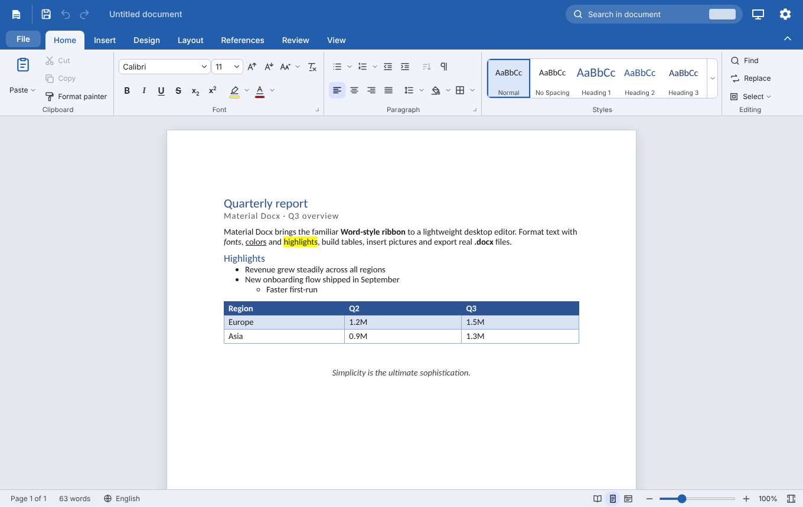
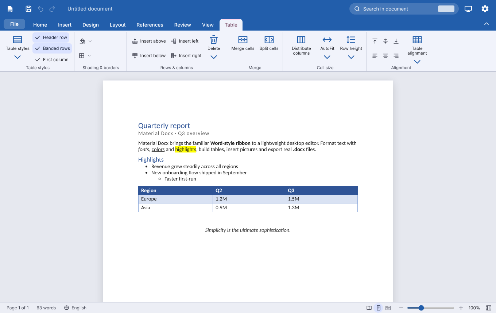
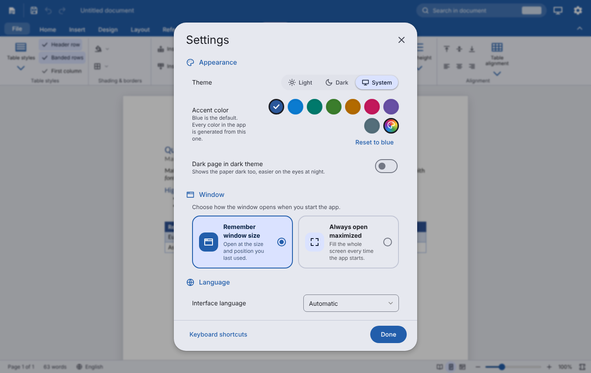
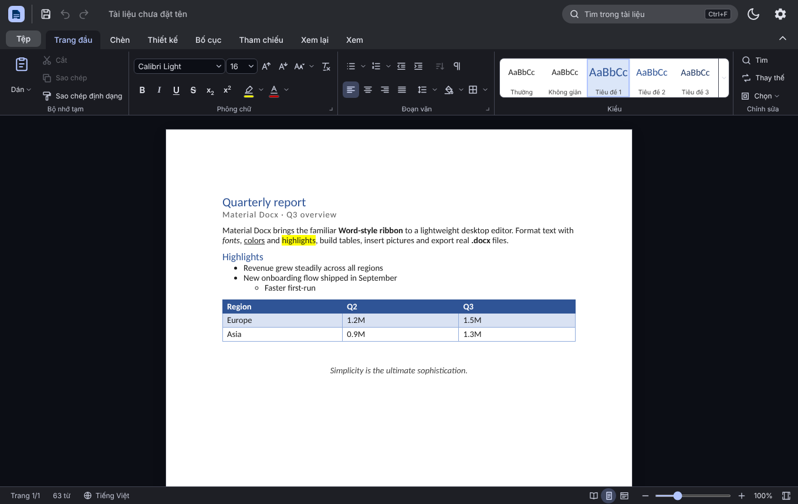
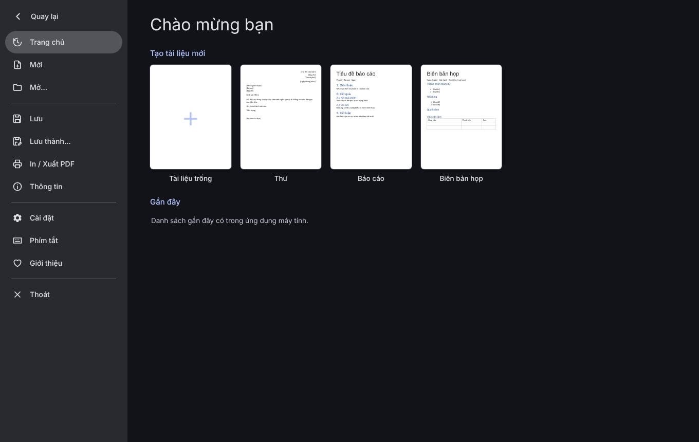

<div align="center">


# Material Docx

**A Word-style word processor with real `.docx` support — built with Tauri 2 and Material Design 3.**

[](https://tauri.app)
[](https://m3.material.io)
[](LICENSE)


English · [Tiếng Việt](#tiếng-việt)

**Author: [`minhtrong67`](https://github.com/minhtrong67) · Built with the help of AI: [`Claude`](https://www.anthropic.com/claude) (Anthropic)**

</div>

---

## Introduction

Material Docx is a fast, lightweight desktop word processor that feels like Microsoft Word — ribbon, paged "print layout", styles, tables, headers & footers, table of contents — but looks and moves like a modern Material Design 3 app. It opens and saves real `.docx` files, follows the system light/dark setting, and recolors the whole interface from a single accent color (Word blue by default). The UI is available in **English** and **Vietnamese**.

## Screenshots

| | |
| --- | --- |
|  |  |
|  |  |
|  | |

## Features

* **Word-style ribbon** – File, Home, Insert, Design, Layout, References, Review, View, plus contextual **Table** and **Picture** tabs; collapsible, with tooltips and keyboard shortcuts.
* **Real pages** – paginated print layout with page breaks, header & footer (page number, page count, date, title), different first page, page color, 7 paper sizes, portrait/landscape, margin presets and custom margins, ruler, read / print / web views, zoom, navigation pane.
* **Text & paragraphs** – fonts, sizes, bold/italic/underline/strike, sub/superscript, text & highlight colors, change case, format painter, styles gallery (Normal, Headings, Title, Subtitle, Quote, Caption, Code…), alignment, indents, line & paragraph spacing, borders & shading, bullet/numbered lists (multi-level, several styles), sort, formatting marks.
* **Tables** – insert, merge/split cells, add/delete rows and columns, 8 table styles, header/banded rows, cell shading, vertical alignment, AutoFit, distribute columns.
* **Pictures** – insert, paste or drag in; resize with handles, rotate, flip, text wrapping, alt text.
* **References** – automatic table of contents, captions, headings navigation.
* **Review** – spell check, word count, read aloud, find & replace (match case, whole word).
* **.docx round-trip** – headers/footers, styles, lists, tables, pictures, table of contents, page setup and page color are written to and read from Word files (also opens/saves `.html` and `.txt`).
* **Window options** – in *Settings → Window*: **remember window size** after you resize it, or **always open maximized**.
* **Theme** – Material Design 3, Light / Dark / System, 16 Material accent colors plus a custom color picker with a generated tonal palette (default Word blue), dark page option, smooth animations (respects *reduce motion*).
* **Fonts** – system UI font by default, with an interface-font option and a default document font / size (with live preview).
* **Settings** – a tidy two-pane dialog (Appearance, Window, Language, Editing, About) with a *reset to defaults* button; adapts to narrow windows.
* **Safe** – auto-recover copy of unsaved work, unsaved-changes prompts, templates (letter, report, minutes…).
* **Languages** – English and Vietnamese, switchable at runtime.

## Download

Get the installer for your platform from the **Releases** page of the repository, from the landing page (`index.html` → `download/Material-Docx-Setup.exe`), or build it yourself (see [Build](#build)).

| Platform | Package |
| --- | --- |
| Windows | NSIS setup `.exe` (custom installer & uninstaller icons, English/Vietnamese) |
| macOS | `.dmg` / `.app` |
| Linux | `.deb`, `.rpm`, `.AppImage` |

## Installation

* **Windows** – run the setup `.exe` and follow the wizard. Uninstall from *Settings → Apps* or the Start-menu shortcut.
* **macOS** – open the `.dmg` and drag *Material Docx* to *Applications*.
* **Linux** – `sudo dpkg -i material-docx_*.deb`, `sudo rpm -i material-docx-*.rpm`, or make the `.AppImage` executable and run it.

## Tech stack

* [Tauri 2](https://tauri.app) (Rust) with WebView2 / WebKitGTK / WKWebView
* Vanilla JavaScript (ES modules, no bundler) + CSS custom properties
* Material Design 3 dynamic color (generated tonal palettes)
* Custom ZIP + WordprocessingML reader/writer (`docx.js`, `zip.js`)
* NSIS installer with custom icons, sidebar and header artwork
* Plugins: `tauri-plugin-dialog`, `tauri-plugin-window-state`

## Development

Requirements: [Rust](https://rustup.rs) (stable), [Node.js](https://nodejs.org) 18+ and the [Tauri 2 prerequisites](https://tauri.app/start/prerequisites/) for your OS.

```bash
cd material-docx
npm install      # install the Tauri CLI
npm run dev      # run the app in development mode
```

This project lives in a Cargo **workspace** (`*/src-tauri`), so all apps share one build cache in `../target`.

Regenerate every icon (app, installer, uninstaller, NSIS bitmaps) with `npm run icons` (needs `pip install pillow`).

## Build

```bash
npm run build    # installers are written to ../target/release/bundle
```

## Project structure

```
material-docx/
├── index.html              # Landing page (single file, Material Design 3, EN/VI, SEO + social meta)
├── download/               # Put the Windows setup here: Material-Docx-Setup.exe
├── screenshots/            # image01.png … image05.png
├── src/                    # Front-end (ES modules, no bundler)
│   ├── index.html  style.css
│   ├── app.js              # bootstrap, title bar, window handling
│   ├── ribbon.js  ribbon-def.js   # ribbon engine + definition
│   ├── editor.js  cmds.js  paginate.js  input.js
│   ├── tables.js  images.js  find.js  view.js  dialogs.js  backstage.js
│   ├── docx.js  zip.js  fileio.js  templates.js
│   ├── theme.js  appearance.js  settings.js  i18n.js  ripple.js
├── src-tauri/              # Rust shell, tauri.conf.json, capabilities, icons, NSIS hooks
└── tools/make-icons.py     # icon generator
```

## License

Released under the [MIT License](LICENSE). Created by **minhtrong67** with the help of **Claude**.

---

<a id="tiếng-việt"></a>

## Tiếng Việt

**Tác giả: `minhtrong67` · Với sự hỗ trợ của AI: `Claude` (Anthropic)**

**Material Docx** là trình soạn thảo văn bản cho máy tính, có giao diện ruy-băng và trang in giống Microsoft Word nhưng theo phong cách Material Design 3. Ứng dụng mở/lưu tệp `.docx` thật, hỗ trợ giao diện sáng/tối/hệ thống, màu chủ đề tùy chỉnh (mặc định xanh Word) và 2 ngôn ngữ Anh/Việt.

**Tính năng chính:** ruy-băng đầy đủ (Trang đầu, Chèn, Thiết kế, Bố cục, Tham chiếu, Xem lại, Xem), phân trang thật, đầu/chân trang, mục lục tự động, bảng (gộp/tách ô, 8 kiểu), hình ảnh (xoay, lật, bao quanh chữ), tìm & thay thế, kiểm tra chính tả, đếm từ, đọc to, thước kẻ, thu phóng, ngăn điều hướng, khôi phục tài liệu chưa lưu.

**Tùy chọn cửa sổ** (*Cài đặt → Cửa sổ*): **ghi nhớ kích thước** khi bạn thay đổi, hoặc **luôn mở phóng to tối đa**.

**Chạy & build:**

```bash
npm install
npm run dev
npm run build
```

Yêu cầu: Rust (stable), Node.js 18+ và [các thành phần của Tauri 2](https://tauri.app/start/prerequisites/). Dự án nằm trong Cargo workspace (`*/src-tauri`). Chạy `npm run icons` để tạo lại icon.

Phát hành theo [Giấy phép MIT](LICENSE).
