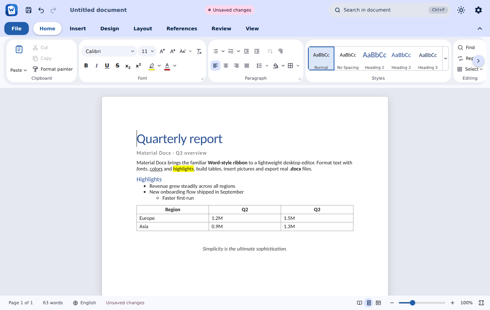
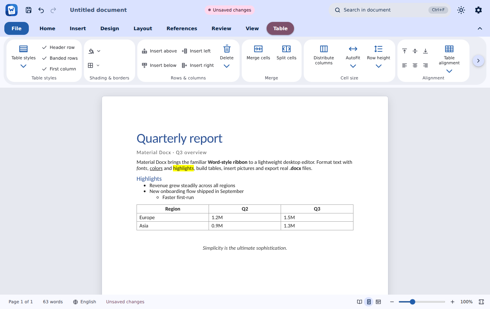
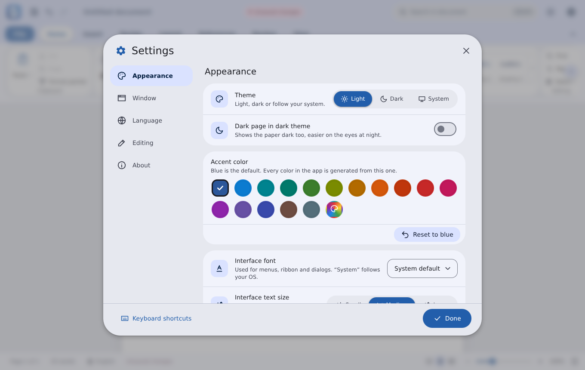
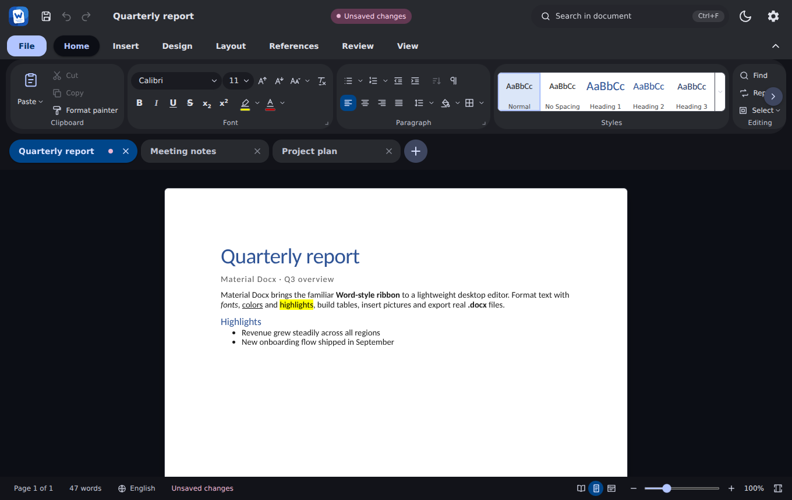

<div align="center">


# Material Docx

**A Word-style desktop word processor designed in Material 3 Expressive.**
Ribbon, paged print layout, tables, pictures and real `.docx` support — free and open source.

   

[Landing page](https://minhtrong67.github.io/material-docx/) · [Download](download/) · [Report an issue](https://github.com/minhtrong67/material-docx/issues)

**Author: [`minhtrong67`](https://github.com/minhtrong67) · Built with the help of AI: [`Claude`](https://www.anthropic.com/claude) (Anthropic)**

</div>

---

## Introduction

Material Docx brings the familiar Word ribbon to a lightweight, fast desktop app. It paginates like a real document, reads and writes genuine `.docx` files, opens a long list of other formats, and wraps everything in **Material 3 Expressive** — big rounded shapes, tonal colour, shape-morphing buttons and spring motion — in light, dark or system themes with any accent colour you like.

## Screenshots

| | |
|---|---|
|  |  |
|  |  |

## Features

- **Word-style ribbon** — Home, Insert, Design, Layout, References, Review, View, plus contextual Table / Picture tabs.
- **Paged layout** — real page breaks, margins, orientation, paper sizes, ruler, headers & footers (different first page), page numbers, table of contents.
- **Multiple documents** — document tabs with their own undo history, drag to reorder, `Ctrl+Tab` / `Ctrl+W`; closing asks about every unsaved tab and crash recovery restores them all.
- **Comments & footnotes kept** — comments, footnotes and endnotes in `.docx` files are preserved and written back on save (shown as markers, not editable yet).
- **Floating format toolbar** — select text and a pill toolbar (bold, italic, underline, strike, highlight) appears right above it.
- **Rich editing** — styles, fonts, colours, highlights, lists, indents, line spacing, format painter, find & replace, spell check, auto-correct, symbols, hyperlinks.
- **Tables & pictures** — table styles, merge/split, shading, borders, row/column tools; resizable pictures with text wrapping, rotate/flip, alt text.
- **Open many file types** — `.docx` `.docm` `.dotx` `.dotm` · `.odt` `.ott` · `.rtf` · `.html` `.htm` `.xhtml` · `.md` `.markdown` · `.csv` `.tsv` · `.txt` `.text` `.log` (drag & drop or File → Open).
- **Save as** `.docx`, `.html`, `.txt`; export **PDF** from the print dialog (*Save as PDF*).
- **Material 3 Expressive UI** — shape-morphing buttons, pill tabs, tonal ribbon cards, spring animations, custom dropdowns, typed toasts (info / success / warning / error) and custom tooltips; every dialog action has a label, an icon and its own colour.
- **Settings** — light / dark / system theme, any accent colour (14 Material swatches + custom), interface text size (small / medium / large), interface font (system default or one of 5 bundled fonts: Roboto, Inter, Open Sans, Lexend, Noto Sans), English / Tiếng Việt, window behaviour (remember size or always maximized).
- **Comfortable at any size** — on narrow windows the ribbon scrolls with the mouse wheel and shows edge buttons for hidden groups.
- **Safety net** — autosave and crash recovery, recent documents, unsaved-changes prompts.
- **Open source, offline, private** — no account, no cloud, no telemetry.

## Installation

1. Download the installer from the [`download/`](download/) folder (or the releases page).
2. Run `Material-Docx-Setup.exe` (per-user install, no admin rights needed) and choose English or Tiếng Việt.
3. Requires **Windows 10 / 11 (64-bit)** with Microsoft Edge WebView2 (already included in Windows 11).

## Tech stack

| Area | Technology |
|---|---|
| Desktop shell | [Tauri 2](https://tauri.app) (Rust) |
| UI | Vanilla JavaScript (ES modules), HTML, CSS — no bundler required |
| Design | Material 3 Expressive, dynamic colour generated from an accent colour |
| Icons | Built-in stroked icon sprite (Material-style) |
| Fonts | System font by default; Roboto, Inter, Open Sans, Lexend, Noto Sans bundled (variable woff2, OFL) |
| Documents | Own ZIP + OOXML reader/writer, ODT / RTF / Markdown / CSV readers |

## Development

Prerequisites: [Node.js](https://nodejs.org) 18+, [Rust](https://rustup.rs) and the [Tauri prerequisites](https://tauri.app/start/prerequisites/) for your OS.

```bash
npm install     # install the Tauri CLI
npm run dev     # run the app in development mode
```

The front-end lives in `src/` and is served as-is, so edits to `src/*.js` / `src/style.css` show up after a reload.

Regenerate every app icon (needs `pip install pillow`):

```bash
npm run icons
```

## Build

```bash
npm run build
```

The installer is written to `target/release/bundle/nsis/` (workspace root) — copy it to `download/` and rename it to `Material-Docx-Setup.exe` for the landing page.

## Project structure

```text
material-docx/
├─ index.html              # landing page (single file, SEO + social meta)
├─ download/               # put the setup file here
├─ screenshots/            # image01 … image04 used by this README
├─ tools/make-icons.py     # generates app / installer / uninstaller icons and logos
├─ src/                    # front-end
│  ├─ index.html           # app shell
│  ├─ app.js               # start-up and wiring
│  ├─ style.css            # Material 3 Expressive styling
│  ├─ fonts/, fonts.css    # bundled UI fonts
│  ├─ editor.js, paginate.js, view.js, tables.js, images.js
│  ├─ ribbon.js, ribbon-def.js, backstage.js, dialogs.js, popup.js
│  ├─ docx.js, zip.js, readers.js, fileio.js     # file formats
│  ├─ settings.js, appearance.js, theme.js, i18n.js
│  └─ logo*.svg
└─ src-tauri/              # Rust shell, tauri.conf.json, icons, NSIS hooks
```

## License

Released under the [MIT License](LICENSE) — free to use, modify and distribute. © 2026 [minhtrong67](https://github.com/minhtrong67).
