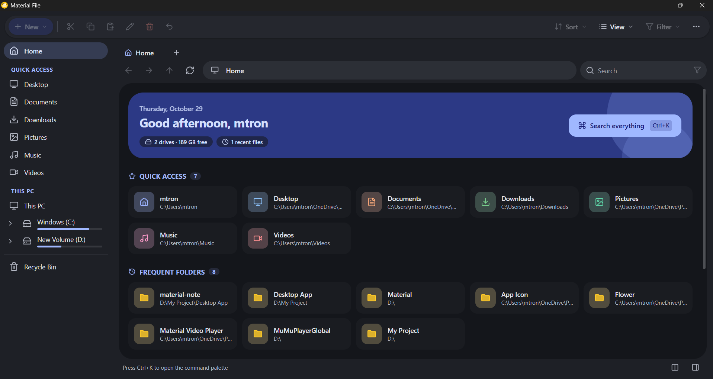
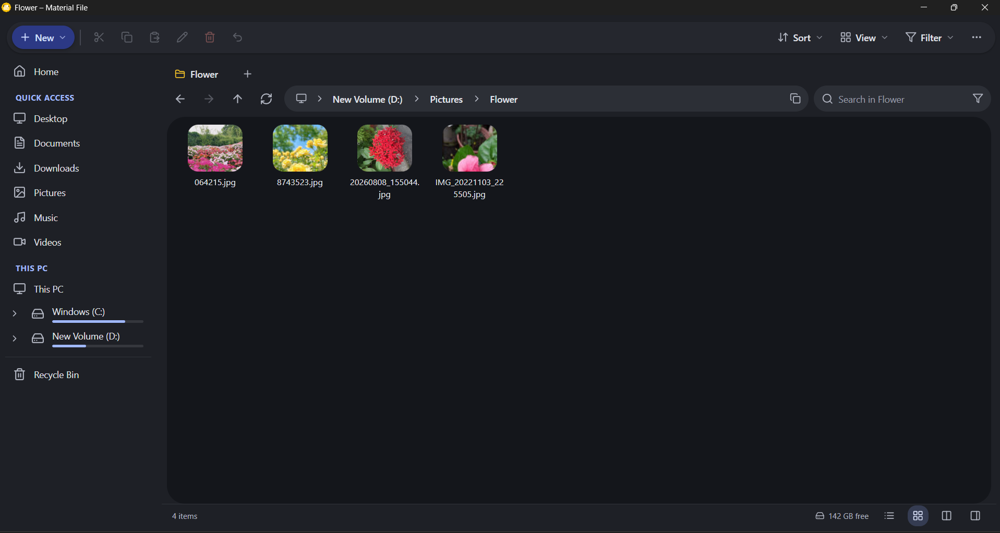
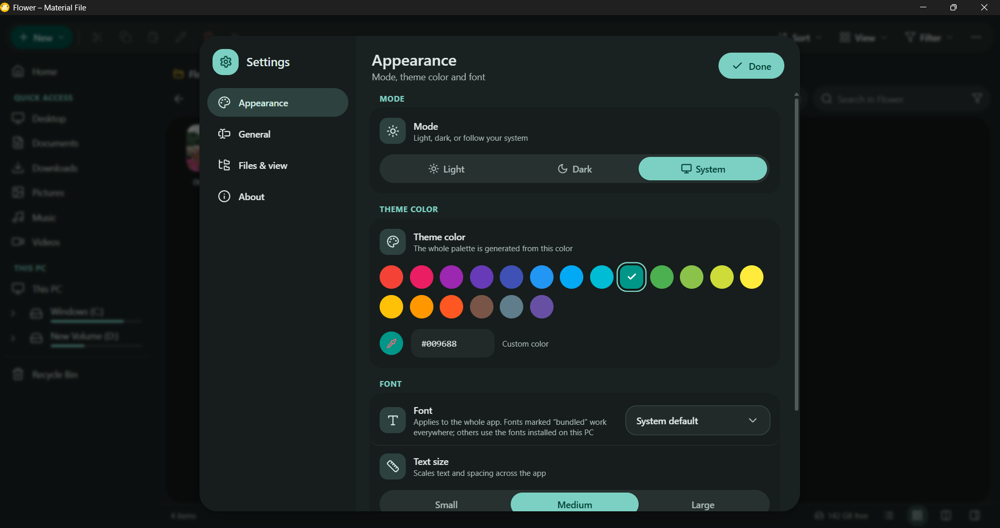
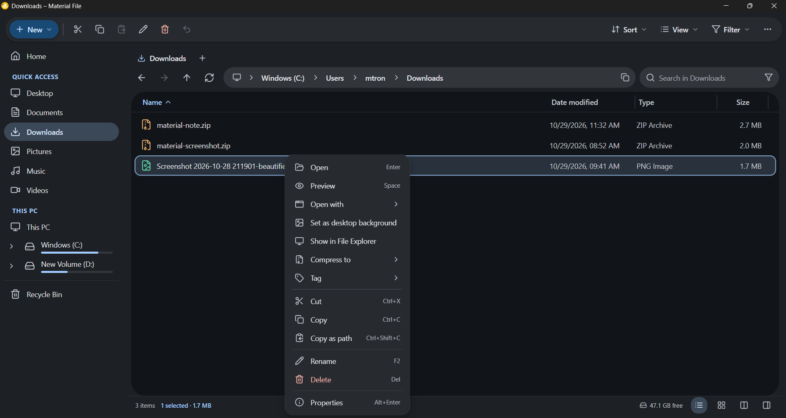

<div align="center">


# Material File

**Trình quản lý tệp đơn giản, nhanh, lấy cảm hứng từ File Explorer của Windows 11, thiết kế theo Material Design 3 Expressive — xây dựng bằng Tauri, React và TypeScript.**

[English](README.md) · [Tiếng Việt](README.vi.md)


</div>

---

## Giới thiệu

Material File giữ lại những phần của File Explorer mà mọi người dùng hằng ngày — truy cập nhanh, ổ đĩa, thẻ thư mục, breadcrumb, chế độ chi tiết và biểu tượng, sao chép / cắt / dán, đổi tên, thùng rác, tìm kiếm và ngăn chi tiết — rồi bổ sung những thứ Explorer còn thiếu: **hai ngăn, thẻ màu, bảng lệnh, tìm tệp trùng và bản đồ dung lượng**. Ứng dụng khởi động nhanh, ít tốn bộ nhớ (Tauri + WebView hệ thống) và theo **Material Design 3 Expressive** với chuyển động lò xo và nút đổi hình.

## Ảnh chụp màn hình

<p align="center">
  
  
</p>
<p align="center">
  
  
</p>

## Tính năng

| Nhóm | Bạn nhận được |
| --- | --- |
| Điều hướng | Thẻ thư mục (bấm giữa để đóng), breadcrumb nhảy tới thư mục con, cây thư mục, lịch sử tiến / lùi, nút bên của chuột, **hai ngăn (F9)** với kéo thả giữa các ngăn |
| Kiểu xem | Chi tiết với cột đổi kích thước, biểu tượng nhỏ / vừa / lớn, nhóm, lọc theo loại, **danh sách ảo hoá** (chỉ vẽ các dòng đang thấy nên thư mục rất lớn vẫn mượt), **nhớ kiểu xem theo từng thư mục**, mật độ gọn / thoải mái |
| Bảng lệnh | **Ctrl+K** để nhảy tới thư mục, tệp hoặc lệnh bất kỳ |
| Thao tác tệp | Sao chép / di chuyển / đổi tên với hộp thoại trùng tên, tiến trình có nút huỷ, xoá vào Thùng rác, hoàn tác, đổi tên hàng loạt, kéo thả (kể cả **từ Explorer vào ứng dụng**) |
| Sắp xếp | **Thẻ màu và dấu sao**, thư mục ghim, thư mục hay dùng, tệp gần đây |
| Tìm kiếm | Lọc khi gõ, Enter tìm trong mọi thư mục con (có thể huỷ), **tìm nâng cao**: regex, loại tệp, kích thước, ngày |
| Công cụ | **Tìm tệp trùng** (kích thước → băm một phần → băm đầy đủ), **bản đồ dung lượng treemap**, tệp nén (ZIP tích hợp, RAR / 7-Zip qua WinRAR / 7-Zip), đặt hình nền |
| Xem trước | Ngăn chi tiết có xem trước văn bản, **xem nhanh bằng Space** cho ảnh (zoom / kéo), video, âm thanh, PDF, Markdown và văn bản; **ảnh thu nhỏ** thật do Rust tạo và lưu đệm |
| Trực tiếp | Danh sách **tự làm mới** khi tệp thay đổi (theo dõi tệp) |
| Chạy nền | **Khay hệ thống** tuỳ chọn, phím tắt toàn cục **Ctrl+Alt+E**, khôi phục thẻ, menu chuột phải **"Open with Material File"** của Explorer (do bộ cài thêm) |
| Giao diện | Sáng / tối / theo hệ thống, 19 màu chủ đề Material + màu tuỳ chỉnh, 5 phông kèm theo (Roboto, Inter, Open Sans, Noto Sans, Nunito) + phông hệ thống, cỡ chữ (nhỏ / vừa / lớn), English & Tiếng Việt |
| Cửa sổ | Ghi nhớ kích thước cửa sổ **hoặc** luôn mở phóng to tối đa |
| Cập nhật | Thông báo bản mới từ GitHub Releases (mỗi ngày một lần, có thể tắt) |
| Chi tiết UI | Tooltip tuỳ biến, dropdown tuỳ biến (không dùng `<select>` mặc định), toast (info / success / warning / error), hộp thoại có nút kèm biểu tượng, nhãn và màu theo hành động |

### Phím tắt

| Hành động | Phím | Hành động | Phím |
| --- | --- | --- | --- |
| Bảng lệnh | `Ctrl+K` | Cài đặt | `Ctrl+,` |
| Thẻ mới / đóng thẻ | `Ctrl+T` / `Ctrl+W` | Cửa sổ mới | `Ctrl+N` |
| Thanh địa chỉ | `Ctrl+L` | Tìm / tìm nâng cao | `Ctrl+F` / `Ctrl+Shift+F` |
| Thư mục mới | `Ctrl+Shift+N` | Đổi tên | `F2` |
| Sao chép / cắt / dán | `Ctrl+C` / `X` / `V` | Xoá / xoá vĩnh viễn | `Del` / `Shift+Del` |
| Hoàn tác | `Ctrl+Z` | Sao chép đường dẫn | `Ctrl+Shift+C` |
| Lùi / tiến / lên | `Alt+←` / `→` / `↑` | Thuộc tính | `Alt+Enter` |
| Xem nhanh | `Space` | Ngăn chi tiết | `Alt+P` |
| Hai ngăn | `F9` | Toàn màn hình | `F11` |
| Chi tiết / biểu tượng | `Ctrl+1` / `Ctrl+2` | Đổi cỡ biểu tượng | `Ctrl+Lăn chuột` |

## Tải về

Tải bộ cài mới nhất ở trang [Releases](https://github.com/minhtrong67/material-file/releases) hoặc nút **Tải về** trên landing page (`index.html`).

## Cài đặt

1. Chạy `Material-File-Setup.exe` (cài cho người dùng hiện tại — không cần quyền quản trị).
2. Nếu Windows SmartScreen cảnh báo ứng dụng chưa ký số, chọn **Thông tin thêm → Vẫn chạy**.
3. Yêu cầu **Windows 10 / 11 (64-bit)** có WebView2 (đã có sẵn trong Windows 11).

## Công nghệ sử dụng

| Lớp | Công nghệ |
| --- | --- |
| Vỏ / backend | [Tauri 2](https://tauri.app) + Rust (`notify`, `image`, `regex`, `trash`, `sysinfo`) |
| Giao diện | React 18 + TypeScript 5 |
| Build | Vite 6 |
| Style | Tailwind CSS 4 + vai trò màu Material 3 (biến CSS, OKLCH) |
| State | Zustand |
| Biểu tượng | [Lucide](https://lucide.dev) (`lucide-react`) |
| Xem trước | `marked` + `DOMPurify` (Markdown) |
| Phông chữ | Mặc định dùng phông hệ thống; Roboto, Inter, Open Sans, Noto Sans, Nunito kèm theo qua Fontsource |

## Phát triển

Yêu cầu: [Node.js 20+](https://nodejs.org), [Rust](https://rustup.rs) và [các thành phần Tauri](https://tauri.app/start/prerequisites/) cho Windows (WebView2 + MSVC build tools).

Thư mục này là một thành viên của Cargo workspace (`*/src-tauri`) dùng chung một bộ nhớ đệm build (`../target`).

```bash
npm install     # cài thư viện
npm run dev     # chạy ứng dụng desktop có hot reload (tauri dev)
```

Tuỳ chọn: `npm run web:dev` chỉ chạy giao diện trong trình duyệt thường với hệ thống tệp giả lập trong bộ nhớ (tiện khi chỉnh UI, không cần Rust). `npm run web:build` kiểm tra kiểu và build frontend.

## Build

```bash
npm run build   # tsc + vite build + tauri build → bộ cài NSIS
```

Bộ cài nằm trong `target/release/bundle/nsis/` (gốc workspace). Chép nó vào `download/Material-File-Setup.exe` để landing page có file để tải.

Tạo lại icon ứng dụng / bộ cài / gỡ cài đặt (màu amber `#FFC107`): `npm run icons` (cần Python + Pillow).

## Cấu trúc dự án

```
material-file/
├─ index.html                 # landing page (1 file, meta SEO + mạng xã hội, EN/VI, giao diện)
├─ package.json  vite.config.ts  tsconfig.json
├─ src/                       # gốc ứng dụng Vite
│  ├─ index.html  main.tsx  Root.tsx  index.css  fonts.css
│  ├─ assets/                 # logo.svg, phông chữ kèm theo
│  ├─ components/             # FileList (ảo hoá), ngăn, sidebar, thanh lệnh, chi tiết…
│  │  ├─ ui/                  # Tooltip, Select, Modal, Toaster, ContextMenu, Buttons, Controls
│  │  └─ dialogs/             # Cài đặt, Thuộc tính, Tệp trùng, Bản đồ dung lượng, Tìm kiếm, Lightbox, Bảng lệnh, Cập nhật
│  ├─ store/                  # zustand: settings, explorer (ngăn/thẻ/thao tác), ui
│  ├─ hooks/                  # phím tắt, hiệu ứng cửa sổ/theme/watcher/kéo thả/khay
│  └─ lib/                    # api (cầu nối Tauri + mock trình duyệt), i18n (EN/VI), theme, menus, view, treemap
├─ src-tauri/
│  ├─ src/main.rs             # lệnh: liệt kê, sao chép/di chuyển có tiến trình, thùng rác, nén…
│  ├─ src/extras.rs           # tìm kiếm, watcher, ảnh thu nhỏ, tệp trùng, dung lượng, khay, phím tắt
│  ├─ icons/                  # icon ứng dụng + installer/ (setup, gỡ cài đặt, ảnh NSIS/WiX, hooks.nsh)
│  └─ tauri.conf.json  capabilities/
├─ tools/generate_icons.py    # trình tạo icon Material màu amber
├─ screenshots/               # image01.png … image04.png
├─ download/                  # đặt file setup vào đây
└─ LICENSE
```

### Hạn chế

- Ưu tiên Windows: lối tắt Thùng rác, tích hợp WinRAR / 7-Zip, hook nút bên chuột, hình nền và menu chuột phải Explorer là tính năng của Windows.
- Kiểm tra cập nhật chỉ *thông báo* có bản phát hành mới trên GitHub, không tự cài đặt.
- Bộ cài chưa ký số → SmartScreen cảnh báo ở lần chạy đầu.

## Ghi công

Thiết kế và phát triển bởi **minhtrong67** với sự hỗ trợ của **Claude** (Anthropic).
Biểu tượng của [Lucide](https://lucide.dev), phông chữ của [Fontsource](https://fontsource.org).

## Giấy phép

Phát hành theo [Giấy phép MIT](LICENSE) — miễn phí và mã nguồn mở.
