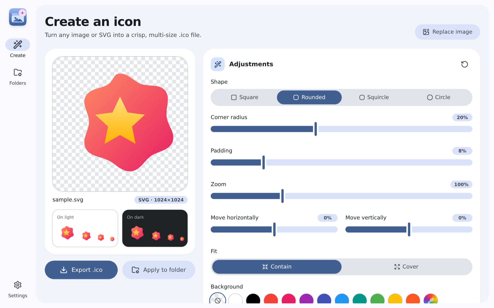
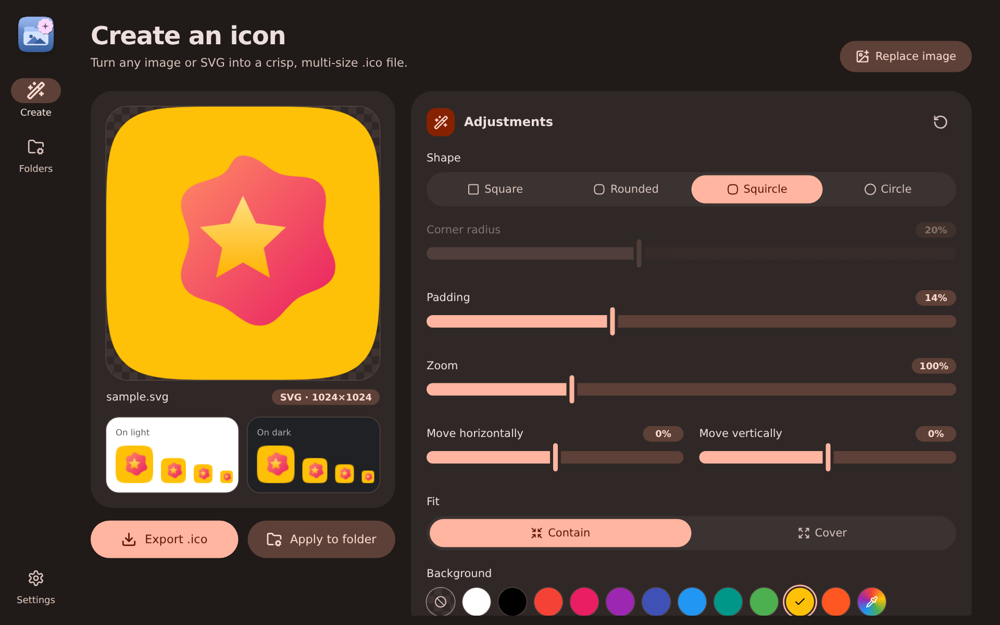
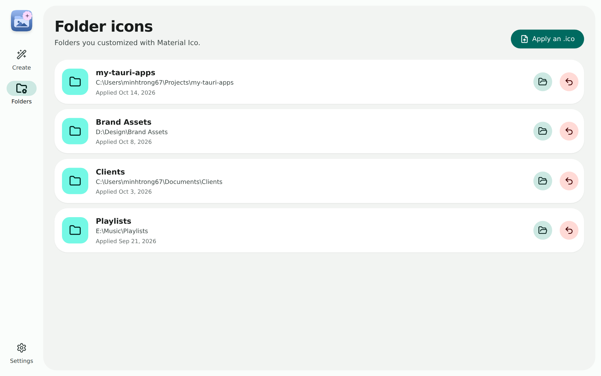
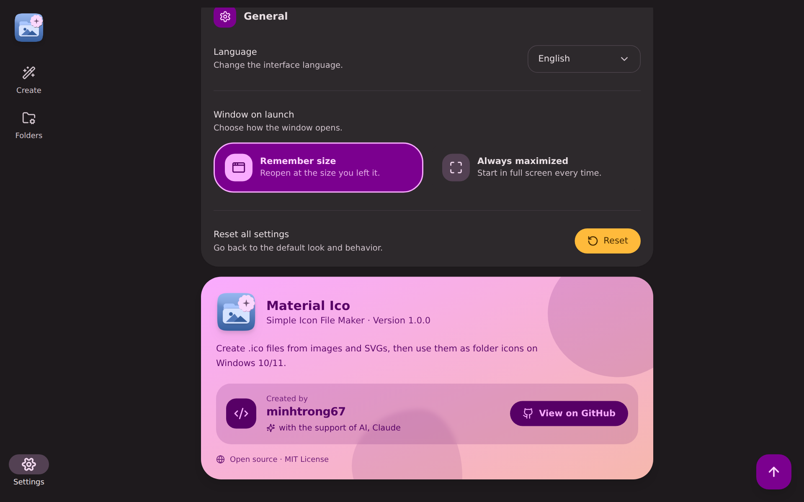

<div align="center">


# Material Ico

**Simple Icon File Maker** — create `.ico` files from images, including SVGs, and use them as custom folder icons on Windows 10/11.


</div>

## Introduction

Material Ico turns any PNG, JPG, WebP, GIF, BMP or SVG into a crisp, multi-size `.ico` file and can apply it to a folder in one click. It is designed with **Material 3 Expressive (2026)**: bold shapes, springy motion and a fully customizable theme.

## Screenshots

| | |
|---|---|
|  |  |
|  |  |

## Features

- **Any image** — PNG, JPG, WebP, GIF, BMP and SVG (vector stays sharp at every size). Drag & drop, browse, or paste with `Ctrl+V`.
- **Live shape editor** — square, rounded, squircle or circle; padding, zoom, offset, contain/cover fit, transparent or custom background.
- **Multi-size `.ico`** — 16, 24, 32, 48, 64, 128 and 256 px entries, PNG-compressed.
- **Folder icons** — applies the icon via a hidden `desktop.ini`, lists customized folders and restores the default icon on demand.
- **Preview** on light and dark Windows backgrounds at real sizes.
- **Settings** — light / dark / system, 16 Material theme colors, small / medium / large text, 5 fonts (System, Roboto, Inter, Poppins, Nunito), English and Tiếng Việt, window behavior (remember size or always maximized).
- **Polished UX** — custom tooltips, dropdowns, toasts (info / success / warning / error), dialogs and side sheets with labeled, colored action buttons, ripple and morphing-shape animations, scroll-to-top.
- **Shortcuts** — `Ctrl+O` open image, `Ctrl+S` export `.ico`.

## Installation

1. Download `Material-Ico_1.0.0_x64-setup.exe` from the [`downloads`](downloads) folder (or build it yourself, see below).
2. Run the installer. It installs for the current user, no admin rights required.
3. Launch **Material Ico** from the Start menu.

Requirements: Windows 10 or 11 (64-bit). WebView2 ships with Windows 10/11.

## Tech Stack

| Area | Technology |
|---|---|
| Desktop shell | [Tauri 2](https://tauri.app) (Rust) |
| UI | React 18, TypeScript, Vite |
| Styling | Tailwind CSS 3, Material 3 Expressive tokens (`@material/material-color-utilities`) |
| Icons | [Lucide](https://lucide.dev) |
| Installer | NSIS (custom installer / uninstaller icons and artwork) |

## Development

Prerequisites: [Node.js 20+](https://nodejs.org), [Rust](https://rustup.rs) and the [Tauri prerequisites for Windows](https://tauri.app/start/prerequisites/).

```bash
npm install
npm run dev
```

`npm run web` starts only the Vite frontend in a browser (file export falls back to a download; folder actions need the desktop app).

## Build

```bash
npm run build
```

The installer is created at `../target/release/bundle/nsis/` (the shared workspace build cache lives in `./target` one level up). Copy it into `downloads/` for the landing page.

To regenerate all icons (app, setup, uninstall, NSIS artwork): `pip install pillow && python scripts/gen-icons.py`.

## Project Structure

```
material-ico/
├─ landing.html            # single-file landing page
├─ downloads/              # put the setup .exe here
├─ screenshots/            # image01..image04.png
├─ scripts/gen-icons.py    # icon generator
├─ src/
│  ├─ components/          # Tooltip, Select, Toast, Modal, Btn, ...
│  ├─ pages/               # Maker, Folders, Settings
│  ├─ lib/                 # render, ico, theme, i18n, store, tauri helpers
│  └─ theme/               # Material Theme Builder export
└─ src-tauri/
   ├─ src/lib.rs           # file + folder icon commands
   ├─ icons/               # app, installer, uninstaller icons, NSIS art
   ├─ nsis/hooks.nsh       # uninstall icon in "Apps & features"
   └─ tauri.conf.json
```

## License

Open source under the [MIT License](LICENSE). Part of [my-tauri-apps](https://github.com/minhtrong67/my-tauri-apps).

Created by **minhtrong67** with the support of AI, Claude.
