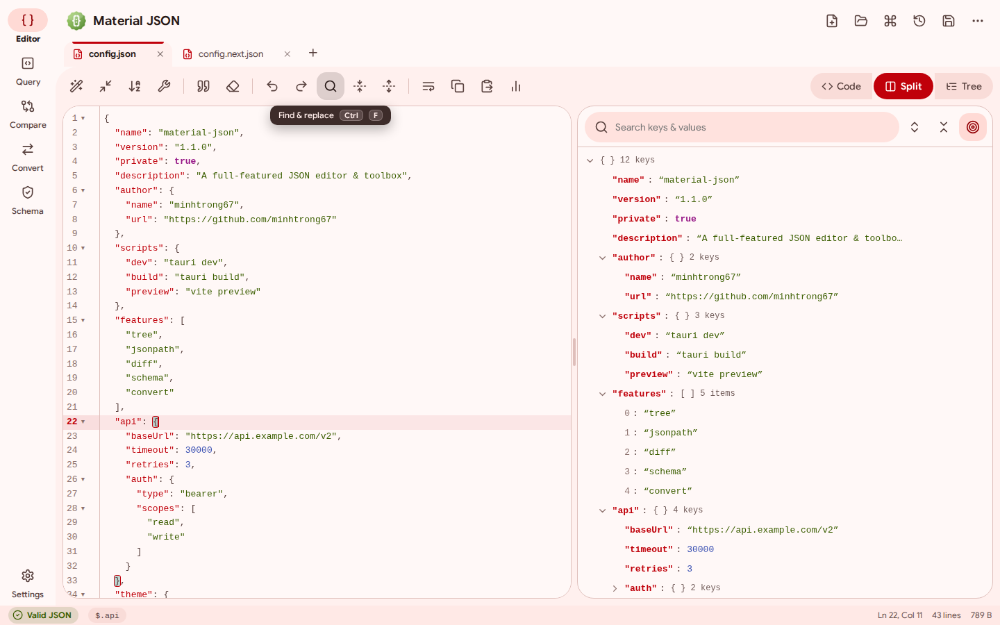
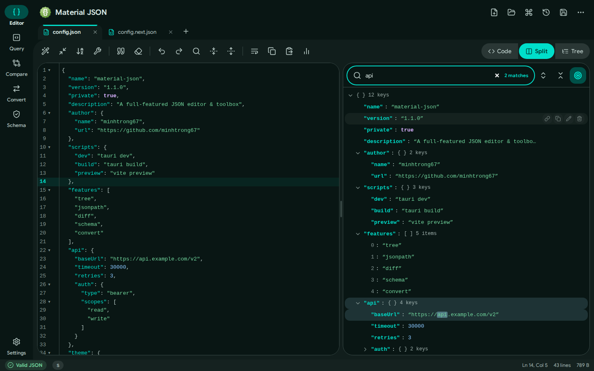
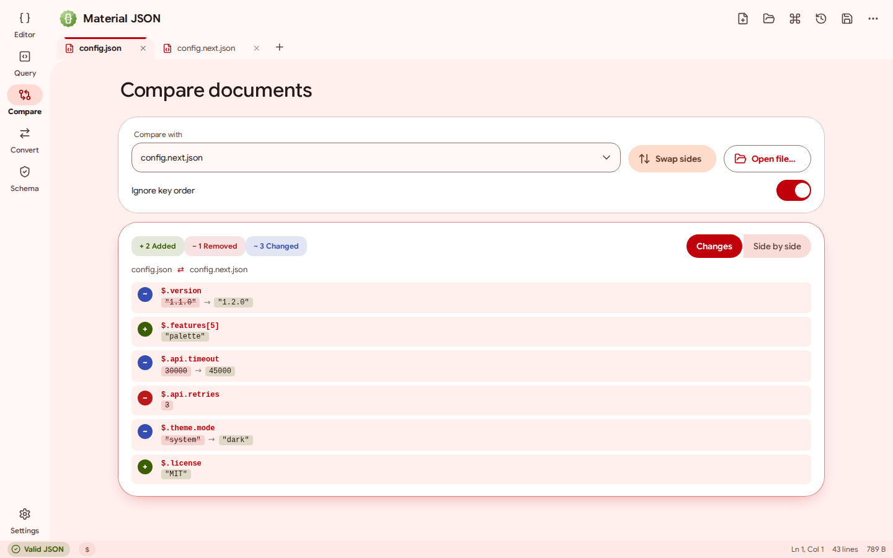
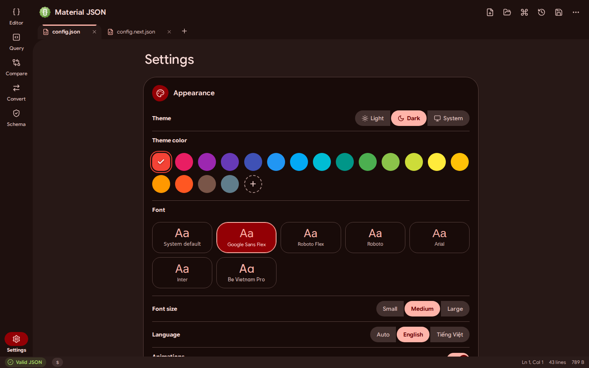

<div align="center">


# Material JSON

**A fast, full-featured JSON editor and toolbox for the desktop — designed in Material 3 Expressive.**

Tree view · JSONPath · Diff · Schema validation · Format converters · Command palette

[](LICENSE)
[](https://tauri.app)
[](https://m3.material.io)
[](#installation)

</div>

---

## Introduction

**Material JSON** is a free and open-source desktop app for working with JSON. Open a file or paste some text and you can format, repair, explore, query, compare, validate and convert it — all offline, in a small and snappy native app ([Tauri](https://tauri.app)) with a bold **Material 3 Expressive** interface: spring motion, shape-morphing controls and a vivid, fully themeable colour system.

A landing page lives in [`index.html`](index.html) (open it in a browser). It links to the installer placed in [`download/`](download).

## Screenshots

| | |
|---|---|
| <br><sub>Editor with live validation, JSONPath breadcrumb and custom tooltips (light)</sub> | <br><sub>Dark theme, custom accent colour, tree search</sub> |
| <br><sub>Compare documents with a themed dropdown</sub> | <br><sub>Settings: colours, fonts, font size, language, window behaviour</sub> |

> Screenshots are captured from the production build in a browser, so the native window frame is not shown.

## Features

**Editor**
- CodeMirror 6: syntax highlighting, line numbers, folding, bracket matching, find & replace, undo/redo
- Live error markers with exact line and column; the status bar shows the **JSONPath of the cursor** (click to copy)
- Multiple tabs, unsaved dots, drag & drop, recent files, session restore, "Open with" support
- **Format**, **Minify**, **Sort keys**, **Repair** (comments, trailing commas, single quotes, unquoted keys…), escape / unescape
- Edits touch only the text that really changed, so scroll position, folds and the undo history stay intact
- Big numbers are preserved exactly — no precision loss when formatting

**Tools**
- **Tree view** – lazy rendering, search keys & values, copy path / value, inline edit, **add keys / array items**, delete, click to select in the editor
- **JSONPath** – `$`, `..`, `[*]`, `[0]`, `[-1]`, `[0:3]`, filters such as `[?(@.price < 10)]`, query history, jump to match
- **Compare** – structural change list and side-by-side line diff, optional "ignore key order"
- **Schema** – validate against JSON Schema draft-07 / 2019-09 / 2020-12 (Ajv) or generate a schema from your data
- **Convert** – JSON → YAML, CSV, XML, TypeScript, JSON Schema; and YAML, CSV, XML → JSON
- **Command palette** (`Ctrl+K`) for every action, plus document **statistics**

**Personalisation**
- Light / Dark / System theme with a circular reveal animation
- Material theme colours (18 swatches + custom) generated with `@material/material-color-utilities` (vibrant scheme)
- 7 fonts: **System**, **Google Sans Flex**, **Roboto Flex**, **Roboto**, **Arial**, **Inter**, **Be Vietnam Pro** (all bundled, work offline) 3 font sizes and 8 **code fonts** for the editor (JetBrains Mono, Fira Code, Cascadia Code, Source Code Pro, Roboto Mono, IBM Plex Mono, Consolas or the system default)
- English and Vietnamese (auto-detected, switchable)
- Window behaviour: **remember size & position** or **always start maximized**
- Custom tooltips, stacked toasts (info / success / warning / error), themed dropdowns, scroll-to-top button on long pages
- Smooth animations that can be switched off — `prefers-reduced-motion` is respected

**Keyboard shortcuts**

| Action | Shortcut |
|---|---|
| New / Open / Save / Save as / Close tab | `Ctrl+N` / `Ctrl+O` / `Ctrl+S` / `Ctrl+Shift+S` / `Ctrl+W` |
| Command palette | `Ctrl+K` |
| Next / previous tab | `Ctrl+Tab` / `Ctrl+Shift+Tab` |
| Format / Minify | `Alt+Shift+F` / `Alt+Shift+M` |
| Find & replace | `Ctrl+F` |
| Switch view (Editor, Query, Compare, Convert, Schema) | `Ctrl+1` … `Ctrl+5` |
| Settings | `Ctrl+,` |

## Installation

1. Download `Material JSON_1.1.0_x64-setup.exe` from the [`download`](download) folder or the Releases page.
2. Run it and follow the wizard (installs per-user, no administrator rights needed).
3. Launch **Material JSON** from the Start menu.

Requires Windows 10 or 11 with the WebView2 runtime (preinstalled on Windows 11; the installer downloads it if missing).

## Tech stack

| Layer | Technology |
|---|---|
| Shell | [Tauri 2](https://tauri.app) (Rust) with the dialog and single-instance plugins |
| UI | TypeScript + [Vite](https://vitejs.dev), hand-written Material 3 Expressive CSS (no UI framework) |
| Editor | [CodeMirror 6](https://codemirror.net) |
| Theming | [@material/material-color-utilities](https://github.com/material-foundation/material-color-utilities) |
| Icons | [Lucide](https://lucide.dev) |
| Fonts | [Fontsource](https://fontsource.org) packages (bundled for offline use) |
| Validation | [Ajv](https://ajv.js.org) + ajv-formats |
| Conversion | [js-yaml](https://github.com/nodeca/js-yaml) and custom CSV / XML / type-inference code |

## Development

**Prerequisites:** [Node.js](https://nodejs.org) 18+, [Rust](https://rustup.rs) (stable) and the [Tauri prerequisites](https://tauri.app/start/prerequisites/) for your OS.

This project is a member of a shared Cargo workspace (`members = ["*/src-tauri"]`), so all projects reuse one `target/` cache. Keep the folder next to the workspace `Cargo.toml`.

```bash
npm install     # install dependencies
npm run dev     # start the desktop app in development mode (hot reload)
```

Handy extras:

```bash
npm run vite:dev                   # frontend only, in the browser (http://localhost:1420)
npm run vite:build                 # type-check + production build of the frontend
python scripts/generate-icons.py   # regenerate every icon (needs: pip install pillow)
```

## Build

```bash
npm run build
```

The Windows installer is created in the workspace `target/release/bundle/nsis/` folder. Copy `Material JSON_1.1.0_x64-setup.exe` into `download/` (no renaming needed) so the landing page link works.

## Project structure

```text
material-json/
├── index.html              # landing page (single file, EN/VI, light/dark/system, colour picker)
├── download/               # put the installer here
├── screenshots/            # image01.png … image04.png (README + landing page)
├── scripts/
│   └── generate-icons.py   # builds app / installer / uninstaller icons and NSIS banners
├── app/
│   ├── index.html          # app shell
│   ├── public/             # static assets (icon)
│   └── src/
│       ├── main.ts         # bootstrap, toolbar, tabs, status bar, shortcuts
│       ├── docs.ts         # open documents, session, dialogs
│       ├── editor.ts       # CodeMirror wrapper
│       ├── json.ts         # parser, repair, stats, JSON paths
│       ├── jsonpath.ts     # JSONPath engine
│       ├── convert.ts      # YAML / CSV / XML / TypeScript converters
│       ├── diff.ts         # structural + line diff
│       ├── palette.ts      # command palette
│       ├── tooltip.ts      # custom tooltips
│       ├── theme.ts        # Material colour scheme + theme switching
│       ├── settings.ts     # persisted preferences
│       ├── i18n.ts         # English / Vietnamese strings
│       ├── ui.ts, icons.ts # dialogs, menus, toasts, Lucide icons
│       ├── tauri.ts        # native window / file helpers (time-boxed calls)
│       ├── views/          # tree, query, compare, convert, schema, settings
│       └── styles/         # base, app, views, fonts, expressive
└── src-tauri/              # Rust shell, icons, installer config
```

## License

Material JSON is public and open source, released under the [MIT License](LICENSE).

Source code: <https://github.com/minhtrong67/my-tauri-apps>

---

<div align="center">

Made by **[minhtrong67](https://github.com/minhtrong67)** with the support of **Claude** (AI).

</div>
