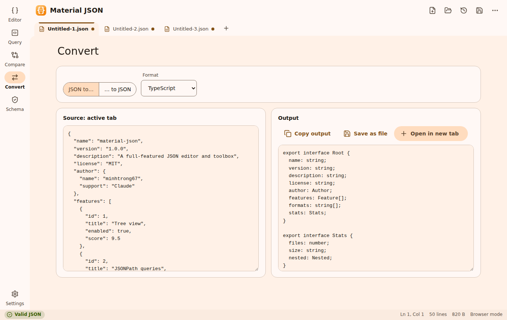
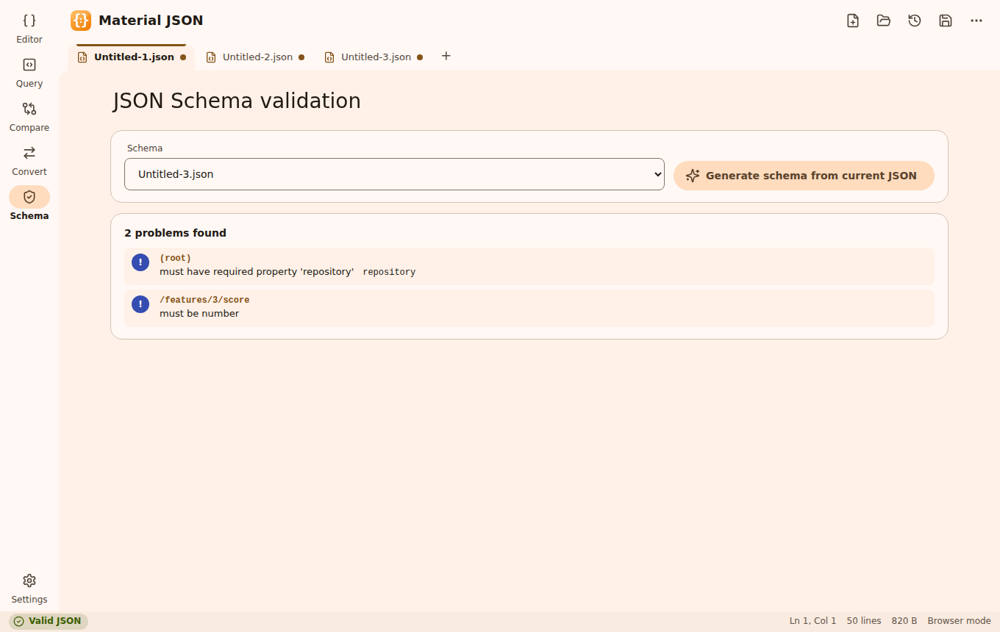
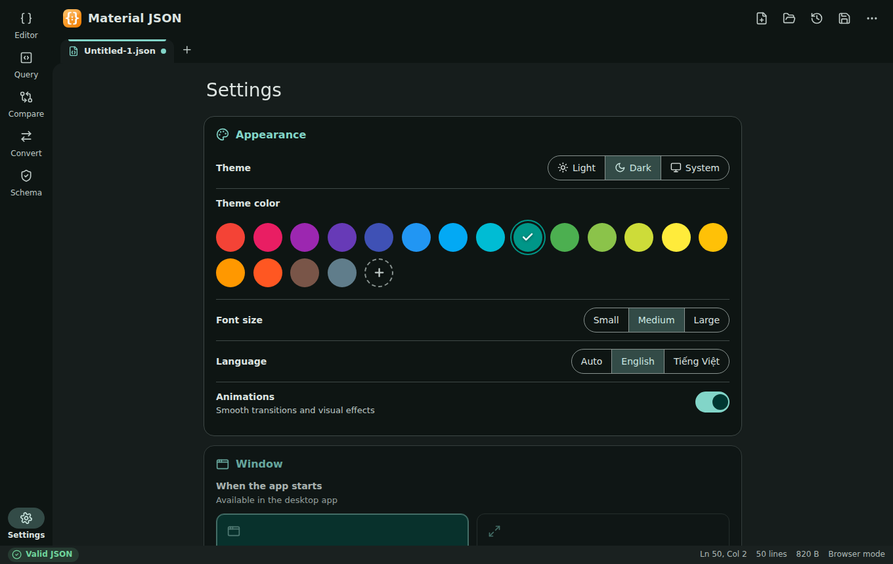
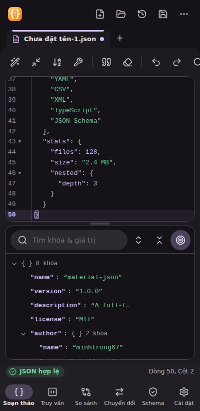

<div align="center">


# Material JSON

**A fast, full-featured JSON editor and toolbox for the desktop — designed with Material Design 3.**

Tree view · JSONPath · Diff · Schema validation · Format converters

[](LICENSE)
[](https://tauri.app)
[](https://m3.material.io)
[](#installation)

</div>

---

## Introduction

**Material JSON** is a free and open-source desktop app for working with JSON. Open a file or paste some text and you can format, repair, explore, query, compare, validate and convert it — all offline, in a small and snappy native app (Tauri) with a calm Material Design 3 interface.

A landing page lives in [`index.html`](index.html) (open it in a browser) and links to the installer placed in [`download/`](download).

## Screenshots

| | |
|---|---|
| <br><sub>Editor with live validation and tree view (light)</sub> | <br><sub>Dark theme, custom accent colour, tree search</sub> |
| <br><sub>JSONPath queries</sub> | <br><sub>Compare documents</sub> |
| <br><sub>Convert to TypeScript, YAML, CSV, XML, JSON Schema</sub> | <br><sub>JSON Schema validation</sub> |
| <br><sub>Settings</sub> | <br><sub>Responsive layout (Vietnamese UI)</sub> |

> Screenshots are captured from the web build (`npm run vite:dev`), so the native window frame is not shown.

## Features

**Editor**
- CodeMirror 6 editor: syntax highlighting, line numbers, code folding, bracket matching, find & replace, undo/redo
- Live error markers with the exact line and column (works the same on every OS / WebView)
- Multiple tabs, unsaved-changes dots, drag & drop files, recent files, session restore, open from the command line / "Open with"
- **Format**, **Minify**, **Sort keys** (A→Z / Z→A), **Repair** (comments, trailing commas, single quotes, unquoted keys, `True/None`…), escape / unescape strings
- Big numbers are preserved exactly (no precision loss when formatting)

**Tools**
- **Tree view** – lazy rendering for large files, search keys & values, copy path / value, inline edit and delete, click to select in the editor, split view with draggable divider
- **JSONPath** – `$`, `..`, `[*]`, `[0]`, `[-1]`, `[0:3]`, `['a','b']`, filters such as `[?(@.price < 10 && @.name =~ /^A/)]`, query history, jump to match
- **Compare** – structural change list and side-by-side line diff, optional "ignore key order"
- **Schema** – validate against JSON Schema draft-07 / 2019-09 / 2020-12 (Ajv), jump to failing values, generate a schema from your data
- **Convert** – JSON → YAML, CSV, XML, TypeScript interfaces, JSON Schema; and YAML, CSV, XML → JSON
- Document **statistics** (size, depth, key and type counts)

**Personalisation**
- Light / Dark / System theme with a circular reveal animation
- Material theme colours (18 swatches + custom colour) generated with `@material/material-color-utilities`
- 3 font sizes (small / medium / large)
- English and Vietnamese (auto-detected, switchable)
- Window behaviour: **remember size & position** or **always start maximized**
- Smooth animations (ripples, view transitions, tab motion, format "shimmer") that can be switched off — `prefers-reduced-motion` is respected

**Keyboard shortcuts**

| Action | Shortcut |
|---|---|
| New / Open / Save / Save as / Close tab | `Ctrl+N` / `Ctrl+O` / `Ctrl+S` / `Ctrl+Shift+S` / `Ctrl+W` |
| Next / previous tab | `Ctrl+Tab` / `Ctrl+Shift+Tab` |
| Format / Minify | `Alt+Shift+F` / `Alt+Shift+M` |
| Find & replace | `Ctrl+F` |
| Switch view (Editor, Query, Compare, Convert, Schema) | `Ctrl+1` … `Ctrl+5` |
| Settings | `Ctrl+,` |

## Installation

1. Download the installer (`Material-JSON-Setup.exe`) from the [`download`](download) folder or the Releases page.
2. Run it and follow the wizard (installs per-user, no administrator rights needed).
3. Launch **Material JSON** from the Start menu.

Requires Windows 10 or 11 with the WebView2 runtime (preinstalled on Windows 11; the installer downloads it if missing).

## Tech stack

| Layer | Technology |
|---|---|
| Shell | [Tauri 2](https://tauri.app) (Rust) with the dialog and single-instance plugins |
| UI | TypeScript + [Vite](https://vitejs.dev), hand-written Material Design 3 CSS (no UI framework) |
| Editor | [CodeMirror 6](https://codemirror.net) |
| Theming | [@material/material-color-utilities](https://github.com/material-foundation/material-color-utilities) |
| Icons | [Lucide](https://lucide.dev) |
| Validation | [Ajv](https://ajv.js.org) + ajv-formats |
| Conversion | [js-yaml](https://github.com/nodeca/js-yaml) and custom CSV / XML / type-inference code |

## Development

**Prerequisites:** [Node.js](https://nodejs.org) 18+, [Rust](https://rustup.rs) (stable) and the [Tauri prerequisites](https://tauri.app/start/prerequisites/) for your OS.

This project is a member of a shared Cargo workspace (`members = ["*/src-tauri"]`), so all projects reuse one `target/` cache. Keep the folder next to the workspace `Cargo.toml`.

```bash
npm install     # install dependencies
npm run dev     # start the desktop app in development mode (hot reload)
```

Handy extras:

```bash
npm run vite:dev                   # frontend only, in the browser (http://localhost:1420)
npm run vite:build                 # type-check + production build of the frontend
python scripts/generate-icons.py   # regenerate every icon (needs: pip install pillow)
```

## Build

```bash
npm run build
```

The Windows installer is created in the workspace `target/release/bundle/nsis/` folder. Copy it to `download/` and rename it to `Material-JSON-Setup.exe` so the landing page link works.

## Project structure

```text
material-json/
├── index.html              # landing page (single file, EN/VI, light/dark/system)
├── download/               # put Material-JSON-Setup.exe here
├── screenshots/            # image01.png … image08.png used by this README
├── scripts/
│   └── generate-icons.py   # builds app / installer / uninstaller icons & NSIS banners
├── app/                    # frontend (Vite root)
│   ├── index.html
│   ├── public/icon.png
│   └── src/
│       ├── main.ts         # app shell: tabs, toolbar, status bar, shortcuts
│       ├── json.ts         # tolerant JSON parser with positions, serializer, utilities
│       ├── jsonpath.ts     # JSONPath engine
│       ├── diff.ts         # structural + line diff
│       ├── convert.ts      # YAML / CSV / XML / TypeScript / JSON Schema converters
│       ├── editor.ts       # CodeMirror setup
│       ├── docs.ts         # tabs, files, recent files, session restore
│       ├── actions.ts      # format / minify / sort / repair / escape
│       ├── theme.ts        # Material colour scheme generation
│       ├── i18n.ts         # English + Vietnamese strings
│       ├── tauri.ts        # native bridge (dialogs, window size, drag & drop)
│       ├── views/          # tree, query, compare, convert, schema, settings
│       └── styles/         # base.css, app.css, views.css
├── src-tauri/              # Rust backend
│   ├── src/{main,lib}.rs
│   ├── capabilities/default.json
│   ├── icons/              # app, installer and uninstaller icons, NSIS images
│   ├── tauri.conf.json
│   └── Cargo.toml
├── package.json
├── vite.config.ts
├── tsconfig.json
├── LICENSE
└── README.md
```

## License

Material JSON is **public and open source**, released under the [MIT License](LICENSE) — free to use, modify and distribute.

## Author

Created by **minhtrong67** with the support of AI — **Claude**.
