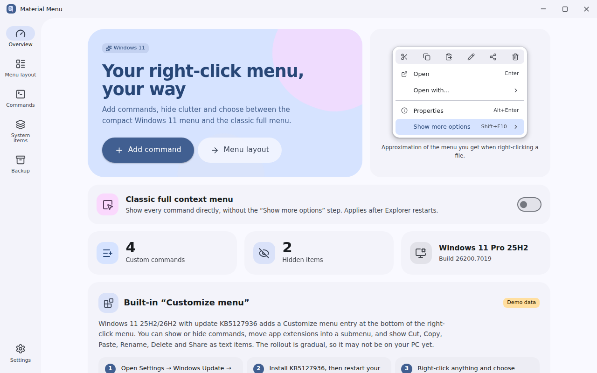
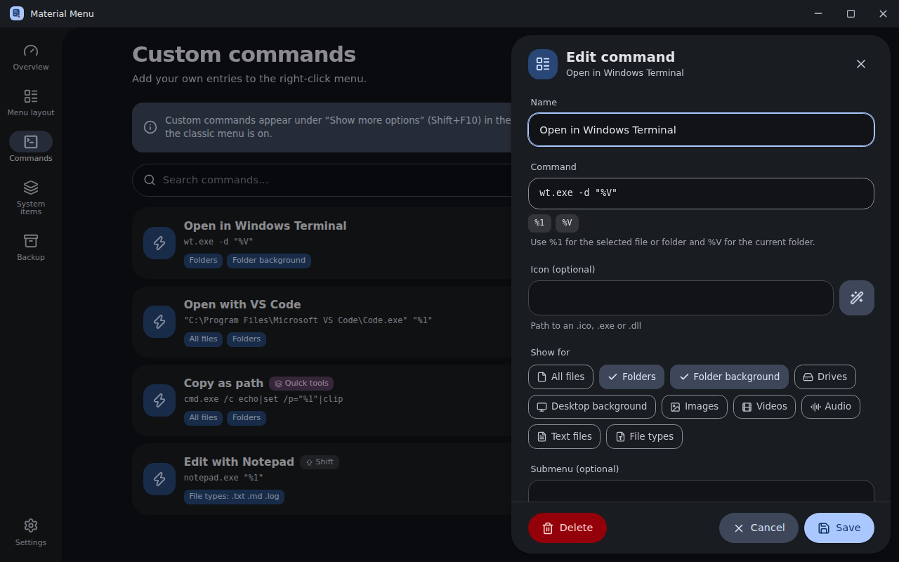
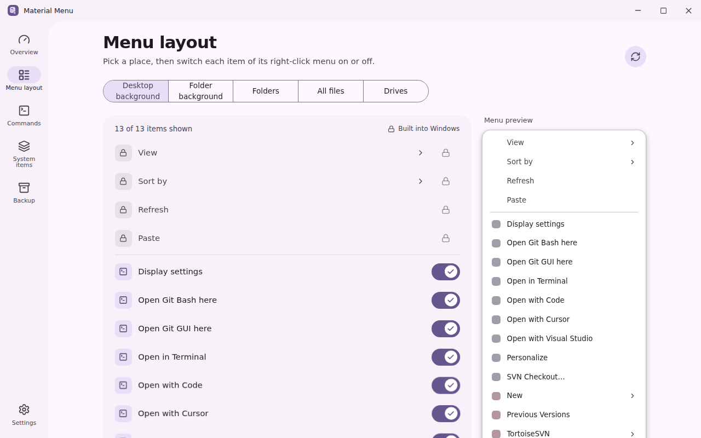
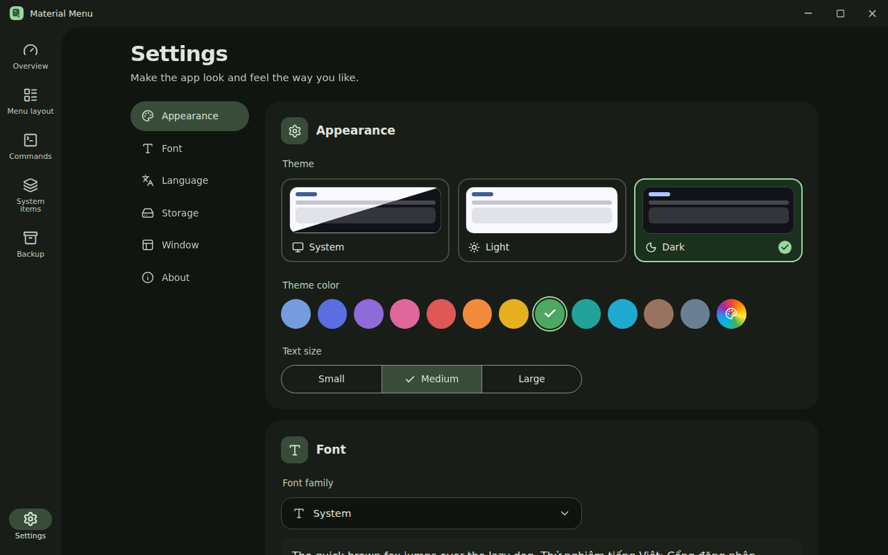

<div align="center">


# Material Menu

**Customize the Windows 11 right-click menu – your way.**

Add your own commands, hide clutter, switch between the compact and the classic full context menu, and back everything up.

[](LICENSE)


</div>

## Introduction

Windows 11 is rolling out its own **Customize menu** entry (preview update KB5127936, Windows 11 25H2/26H2). **Material Menu** brings the same idea to every build: it manages the context menu through the registry, so it also works on PCs that have not received that update, and it adds what Windows does not offer – your own commands, submenus, backups and a live preview.

Everything is written to **your user registry hive only** (`HKCU`). No administrator rights are required and every change can be undone.

## Screenshots

| | |
|---|---|
|  |  |
|  |  |

## Features

- **Custom commands** – launch any program or script from the right-click menu for files, folders, folder background, drives, desktop background, images/videos/audio/text or specific extensions.
- **Submenus, order and position** – group commands, pin to top/bottom, separators, "only with Shift", icons and ready-made presets (Terminal, PowerShell, CMD, VS Code, Notepad, Copy as path).
- **Hide or show system items** – scans existing commands and shell extensions and switches them off per user (reversible, nothing is uninstalled).
- **Classic full menu toggle** – skip "Show more options" or return to the compact Windows 11 menu.
- **Live preview** of the resulting menu.
- **Backup & restore** – export/import JSON, restore saved backups, one-click reset.
- **Restart Explorer** button whenever a change needs it.
- **Material Design 3 Expressive** UI: light / dark / system, 12 theme colors + custom color, text size, 7 fonts (System, Google Sans Flex, Roboto Flex, Roboto, Arial, Inter, Be Vietnam Pro), English and Vietnamese, custom tooltips, dropdowns, dialogs, side sheet and toasts.
- Window behaviour: remember last size or always start maximized; configurable backup folder.

> **Good to know:** classic registry entries appear under **Show more options** (Shift+F10) in the compact Windows 11 menu, or directly when the classic menu is enabled. Modern packaged (MSIX) entries are not enumerated by the registry scan.

## Installation

1. Build the installer (see [Build](#build)) or place a prebuilt one in [`download/`](download/) for the landing page.
2. Run `Material Menu_1.0.0_x64-setup.exe` – installs per user, no admin prompt.
3. Requires Windows 10/11 x64 and the WebView2 runtime (the installer bootstraps it).

## Tech stack

| Layer | Technology |
|---|---|
| Shell | [Tauri 2](https://tauri.app) (Rust) + `winreg` |
| UI | React, TypeScript, Vite, Tailwind CSS 3 |
| Design | Material Design 3 Expressive, `@material/material-color-utilities` |
| Icons | [Lucide](https://lucide.dev) |
| Installer | NSIS with custom setup / uninstall icons and banners |

## Development

Prerequisites: Node.js 20+, Rust (stable, MSVC toolchain) and the [Tauri Windows prerequisites](https://tauri.app/start/prerequisites/).

```bash
npm install
npm run dev      # desktop app with hot reload
```

`npm run web:dev` serves the UI in a browser with a simulated backend (handy for design work).

## Build

```bash
npm run build    # creates the NSIS installer
```

Output: `<workspace>/target/release/bundle/nsis/Material Menu_1.0.0_x64-setup.exe`. Copy it into [`download/`](download/) so the landing page button works.

The project lives in a Cargo workspace (`members = ["*/src-tauri"]`), so all apps share one `target` cache.

## Project structure

```
material-menu/
├── index.html            # landing page (single file, EN/VI, themes)
├── app.html              # Vite entry of the desktop app
├── download/             # put the installer here
├── screenshots/          # image01.png … image04.png
├── src/
│   ├── components/       # UI kit (tooltip, select, dialog, sheet, toast), titlebar, menu preview
│   ├── lib/              # api (+ browser mock), i18n, theme, settings, app state
│   └── pages/            # Overview, Commands, System, Backup, Settings
└── src-tauri/
    ├── src/              # registry.rs, commands.rs, store.rs, sys.rs, model.rs
    ├── icons/            # app / setup / uninstall icons, installer banners
    ├── capabilities/
    └── tauri.conf.json
```

## License

Open source under the [MIT License](LICENSE). Repository: <https://github.com/minhtrong67/my-tauri-apps>

Created by **minhtrong67** with the support of Claude (AI).
