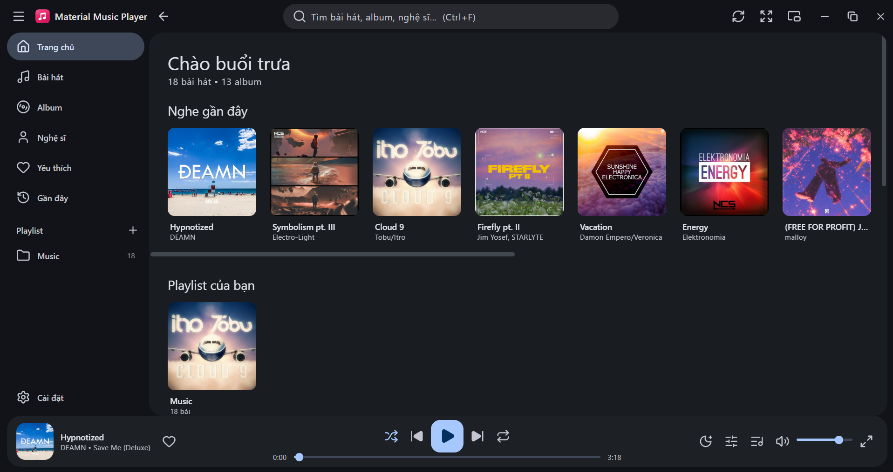
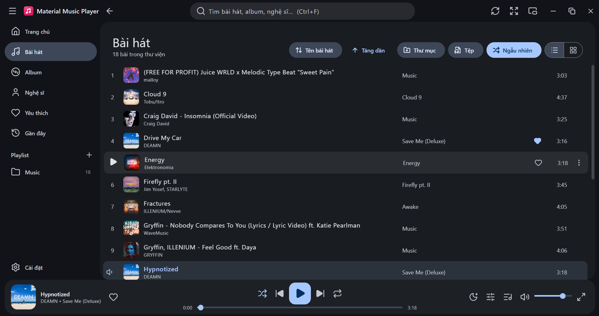
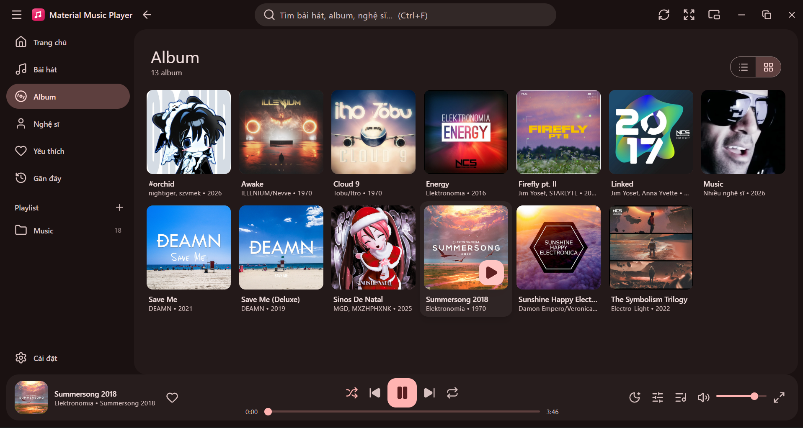
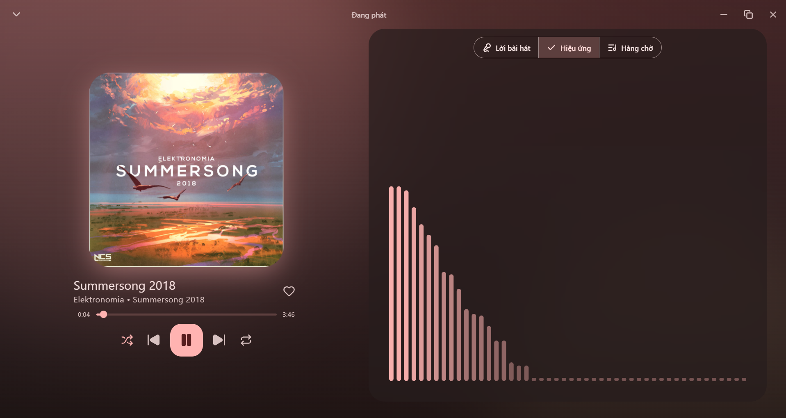
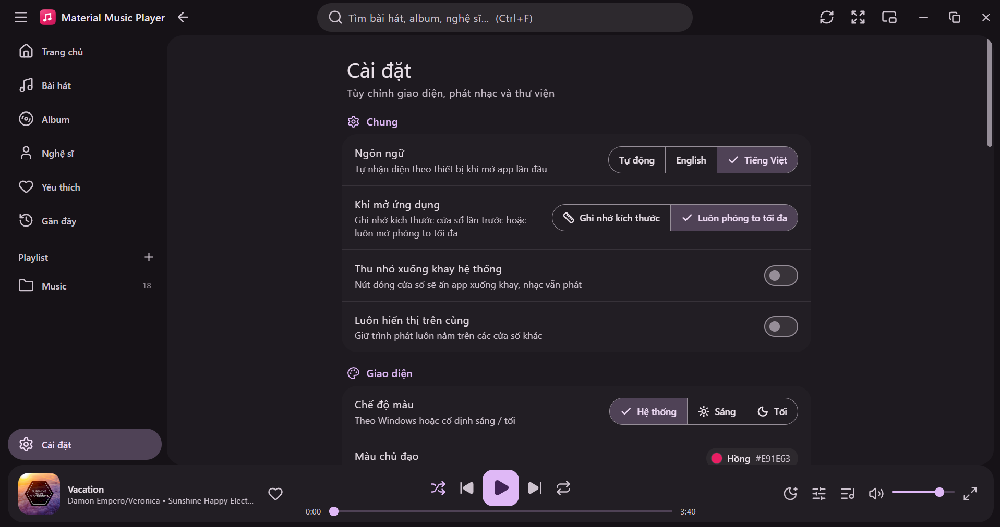

<div align="center">


# Material Music

**A beautiful local music player for Windows with a Material Design 3 interface.**


English · [Tiếng Việt](README.vi.md)

</div>

---

## Table of contents

1. [Introduction](#introduction)
2. [Screenshots](#screenshots)
3. [Features](#features)
4. [Installation](#installation)
5. [Tech Stack](#tech-stack)
6. [Development](#development)
7. [Build](#build)
8. [Project Structure](#project-structure)
9. [License](#license)

---

## Introduction

**Material Music** plays the music stored on your PC. It is built with [Tauri](https://tauri.app), React and Rust, so it is small, fast and light on memory, and it wears a modern **Material Design 3** interface:

- **Material You colors** generated from one theme color of your choice – or from the cover art of the song that is playing – in **light**, **dark** or **follow-system** mode.
- **English and Vietnamese** user interface, switchable at any time.
- **System font by default** (`system-ui`) with a font picker (Roboto, Inter, Open Sans, Segoe UI, Arial, Verdana, Georgia, Consolas …) and crisp **Lucide** icons.
- A **library** that scans your Windows *Music* folder automatically, reads tags and cover art, and builds playlists from folders.
- A full player: queue, playlists, equalizer, synced lyrics, sleep timer, mini player and more.

> ✨ Designed and developed by **minhtrong67** — with the support of the AI assistant **Claude** (Anthropic).

## Screenshots

> The images live in the [`screenshots`](screenshots) folder and are named `image01.png`, `image02.png`, `image03.png`… Replace each placeholder with a real screenshot using the same file name.

| Home | Songs (list) |
|:---:|:---:|
|  |  |

| Albums (grid) | Now Playing |
|:---:|:---:|
|  |  |

| Settings |
|:---:|
|  |

## Features

### Library
- **Import a folder** (recursive) – it becomes a playlist automatically, with a *Rescan* button to stay in sync.
- Import single files, **drag & drop** files or folders, or **Open with** from Explorer (mp3, flac, wav, ogg, opus, m4a, aac).
- **Automatic scan of the Windows Music folder** on startup; a **Refresh button** (title bar or `F5`) rescans on demand. New songs are added, changed ones updated and deleted ones removed.
- Importing a song that already exists **overwrites** it instead of creating a duplicate (matched by path); drives that are offline never wipe your library.
- Tags (title, artist, album, year, genre, track) and embedded **cover art** via `lofty`.
- Browse by Songs, Albums, Artists, Playlists, Favorites and Recent – with **list / grid view** on every tab, accent-insensitive search (`Ctrl+F`) and sorting.
- Virtualized lists: smooth with tens of thousands of songs.
- Back up / restore the library (JSON), remove missing files.
- **Folder watching:** songs you add, rename or delete inside the library folders show up automatically (can be turned off).
- **Edit tags:** right-click a song → *Edit tags* to rewrite title, artist, album, album artist, genre, year and track number inside the file itself.
- **Smart playlists** that fill themselves: *Most played*, *New this month*, *Never played* and *Lossless* (FLAC / WAV).

#### Supported audio formats

| Format | Extensions | Tags & cover art | Notes |
|---|---|---|---|
| MP3 | `.mp3` | ID3v1 / ID3v2 | Most common lossy format |
| FLAC | `.flac` | Vorbis comments, picture block | Lossless |
| WAV | `.wav` | RIFF INFO / ID3 | Uncompressed |
| Ogg Vorbis | `.ogg`, `.oga` | Vorbis comments | Lossy |
| Opus | `.opus` | Opus tags | Lossy, very efficient |
| M4A / AAC | `.m4a`, `.aac` | MP4 atoms / ADTS | Lossy (AAC) |

Playback uses the Microsoft Edge WebView2 media stack, so a file plays if WebView2 can decode it. The list lives in `AUDIO_EXTS` (see [Development](#development)).

### Playback
- Play / pause, previous / next, seek, volume, shuffle and repeat (off / all / one).
- Queue: play next, add to queue, drag to reorder.
- **Gapless playback** and optional **crossfade** (3 / 6 / 10 s): the next song is preloaded on a second audio deck and takes over without a gap.
- **ReplayGain** (track or album) evens out loudness between songs, limited by the stored peak so it never clips.
- Playlists: create, rename, delete, reorder, import / export **M3U / M3U8**.
- **10-band equalizer** with presets and preamp, playback speed 0.5× – 2×.
- **Synced lyrics** (`.lrc` next to the song or embedded in the tags) – click a line to seek. No lyrics yet? **Search online** (LRCLIB, only when you press the button) and save them as a `.lrc` next to the song.
- Spectrum visualizer, full-window *Now Playing* view and a **mini player** that stays on top.
- Sleep timer (15 – 120 minutes or after the current song), **global media keys** (Play/Pause, Next, Previous, Stop – work in the background and from the tray; the Windows media overlay shows the cover and progress), restore of the previous session.

### Appearance & languages
- Light, dark or system theme; **18 Material theme colors** + custom color (default theme = `material-theme-blue.json`); optional **dynamic color from the cover art**; **font picker** with popular fonts.
- A tidy, grouped **Settings** page: General · Appearance · Playback · Library · About.
- English / Vietnamese UI, automatic by default.
- **Material 3 Expressive:** spring motion tokens (fast / default / slow, spatial and effects, sampled into CSS `linear()` easing), five button sizes that stay round but square off while pressed or selected, icon toggle buttons that morph from circle to rounded square, connected button groups, an expressive slider (thick track, bar handle, value bubble), a **wavy seek bar** that flows while music plays and flattens when paused, a morphing-shape **loading indicator**, a floating-toolbar player bar and emphasized headings.
- **Theme reveal:** switching light / dark / color expands the new theme as a circle from where you clicked (View Transitions, with a fade fallback). Lyrics blur and soften away from the line being sung, and covers zoom in on every song change.
- Smooth Material motion: staggered card entrances, hover lift, sliding toggles, press feedback and screen transitions (reduced automatically when Windows animations are off).

### Performance
- **Fast start-up:** icons are tree-shaken Lucide SVGs (no icon font to load), the window is revealed only after the first frame is painted (no white flash) and the last theme is applied before the first paint.
- **Smooth with large libraries:** virtualized lists and grids, lazily generated thumbnails, images decoded off the main thread, and small, debounced writes to disk.
- **Resilient:** a built-in error screen with *Reload* replaces any blank window.

### Windows integration
- **Window on startup** (*Settings → General*): choose **Remember size** – the app reopens with the window size, position and state you left it in – or **Always maximized** – it opens maximized every time (a normal maximize, not `F11` fullscreen; restoring down returns to your last size). Fullscreen and the mini player are never saved, and if a monitor is unplugged the window is re-centered.
- System tray with play / pause / previous / next, optional *close to tray*, always on top, single instance.
- Frameless Material title bar.

### Security
- The asset protocol starts **empty**: only the cover cache and the folders that hold your library are readable by the web view (no more `**` wildcard).
- File commands accept only absolute paths to `.m3u`, `.m3u8`, `.lrc` and `.json` files, never write into the app's own data folder and cap the size of what they read.
- Content-Security-Policy with `object-src 'none'`, `base-uri 'none'` and `frame-ancestors 'none'`; online lyrics are fetched by the Rust side, so the web view still has no network access.

### Keyboard shortcuts

| Key | Action | Key | Action |
|---|---|---|---|
| `Space` | Play / pause | `M` | Mute |
| `Ctrl+←` / `Ctrl+→` | Previous / next song | `S` | Shuffle |
| `←` / `→` | Seek 5 s | `R` | Repeat mode |
| `↑` / `↓` | Volume | `L` | Favorite the playing song |
| `Q` | Queue | `N` | Now Playing |
| `Ctrl+F` | Search | `F5` | Refresh library |
| `F11` | Fullscreen | `Esc` | Close dialog / leave fullscreen |

## Installation

### Download

Download the latest installer from the **Releases** page of this repository:

| File | Description |
|---|---|
| `Material Music_1.1.0_x64-setup.exe` | Installer for Windows 10 / 11 (64-bit) – recommended |

| System requirements | |
|---|---|
| OS | Windows 10 (1809 or newer) or Windows 11, 64-bit |
| Runtime | Microsoft Edge WebView2 (preinstalled on Windows 11 and up-to-date Windows 10) |

Supported audio: **MP3, FLAC, WAV, OGG, Opus, M4A, AAC** (playback uses the WebView2 media stack). Prefer to build it yourself? See [Build](#build).

### Install

1. Run **`Material Music_1.1.0_x64-setup.exe`**. It installs per user, so **no administrator rights** are needed.
2. If Windows SmartScreen shows *"Windows protected your PC"* (the installer is not code-signed), click **More info → Run anyway**.
3. Follow the wizard and launch **Material Music** from the Start menu.
4. The app scans your **Music** folder automatically; add more with *Add folder* or by dragging folders into the window.

**Uninstall** – *Settings → Apps → Installed apps → Material Music → Uninstall* (or run `uninstall.exe` in the install folder). Data lives in `%APPDATA%\com.minhtrong67.material-music-player` and cover cache in `%LOCALAPPDATA%\com.minhtrong67.material-music-player`; delete them for a completely clean removal.

**Upgrading from "Melodia"** – the first launch automatically imports the library saved by the old Melodia build.

| Problem | Solution |
|---|---|
| Equalizer / visualizer not working | The WebView did not allow audio processing of local files; playback continues normally and the dialog shows a notice. |
| Old icon still shown after reinstall | Windows caches icons – rename the file or restart Explorer. |
| A song cannot be played | The file may be missing or damaged; the app skips to the next song and shows a message. |

## Tech Stack

| Layer | Technology |
|---|---|
| Desktop shell | [Tauri 2](https://tauri.app) (Rust) – tray, single-instance, dialogs, asset protocol, file associations |
| UI | [React 18](https://react.dev) + [TypeScript 5](https://www.typescriptlang.org) |
| Build tool | [Vite 5](https://vitejs.dev) |
| Styling | [Tailwind CSS 3](https://tailwindcss.com) with Material 3 design tokens |
| Design system | Material Design 3 – [`@material/material-color-utilities`](https://github.com/material-foundation/material-color-utilities), [Lucide](https://lucide.dev) icons, `system-ui` font (+ bundled Roboto / Inter / Open Sans, SIL OFL) |
| State | [Zustand](https://zustand-demo.pmnd.rs) |
| Audio | HTML5 `<audio>` + Web Audio API (equalizer, visualizer) on Microsoft Edge WebView2 |
| Rust crates | `tauri`, `tauri-plugin-dialog`, `tauri-plugin-single-instance`, `tauri-plugin-global-shortcut` (media keys), `lofty` (read / write tags, cover art, ReplayGain), `rayon` (parallel scan), `notify` (folder watching), `ureq` (online lyrics), `walkdir`, `base64`, `serde` |
| Installer | NSIS (via the Tauri bundler) |

## Development

**Prerequisites** – Windows 10 / 11 with WebView2, [Node.js](https://nodejs.org) 18+, [Rust](https://rustup.rs) (stable) with *Desktop development with C++* (Visual Studio Build Tools), and the [Tauri prerequisites](https://tauri.app/start/prerequisites/).

```bash
cd material-music-player
npm install
npm run dev
```

`npm run dev` launches the desktop app (Tauri) with hot reload. The first run compiles the Rust side and takes a few minutes.

| Command | What it does |
|---|---|
| `npm run dev` | Run the desktop app (Tauri) with hot reload |
| `npm run build` | Build the Windows installer |
| `npm run vite:dev` | UI only in a browser (Tauri features are unavailable) |
| `npm run icons` | Regenerate every app / setup / uninstall icon in `#E91E63` (needs Python + `pip install pillow`) |
| `npx tsc --noEmit` | Type-check the frontend |
| `cargo check` (inside `src-tauri`) | Type-check the Rust backend |

**Using it inside an existing Cargo workspace** – add it to the workspace members:

```toml
[workspace]
members = [
  # ...your existing apps...
  "material-music-player/src-tauri",
]
```

| Customization | Where |
|---|---|
| Default theme color | `defaultSettings.seedColor` in `src/lib/types.ts` and `DEFAULT_SEED` in `src/lib/theme.ts` |
| Theme colors / fonts offered | `MATERIAL_COLORS` / `FONT_OPTIONS` in `src/lib/theme.ts` |
| Add a language | add a dictionary in `src/lib/i18n.ts` (the compiler checks every key is translated) |
| Default window size | `app.windows` in `src-tauri/tauri.conf.json` |
| Supported audio extensions | `AUDIO_EXTS` in `src-tauri/src/lib.rs` and `src/lib/tauri.ts` |

User data: `library.json` (tracks), `user.json` (playlists, favorites, history, settings, session), `window.json` (window geometry) and `prefs.json` in `%APPDATA%\com.minhtrong67.material-music-player`; cover cache in `%LOCALAPPDATA%\com.minhtrong67.material-music-player\covers`.

## Build

```bash
npm install
npm run build
```

| Artifact | Path (project inside a Cargo workspace → `target` at the workspace root) |
|---|---|
| Installer | `target/release/bundle/nsis/Material Music_1.1.0_x64-setup.exe` |
| Portable executable | `target/release/material-music-player.exe` |

- The first build downloads the NSIS tooling, so an internet connection is required.
- To change the version, edit `version` in both `package.json` and `src-tauri/tauri.conf.json`.
- The installer is not code-signed – see the [Tauri signing guide](https://tauri.app/distribute/sign/windows/).

**Icons** – the app icon, the setup (installer) icon and the uninstall icon share the same artwork and ship with every standard Windows display size:

| File | Used for | Sizes |
|---|---|---|
| `src-tauri/icons/icon.ico` | app, taskbar, Explorer, window | 16, 20, 24, 32, 40, 48, 64, 128, 256 px |
| `src-tauri/icons/setup.ico` | setup `.exe` (icon + download badge) | 16, 20, 24, 32, 40, 48, 64, 128, 256 px |
| `src-tauri/icons/uninstall.ico` | `uninstall.exe` (icon + trash badge) | 16, 20, 24, 32, 40, 48, 64, 128, 256 px |
| `installer-header.bmp` / `installer-sidebar.bmp` | NSIS installer artwork | 150×57 / 164×314 |
| `32x32.png`, `64x64.png`, `128x128.png`, `128x128@2x.png` (256), `256x256.png`, `icon.png` (512) | Tauri / bundler / high-DPI | as named |

To use your own artwork replace `src-tauri/icons/icon.png` (square, ≥ 512 px), run `npx tauri icon src-tauri/icons/icon.png`, and update `scripts/generate-icons.py` if you also want matching setup / uninstall icons.

**Landing page** – `index.html` at the project root is a single-file Material Design landing page (responsive, SEO + social meta tags, EN/VI). Its Download button points to `download/Material-Music_1.1.0_x64-setup.exe`; copy your built installer into the [`download`](download) folder with that name. Open it by double-clicking, or host the repository root (e.g. GitHub Pages).

## Project Structure

```
material-music-player/
├─ screenshots/                README screenshots (image01.png … image05.png)
├─ index.html                 landing page (single HTML file, Material Design, SEO)
├─ download/                  put the setup .exe here (linked from the landing page)
├─ app.html                   app entry (Vite)
├─ public/                    static assets (logo used by the UI)
├─ src/                       React + TypeScript + Tailwind frontend
│  ├─ main.tsx, App.tsx       entry point, layout, global shortcuts, drag & drop, theme
│  ├─ index.css               Material 3 tokens, motion, sliders
│  ├─ lib/
│  │  ├─ store/               application state (zustand slices)
│  │  │  ├─ index.ts          composes the slices into `useStore`
│  │  │  ├─ core.ts           helpers shared by the slices (scan, merge, persistence, next-song sync)
│  │  │  ├─ library.ts · player.ts · playlists.ts · ui.ts · app.ts
│  │  │  └─ derived.ts        albums / artists / search hooks
│  │  ├─ audio.ts             two-deck engine: gapless, crossfade, ReplayGain, equalizer, spectrum
│  │  ├─ smart.ts             smart playlists
│  │  ├─ components/Expressive.tsx   wavy seek bar + morphing loading indicator
│  │  ├─ i18n.ts              English / Vietnamese dictionaries
│  │  ├─ theme.ts             Material 3 palette generation from a seed color
│  │  ├─ cover.ts, lrc.ts, m3u.ts, menus.ts
│  │  └─ tauri.ts, window.ts, types.ts, utils.ts
│  ├─ components/             TitleBar, NavDrawer, PlayerBar, NowPlaying, QueuePanel, MiniPlayer,
│  │                          Collection, TrackRow, TrackListView, MediaCard, Dialogs, ui (M3 kit) …
│  └─ views/                  Library (home, songs, albums, artists, playlists, search), Settings
├─ scripts/
│  └─ generate-icons.py       generates every icon (app, setup, uninstall) in #E91E63
├─ src-tauri/                 Rust backend
│  ├─ src/lib.rs              commands: parallel scan, tags (read / write) & covers, lyrics (local / online), state, tray, media keys, folder watcher, window memory
│  ├─ src/main.rs
│  ├─ capabilities/           Tauri permissions
│  ├─ icons/                  app, setup and uninstall icons
│  ├─ Cargo.toml
│  └─ tauri.conf.json         app, window, installer and file-association config
├─ README.md / README.vi.md
├─ package.json, vite.config.ts, tailwind.config.js, tsconfig.json
└─ LICENSE
```

## License

Released under the [MIT License](LICENSE) © 2026 minhtrong67.

Designed and developed by **minhtrong67** with the support of the AI assistant **Claude** (Anthropic). Built with [Tauri](https://tauri.app), [React](https://react.dev), [Tailwind CSS](https://tailwindcss.com), [Zustand](https://zustand-demo.pmnd.rs), [Material Color Utilities](https://github.com/material-foundation/material-color-utilities), [Lucide](https://lucide.dev) and [lofty](https://crates.io/crates/lofty).
