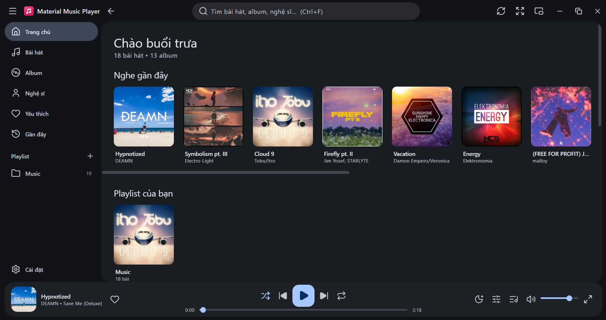
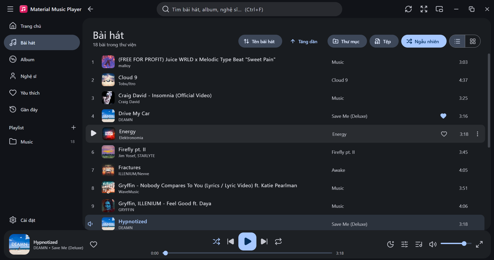
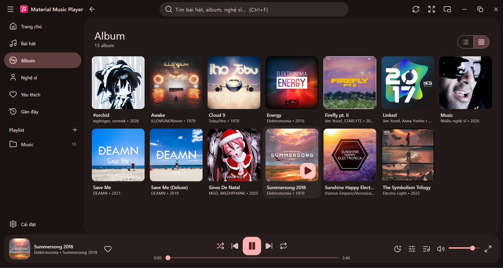
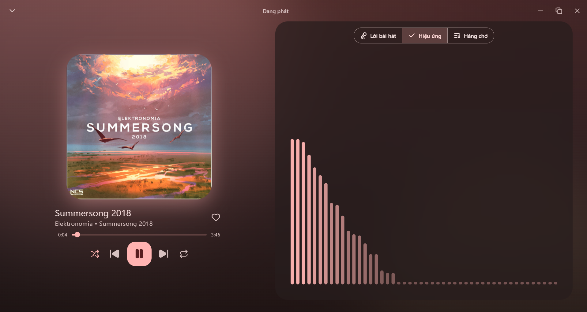
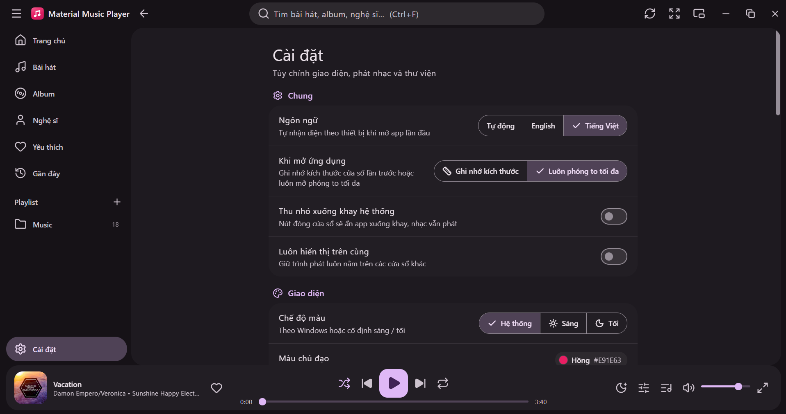

<div align="center">


# Material Music

**Trình phát nhạc local đẹp mắt cho Windows, giao diện Material Design 3.**


[English](README.md) · Tiếng Việt

</div>

---

## Mục lục

1. [Giới thiệu](#giới-thiệu)
2. [Screenshot](#screenshot)
3. [Tính năng](#tính-năng)
4. [Cài đặt](#cài-đặt)
5. [Tech stack](#tech-stack)
6. [Development](#development)
7. [Build](#build)
8. [Cấu trúc project](#cấu-trúc-project)
9. [License](#license)

---

## Giới thiệu

**Material Music** phát nhạc lưu trên máy tính của bạn. Ứng dụng xây dựng bằng [Tauri](https://tauri.app), React và Rust nên nhỏ, nhanh, ít tốn bộ nhớ, và mang giao diện **Material Design 3** hiện đại:

- **Hệ màu Material You** sinh từ một màu chủ đề bạn chọn – hoặc từ ảnh bìa bài đang phát – ở chế độ **sáng**, **tối** hoặc **theo hệ thống**.
- Giao diện **Tiếng Việt và English**, đổi bất cứ lúc nào.
- **Mặc định dùng font hệ thống** (`system-ui`), có thể chọn font phổ biến (Roboto, Inter, Open Sans, Segoe UI, Arial, Verdana, Georgia, Consolas …) và bộ icon **Lucide** sắc nét.
- **Thư viện** tự quét thư mục *Music* của Windows, đọc thẻ nhạc và ảnh bìa, tạo playlist từ thư mục.
- Đầy đủ trình phát: hàng chờ, playlist, equalizer, lời bài hát đồng bộ, hẹn giờ tắt, trình phát mini và nhiều hơn nữa.

> ✨ Thiết kế và phát triển bởi **minhtrong67** — với sự hỗ trợ của trợ lý AI **Claude** (Anthropic).

## Screenshot

> Các ảnh nằm trong thư mục [`screenshots`](screenshots) và đặt tên `image01.png`, `image02.png`, `image03.png`… Hãy thay từng ảnh giữ chỗ bằng ảnh chụp thật, giữ nguyên tên tệp.

| Trang chủ | Bài hát (danh sách) |
|:---:|:---:|
|  |  |

| Album (dạng ô) | Đang phát |
|:---:|:---:|
|  |  |

| Cài đặt |
|:---:|
|  |

## Tính năng

### Thư viện
- **Nhập thư mục** (đệ quy) – tự thành playlist, có nút *Quét lại* để đồng bộ.
- Nhập từng tệp, **kéo thả** tệp hoặc thư mục, hoặc **Mở bằng** từ Explorer (mp3, flac, wav, ogg, opus, m4a, aac).
- **Tự động quét thư mục Music của Windows** khi mở app; **nút Làm mới** (thanh tiêu đề hoặc `F5`) quét ngay. Bài mới được thêm, bài đã đổi được cập nhật, bài đã xóa bị gỡ khỏi thư viện.
- Nhập lại bài đã có sẽ **ghi đè** chứ không tạo bản sao (nhận diện theo đường dẫn); ổ đĩa tạm thời không kết nối sẽ không làm mất thư viện.
- Đọc thẻ nhạc (tên, nghệ sĩ, album, năm, thể loại, track) và **ảnh bìa** nhúng bằng `lofty`.
- Duyệt theo Bài hát, Album, Nghệ sĩ, Playlist, Yêu thích, Gần đây – mọi tab đều có **dạng danh sách / dạng ô**, tìm kiếm không dấu (`Ctrl+F`) và sắp xếp.
- Danh sách ảo hoá: mượt với hàng chục nghìn bài.
- Sao lưu / khôi phục thư viện (JSON), xóa tệp bị thiếu.
- **Theo dõi thư mục:** bài bạn thêm, đổi tên hoặc xóa trong các thư mục thư viện tự được cập nhật (có thể tắt).
- **Sửa thẻ bài hát:** chuột phải vào bài → *Sửa thẻ bài hát* để ghi lại tên, nghệ sĩ, album, nghệ sĩ album, thể loại, năm và số thứ tự thẳng vào tệp.
- **Playlist thông minh** tự đầy: *Nghe nhiều nhất*, *Mới trong tháng*, *Chưa nghe bao giờ* và *Chất lượng không mất dữ liệu* (FLAC / WAV).

#### Định dạng âm thanh được hỗ trợ

| Định dạng | Đuôi tệp | Thẻ nhạc & ảnh bìa | Ghi chú |
|---|---|---|---|
| MP3 | `.mp3` | ID3v1 / ID3v2 | Định dạng nén phổ biến nhất |
| FLAC | `.flac` | Vorbis comments, khối ảnh | Không mất dữ liệu |
| WAV | `.wav` | RIFF INFO / ID3 | Không nén |
| Ogg Vorbis | `.ogg`, `.oga` | Vorbis comments | Nén có mất dữ liệu |
| Opus | `.opus` | Thẻ Opus | Nén có mất dữ liệu, rất hiệu quả |
| M4A / AAC | `.m4a`, `.aac` | MP4 atoms / ADTS | Nén có mất dữ liệu (AAC) |

App phát nhạc bằng bộ giải mã media của Microsoft Edge WebView2, nên tệp nào WebView2 giải mã được thì phát được. Danh sách đuôi tệp nằm ở `AUDIO_EXTS` (xem [Development](#development)).

### Phát nhạc
- Phát / tạm dừng, bài trước / sau, tua, âm lượng, ngẫu nhiên, lặp (tắt / tất cả / một bài).
- Hàng chờ: phát tiếp theo, thêm vào hàng chờ, kéo thả sắp xếp.
- **Phát liền mạch (gapless)** và **crossfade** tùy chọn (3 / 6 / 10 giây): bài kế tiếp được nạp sẵn trên bộ phát thứ hai rồi nối vào không có khoảng trống.
- **ReplayGain** (theo bài hoặc theo album) cân bằng độ lớn giữa các bài, có giới hạn theo đỉnh (peak) nên không bị rè.
- Playlist: tạo, đổi tên, xóa, sắp xếp, nhập / xuất **M3U / M3U8**.
- **Equalizer 10 băng tần** có preset và preamp, tốc độ phát 0.5× – 2×.
- **Lời bài hát đồng bộ** (tệp `.lrc` cạnh bài hoặc nhúng trong thẻ) – bấm vào dòng để tua. Chưa có lời? **Tìm trên mạng** (LRCLIB, chỉ khi bạn bấm nút) rồi lưu thành tệp `.lrc` cạnh bài hát.
- Visualizer phổ âm thanh, màn hình *Đang phát* toàn khung và **trình phát mini** luôn ở trên cùng.
- Hẹn giờ tắt (15 – 120 phút hoặc hết bài hiện tại), **phím media toàn cục** (Phát/Tạm dừng, Bài kế, Bài trước, Dừng – hoạt động khi chạy nền và từ khay hệ thống; lớp phủ media của Windows hiển thị ảnh bìa và tiến trình), khôi phục phiên trước.

### Giao diện & ngôn ngữ
- Chủ đề sáng, tối hoặc theo hệ thống; màu có sẵn + màu tùy chọn; **màu động theo ảnh bìa**.
- Giao diện Tiếng Việt / English, mặc định tự theo hệ thống.
- **Material 3 Expressive:** chuyển động spring (nhanh / mặc định / chậm, spatial và effects, lấy mẫu thành easing `linear()` của CSS), nút có năm kích cỡ vẫn tròn nhưng vuông bo lại khi nhấn hoặc được chọn, nút biểu tượng bật/tắt đổi hình từ tròn sang vuông bo, nhóm nút liền (connected button group), slider kiểu mới (track dày, tay cầm dạng thanh, bong bóng giá trị), **thanh tua dạng sóng** chạy khi đang phát và phẳng lại khi tạm dừng, **loading indicator** đổi hình, thanh phát nhạc dạng toolbar nổi và tiêu đề nhấn mạnh.
- **Tự động cập nhật:** kiểm tra bản mới đã ký số khi mở app và mỗi 6 giờ, hiển thị ghi chú phát hành, tải kèm thanh tiến trình, cài đặt rồi khởi động lại (xem [Tự động cập nhật](#tự-động-cập-nhật)).
- **Hiệu ứng đổi giao diện:** khi chuyển sáng / tối / màu chủ đề, giao diện mới lan ra dạng vòng tròn từ chỗ bạn bấm (View Transitions, có phương án mờ dần dự phòng). Lời bài hát mờ và nhòe dần ra xa dòng đang hát, ảnh bìa phóng vào mỗi khi đổi bài.
- Chuyển động mượt kiểu Material: thẻ xuất hiện lần lượt, nhấc lên khi rê chuột, nút chuyển trượt, phản hồi khi bấm và chuyển màn hình (tự giảm khi tắt hiệu ứng động của Windows).

### Hiệu năng
- **Khởi động nhanh:** icon là SVG Lucide chỉ nạp phần dùng đến (không cần tải font icon), cửa sổ chỉ hiện sau khi khung hình đầu tiên đã vẽ xong (không còn màn hình trắng nháy) và chủ đề lần trước được áp dụng trước khi vẽ.
- **Mượt với thư viện lớn:** danh sách và lưới ảo hoá, ảnh thu nhỏ tạo dần khi cần, ảnh được giải mã ngoài luồng chính, ghi đĩa nhỏ và có độ trễ gộp.
- **Bền vững:** có màn hình báo lỗi kèm nút *Tải lại* thay cho cửa sổ trắng.

### Tích hợp Windows
- **Cửa sổ khi mở app** (*Cài đặt → Hệ thống*): chọn **Ghi nhớ kích thước** – mở lại đúng kích thước, vị trí và trạng thái cửa sổ lần trước – hoặc **Luôn phóng to tối đa** – luôn mở ở trạng thái phóng to (phóng to bình thường, không phải toàn màn hình `F11`; thu nhỏ lại sẽ về đúng kích thước lần trước). Chế độ toàn màn hình và mini không bao giờ bị lưu; nếu màn hình đã rút khỏi máy, cửa sổ tự về giữa màn hình.
- Khay hệ thống có phát / tạm dừng / trước / sau, tùy chọn *đóng xuống khay*, luôn ở trên cùng, chỉ chạy một cửa sổ.
- Thanh tiêu đề Material tự vẽ.

### Bảo mật
- Giao thức asset bắt đầu **rỗng**: web view chỉ đọc được thư mục cache ảnh bìa và các thư mục chứa thư viện của bạn (bỏ ký tự đại diện `**`).
- Các lệnh về tệp chỉ nhận đường dẫn tuyệt đối tới tệp `.m3u`, `.m3u8`, `.lrc`, `.json`, không ghi vào thư mục dữ liệu của app và giới hạn dung lượng khi đọc.
- Content-Security-Policy có `object-src 'none'`, `base-uri 'none'`, `frame-ancestors 'none'`; lời bài hát trên mạng do phía Rust tải, nên web view vẫn không có quyền truy cập mạng.

### Phím tắt

| Phím | Chức năng | Phím | Chức năng |
|---|---|---|---|
| `Space` | Phát / tạm dừng | `M` | Tắt tiếng |
| `Ctrl+←` / `Ctrl+→` | Bài trước / sau | `S` | Ngẫu nhiên |
| `←` / `→` | Tua 5 giây | `R` | Chế độ lặp |
| `↑` / `↓` | Âm lượng | `L` | Yêu thích bài đang phát |
| `Q` | Hàng chờ | `N` | Màn hình đang phát |
| `Ctrl+F` | Tìm kiếm | `F5` | Làm mới thư viện |
| `Esc` | Đóng cửa sổ | | |

## Cài đặt

### Download

Tải bộ cài mới nhất ở trang **Releases** của repository này:

| Tệp | Mô tả |
|---|---|
| `Material Music_1.2.0_x64-setup.exe` | Bộ cài cho Windows 10 / 11 (64-bit) – khuyên dùng |

| Yêu cầu hệ thống | |
|---|---|
| Hệ điều hành | Windows 10 (1809 trở lên) hoặc Windows 11, 64-bit |
| Runtime | Microsoft Edge WebView2 (có sẵn trên Windows 11 và Windows 10 đã cập nhật) |

Định dạng âm thanh hỗ trợ: **MP3, FLAC, WAV, OGG, Opus, M4A, AAC** (phát bằng bộ giải mã WebView2). Muốn tự build? Xem mục [Build](#build).

### Cài đặt

1. Chạy **`Material Music_1.2.0_x64-setup.exe`**. Bộ cài cài theo từng người dùng nên **không cần quyền quản trị**.
2. Nếu Windows SmartScreen hiện *"Windows protected your PC"* (bộ cài chưa ký số), bấm **More info → Run anyway**.
3. Làm theo trình cài đặt rồi mở **Material Music** từ Start menu.
4. Ứng dụng tự quét thư mục **Music**; thêm thư mục khác bằng *Thêm thư mục* hoặc kéo thả vào cửa sổ.

**Gỡ cài đặt** – *Settings → Apps → Installed apps → Material Music → Uninstall* (hoặc chạy `uninstall.exe` trong thư mục cài đặt). Dữ liệu nằm ở `%APPDATA%\com.minhtrong67.material-music-player`, bộ nhớ đệm ảnh bìa ở `%LOCALAPPDATA%\com.minhtrong67.material-music-player`; xóa hai thư mục này nếu muốn gỡ sạch hoàn toàn.

**Nâng cấp từ "Melodia"** – lần mở đầu tiên app tự nhập thư viện đã lưu của bản Melodia cũ.

| Sự cố | Cách xử lý |
|---|---|
| Equalizer / visualizer không hoạt động | WebView không cho xử lý âm thanh với tệp cục bộ; nhạc vẫn phát bình thường và hộp thoại có thông báo. |
| Sau khi cài lại vẫn hiện icon cũ | Windows lưu cache icon – đổi tên tệp hoặc khởi động lại Explorer. |
| Không phát được một bài | Tệp có thể bị thiếu hoặc hỏng; app tự chuyển sang bài tiếp theo và hiện thông báo. |

## Tech stack

| Tầng | Công nghệ |
|---|---|
| Lõi desktop | [Tauri 2](https://tauri.app) (Rust) – khay hệ thống, single-instance, hộp thoại, asset protocol, liên kết tệp |
| Giao diện | [React 18](https://react.dev) + [TypeScript 5](https://www.typescriptlang.org) |
| Công cụ build | [Vite 5](https://vitejs.dev) |
| Styling | [Tailwind CSS 3](https://tailwindcss.com) với design token Material 3 |
| Design system | Material Design 3 – [`@material/material-color-utilities`](https://github.com/material-foundation/material-color-utilities), icon [Lucide](https://lucide.dev), font `system-ui` (+ Roboto / Inter / Open Sans đóng gói sẵn, giấy phép SIL OFL) |
| State | [Zustand](https://zustand-demo.pmnd.rs) |
| Âm thanh | HTML5 `<audio>` + Web Audio API (equalizer, visualizer) trên Microsoft Edge WebView2 |
| Rust crates | `tauri`, `tauri-plugin-dialog`, `tauri-plugin-single-instance`, `tauri-plugin-global-shortcut` (phím media), `lofty` (đọc / ghi thẻ, ảnh bìa, ReplayGain), `rayon` (quét song song), `notify` (theo dõi thư mục), `ureq` (lời bài hát trên mạng), `walkdir`, `base64`, `serde` |
| Bộ cài | NSIS (qua Tauri bundler) |

## Development

**Yêu cầu** – Windows 10 / 11 có WebView2, [Node.js](https://nodejs.org) 18+, [Rust](https://rustup.rs) (stable) với *Desktop development with C++* (Visual Studio Build Tools) và [điều kiện của Tauri](https://tauri.app/start/prerequisites/).

```bash
cd material-music-player
npm install
npm run dev
```

`npm run dev` mở ứng dụng desktop (Tauri) với hot reload. Lần chạy đầu phải biên dịch phần Rust nên mất vài phút.

| Lệnh | Tác dụng |
|---|---|
| `npm run dev` | Chạy ứng dụng desktop (Tauri), có hot reload |
| `npm run build` | Đóng gói bộ cài cho Windows |
| `npm run vite:dev` | Chỉ chạy giao diện trên trình duyệt (tính năng Tauri không dùng được) |
| `npm run icons` | Tạo lại toàn bộ icon app / setup / uninstall màu `#E91E63` (cần Python + `pip install pillow`) |
| `npx tsc --noEmit` | Kiểm tra kiểu cho frontend |
| `cargo check` (trong `src-tauri`) | Kiểm tra backend Rust |

**Dùng trong workspace Cargo có sẵn** – thêm vào `members`:

```toml
[workspace]
members = [
  # ...các app hiện có...
  "material-music-player/src-tauri",
]
```

| Tùy biến | Vị trí |
|---|---|
| Màu chủ đề mặc định | `defaultSettings.seedColor` trong `src/lib/types.ts` và `DEFAULT_SEED` trong `src/lib/theme.ts` |
| Danh sách màu / font | `MATERIAL_COLORS` / `FONT_OPTIONS` trong `src/lib/theme.ts` |
| Thêm ngôn ngữ | thêm từ điển trong `src/lib/i18n.ts` (trình biên dịch kiểm tra đủ khóa dịch) |
| Kích thước cửa sổ mặc định | `app.windows` trong `src-tauri/tauri.conf.json` |
| Đuôi âm thanh được hỗ trợ | `AUDIO_EXTS` trong `src-tauri/src/lib.rs` và `src/lib/tauri.ts` |

Dữ liệu người dùng: `library.json` (bài hát), `user.json` (playlist, yêu thích, lịch sử, cài đặt, phiên phát), `window.json` (kích thước cửa sổ) và `prefs.json` trong `%APPDATA%\com.minhtrong67.material-music-player`; ảnh bìa lưu đệm ở `%LOCALAPPDATA%\com.minhtrong67.material-music-player\covers`.

## Build

```bash
npm install
npm run build
```

| Sản phẩm | Đường dẫn (project nằm trong Cargo workspace → `target` ở gốc workspace) |
|---|---|
| Bộ cài | `target/release/bundle/nsis/Material Music_1.2.0_x64-setup.exe` |
| File chạy trực tiếp | `target/release/material-music-player.exe` |

- Lần build đầu tải công cụ NSIS nên cần có internet.
- Muốn đổi phiên bản, sửa `version` ở cả `package.json` và `src-tauri/tauri.conf.json`.
- Bộ cài chưa ký số – xem [hướng dẫn ký của Tauri](https://tauri.app/distribute/sign/windows/).

**Icon** – icon ứng dụng, icon bộ cài (setup) và icon gỡ cài đặt (uninstall) dùng chung một hình và có đủ mọi kích thước hiển thị chuẩn của Windows:

| Tệp | Dùng cho | Kích thước |
|---|---|---|
| `src-tauri/icons/icon.ico` | ứng dụng, thanh tác vụ, Explorer, cửa sổ | 16, 20, 24, 32, 40, 48, 64, 128, 256 px |
| `src-tauri/icons/setup.ico` | trình cài đặt `setup.exe` (icon + huy hiệu tải xuống) | 16, 20, 24, 32, 40, 48, 64, 128, 256 px |
| `src-tauri/icons/uninstall.ico` | `uninstall.exe` (icon + huy hiệu thùng rác) | 16, 20, 24, 32, 40, 48, 64, 128, 256 px |
| `installer-header.bmp` / `installer-sidebar.bmp` | hình nền trình cài đặt NSIS | 150×57 / 164×314 |
| `32x32.png`, `64x64.png`, `128x128.png`, `128x128@2x.png` (256), `256x256.png`, `icon.png` (512) | Tauri / bundler / màn hình độ phân giải cao | theo tên tệp |

Muốn dùng hình khác, thay `src-tauri/icons/icon.png` (vuông, ≥ 512 px), chạy `npx tauri icon src-tauri/icons/icon.png`, rồi chỉnh `scripts/generate-icons.py` nếu muốn tạo lại icon setup / uninstall tương ứng.

**Landing page** – `index.html` ở thư mục gốc là trang giới thiệu một tệp HTML theo phong cách Material Design (responsive, đủ thẻ meta SEO và chia sẻ mạng xã hội, song ngữ EN/VI). Nút Download trỏ tới `download/Material-Music_1.2.0_x64-setup.exe`; hãy chép bộ cài đã build vào thư mục [`download`](download) với đúng tên này. Mở bằng cách nhấp đúp, hoặc host thư mục gốc (ví dụ GitHub Pages).

### Tự động cập nhật

App kiểm tra phiên bản mới sau khi mở vài giây và cứ 6 giờ một lần (*Cài đặt → Giới thiệu → Tự động cập nhật*, hoặc bấm **Kiểm tra cập nhật**). App đọc một tệp khai báo nhỏ `download/latest.json` trên website; nếu có bản mới hơn đã được **ký số**, toast và hộp thoại sẽ hiện ra để tải về, xem ghi chú phát hành và thanh tiến trình, cài đặt rồi tự khởi động lại. Mọi bản cập nhật đều được xác minh bằng khóa công khai của bạn trước khi cài.

### Thiết lập một lần
1. Tạo cặp khóa ký (giữ khóa riêng bí mật, đừng commit, nhớ sao lưu: mất khóa là không phát hành cập nhật được nữa):
   ```powershell
   npx tauri signer generate -w "$env:USERPROFILE\.tauri\material-music.key"
   ```
2. Mở `material-music.key.pub`, chép toàn bộ nội dung và dán vào `src-tauri/tauri.conf.json` → `plugins.updater.pubkey` (thay chỗ giữ chỗ).
3. Kiểm tra `plugins.updater.endpoints` (mặc định `https://material-music-player-delta.vercel.app/download/latest.json`). Nếu website nằm ở nơi khác thì đổi lại và đặt `UPDATE_BASE_URL` cho bước 2 bên dưới.

### Phát hành phiên bản mới
1. Tăng version trong `package.json`, `src-tauri/Cargo.toml` và `src-tauri/tauri.conf.json`.
2. Build, ký và tạo tệp khai báo trong một lệnh (PowerShell):
   ```powershell
   $env:TAURI_SIGNING_PRIVATE_KEY = "$env:USERPROFILE\.tauri\material-music.key"
   $env:TAURI_SIGNING_PRIVATE_KEY_PASSWORD = "mat-khau-cua-ban"   # chỉ khi bạn có đặt mật khẩu
   npm run release -- "Điểm mới của phiên bản này"
   ```
   Lệnh này chạy `tauri build` kèm gói cập nhật, chép bộ cài vào `download/Material-Music_<version>_x64-setup.exe` và ghi `download/latest.json`.
3. Deploy website (đẩy thư mục `download` lên). Các app đã cài sẽ nhận bản mới ở lần kiểm tra kế tiếp.

`npm run build` không đổi: vẫn tạo bộ cài thường, không ký và không cần khóa. Bản cài trước khi có tự cập nhật (1.1.0 trở xuống) cần cập nhật thủ công một lần.

## Cấu trúc project

```
material-music-player/
├─ screenshots/                ảnh chụp dùng trong README (image01.png … image05.png)
├─ index.html                 landing page (một tệp HTML, Material Design, SEO)
├─ download/                  đặt tệp cài đặt .exe vào đây
├─ app.html                   điểm vào của ứng dụng (Vite)
├─ public/                    tài nguyên tĩnh (logo dùng trong giao diện)
├─ src/                       frontend React + TypeScript + Tailwind
│  ├─ main.tsx, App.tsx       điểm vào, bố cục, phím tắt toàn cục, kéo thả, chủ đề
│  ├─ index.css               token Material 3, chuyển động, slider
│  ├─ lib/
│  │  ├─ store/               trạng thái ứng dụng (các slice zustand)
│  │  │  ├─ index.ts          ghép các slice thành `useStore`
│  │  │  ├─ core.ts           hàm dùng chung giữa các slice (quét, gộp, lưu, đồng bộ bài kế tiếp)
│  │  │  ├─ library.ts · player.ts · playlists.ts · ui.ts · app.ts
│  │  │  └─ derived.ts        hook album / nghệ sĩ / tìm kiếm
│  │  ├─ audio.ts             bộ máy hai deck: gapless, crossfade, ReplayGain, equalizer, phổ âm thanh
│  │  ├─ smart.ts             playlist thông minh
│  │  ├─ components/Expressive.tsx   thanh tua dạng sóng + loading indicator đổi hình
│  │  ├─ i18n.ts              từ điển English / Tiếng Việt
│  │  ├─ theme.ts             sinh bảng màu Material 3 từ màu chủ đề
│  │  ├─ cover.ts, lrc.ts, m3u.ts, menus.ts
│  │  └─ tauri.ts, window.ts, types.ts, utils.ts
│  ├─ components/             TitleBar, NavDrawer, PlayerBar, NowPlaying, QueuePanel, MiniPlayer,
│  │                          Collection, TrackRow, TrackListView, MediaCard, Dialogs, ui (bộ M3) …
│  └─ views/                  Library (trang chủ, bài hát, album, nghệ sĩ, playlist, tìm kiếm), Settings
├─ scripts/
│  └─ generate-icons.py       tạo toàn bộ icon (app, setup, uninstall) màu #E91E63
├─ src-tauri/                 backend Rust
│  ├─ src/lib.rs              lệnh: quét song song, thẻ nhạc (đọc / ghi) & ảnh bìa, lời bài hát (cục bộ / trên mạng), trạng thái, khay, phím media, theo dõi thư mục, nhớ cửa sổ
│  ├─ src/main.rs
│  ├─ capabilities/           quyền của Tauri
│  ├─ icons/                  icon ứng dụng, setup và uninstall
│  ├─ Cargo.toml
│  └─ tauri.conf.json         cấu hình ứng dụng, cửa sổ, bộ cài, liên kết tệp
├─ README.md / README.vi.md
├─ package.json, vite.config.ts, tailwind.config.js, tsconfig.json
└─ LICENSE
```

## License

Phát hành theo [Giấy phép MIT](LICENSE) © 2026 minhtrong67.

Thiết kế và phát triển bởi **minhtrong67** với sự hỗ trợ của trợ lý AI **Claude** (Anthropic). Xây dựng với [Tauri](https://tauri.app), [React](https://react.dev), [Tailwind CSS](https://tailwindcss.com), [Zustand](https://zustand-demo.pmnd.rs), [Material Color Utilities](https://github.com/material-foundation/material-color-utilities), [Lucide](https://lucide.dev) và [lofty](https://crates.io/crates/lofty).
