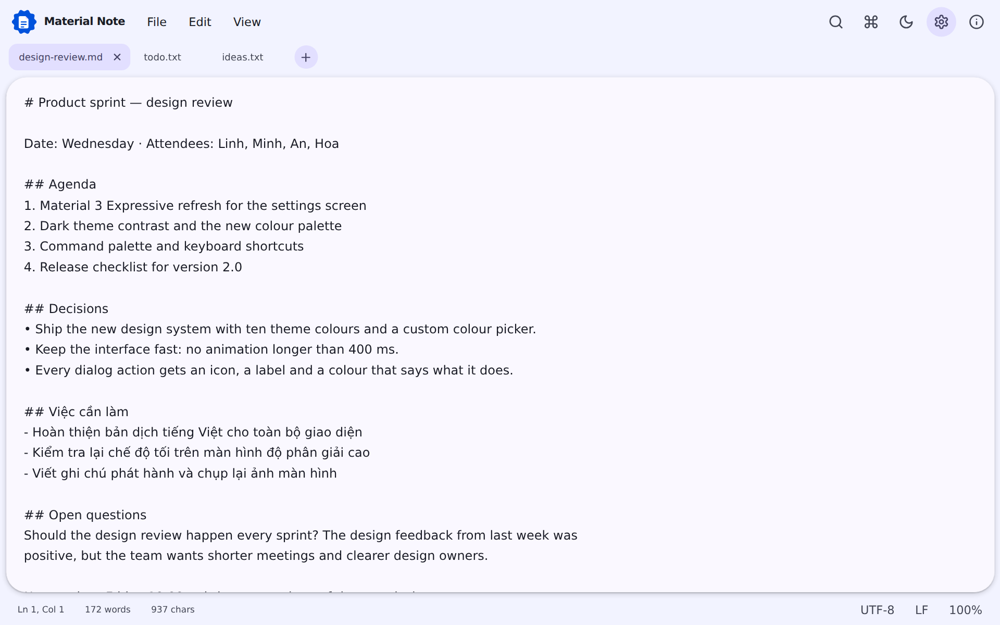
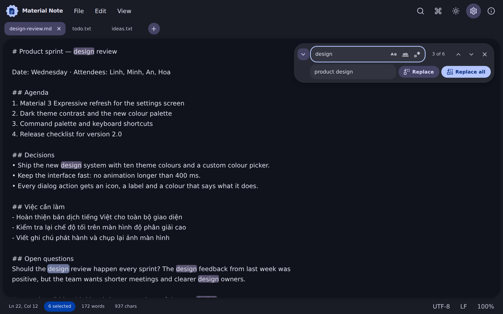
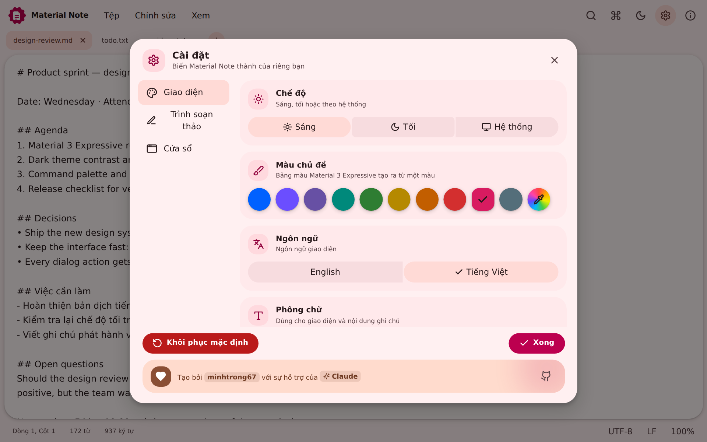
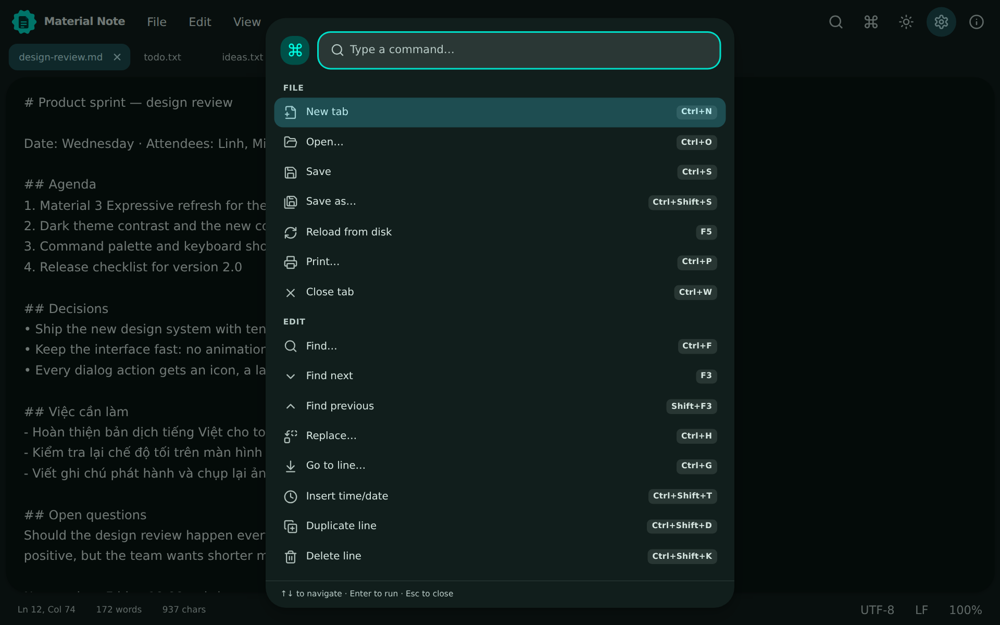

<div align="center">


# Material Note

**Ứng dụng ghi chú nhanh, biểu cảm theo phong cách Material 3 Expressive.**
Nhiều thẻ · Tìm & thay thế · Bảng lệnh · Giao diện tuỳ chỉnh · Tiếng Anh & Tiếng Việt

[English](README.md) · [Tải về](download/) · [Landing page](index.html)

</div>

---

## Giới thiệu

Material Note là ứng dụng ghi chú gọn nhẹ cho máy tính, xây dựng bằng **Tauri**, **React** và **TypeScript**. Mở lên là chạy, không vướng tay và mang giao diện Material 3 Expressive hiện đại: nút bấm đổi hình khi nhấn, hiệu ứng lò xo, chuyển giao diện sáng/tối bằng vòng loang tròn và bảng màu tạo từ bất kỳ màu nào bạn thích.

Dự án thuộc bộ sưu tập mã nguồn mở [my-tauri-apps](https://github.com/minhtrong67/my-tauri-apps).

## Ảnh màn hình

| | |
|---|---|
|  |  |
|  |  |

## Tính năng

- **Thẻ nhớ phiên làm việc** – kéo thả sắp xếp, nhấn chuột giữa để đóng, thẻ ngang hoặc dọc; tự khôi phục tệp đang mở, vị trí con trỏ, vị trí cuộn và cả nội dung chưa lưu.
- **Tìm & thay thế** – tô sáng trực tiếp, phân biệt hoa thường, cả từ, biểu thức chính quy, bộ đếm kết quả, thay tất cả.
- **Bảng lệnh** – `Ctrl+Shift+P` chạy mọi thao tác theo tên.
- **Bảng mã & lưu an toàn** – UTF-8 (có/không BOM), UTF-16, Windows-125x, Shift-JIS, GBK…; đổi kiểu xuống dòng LF/CRLF; lưu nguyên tử; cảnh báo khi tệp bị đổi trên ổ đĩa.
- **Tiện ích soạn thảo** – đi tới dòng, nhân đôi/xoá dòng, chữ hoa/thường, chèn giờ/ngày, thu phóng bằng `Ctrl+Cuộn`, tự xuống dòng, chế độ tập trung, toàn màn hình, in.
- **Tự động lưu** cho tệp đã có tên, tự khôi phục phiên làm việc và **thư mục lưu mặc định** tuỳ chỉnh.
- **Cài đặt** – sáng / tối / hệ thống, 10 màu chủ đề Material và bộ chọn màu tuỳ ý, năm phông chữ (System UI, Roboto, Inter, Lora, JetBrains Mono), cỡ chữ Nhỏ / Vừa / Lớn, tiếng Anh và tiếng Việt, cách cửa sổ mở (ghi nhớ kích thước hoặc luôn phóng to tối đa).
- **Trải nghiệm trau chuốt** – tooltip và dropdown tự thiết kế, toast 4 loại (thông tin, thành công, cảnh báo, lỗi), nút hành động luôn có icon + nhãn + màu, nút lên đầu trang, kéo thả tệp, chỉ chạy một cửa sổ.

## Cài đặt

1. Tải bộ cài mới nhất trong thư mục [`download`](download/) (`Material-Note-Setup.exe`).
2. Chạy bộ cài (cài cho người dùng hiện tại, không cần quyền quản trị).
3. Mở **Material Note** từ Start, hoặc nhấn chuột phải vào tệp văn bản và chọn *Open with*.

> Yêu cầu Windows 10 / 11 (64-bit).

## Công nghệ

Tauri 2 (Rust) · React 18 · TypeScript · Vite · Tailwind CSS 4 · Zustand · Lucide · `@material/material-color-utilities` · phông Roboto, Inter, Lora, JetBrains Mono (kèm sẵn, dùng offline).

## Phát triển

```bash
npm install     # cài thư viện
npm run dev     # chạy ứng dụng desktop (hot reload)
```

Thêm: `npm run web:dev` (chỉ giao diện trên trình duyệt), `npm run icons` (tạo lại toàn bộ icon), `npm run palettes` (tạo lại bảng màu trong `index.html`).

## Build

```bash
npm run build
```

Bộ cài nằm ở `target/release/bundle/`. Đổi tên file `.exe` thành `Material-Note-Setup.exe` rồi chép vào [`download/`](download/) để nút tải trên landing page hoạt động.

## Cấu trúc dự án

Xem sơ đồ trong [README.md](README.md#project-structure).

## Giấy phép

Mã nguồn mở theo [giấy phép MIT](LICENSE).

Tạo bởi **minhtrong67** với sự hỗ trợ của **Claude** · <https://github.com/minhtrong67/my-tauri-apps>
