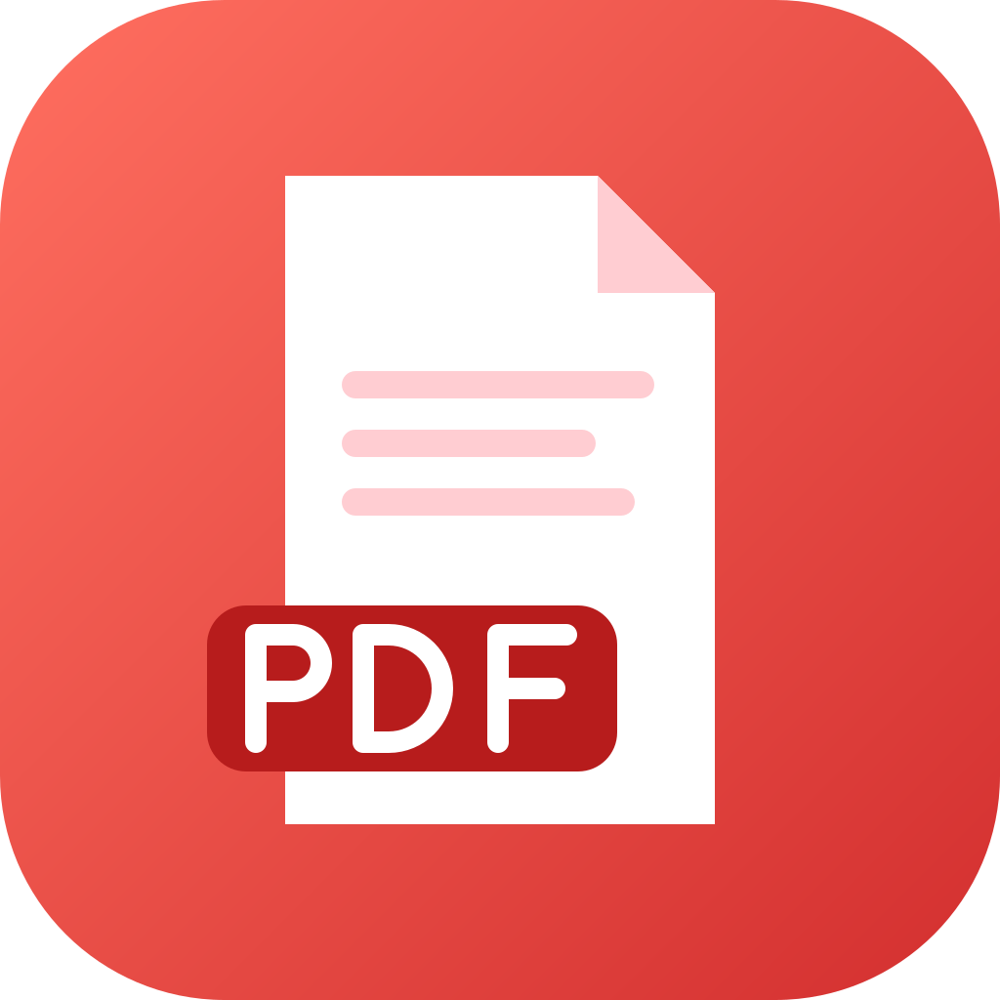
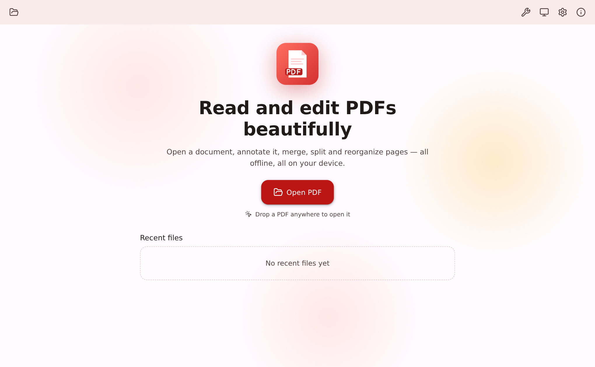
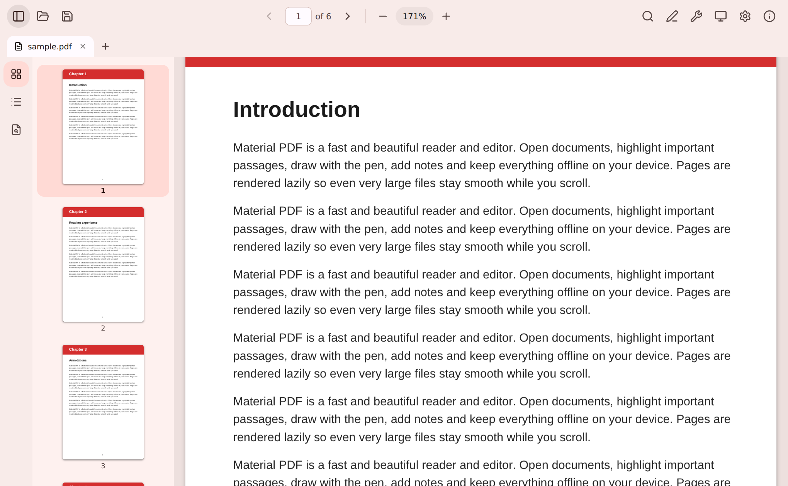
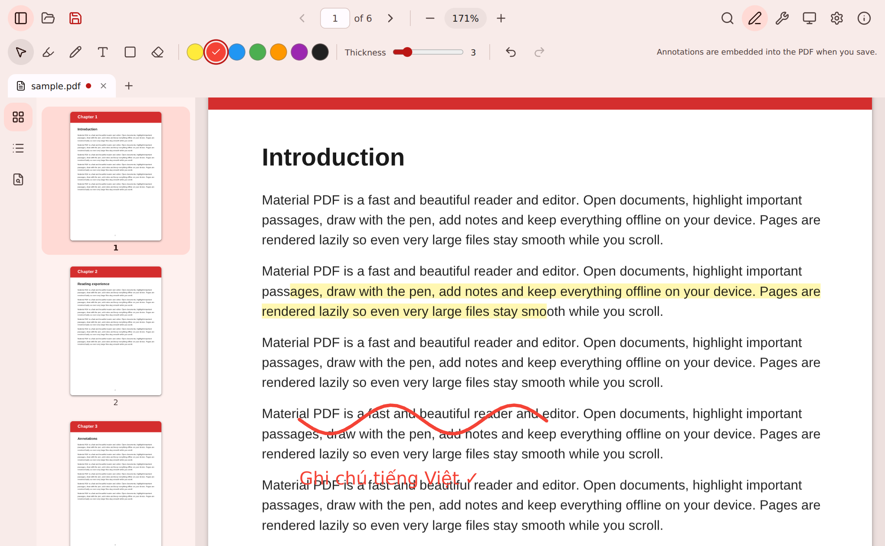
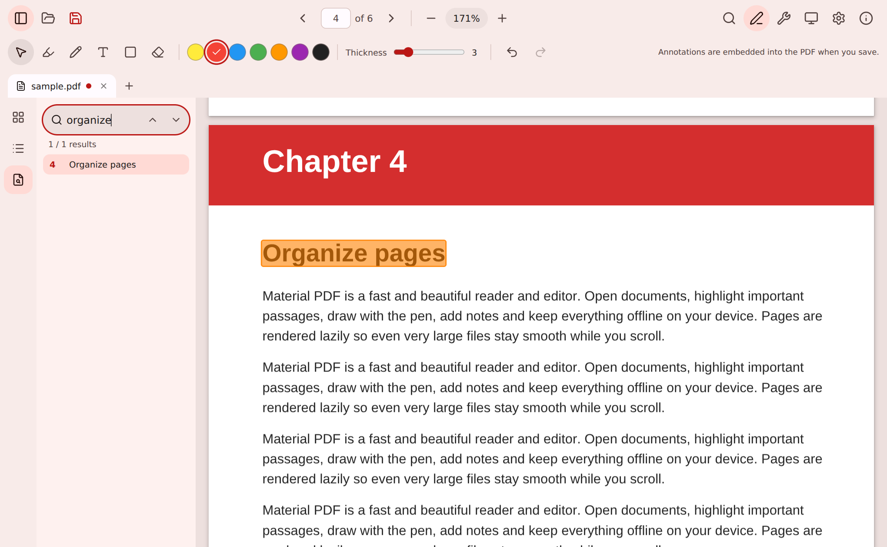
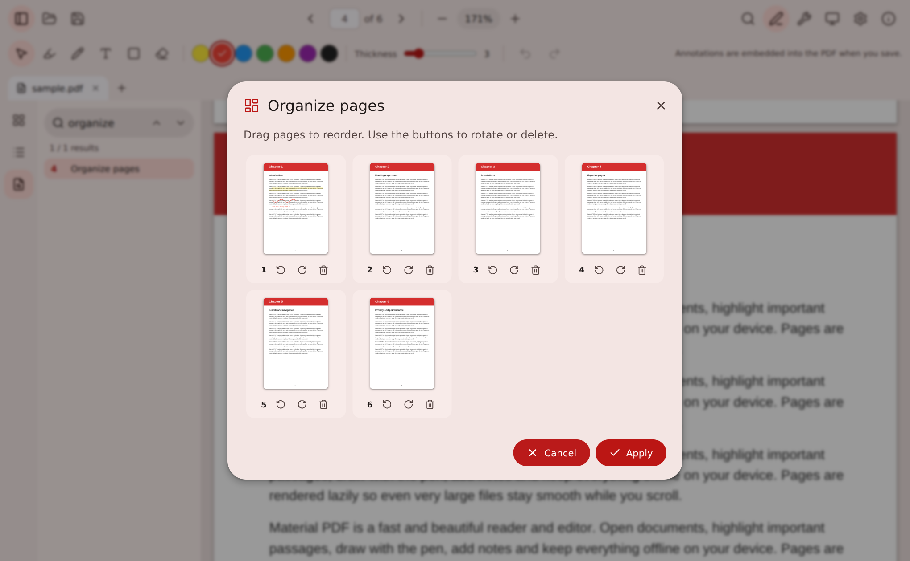
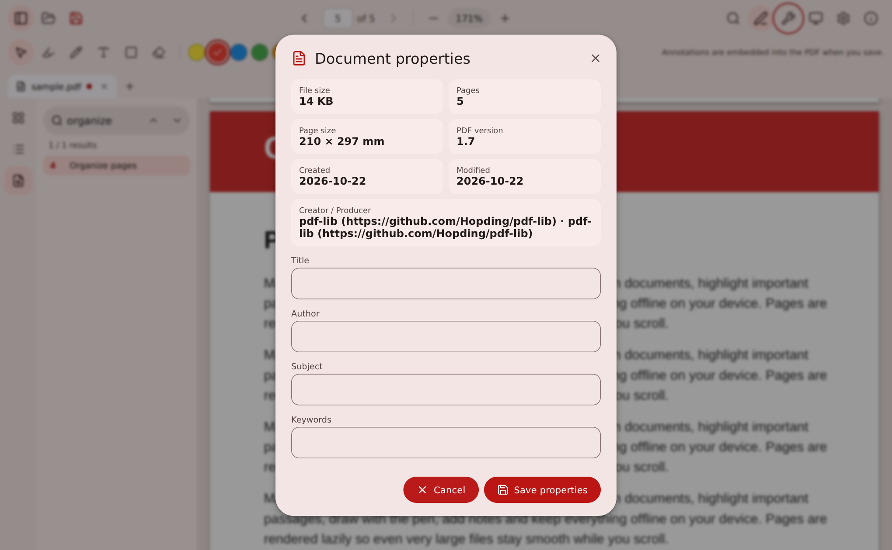
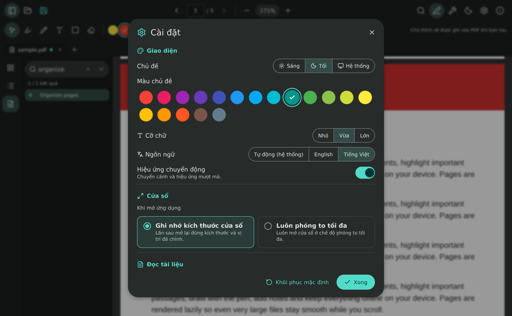
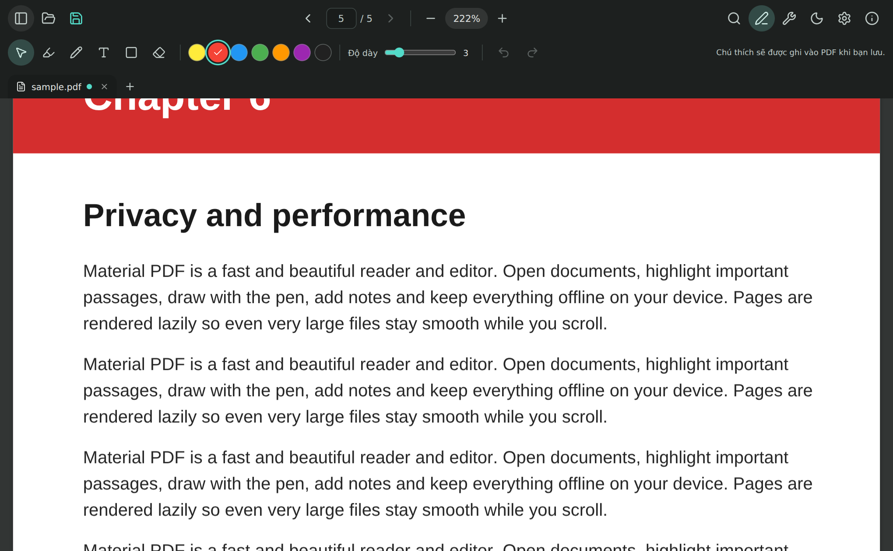
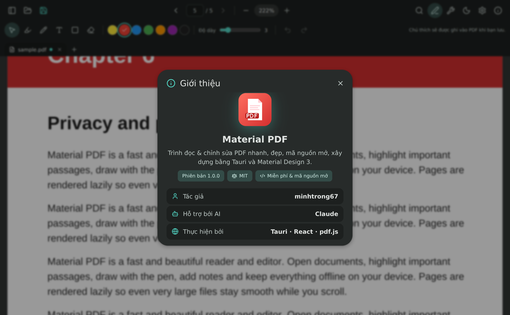

<div align="center">



# Material PDF

**A fast, beautiful and open-source PDF reader & editor — built with Tauri and Material Design 3.**

[](LICENSE)


English · [Tiếng Việt](#tiếng-việt)

</div>

## Introduction

Material PDF lets you read, search, annotate and reorganize PDF files completely offline. The interface follows Material Design 3 with dynamic color themes, light/dark/system modes and smooth, purposeful animations.

## Screenshots

| | |
|---|---|
|  |  |
|  |  |
|  |  |
|  |  |
|  | |

## Features

- **Reading** — multi-tab, continuous or single-page layout, zoom (fit width / fit page / custom, Ctrl + wheel), thumbnails, outline, night mode for pages, presentation mode (F5), print.
- **Search** — full-text search with highlighted matches and a results list.
- **Annotate** — highlight selected text, pen, rectangle, text notes (Unicode / Vietnamese supported), eraser, undo/redo. Annotations are embedded into the PDF on save.
- **Edit** — merge PDFs, split / extract by ranges, organize pages (drag to reorder, rotate, delete), images → PDF, export pages as PNG, edit document properties.
- **Security** — opens password-protected documents.
- **Personalization** — light / dark / system theme, 18 Material theme colors, 3 font sizes, English & Vietnamese (auto-detected), window startup: remember size or always maximized.
- **Convenience** — drag & drop, recent files, "Open with" file association, keyboard shortcuts (Ctrl+O/S/P/F/W, Ctrl +/−/0, arrows).

## Installation

Download the installer from the [`download`](download) folder (or the landing page `index.html`) and run `Material-PDF_1.0.0_x64-setup.exe`. Or build it yourself — see below.

## Tech stack

Tauri 2 (Rust) · React 18 + TypeScript · Vite · pdf.js · pdf-lib · Zustand · Lucide icons · Material Color Utilities.

## Development

Requirements: [Node.js 18+](https://nodejs.org), [Rust](https://rustup.rs) and the [Tauri prerequisites](https://tauri.app/start/prerequisites/).

```bash
npm install
npm run dev      # launches the desktop app with hot reload
```

This project is a member of a shared Cargo workspace (`../Cargo.toml`, members `*/src-tauri`), so all projects reuse one `target/` cache.

## Build

```bash
npm run build
```

The NSIS installer is created in `../target/release/bundle/nsis/`. Copy it to `download/` for the landing page.

## Project structure

```
material-pdf/
├── index.html            # landing page
├── download/             # installer location
├── screenshots/          # image01.png, image02.png, ...
├── app/                  # frontend (Vite root)
│   ├── index.html
│   ├── public/           # icon.svg, pdf.js cmaps/fonts (copied on install)
│   └── src/
│       ├── components/   # Toolbar, Viewer, Sidebar, Dialogs, ...
│       └── lib/          # store, i18n, theme, pdf engine, native bridge
├── src-tauri/            # Rust backend, config, icons
└── scripts/
```

## License

Released under the [MIT License](LICENSE) — free and open source.

Author: **minhtrong67**, with the support of AI **Claude**.

---

## Tiếng Việt

Material PDF là trình đọc & chỉnh sửa PDF nhanh, đẹp, mã nguồn mở, hoạt động hoàn toàn ngoại tuyến. Chạy `npm install` → `npm run dev` → `npm run build`. Bộ cài đặt đặt trong thư mục `download/`. Giấy phép MIT. Tác giả **minhtrong67** với sự hỗ trợ của AI **Claude**.
