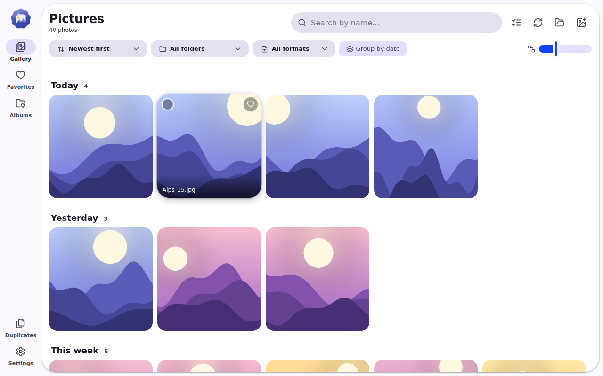
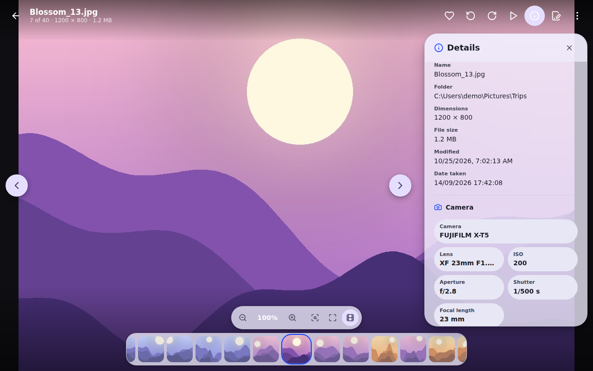
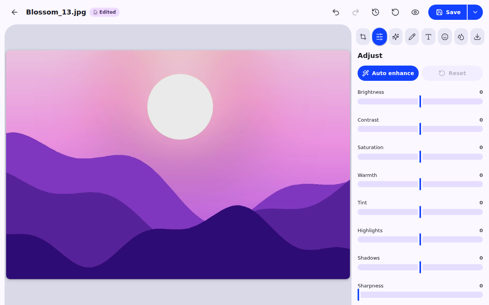
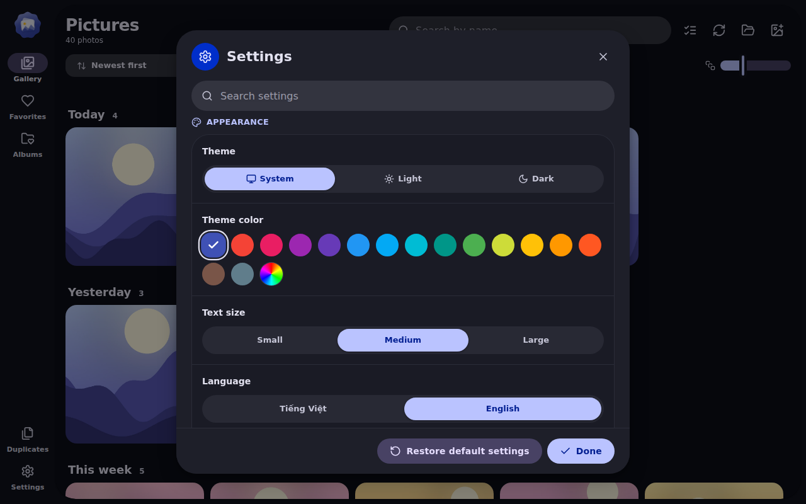

<div align="center">


# Material Photo

**Trình xem và chỉnh sửa ảnh nhanh, đẹp, mã nguồn mở cho Windows, thiết kế theo Material 3 Expressive.**

[](LICENSE)


</div>

## Giới thiệu

Material Photo giúp bạn lướt xem, sắp xếp và chỉnh sửa ảnh trên Windows trong một ứng dụng nhẹ, mượt và có giao diện **Material 3 Expressive**: hình khối biến đổi, chuyển động bật nảy, màu sắc theo chủ đề của bạn và hỗ trợ sáng/tối. Ứng dụng hỗ trợ **tiếng Việt** và **tiếng Anh**.

## Screenshot

| | |
|---|---|
|  |  |
| **Thư viện** nhóm theo ngày | **Trình xem** với EXIF, histogram, dải ảnh |
|  |  |
| **Trình chỉnh sửa** đầy đủ công cụ | **Cài đặt** gọn gàng, tùy chỉnh giao diện |

## Tính năng

**Thư viện**
- Tự nạp thư mục *Pictures*, mở thư mục bất kỳ, kéo thả ảnh hoặc thư mục vào cửa sổ.
- Nhóm theo ngày với tiêu đề, lưới ảo hóa mượt với hàng chục nghìn ảnh, thumbnail cache (đúng chiều xoay EXIF).
- Tìm kiếm theo tên, lọc theo thư mục và định dạng, 6 kiểu sắp xếp, chỉnh kích thước ô ảnh.
- **Yêu thích** và **Album** tự tạo (ảnh có thể ở nhiều thư mục khác nhau).
- Chọn nhiều ảnh (Ctrl/Shift/ô chọn): yêu thích, thêm vào album, sao chép/di chuyển tới thư mục, **đổi tên hàng loạt**, xoá.
- **Tìm ảnh trùng** (so sánh nội dung) và chuyển bản thừa vào Thùng rác.
- Tự cập nhật khi thư mục thay đổi (file watcher, có thể tắt).

**Trình xem**
- Zoom theo con trỏ, kéo để di chuyển, pinch trên màn hình cảm ứng, bản đồ thu nhỏ, dải ảnh, vuốt chuyển ảnh.
- **Trình chiếu** có cài đặt: thời gian, hiệu ứng (mờ/trượt/thu phóng), ngẫu nhiên, lặp lại.
- Bảng **chi tiết EXIF** (máy ảnh, ống kính, ISO, khẩu độ, tốc độ, tiêu cự, ngày chụp, GPS) và **histogram**.
- Xoay nhanh, sao chép ảnh, in, đặt làm hình nền, hiện trong thư mục, đổi tên.
- Xoá vào Thùng rác kèm nút **Hoàn tác**.

**Trình chỉnh sửa**
- Cắt (tỉ lệ tự do/gốc/1:1/4:3/3:2/16:9...), xoay, lật, chỉnh thẳng.
- 11 mức điều chỉnh (sáng, tương phản, bão hòa, độ ấm, sắc thái, vùng sáng, vùng tối, độ nét, tối viền, sắc độ, làm mờ) và **tự động cải thiện**; lưu **bộ chỉnh** riêng.
- 12 bộ lọc có cường độ.
- Vẽ: bút, bút dạ, đường thẳng, mũi tên, chữ nhật, ô-van, tẩy; **chữ** xoay/đổi cỡ được; **emoji**, hình mờ; **làm mờ / vỡ hạt** vùng nhạy cảm.
- Lịch sử chỉnh sửa (nhảy về bước bất kỳ), hoàn tác/làm lại, giữ để so sánh với ảnh gốc.
- Xuất PNG/JPEG/WebP, đổi kích thước và chất lượng, giữ dữ liệu EXIF của JPEG, lưu bản sao, lưu đè (có xác nhận) hoặc sao chép vào clipboard.

**Cài đặt**
- Chế độ sáng / tối / theo hệ thống, 16 màu chủ đề Material hoặc màu tùy chọn, 3 cỡ chữ, tiếng Việt / English, 7 phông chữ (gồm Roboto), giảm chuyển động.
- Tùy chọn cửa sổ khi mở app: **ghi nhớ kích thước** hoặc **luôn phóng to tối đa**.
- Tìm kiếm trong cài đặt, bảng phím tắt, thông tin tác giả.

## Cài đặt

1. Tải tệp `Material Photo_1.1.0_x64-setup.exe` trong thư mục [`downloads`](downloads) (hoặc tự build, xem bên dưới).
2. Chạy tệp cài đặt và làm theo hướng dẫn (cài cho người dùng hiện tại, không cần quyền quản trị).
3. Mở **Material Photo** từ Start Menu.

Yêu cầu: Windows 10 / 11 (64-bit) với WebView2 Runtime (có sẵn trên Windows 11 và các bản Windows 10 mới).

## Tech stack

| Thành phần | Công nghệ |
|---|---|
| Khung ứng dụng | [Tauri 2](https://tauri.app) (Rust) |
| Giao diện | React 18, TypeScript, Vite 6, Tailwind CSS 4 |
| Thiết kế | Material 3 Expressive, `@material/material-color-utilities` |
| Icon | [Lucide](https://lucide.dev) |
| Xử lý ảnh | Canvas (trình chỉnh sửa), crate `image`, `kamadak-exif` (Rust) |

## Development

Yêu cầu: [Node.js](https://nodejs.org) 18+, [Rust](https://rustup.rs) và [điều kiện tiên quyết của Tauri](https://tauri.app/start/prerequisites/).

```bash
npm install     # cài thư viện
npm run dev     # chạy ứng dụng ở chế độ phát triển (tauri dev + Vite)
npm run build   # build bộ cài Windows
```

Các lệnh bổ sung: `npm run web` (chỉ chạy giao diện Vite ở trình duyệt) và `npm run typecheck`.

Dự án nằm trong Cargo workspace dùng chung (`members = ["*/src-tauri"]`) nên mọi project dùng chung thư mục `target`.

## Build

```bash
npm run build
```

Bộ cài NSIS được tạo trong `target/release/bundle/nsis/` của workspace (hoặc `src-tauri/target/...` nếu chạy độc lập). Chép tệp `Material Photo_1.1.0_x64-setup.exe` vào thư mục [`downloads`](downloads) để nút tải trên landing page hoạt động.

## Cấu trúc project

```
material-photo/
├── index.html            # Landing page (một tệp, SEO, sáng/tối, EN/VI, màu chủ đề)
├── favicon.svg, *.png    # Icon cho landing page
├── downloads/            # Đặt tệp cài đặt .exe vào đây
├── screenshots/          # image01.png ... image04.png
├── package.json, vite.config.ts, tsconfig.json
├── src/                  # Giao diện (Vite root)
│   ├── index.html, main.tsx, App.tsx, index.css
│   ├── components/       # ui, Overlays (tooltip, menu, toast, modal), Select
│   ├── features/         # Gallery, Viewer, Editor, EditorPanels, SettingsDialog, Dialogs
│   ├── lib/              # store, i18n, theme, tauri, actions, editorEngine
│   ├── fonts/            # Phông chữ đóng gói sẵn (Roboto, Inter, ...)
│   └── public/           # Icon của app
└── src-tauri/            # Ứng dụng Tauri (Rust)
    ├── src/lib.rs        # Lệnh: thumbnail, EXIF, ghi ảnh, Thùng rác, watcher...
    ├── src/exif_util.rs  # Đọc EXIF, giữ EXIF khi lưu JPEG
    ├── icons/, installer/  # Bộ icon app, setup, uninstall (Material 3 Expressive, màu indigo)
    └── tauri.conf.json
```

## License

Dự án mã nguồn mở, phát hành theo giấy phép [MIT](LICENSE).

Kho mã chung của các ứng dụng: <https://github.com/minhtrong67/my-tauri-apps>

---

<div align="center">

**Tác giả: [minhtrong67](https://github.com/minhtrong67)** · Xây dựng với sự hỗ trợ của **Claude (Anthropic)**

</div>
