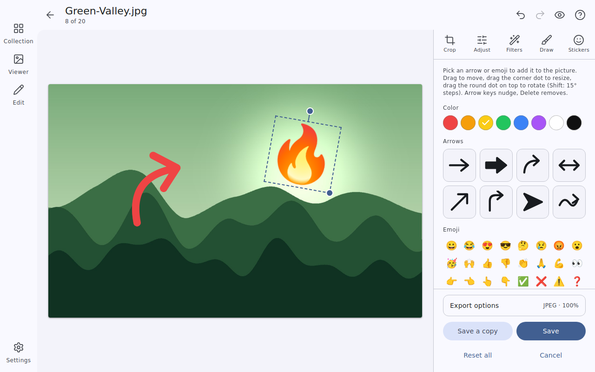
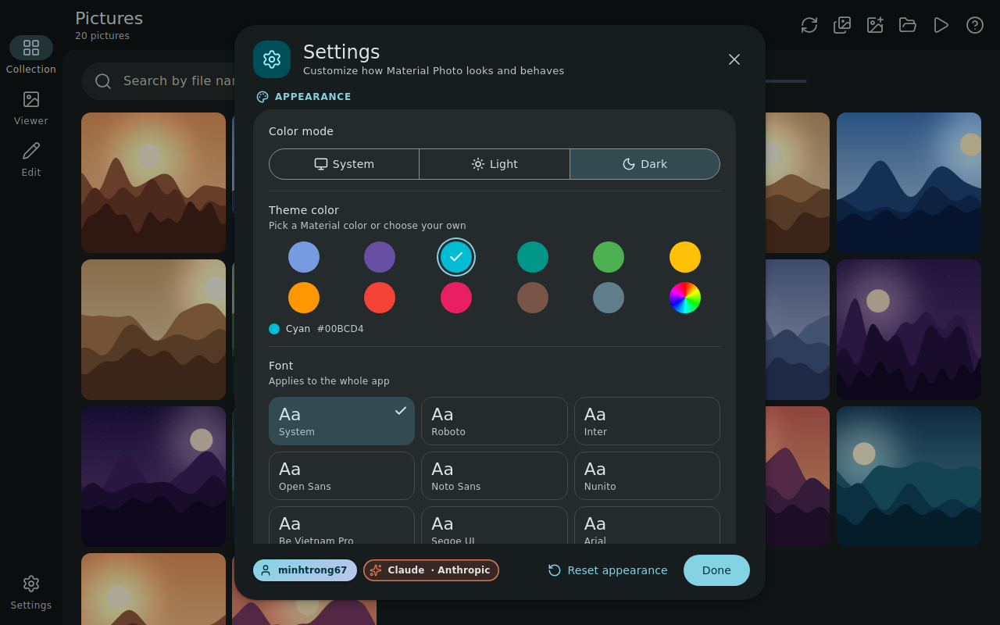
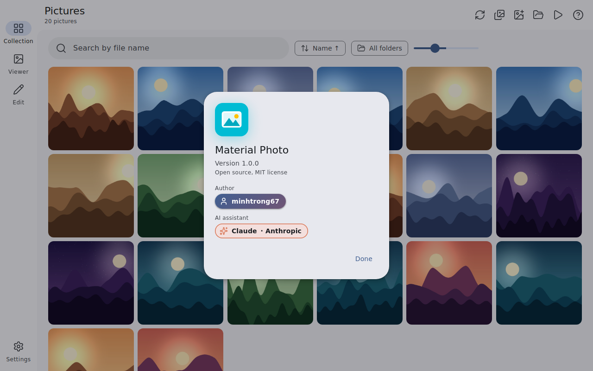
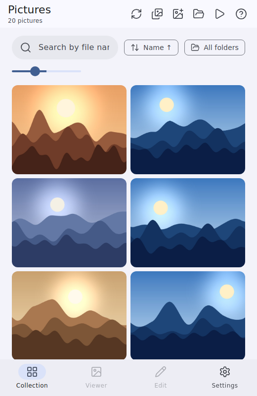

<div align="center">


# Material Photo

**A fast, lightweight photo viewer and editor for Windows, in Material Design 3.**

Built with Tauri · Vanilla JavaScript · Lucide icons · English and Vietnamese

Author: **minhtrong67** · Built with the assistance of **Claude** (Anthropic)

</div>

Material Photo is a photo viewer and editor in the spirit of the Microsoft Photos app. It scans your Pictures folder automatically, lets you browse and view pictures smoothly, and includes a full set of basic editing tools. It follows the Material Design 3 language with the system UI font by default, light, dark and system themes, a customizable theme color and font, and an English and Vietnamese interface that follows your device language.

A landing page for the app is included: open [`index.html`](index.html) in the project root.

## Screenshots

| | |
| --- | --- |
|  |  |
|  |  |
|  |  |
|  |  |

The pictures in the screenshots are generated samples.

## Features

**Library**
- Scans the Windows **Pictures** folder, including sub folders, when the app starts (can be turned off), with a refresh button, a library button and a folder filter
- Open any picture or folder, drag and drop, or double click a picture in Windows Explorer
- Cached thumbnails generated in the background (old ones are cleaned up automatically), so even large libraries scroll smoothly and open instantly on later launches
- Search by file name, sort by name, date or size, adjustable thumbnail size, right click menu (open, edit, show in folder, copy path, delete)

**Viewer**
- Smooth zoom around the cursor, pan, double click to zoom, fit and actual size, filmstrip, previous and next with slide animation
- Slideshow, full screen, picture info panel, copy, print, show in folder and delete to the Recycle Bin
- PNG, JPEG, GIF (animated), WebP, BMP, ICO, AVIF and SVG

**Editor**
- Crop with aspect ratios (free, original, 1:1, 4:3, 3:2, 16:9, 9:16), straighten, rotate and flip
- Adjust brightness, contrast, saturation, warmth, sharpness, vignette and blur; nine filters with previews
- Draw with pen, highlighter, line, arrow, box and ellipse tools. Hold **Shift** for straight strokes; stroke smoothing keeps freehand lines clean
- Stickers: eight arrow styles and quick emoji, movable, resizable, rotatable, with duplicate, bring to front and delete
- Unlimited undo and redo, hold to compare with the original, save over the original (always in the original format) or save a copy as PNG, JPEG or WebP

**Personalization**
- Light, dark or system theme, with a **Material 3 color scheme generated from any seed color** (11 Material presets or a custom color). The default theme is the blue Material Theme Builder export
- **Font**: the system font by default, or Roboto, Inter, Open Sans, Noto Sans, Nunito, Be Vietnam Pro (bundled, work offline) and Segoe UI, Arial, Verdana, Tahoma, Georgia
- **Language**: Vietnamese and English; the device language is detected automatically on first launch, or pick one manually
- **Window on startup**: *Remember size* reopens the window at the size and position you left, *Always maximized* always opens maximized. The window appears only after the first paint, so there is no white flash

**Experience**
- Ripples, animated view transitions, staggered thumbnails, slide between pictures and animated dialogs; motion switches off when Windows reduces motion
- Adaptive layout: navigation rail on wide windows, bottom bar on narrow ones

## Installation

1. Download the latest installer, `Material Photo_1.0.0_x64-setup.exe`, from the Releases page of this repository (or from the `downloads` folder), or build it yourself (see [Build](#build)).
2. Run the installer. It installs for the current user and needs no administrator rights.
3. To make Material Photo the default app for pictures, right click a picture, choose **Open with**, then **Choose another app**, select **Material Photo** and tick **Always use this app**.
4. To uninstall, use Windows Settings, Apps, Installed apps, or the uninstaller in the installation folder.

Requirements: Windows 10 or 11 with the Microsoft Edge WebView2 Runtime (included with Windows 11 and current Windows 10).

## Tech stack

- [Tauri 2](https://tauri.app) with a Rust core (folder scan, thumbnail cache, file access, Recycle Bin, single instance, window state) and the WebView2 runtime that ships with Windows, so no browser engine is bundled
- Vanilla HTML, CSS and JavaScript with the Canvas 2D API for editing, no runtime framework
- [Lucide](https://lucide.dev) icons, [Material Color Utilities](https://github.com/material-foundation/material-color-utilities) for the Material 3 color roles, and bundled variable fonts from [Fontsource](https://fontsource.org)
- Rust crates: `image`, `trash`, `base64`, `serde`, `serde_json`, and the official dialog, opener, single instance and window state plugins

## Development

Prerequisites: [Node.js](https://nodejs.org) 18 or later, [Rust](https://rustup.rs) (stable), Microsoft C++ Build Tools (the "Desktop development with C++" workload) and WebView2.

Keep the project in your shared Cargo workspace folder (for example `D:\tauri-apps\`). The workspace `Cargo.toml` uses `members = ["*/src-tauri"]`, so this project is picked up automatically and every project reuses one build cache in `target`.

```bash
npm install
npm run dev
```

## Build

```bash
npm run build
```

The installer is written to `<workspace>\target\release\bundle\nsis\`. Copy it to the `downloads` folder so the landing page download button works. Release profile settings (small, fast binary) live in the workspace `Cargo.toml`.

## Project structure

```
material-photo/
  index.html            Landing page (SEO and social meta tags, light and dark, responsive)
  downloads/            Put the installer here (linked by the landing page)
  screenshots/          Screenshots used by this README (image01 to image08)
  src/                  Frontend
    index.html          Markup of the collection, viewer, editor and dialogs
    css/app.css         Material 3 styles and animations
    js/app.js           App logic, i18n, settings, editor
    vendor/mcu.js       Material Color Utilities bundle (color roles from a seed)
    fonts/              Bundled fonts (Latin and Vietnamese subsets)
  src-tauri/
    src/lib.rs          Rust core
    src/main.rs         Entry point
    tauri.conf.json     Window, bundle, installer and file association settings
    capabilities/       Permissions granted to the main window
    icons/              Application icons
    installer/          Setup and uninstall icons, installer images
  package.json
  LICENSE
```

**Icons and branding.** The app icon uses the cyan `#00BCD4`, drawn in flat Material style and rendered natively at each size (small sizes use a bolder variant).

| Asset | File | Sizes |
| --- | --- | --- |
| Application icon | `src-tauri/icons/icon.ico` | 16, 20, 24, 32, 40, 48, 64, 96, 128, 256 |
| Application PNGs | `src-tauri/icons/*.png`, `icons/png/*.png` | 16 to 1024 |
| Windows Store logos | `src-tauri/icons/Square*Logo.png`, `StoreLogo.png` | 30 to 310 |
| Setup icon | `src-tauri/installer/setup.ico` | 16 to 256, download badge |
| Uninstall icon | `src-tauri/installer/uninstall.ico` | 16 to 256, trash badge |
| Installer images | `src-tauri/installer/header.bmp`, `sidebar.bmp` | 150 x 57, 164 x 314 |

Icons are embedded at compile time: after replacing them run `cargo clean -p material-photo` and build again. If Windows shows an old icon, run `ie4uinit.exe -ClearIconCache`.

## License

Material Photo is public and open source, released under the [MIT License](LICENSE).

Third party: Lucide (ISC), Material Color Utilities (Apache 2.0), Fontsource fonts (SIL Open Font License 1.1).

Designed and maintained by **minhtrong67**, with development supported by Claude, an AI assistant made by Anthropic.
