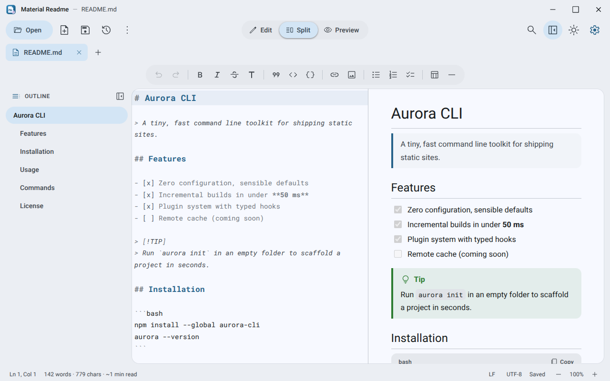
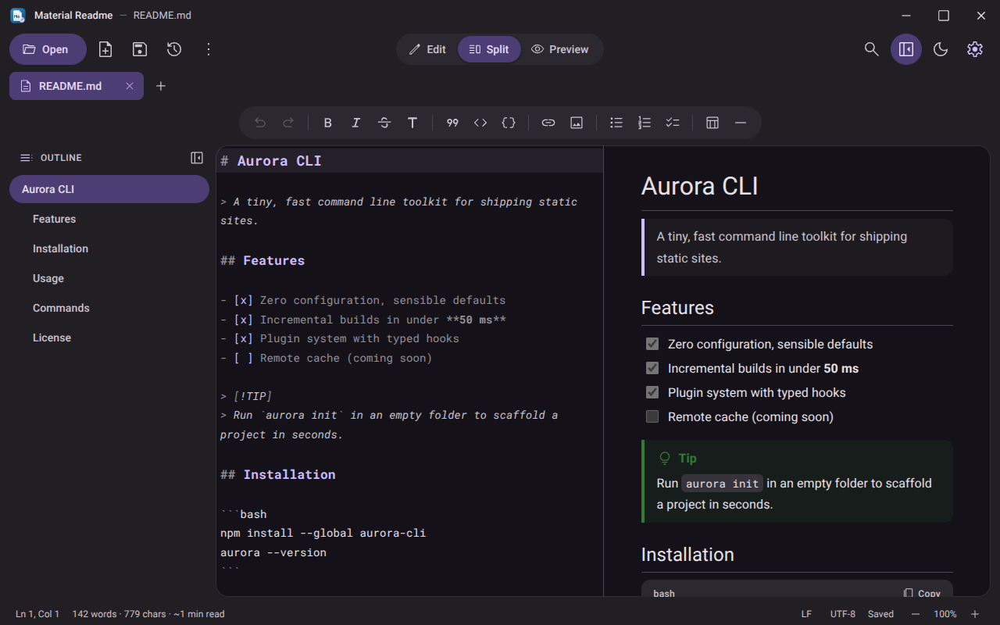
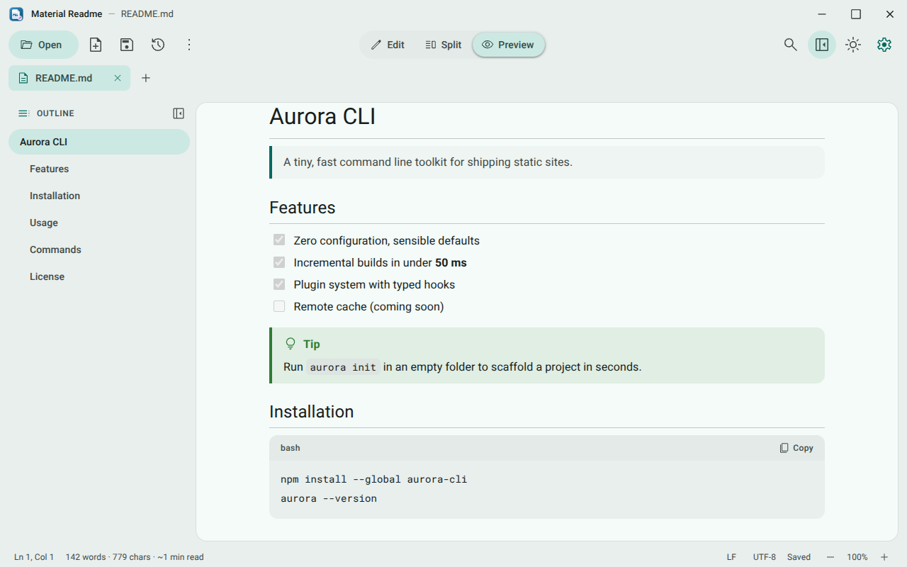
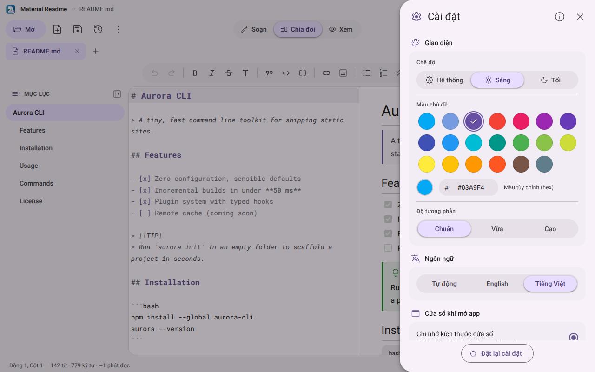
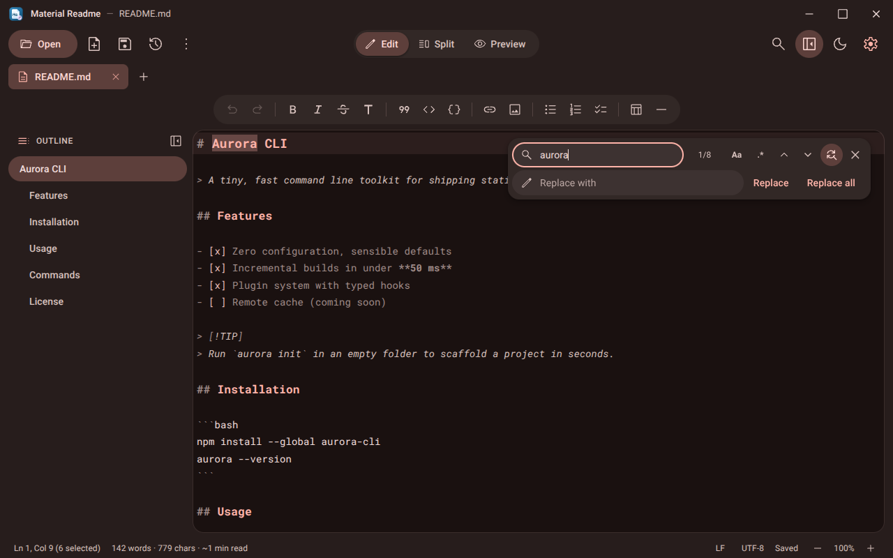
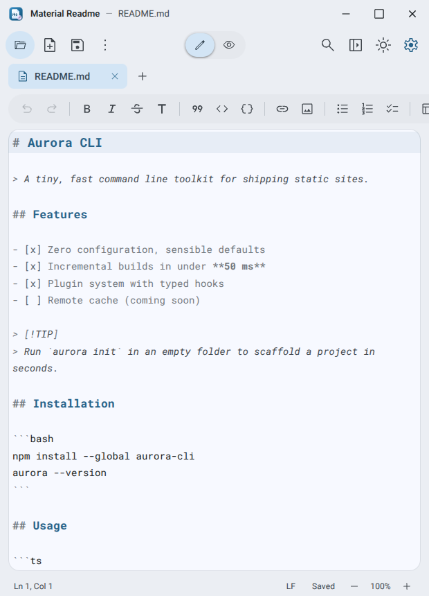

<div align="center">


# Material Readme

**A Material Design 3 Markdown editor and viewer for the desktop.**

Write, preview and polish `README.md` files with a calm, modern interface, live split preview and themes in every Material colour.

[](LICENSE)
[](https://tauri.app)
[](#installation)
[](#features)

[English](README.md) · [Tiếng Việt](README.vi.md)

</div>

---

## Introduction

Material Readme started as a read-only Markdown viewer and is now a complete editor. It opens `.md` files instantly, lets you edit them with a formatting toolbar and keyboard shortcuts, and renders the result live next to your text. The whole interface follows **Material Design 3** and is coloured from the Material Theme Builder exports in `src/theme/`, so you can switch to any Material colour without losing visual consistency.

The app is built with [Tauri 2](https://tauri.app), which keeps it small, fast and light on memory. Everything works offline.

## Screenshots

| | |
| :---: | :---: |
|  |  |
| Split view with live preview | Dark theme from the purple theme file |
|  |  |
| Reading mode with a teal theme colour | Settings side sheet (Vietnamese UI) |
|  |  |
| Find and replace | Responsive layout in a narrow window |

## Features

**Editing**
- CodeMirror 6 editor with Markdown and fenced code syntax colours, undo history per file and list continuation on Enter.
- Formatting toolbar: bold, italic, strikethrough, headings, quote, inline code, code block, link, image, bulleted / numbered / task lists, table and horizontal rule, plus `Ctrl+B`, `Ctrl+I`, `Ctrl+K` and friends.
- Find and replace with match case and regular expressions, in the editor or in the rendered preview.
- Multiple documents in tabs, unsaved-change indicators and a prompt before anything is lost.
- Autosave (optional), atomic file writes, CRLF / LF preserved, and live reload when a file changes on disk.

**Reading**
- Three layouts: **Edit**, **Split** (synchronised scrolling) and **Preview**.
- GitHub Flavoured Markdown: tables, task lists, strikethrough, alerts (`> [!NOTE]`), front matter, syntax-highlighted code blocks with a copy button.
- Local images with relative paths, relative links to other `.md` files, in-page anchors and external links that open in your browser.
- Outline panel with the active heading highlighted while you scroll.
- Zoom from 60% to 220% (`Ctrl+Wheel`, `Ctrl+=`, `Ctrl+-`).

**Personalisation**
- Light, dark or system mode with a circular reveal animation.
- Three ready-made themes exported from Material Theme Builder (`material-theme-sky.json` is the default, plus `blue` and `purple`), 17 Material palette colours and a custom hex colour. Three contrast levels (standard, medium, high).
- English and Vietnamese. The app detects your system language on first launch and you can override it in **Settings**.
- Window behaviour on startup: **remember the last window size** or **always open maximized**.

**Everything else**
- Open files by double click (file association), drag and drop, `Ctrl+O`, or the recent files list. A second launch hands its files to the running window.
- Export to a standalone HTML page, print or save as PDF.
- Smooth Material motion: ripples, state layers, animated tabs, dialogs, menus and sheets. Respects *reduce motion*.
- Custom title bar, installer and uninstaller icons in the same Material style.

## Installation

### Download the installer

1. Download `Material Readme_2.0.0_x64-setup.exe` from the [`downloads`](downloads) folder (or from your release page).
2. Run it. The installer installs for the current user, no administrator rights required.
3. Start **Material Readme** from the Start menu. To open Markdown files with it, choose *Open with → Material Readme*.

> Windows 10 and 11 (64-bit). The Microsoft Edge WebView2 runtime is required; it is already part of Windows 11 and recent Windows 10 updates.

### Landing page

`index.html` in the project root is a standalone landing page for the app. Open it in a browser or publish the repository with GitHub Pages. Before publishing, replace `https://minhtrong67.github.io/material-readme/` in its `<head>` (canonical URL, Open Graph and Twitter tags) with your real address.

## Tech stack

| Layer | Technology |
| --- | --- |
| Shell | [Tauri 2](https://tauri.app) (Rust), plugins: dialog, opener, single-instance |
| Editor | [CodeMirror 6](https://codemirror.net) |
| Markdown | [marked](https://marked.js.org), [DOMPurify](https://github.com/cure53/DOMPurify), [highlight.js](https://highlightjs.org) |
| Design | Material Design 3, [material-color-utilities](https://github.com/material-foundation/material-color-utilities), Material Symbols (Outlined) |
| Fonts | Roboto and Roboto Mono (bundled, with Vietnamese support) |
| Frontend | Plain HTML, CSS and ES modules. No bundler, no framework |

## Development

### Requirements

- [Node.js](https://nodejs.org) 18 or newer
- [Rust](https://rustup.rs) (stable) with the MSVC toolchain
- Microsoft C++ Build Tools and WebView2 (see the [Tauri prerequisites](https://tauri.app/start/prerequisites/))

### Workspace

This project is meant to live inside a Cargo workspace folder that contains the shared `Cargo.toml`:

```text
tauri-apps/
├─ Cargo.toml            # workspace: members = ["*/src-tauri"], one shared ./target
└─ material-readme/      # this project
```

Every sub folder that has a `src-tauri/Cargo.toml` is picked up automatically, and all projects reuse the same build cache.

### Run

```bash
npm install
npm run dev
```

`npm run dev` starts the app with live reload for everything inside `src/`.

## Build

```bash
npm run build
```

The Windows installer is created at `target/release/bundle/nsis/Material Readme_2.0.0_x64-setup.exe` (inside the workspace folder). Copy it to [`downloads`](downloads) so the landing page can serve it.

### Optional tools

The bundled libraries and icons are committed, so you never need these to run or build the app.

- **Rebuild CodeMirror and the colour engine:** `cd tools/vendor && npm install && npm run build`
- **Regenerate app icons:** edit `tools/icons/app-icon.svg`, export a 1024 px PNG and run `npx tauri icon <png>`. The uninstaller icon source is `tools/icons/uninstall-icon.svg`.

## Project structure

```text
material-readme/
├─ index.html                  # landing page (single file, SEO + social meta)
├─ downloads/                  # put the installer here
├─ screenshots/                # image01.png … image06.png used by this README
├─ package.json                # npm run dev / npm run build
├─ src/                        # frontend
│  ├─ index.html
│  ├─ css/                     # theme tokens, app shell, markdown, editor
│  ├─ js/
│  │  ├─ main.js               # documents, tabs, find, scroll sync, shortcuts
│  │  ├─ editor.js             # CodeMirror wrapper + formatting commands
│  │  ├─ preview.js            # block-by-block Markdown rendering
│  │  ├─ theme.js              # Material colour schemes
│  │  ├─ settings.js           # settings side sheet
│  │  ├─ ui.js                 # ripple, menus, dialogs, tooltips, snackbar
│  │  ├─ i18n.js               # English and Vietnamese
│  │  └─ bridge.js             # Tauri API wrapper
│  ├─ theme/                   # Material Theme Builder exports (sky = default, blue, purple)
│  ├─ fonts/                   # Roboto, Roboto Mono
│  └─ vendor/                  # marked, DOMPurify, highlight.js, CodeMirror, MCU
├─ src-tauri/
│  ├─ src/lib.rs               # file commands, window size memory, single instance
│  ├─ tauri.conf.json          # window, bundle, NSIS installer
│  ├─ capabilities/
│  └─ icons/                   # app, installer, uninstaller and installer art
└─ tools/                      # optional: vendor bundle and icon sources
```

## License

Material Readme is public and open source, released under the [MIT License](LICENSE).

---

<div align="center">

Designed and developed by **minhtrong67** with the assistance of AI **Claude** (Anthropic).

</div>
