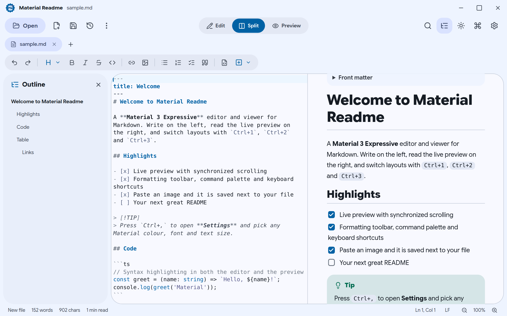
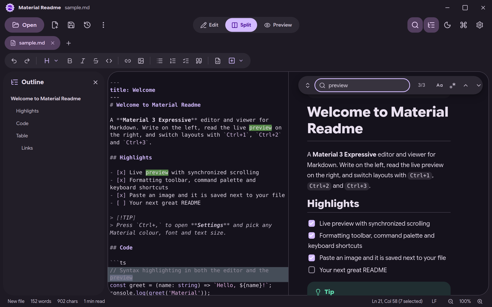
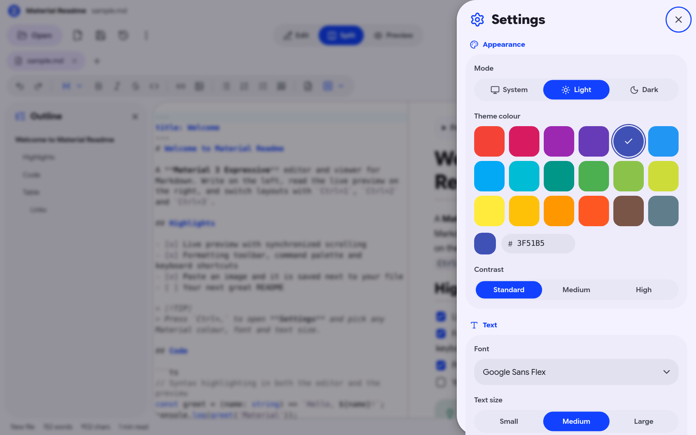
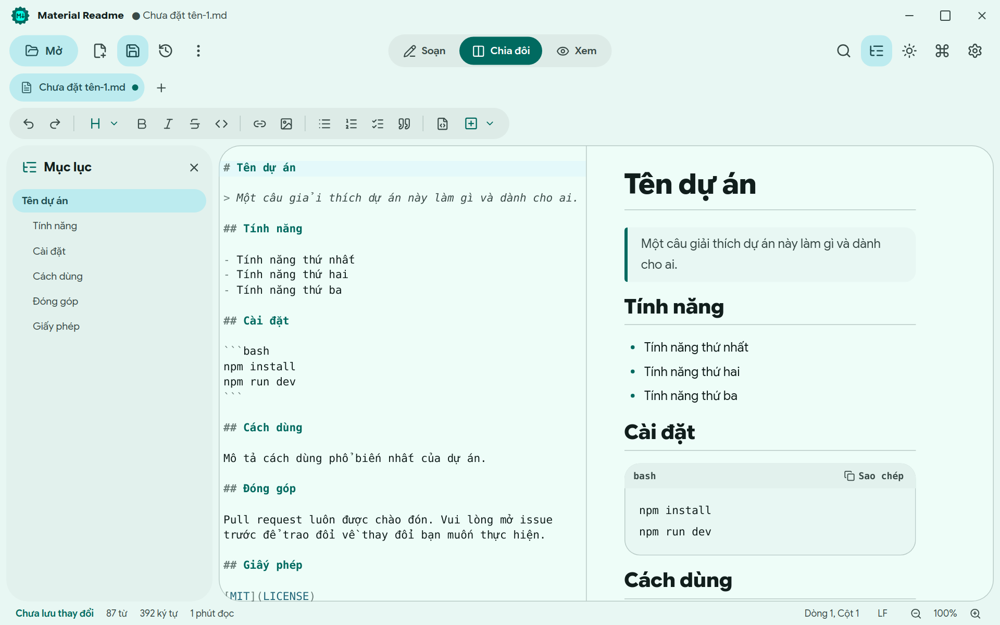

<div align="center">


# Material Readme

**Write, preview and polish Markdown in Material 3 Expressive.**

A fast, friendly desktop editor and viewer for Markdown, built with Tauri 2, React and TypeScript.

[](package.json)
[](#installation)
[](https://tauri.app)
[](LICENSE)

[English](README.md) · [Tiếng Việt](README.vi.md) · [Landing page](index.html)

</div>

## Introduction

Material Readme is a desktop app to read, write and live-preview Markdown files. It pairs a CodeMirror 6 editor with a block-by-block live preview, so long documents stay smooth while you type. The whole interface follows **Material 3 Expressive**: bold shapes, spring motion, rounded containers and a full colour system generated from any colour you pick.

It is part of the [my-tauri-apps](https://github.com/minhtrong67/my-tauri-apps) collection and works fully offline: your files never leave your computer.

## Screenshots

| | |
| :---: | :---: |
|  |  |
| **Split view** · editor, outline and live preview | **Dark theme** · deep purple with find and highlight |
|  |  |
| **Settings** · modes, 18 colours, fonts and sizes | **Tiếng Việt** · fully translated, with templates |

## Features

**Writing**
- Three layouts: Edit, Split and Preview, with synchronized scrolling in split view.
- Formatting toolbar and shortcuts for headings, bold, italic, strikethrough, code, links, images, lists, task lists, quotes, tables and rules.
- Paste or drop an image: it is saved to an `assets` folder beside your file and linked for you.
- Templates (README, API reference, changelog, meeting notes), shields.io badges and a generated table of contents.
- Find and replace with case, regular expression and match counter, in both the editor and the preview.
- Command palette (`Ctrl+Shift+P`) and a full set of keyboard shortcuts (`F1`).

**Reading**
- GitHub-style rendering: tables, task lists, front matter, alerts (`> [!NOTE]`), syntax-highlighted code with a copy button.
- Outline drawer that follows your position, local images, relative links to other `.md` files.
- Export to a standalone HTML file, or print to PDF.

**Safety and workflow**
- Multiple tabs, drag and drop to open files, `.md` file association and single-instance handling.
- Autosave, session restore (tabs and unsaved drafts), and a prompt when a file changes on disk.
- Atomic saves, line-ending detection (LF or CRLF) and a warning for files that are not valid UTF-8.

**Personalization** (Settings, `Ctrl+,`)
- Mode: system, light or dark, with a circular reveal when you switch.
- 18 Material theme colours or any custom hex colour, with three contrast levels.
- Fonts: System, Google Sans Flex, Roboto Flex, Roboto, Arial, Inter and Be Vietnam Pro.
- Text size: small, medium or large, plus editor zoom.
- Language: English or Tiếng Việt (or automatic).
- Window on startup: remember the last size, or always open maximized.
- Default save folder, autosave, restore session, word wrap, line numbers.

## Installation

### Windows installer

1. Download `Material Readme_3.0.0_x64-setup.exe` from the [`downloads`](downloads) folder (or from the landing page).
2. Run the installer. It installs for the current user and does not need administrator rights.
3. Open any `.md` file with Material Readme, or launch it from the Start menu.

Requires Windows 10 or 11 (64-bit) with Microsoft Edge WebView2, which is already present on current Windows versions.

### Build from source

See [Development](#development) and [Build](#build).

## Tech stack

| Area | Technology |
| --- | --- |
| Shell | [Tauri 2](https://tauri.app) (Rust) |
| UI | React 19, TypeScript, Vite, Tailwind CSS 4 |
| Design | Material 3 Expressive, colours from `@material/material-color-utilities` |
| Icons | [Lucide](https://lucide.dev) |
| Editor | CodeMirror 6 |
| Markdown | marked, DOMPurify, highlight.js |
| State | Zustand |
| Fonts | Bundled (latin, latin-ext, vietnamese subsets): Google Sans Flex, Roboto Flex, Roboto, Inter, Be Vietnam Pro |

## Development

Requirements: [Node.js](https://nodejs.org) 20 or newer, [Rust](https://rustup.rs) (stable) and the [Tauri prerequisites](https://tauri.app/start/prerequisites/) for your system.

```bash
npm install     # install dependencies
npm run dev     # start the desktop app with hot reload
```

You can also work on the interface alone in a browser with `npm run web:dev` (file dialogs fall back to the browser).

## Build

```bash
npm run build   # type-check, bundle the UI and create the installer
```

The installer is written to `target/release/bundle/nsis/` in the Cargo workspace root (or `src-tauri/target/...` when used on its own). Copy it into [`downloads`](downloads) so the landing page link works.

Handy scripts:

| Command | What it does |
| --- | --- |
| `npm run web:build` | Type-check and build only the UI into `dist/` |
| `node tools/fonts/make-fonts.mjs` | Rebuild the trimmed font subsets |
| `node tools/icons/make-icons.mjs` | Regenerate the app icon, uninstall icon, installer images and social image |
| `npx tsx tools/landing/build-landing.mjs` | Rebuild `index.html` from `tools/landing/landing.template.html` |

## Project structure

```text
material-readme/
├── index.html              Landing page (single file)
├── app/                    Desktop UI (Vite root)
│   ├── index.html
│   ├── public/             Favicon
│   └── src/
│       ├── main.tsx, App.tsx
│       ├── components/     Chrome, Workspace, Sheets, Hosts (toast, menu, tooltip), base widgets
│       ├── lib/            controller, editor, markdown, theme, i18n, settings, tauri bridge
│       ├── styles/         app.css (Tailwind + tokens), markdown.css, fonts.css
│       └── assets/fonts/   Bundled font subsets
├── src-tauri/              Rust backend, tauri.conf.json, capabilities, icons
├── screenshots/            image01 to image04
├── downloads/              Put the setup file here
├── assets/                 App icon sources, favicon, social image
├── tools/                  Generators for fonts, icons and the landing page
├── package.json
└── LICENSE
```

## License

Material Readme is public and open source under the [MIT License](LICENSE).
Project home: <https://github.com/minhtrong67/my-tauri-apps>
