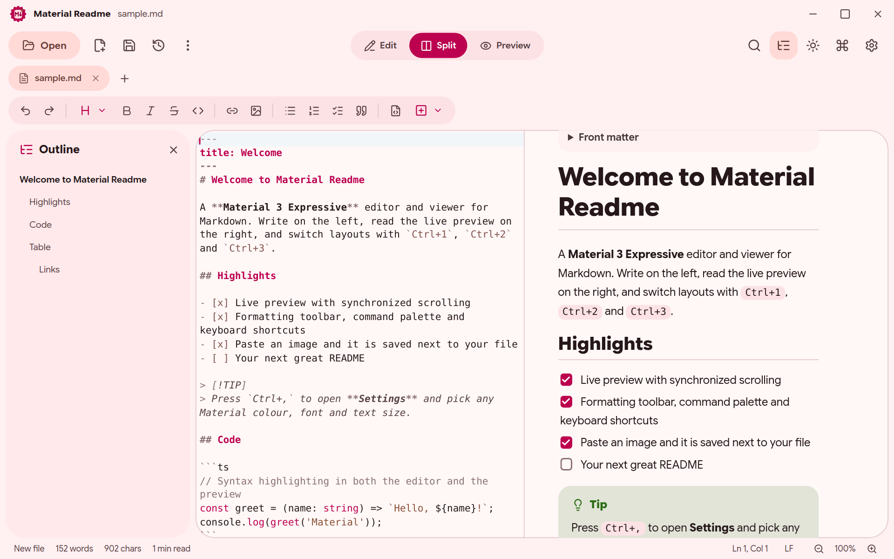
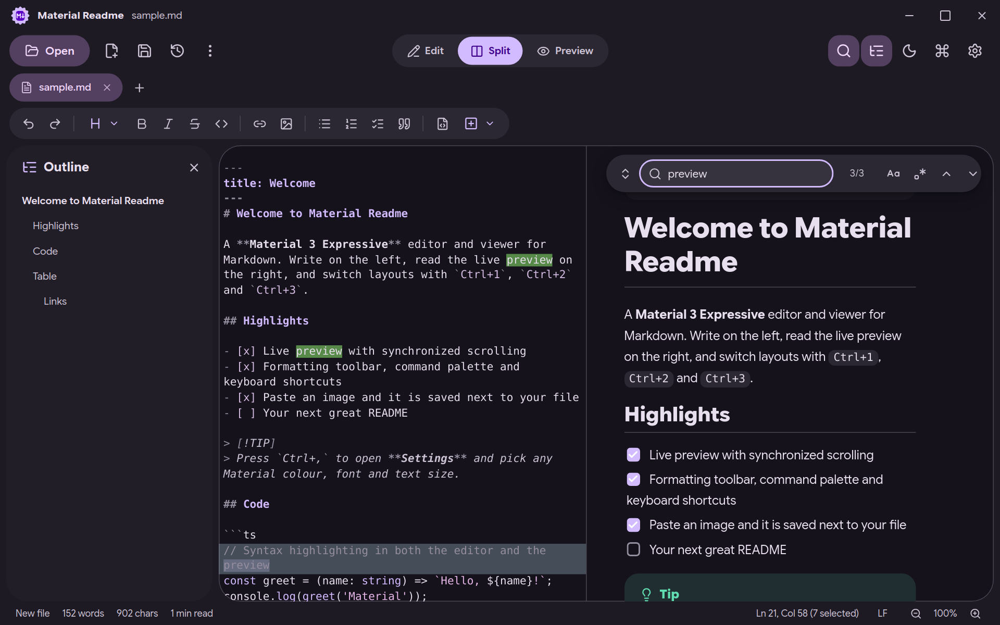
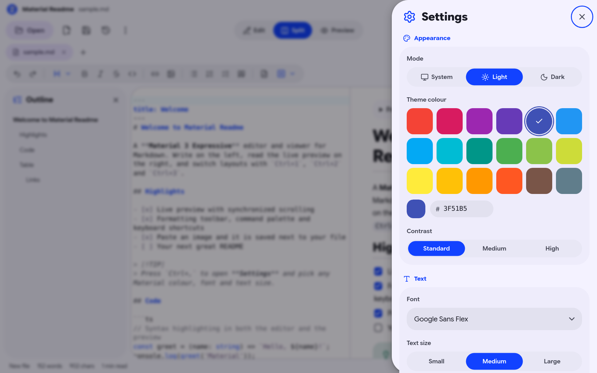
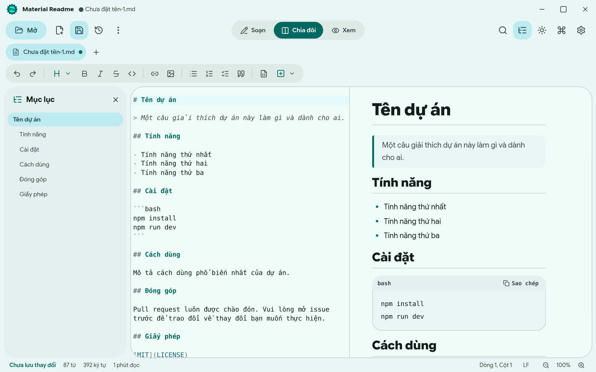

<div align="center">


# Material Readme

**Viết, xem trước và hoàn thiện Markdown theo phong cách Material 3 Expressive.**

Trình soạn thảo và xem Markdown nhanh, thân thiện cho máy tính, xây dựng bằng Tauri 2, React và TypeScript.

[](package.json)
[](#cài-đặt)
[](https://tauri.app)
[](LICENSE)

[English](README.md) · [Tiếng Việt](README.vi.md) · [Trang giới thiệu](index.html)

</div>

## Giới thiệu

Material Readme là ứng dụng máy tính để đọc, viết và xem trước Markdown trực tiếp. Ứng dụng kết hợp trình soạn thảo CodeMirror 6 với bản xem trước cập nhật từng khối, nên tài liệu dài vẫn mượt khi bạn gõ. Toàn bộ giao diện theo **Material 3 Expressive**: hình khối đậm, chuyển động kiểu lò xo, khung bo tròn lớn và hệ màu đầy đủ sinh ra từ bất kỳ màu nào bạn chọn.

Ứng dụng thuộc bộ [my-tauri-apps](https://github.com/minhtrong67/my-tauri-apps), hoạt động hoàn toàn ngoại tuyến: tệp của bạn không bao giờ rời khỏi máy.

## Ảnh chụp màn hình

| | |
| :---: | :---: |
|  |  |
| **Chia đôi** · trình soạn thảo, mục lục và xem trước | **Giao diện tối** · tím than, có tìm kiếm và tô sáng |
|  |  |
| **Cài đặt** · chế độ, 18 màu, font và cỡ chữ | **Tiếng Việt** · dịch đầy đủ, có mẫu tài liệu |

## Tính năng

**Soạn thảo**
- Ba bố cục: Soạn, Chia đôi và Xem, cuộn đồng bộ ở chế độ chia đôi.
- Thanh định dạng và phím tắt cho tiêu đề, in đậm, in nghiêng, gạch ngang, mã, liên kết, hình ảnh, danh sách, danh sách việc cần làm, trích dẫn, bảng và đường kẻ.
- Dán hoặc kéo thả ảnh: ảnh được lưu vào thư mục `assets` cạnh tệp và tự chèn liên kết.
- Mẫu có sẵn (README, tài liệu API, nhật ký thay đổi, biên bản họp), huy hiệu shields.io và mục lục tài liệu tự tạo.
- Tìm và thay thế có phân biệt hoa thường, biểu thức chính quy và bộ đếm kết quả, dùng được cả ở khung soạn lẫn khung xem.
- Bảng lệnh (`Ctrl+Shift+P`) và bộ phím tắt đầy đủ (`F1`).

**Đọc**
- Hiển thị kiểu GitHub: bảng, danh sách việc cần làm, front matter, cảnh báo (`> [!NOTE]`), mã có tô màu cú pháp và nút sao chép.
- Mục lục bám theo vị trí đọc, ảnh cục bộ, liên kết tương đối tới các tệp `.md` khác.
- Xuất ra tệp HTML độc lập hoặc in ra PDF.

**An toàn và quy trình**
- Nhiều thẻ, kéo thả để mở tệp, liên kết tệp `.md` và chỉ chạy một cửa sổ.
- Tự động lưu, khôi phục phiên (các thẻ và bản nháp chưa lưu), nhắc khi tệp thay đổi trên đĩa.
- Lưu an toàn qua tệp tạm, nhận diện kiểu xuống dòng (LF hoặc CRLF) và cảnh báo tệp không phải UTF-8 hợp lệ.

**Cá nhân hóa** (Cài đặt, `Ctrl+,`)
- Chế độ: theo hệ thống, sáng hoặc tối, có hiệu ứng lan tròn khi đổi.
- 18 màu chủ đề Material hoặc màu hex tùy chọn, ba mức tương phản.
- Font: System, Google Sans Flex, Roboto Flex, Roboto, Arial, Inter và Be Vietnam Pro.
- Cỡ chữ: nhỏ, vừa hoặc lớn, cùng thu phóng trình soạn thảo.
- Ngôn ngữ: English hoặc Tiếng Việt (hoặc tự động).
- Cửa sổ khi mở app: ghi nhớ kích thước lần trước, hoặc luôn phóng to tối đa.
- Thư mục lưu mặc định, tự động lưu, khôi phục phiên, tự xuống dòng, số dòng.

## Cài đặt

### Bộ cài Windows

1. Tải `Material Readme_3.0.0_x64-setup.exe` trong thư mục [`downloads`](downloads) (hoặc từ trang giới thiệu).
2. Chạy bộ cài. Ứng dụng cài cho người dùng hiện tại và không cần quyền quản trị.
3. Mở bất kỳ tệp `.md` nào bằng Material Readme, hoặc chạy từ menu Start.

Yêu cầu Windows 10 hoặc 11 (64-bit) có Microsoft Edge WebView2, vốn đã có sẵn trên các bản Windows hiện nay.

### Tự build từ mã nguồn

Xem [Phát triển](#phát-triển) và [Build](#build).

## Công nghệ

| Lĩnh vực | Công nghệ |
| --- | --- |
| Khung ứng dụng | [Tauri 2](https://tauri.app) (Rust) |
| Giao diện | React 19, TypeScript, Vite, Tailwind CSS 4 |
| Thiết kế | Material 3 Expressive, màu sinh bằng `@material/material-color-utilities` |
| Biểu tượng | [Lucide](https://lucide.dev) |
| Trình soạn thảo | CodeMirror 6 |
| Markdown | marked, DOMPurify, highlight.js |
| Quản lý trạng thái | Zustand |
| Font | Đóng gói sẵn (bộ latin, latin-ext, vietnamese): Google Sans Flex, Roboto Flex, Roboto, Inter, Be Vietnam Pro |

## Phát triển

Yêu cầu: [Node.js](https://nodejs.org) 20 trở lên, [Rust](https://rustup.rs) (stable) và [điều kiện cần của Tauri](https://tauri.app/start/prerequisites/) cho hệ điều hành của bạn.

```bash
npm install     # cài đặt thư viện
npm run dev     # chạy ứng dụng desktop với hot reload
```

Bạn cũng có thể chỉ làm việc với giao diện trong trình duyệt bằng `npm run web:dev` (hộp thoại tệp sẽ dùng bản của trình duyệt).

## Build

```bash
npm run build   # kiểm tra kiểu, đóng gói giao diện và tạo bộ cài
```

Bộ cài nằm ở `target/release/bundle/nsis/` trong thư mục gốc của Cargo workspace (hoặc `src-tauri/target/...` khi chạy riêng lẻ). Hãy chép vào thư mục [`downloads`](downloads) để nút tải ở trang giới thiệu hoạt động.

Một số lệnh hữu ích:

| Lệnh | Chức năng |
| --- | --- |
| `npm run web:build` | Kiểm tra kiểu và chỉ build giao diện vào `dist/` |
| `node tools/fonts/make-fonts.mjs` | Tạo lại các bộ font đã lược gọn |
| `node tools/icons/make-icons.mjs` | Tạo lại icon app, icon gỡ cài đặt, ảnh bộ cài và ảnh chia sẻ |
| `npx tsx tools/landing/build-landing.mjs` | Tạo lại `index.html` từ `tools/landing/landing.template.html` |

## Cấu trúc dự án

```text
material-readme/
├── index.html              Trang giới thiệu (một tệp)
├── app/                    Giao diện desktop (gốc của Vite)
│   ├── index.html
│   ├── public/             Favicon
│   └── src/
│       ├── main.tsx, App.tsx
│       ├── components/     Chrome, Workspace, Sheets, Hosts (toast, menu, tooltip), thành phần nền
│       ├── lib/            controller, editor, markdown, theme, i18n, settings, cầu nối tauri
│       ├── styles/         app.css (Tailwind + token), markdown.css, fonts.css
│       └── assets/fonts/   Bộ font đóng gói sẵn
├── src-tauri/              Backend Rust, tauri.conf.json, quyền, icon
├── screenshots/            image01 đến image04
├── downloads/              Đặt tệp cài đặt vào đây
├── assets/                 Nguồn icon app, favicon, ảnh chia sẻ
├── tools/                  Công cụ tạo font, icon và trang giới thiệu
├── package.json
└── LICENSE
```

## Giấy phép

Material Readme là dự án công khai và mã nguồn mở theo [Giấy phép MIT](LICENSE).
Trang chủ dự án: <https://github.com/minhtrong67/my-tauri-apps>
