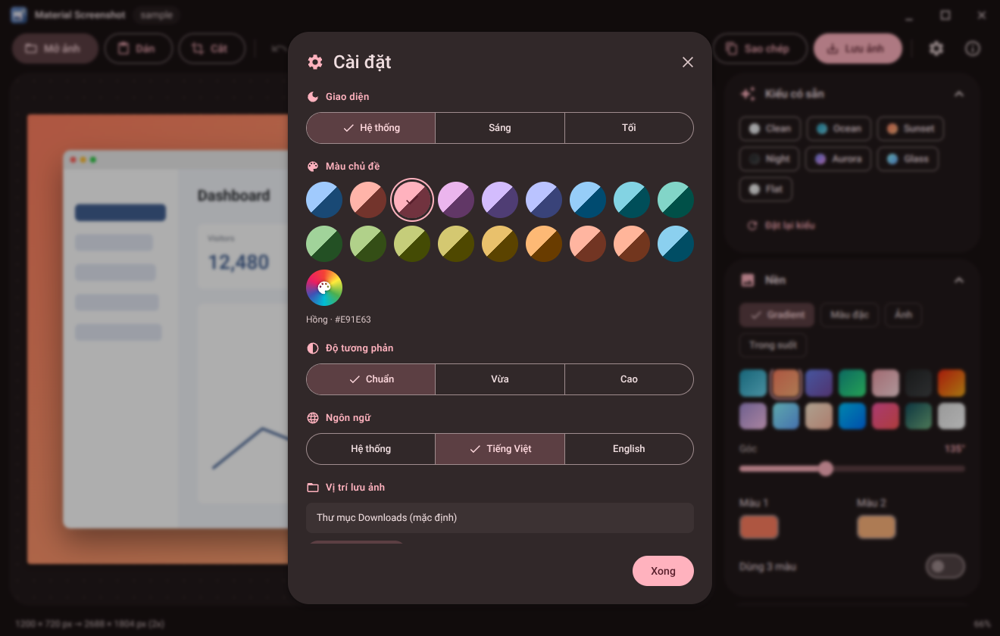
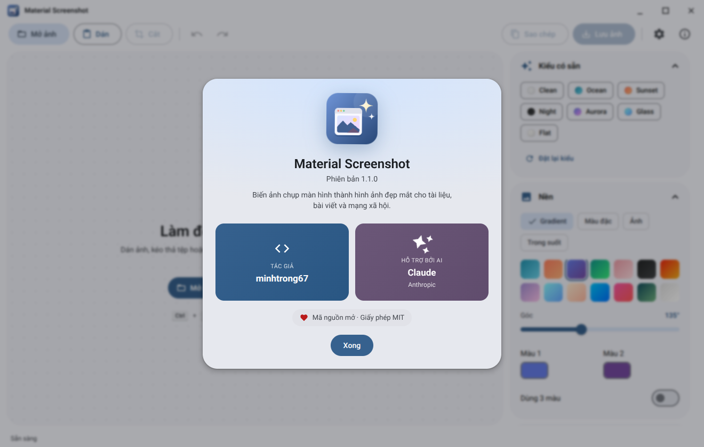

<div align="center">


# Material Screenshot

**Turn plain screenshots into polished images in seconds.**

A lightweight, offline desktop app designed with Material Design 3.


**English** · [Tiếng Việt](README.md)

</div>

## Introduction

**Material Screenshot** makes screenshots look great for docs, blog posts, social media and slides: add gradient backgrounds, window frames, shadows and annotations, then export or copy to the clipboard. It works fully offline, stays small thanks to Tauri 2 and follows **Material Design 3**. Public and open source (MIT).

> Author: **minhtrong67** · Built with the assistance of the AI **Claude** (Anthropic).

## Screenshots

| | |
|---|---|
|  |  |
|  |  |
|  |  |

## Features

- **Input:** paste (`Ctrl` + `V`), drag and drop, or open PNG / JPEG / WebP / GIF / BMP; built-in sample.
- **Style:** gradient (2–3 colours, 14 presets), solid, blurred image or transparent backgrounds; padding, radius, aspect ratios, border, shadow; Windows 11 / macOS / browser / glass frames; 7 one-click styles.
- **Edit:** crop, 60-step undo/redo, annotations (box, arrow, text, highlight, pixelate), caption.
- **Export:** PNG, JPEG, WebP at 1x–3x; copy to the clipboard or save straight into a default folder (Windows **Downloads**, changeable in Settings, with an optional "ask each time").
- **Experience:** Material 3 light / dark / system, 19 theme colours plus custom, 3 contrast levels; Vietnamese and English with automatic device-language detection; startup window option (remember size or always maximized); smooth animations; responsive; default **Roboto** font (bundled, works offline).

## Installation

**Users:** download `Material-Screenshot_1.1.0_x64-setup.exe` from [`download/`](download) and run it (per-user, no admin rights).
**Developers:** Windows 10/11, Node.js 18+, Rust (stable), Microsoft C++ Build Tools, WebView2 Runtime.

## Tech stack

Tauri 2 (Rust), vanilla HTML / CSS / JavaScript with Canvas 2D, Material Color Utilities, Roboto font, `tauri-plugin-dialog`.

## Development

Keep the project inside your shared Cargo workspace folder so all Tauri projects reuse one build cache.

```bash
npm install
npm run dev
```

## Build

```bash
npm run build
```

The installer is written to `<workspace>\target\release\bundle\nsis\`. Rename it to `Material-Screenshot_1.1.0_x64-setup.exe` and put it in `download/`. When hosting the landing page, replace `https://your-domain.com/` in `index.html`, `robots.txt` and `sitemap.xml` with your real domain. Regenerate icons with `python scripts/generate-icons.py` (needs `cairosvg`, `pillow`).

## Project structure

`index.html` (landing page) · `download/` · `screenshots/` · `assets/` · `scripts/` · `src/` (app UI) · `src-tauri/` (Rust core, icons, installer images). Full tree in the [Vietnamese README](README.md).

## License

Released under the [MIT License](LICENSE). Designed and developed by **minhtrong67** with the assistance of **Claude** (Anthropic).
