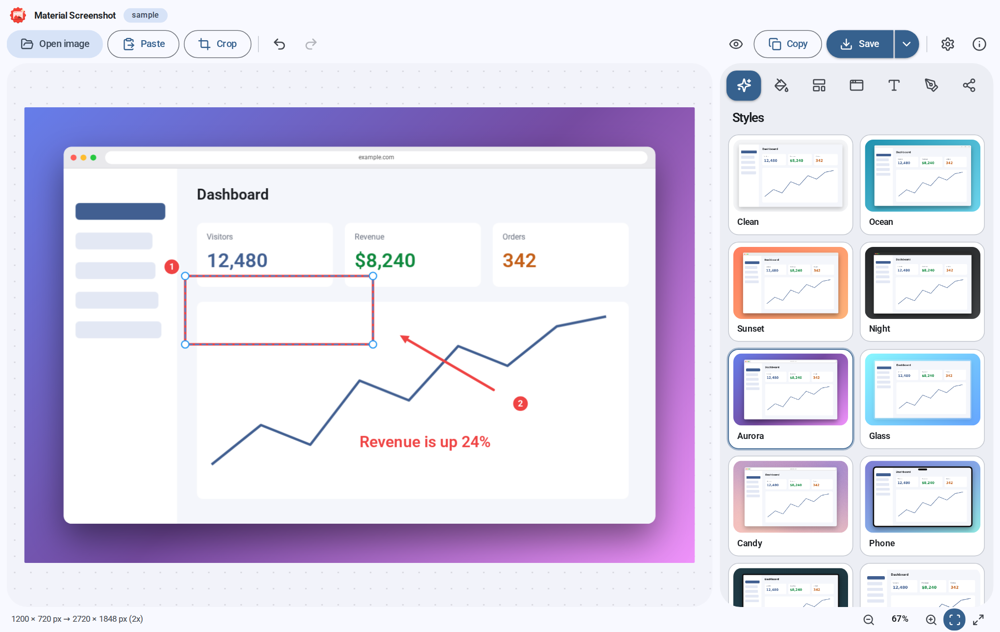
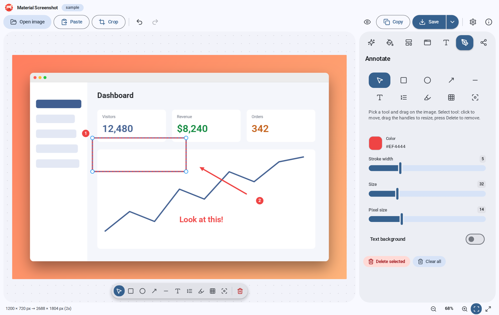
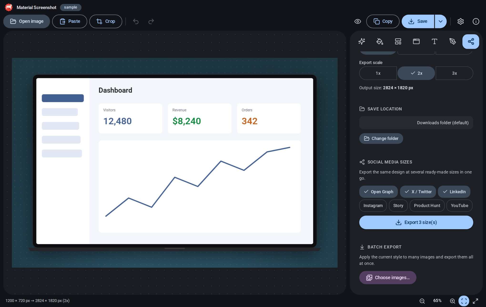
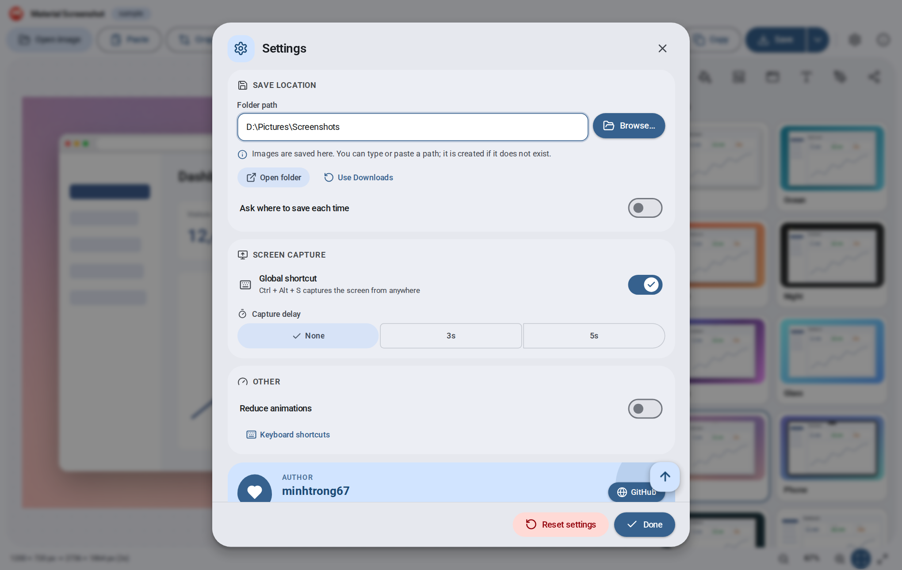

<div align="center">


# Material Screenshot

**Turn plain screenshots into polished images in seconds.**

A free, open-source Windows desktop app built with Tauri 2 and designed with Material 3 Expressive.

[](https://tauri.app)
[](https://react.dev)
[](https://www.typescriptlang.org)
[](https://tailwindcss.com)
[](#license)

[Tiếng Việt](README.md) · [Landing page](index.html) · [GitHub](https://github.com/minhtrong67/my-tauri-apps)

</div>

---

## Introduction

**Material Screenshot** lets you capture your screen (or open, paste or drop an existing image) and make it look great: gradient backgrounds, device frames, shadows, annotations and watermarks, then save or copy the result for docs, blog posts or social media.

Everything is processed on your PC; the app never uploads your images anywhere.

## Screenshot

<table>
  <tr>
    <td></td>
    <td></td>
  </tr>
  <tr>
    <td></td>
    <td></td>
  </tr>
</table>

## Features

**Getting an image**
- Capture the screen with the global shortcut `Ctrl + Alt + S` (full screen, or select a region and crop), with an optional 3 or 5 second timer
- Open an image, paste from the clipboard (`Ctrl + V`), drop one or many files, "Open with" support, recent files list

**Styling**
- 10 ready-made styles with real previews, save your own styles, import and export them as text
- Gradient, mesh, solid, image and transparent backgrounds; dot, grid and grain textures; auto colors from your image
- Windows, macOS, browser, glass, phone, tablet and laptop frames; rotate and skew for emphasis
- Corner radius, padding, shadow, border, aspect ratio (1:1, 4:3, 16:9, 9:16, custom…), captions and watermark (text or logo)

**Annotations**
- Arrow, line, rectangle, ellipse, text, step numbers, highlight, pixelate (hide sensitive info) and spotlight
- Select, move, resize, delete; undo and redo; zoom and pan; hold the eye button (or `X`) to see the original

**Export**
- PNG, JPEG, WebP at 1x / 2x / 3x, save straight to the default folder (Downloads) or ask where to save
- Custom save path in Settings: browse for a folder, or type / paste a path (created if missing), and open the folder in one click
- Export several social media sizes at once (Open Graph, X, LinkedIn, Instagram, Story, Product Hunt, YouTube) and batch-export many images

**Personalization (Settings)**
- Light / dark / system theme, 18 Material theme colors (plus a custom color), balanced or vibrant palette, contrast level
- Small / medium / large text, 5 fonts (Roboto, System UI, Inter, Nunito, Be Vietnam Pro), Vietnamese and English
- Window on startup: remember the last size or always open maximized
- Custom tooltips, dropdowns, toasts (info / success / warning / error), dialogs and a scroll-to-top button, all themed for light and dark

### Keyboard shortcuts

| Key | Action | Key | Action |
| --- | --- | --- | --- |
| `Ctrl + O` | Open image | `Ctrl + Z` / `Ctrl + Y` | Undo / Redo |
| `Ctrl + V` | Paste image | `C` | Crop |
| `Ctrl + Alt + S` | Capture screen | `V R O A L T N H B S` | Annotation tools |
| `Ctrl + C` | Copy image | `Delete` | Delete selected annotation |
| `Ctrl + S` | Save image | `Ctrl + wheel` | Zoom |
| `Ctrl + /` | Show all shortcuts | `0` / `1` | Fit / 100% |

## Download

Get the Windows installer (`Material-Screenshot_2.0.0_x64-setup.exe`) from the [`download`](download) folder or the [Releases](https://github.com/minhtrong67/my-tauri-apps/releases) page.

## Installation

1. Download the `.exe` above and run it.
2. The NSIS installer installs for the current user, no administrator rights needed.
3. Requires Windows 10 / 11 (64-bit) and Microsoft Edge WebView2 (preinstalled on Windows 11, the installer downloads it if missing).

## Tech stack

| Layer | Technology |
| --- | --- |
| App framework | [Tauri 2](https://tauri.app) (Rust) |
| UI | React 19, TypeScript, Vite 6, Tailwind CSS 4 |
| Design | Material 3 Expressive, `@material/material-color-utilities` |
| Icons | [Lucide](https://lucide.dev) |
| Rendering | Canvas 2D |
| Screen capture | [`xcap`](https://crates.io/crates/xcap) (Rust) |
| Installer | NSIS |

## Development

Requirements: [Node.js](https://nodejs.org) 18+, [Rust](https://rustup.rs) (stable), Microsoft C++ Build Tools and WebView2 (see [Tauri prerequisites](https://tauri.app/start/prerequisites/)).

```bash
npm install      # install dependencies
npm run dev      # run the app in development mode (Tauri + Vite, hot reload)
```

The project lives in the `my-tauri-apps` Cargo workspace (see the root `Cargo.toml`), so every app shares one `./target` build cache.

Just want to preview the UI in a browser (no screen capture or direct file saving)? Run `npm run web`.

Other commands: `npm run typecheck` (TypeScript check), `npm run icons` (regenerate the whole icon set, needs `pip install cairosvg pillow`).

## Build

```bash
npm run build
```

The installer is created in the workspace `target/release/bundle/nsis/`. Rename it to `Material-Screenshot_2.0.0_x64-setup.exe` and copy it into the `download` folder so the landing page buttons work.

## Project structure

```
material-screenshot/
├── index.html               # Landing page (single file, Material 3 Expressive)
├── app/                     # App UI (Vite root)
│   ├── index.html
│   ├── public/icon.svg
│   └── src/
│       ├── main.tsx · App.tsx · index.css
│       ├── components/      # Stage, Panel, Toolbar, Dialogs, Settings, ui/ (Button, Select, Tooltip, Toast…)
│       ├── lib/             # editor, render (canvas), theme, settings, i18n (dict), tauri…
│       └── hooks/
├── src-tauri/               # Rust backend
│   ├── src/lib.rs           # Commands: save/read image, screen capture, window state
│   ├── tauri.conf.json · capabilities/
│   ├── icons/               # app, setup (installer.ico) and uninstall (uninstaller.ico) icons
│   └── installer/           # NSIS header and sidebar bitmaps
├── assets/                  # Web icons, social share image (og-image), landing page fonts
├── screenshots/             # image01 … image04
├── download/                # Put the setup .exe here
├── scripts/generate-icons.py
├── package.json · vite.config.ts · tsconfig.json
└── LICENSE
```

## License

Released under the [MIT](LICENSE) license. Public and open source at [github.com/minhtrong67/my-tauri-apps](https://github.com/minhtrong67/my-tauri-apps).

---

<div align="center">

**Author: [minhtrong67](https://github.com/minhtrong67)** · Built with the support of AI **Claude** (Anthropic)

</div>
