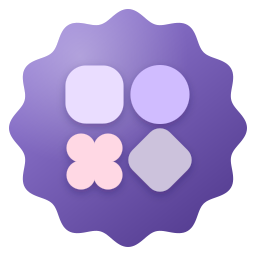
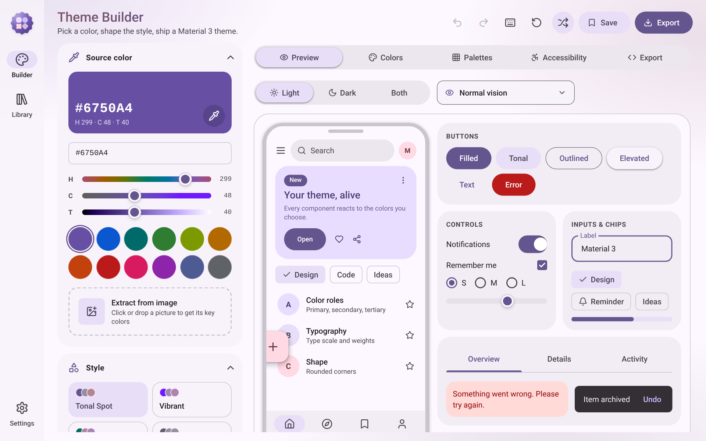
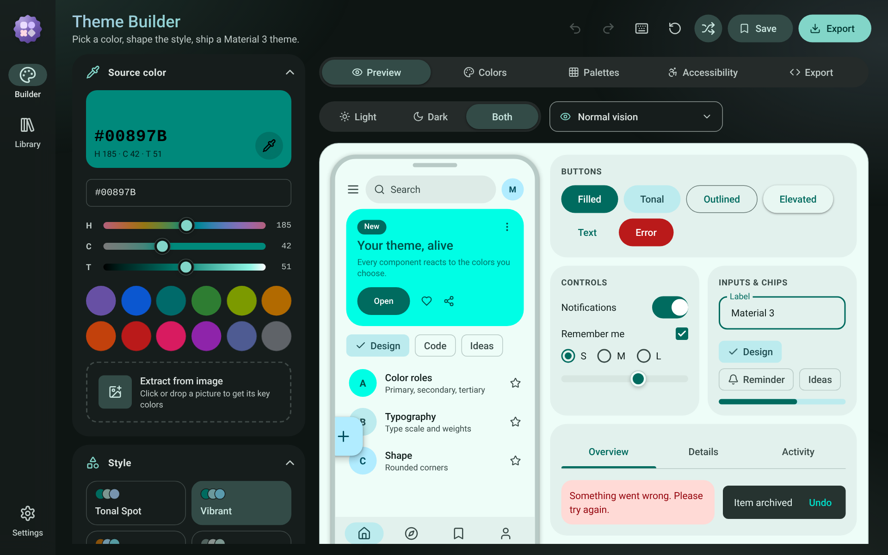
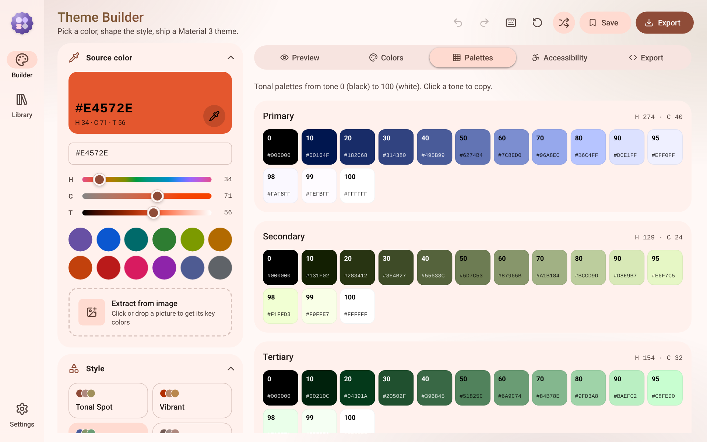
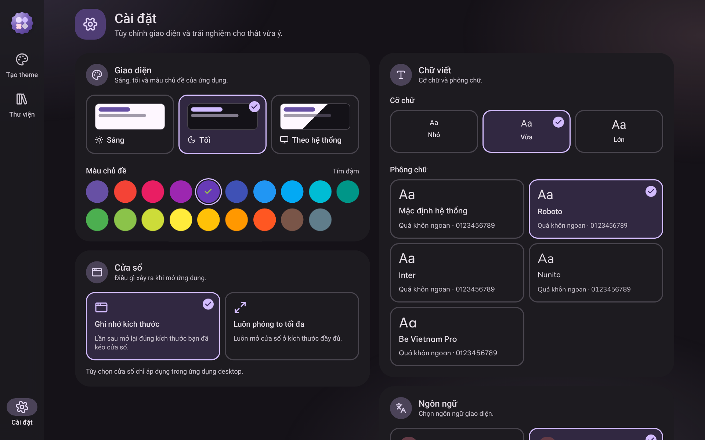

<div align="center">



# Material Theme Builder

**Design, preview and export Material Design 3 color themes — as a fast, native desktop app.**

[](LICENSE)


English · [Tiếng Việt](#tiếng-việt)

</div>

---

## Introduction

Material Theme Builder takes the idea of the official web tool and pushes it further. Pick a source color (or extract one from an image), choose a dynamic-color variant, tune contrast, then see your theme come alive on real Material 3 components in light, dark or side-by-side. When it looks right, export it to the format your project needs.

It is built with Tauri, so it is tiny, starts instantly and works fully offline. Your themes are stored locally.

## Screenshots

| | |
|---|---|
|  |  |
|  |  |

## Features

**Theme generation**
- Source color picker with HEX input and HCT (hue / chroma / tone) sliders
- Quick swatches, random color, and **extract key colors from an image**
- 9 dynamic-color variants: Tonal Spot, Vibrant, Expressive, Neutral, Monochrome, Fidelity, Content, Rainbow, Fruit Salad
- Standard, medium and high contrast for both light and dark schemes
- Undo / redo history

**Preview and inspection**
- Live preview on a phone mockup and component gallery (buttons, cards, chips, inputs, tabs, snackbar, FAB…)
- Light, dark or both side by side
- Color vision deficiency simulation
- Full color-role table and tonal palettes
- Accessibility tab with WCAG contrast checks for role pairs

**Export**
- CSS variables, Tailwind CSS, SCSS, JSON, Jetpack Compose, Flutter, Android XML
- Project file (`.mtb.json`) to save and reopen a theme
- Copy to clipboard or save to disk through the native dialog

**Library**
- Save themes, rename, duplicate, delete and reopen them anytime

**Settings**
- Light / dark / system mode
- Theme accent color from the Material palette
- Font size: small, medium, large
- 5 fonts: system default, Roboto, Inter, Nunito, Be Vietnam Pro
- Language: English and Tiếng Việt
- Window behavior: remember last size, or always start maximized

**Experience**
- Material 3 Expressive look: shape morphing, ripples, spring-like motion
- Custom tooltips, toasts (info / success / warning / error), dropdowns and dialogs that follow light and dark themes
- Keyboard shortcuts (press `?` in the builder)
- Custom app, installer and uninstaller icons

## Installation

### Download

Get the latest installer from the [Releases](../../releases) page or from the landing page (`index.html`, files in `download/`).

| Platform | File |
|---|---|
| Windows | `Material-Theme-Builder_1.0.0_x64-setup.exe` |
| macOS | `.dmg` (build it yourself, see below) |
| Linux | `.deb`, `.AppImage` (build it yourself, see below) |

### Requirements to build from source

- [Node.js](https://nodejs.org) 20 or newer
- [Rust](https://www.rust-lang.org/tools/install) stable
- Tauri system prerequisites for your OS: <https://tauri.app/start/prerequisites/>

## Tech stack

| Layer | Technology |
|---|---|
| Desktop shell | [Tauri 2](https://tauri.app) (Rust) |
| UI | React 19, TypeScript, Vite 6 |
| Styling | Tailwind CSS 4, Material 3 Expressive design tokens |
| Color science | [`@material/material-color-utilities`](https://github.com/material-foundation/material-color-utilities) |
| Icons | [Lucide](https://lucide.dev) |
| Fonts | Roboto, Inter, Nunito, Be Vietnam Pro via Fontsource |

## Development

```bash
npm install
npm run dev
```

`npm run dev` starts Vite and opens the Tauri window with hot reload.

To work on the UI only, in a browser:

```bash
npm run dev:web
```

Other scripts:

| Command | Description |
|---|---|
| `npm run dev` | Run the desktop app in development |
| `npm run build` | Build the production installers |
| `npm run build:web` | Typecheck and build the frontend only |
| `npm run icons` | Regenerate all app, setup and uninstall icons |

## Build

```bash
npm run build
```

Installers are written to `target/release/bundle/` of the shared Cargo workspace (one level above this folder).

## Project structure

```
material-theme-builder/
├── app/                  # Frontend source (Vite root)
│   ├── index.html
│   ├── public/
│   └── src/
│       ├── components/   # UI kit, tooltip, dialogs, color picker, tabs
│       ├── lib/          # theme engine, export, i18n, tauri bridge
│       ├── pages/        # Builder, Library, Settings
│       └── state/        # builder, settings, toast contexts
├── src-tauri/            # Rust shell, capabilities, icons, installer assets
├── scripts/              # Icon, landing asset and screenshot generators
├── screenshots/          # README images (image01 – image04)
├── download/             # Put installer files here for the landing page
├── assets/               # Landing page favicon and social image
├── index.html            # Landing page (single file)
└── package.json
```

## Credits

Created by **minhtrong67**, built with the assistance of AI — **Claude** by Anthropic.

## License

Released under the [MIT License](LICENSE). The project is public and open source; contributions are welcome.

---

## Tiếng Việt

**Material Theme Builder** là ứng dụng desktop mã nguồn mở giúp bạn tạo, xem trước và xuất bộ màu Material Design 3. Chọn màu gốc (hoặc lấy từ ảnh), chọn biến thể màu động, chỉnh độ tương phản, xem trực tiếp trên các component thật ở giao diện sáng/tối, rồi xuất ra CSS, Tailwind, SCSS, JSON, Compose, Flutter hoặc Android XML.

Cài đặt: tải bộ cài ở trang Releases, hoặc chạy từ mã nguồn:

```bash
npm install
npm run dev     # chạy chế độ phát triển
npm run build   # đóng gói bộ cài
```

Tác giả: **minhtrong67**, với sự hỗ trợ của AI **Claude**. Giấy phép: MIT.
