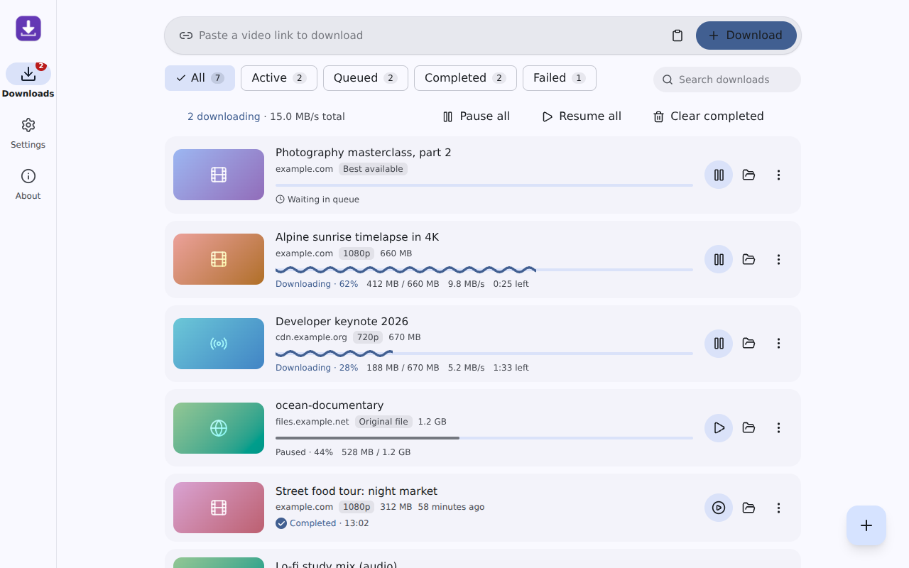
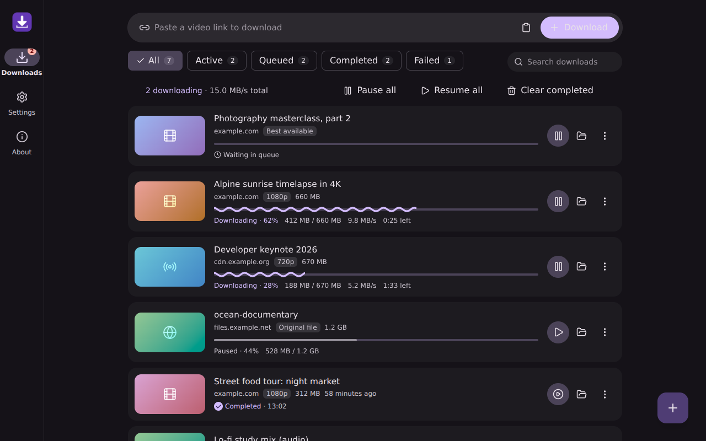
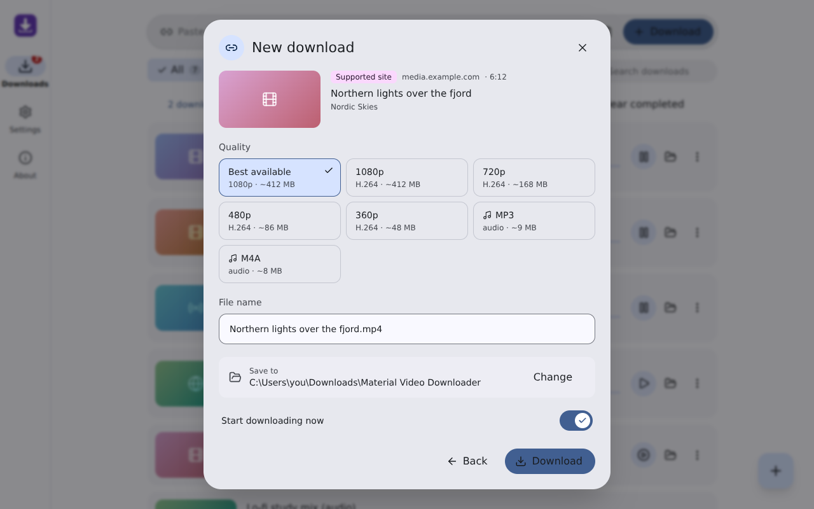
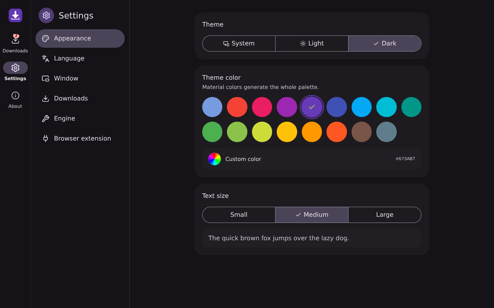
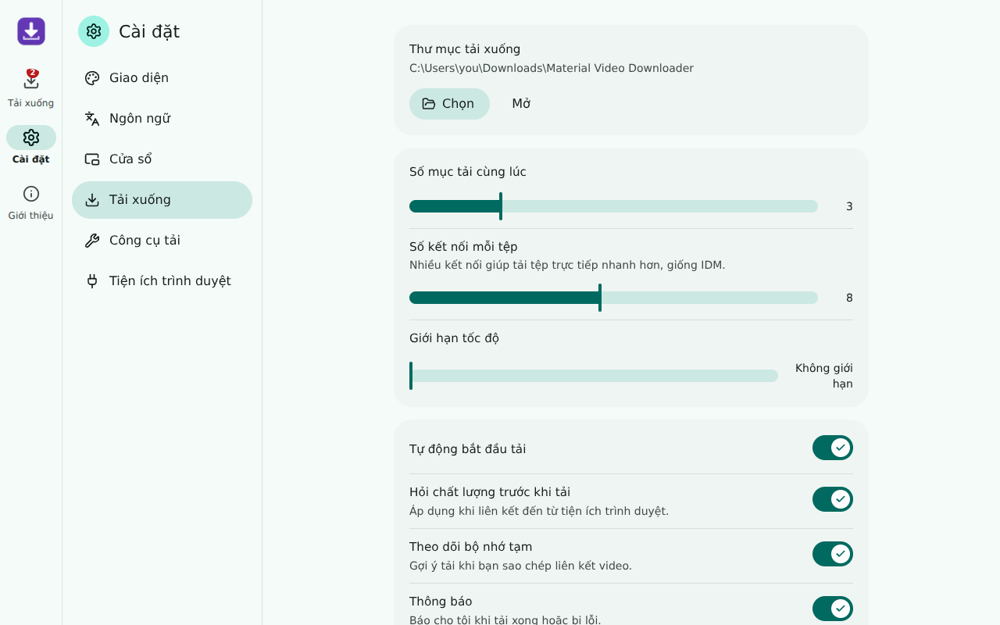
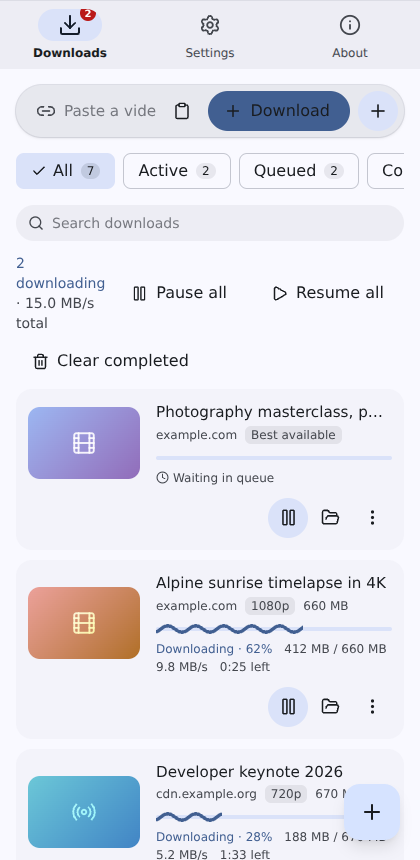

<div align="center">


# Material Video Downloader

**Download videos from the web — fast, tidy and beautifully Material.**

A free, open-source desktop app (Tauri + React) with IDM-style segmented downloads, HLS support, 1000+ sites through yt-dlp, and a companion Chrome extension that catches videos while you browse.

[](LICENSE)


[Landing page](landing.html) · [Download](download/) · [Report a bug](../../issues)

</div>

---

## Screenshots

<div align="center">

| Light | Dark + custom color |
| :---: | :---: |
|  |  |
| **Quality picker** | **Appearance settings** |
|  |  |
| **Vietnamese interface** | **Responsive layout** |
|  |  |

</div>

## Features

**Downloading**
- **Segmented downloads** – up to 16 parallel connections per file, pause / resume, automatic retry.
- **HLS (`.m3u8`)** – parallel segment download, AES-128 decryption, fMP4 support, merged to MP4 (ffmpeg) or TS.
- **1000+ sites** – video platforms and social networks through [yt-dlp](https://github.com/yt-dlp/yt-dlp), with a per-resolution quality picker, estimated sizes and MP3 / M4A audio.
- **Queue & limits** – simultaneous download limit, global speed limiter, resume after restart.
- **Comfort** – drag & drop links, batch add, clipboard watcher, desktop notifications, search and filters.

**Browser extension (Chrome / Edge / Brave)**
- Detects MP4 / WebM / MP3 / HLS requests per tab and shows a badge.
- Floating **Download** button over `<video>` elements, right-click menu on links.
- Sends links (with referer, user-agent and cookies) to the app over `127.0.0.1` only.
- Falls back to the browser's own downloader for plain files when the app is closed.

**Design & experience**
- Material Design 3 with colors generated from a seed (the default is the project's own Material Theme Builder export).
- Light / dark / **system** theme with a circular reveal transition, **17 Material theme colors** plus a custom picker.
- **3 text sizes**, **English / Tiếng Việt** (auto-detected, switchable).
- Wavy progress indicator, ripples, spring animations, responsive from small windows to ultrawide.
- **Window behavior** option: remember the last size, or always open maximized.
- Lucide icons everywhere, system font stack.

## Installation

### Windows / macOS / Linux
1. Download the installer for your system from [`download/`](download/) (or from your Releases page).
2. Run it. On Windows the NSIS setup lets you choose the language (English / Tiếng Việt) and per-user or machine-wide install.

### Chrome extension
1. Open `chrome://extensions` and enable **Developer mode**.
2. Click **Load unpacked** and choose the [`extension/`](extension/) folder (or unzip `download/material-video-downloader-extension.zip`).
3. Keep the desktop app running — the popup shows a green dot when they are connected.

### Optional helpers
- **yt-dlp** – installed with one click the first time you open a platform link (Settings → Engine).
- **ffmpeg** – needed to merge separate video + audio (highest qualities) and to make MP3. One-click install on Windows; elsewhere use `brew install ffmpeg` / `sudo apt install ffmpeg`.

## Tech stack

| Layer | Tools |
| --- | --- |
| Shell | [Tauri 2](https://tauri.app) (Rust) |
| UI | React 19, TypeScript, Vite, Tailwind CSS 4, Zustand |
| Design | Material Design 3 via `@material/material-color-utilities`, Lucide icons |
| Engine | `reqwest` + `tokio` (segmented HTTP, HLS), `tiny_http` (extension bridge), yt-dlp, ffmpeg |
| Extension | Chrome Manifest V3, vanilla JS |

## Development

Requirements: [Node.js 20+](https://nodejs.org), [Rust](https://rustup.rs) and the [Tauri prerequisites](https://tauri.app/start/prerequisites/) for your OS.

```bash
npm install     # install dependencies
npm run dev     # start the desktop app with hot reload
```

`npm run dev:web` runs only the web UI in a browser with a simulated backend, handy for design work.

This project lives in a shared Cargo workspace (`members = ["*/src-tauri"]`) so every Tauri app reuses one `target/` cache.

## Build

```bash
npm run build   # produces installers in <workspace>/target/release/bundle/
```

Windows gets an NSIS setup (`bundle/nsis/*.exe`) with its own setup and uninstall icons; macOS gets `.app`/`.dmg`; Linux gets `.deb`/`.AppImage`.
Copy the result into [`download/`](download/) using the names listed in [`download/README.md`](download/README.md), then run `npm run pack:extension` to refresh the extension zip.

Other scripts: `npm run icons` regenerates every app / setup / uninstall / extension icon (requires Python + Pillow).

## Project structure

```
material-video-downloader/
├── index.html              # Vite entry (app)
├── landing.html            # Single-file landing page (EN/VI, light/dark)
├── src/                    # React app
│   ├── components/         # Material UI primitives, dialog, cards, nav
│   ├── pages/              # Downloads, Settings, About
│   ├── lib/                # theme engine, i18n, API bridge, mock backend
│   └── store/              # Zustand stores
├── src-tauri/              # Rust backend
│   ├── src/                # manager, direct, hls, ytdlp, analyze, server, window
│   ├── icons/              # app, setup.ico, uninstall.ico
│   └── tauri.conf.json
├── extension/              # Chrome MV3 extension (popup, service worker, content script)
├── scripts/                # icon generator, extension packer
├── screenshots/            # image01 … image06
├── download/               # place installers here (linked by landing.html)
└── LICENSE
```

## Responsible use

Only download content you own or are permitted to save, and respect each website's terms of service.

## License

[MIT](LICENSE) © 2026 **minhtrong67** — free and open source.

Built with the help of [Claude](https://claude.ai), an AI assistant by Anthropic.
