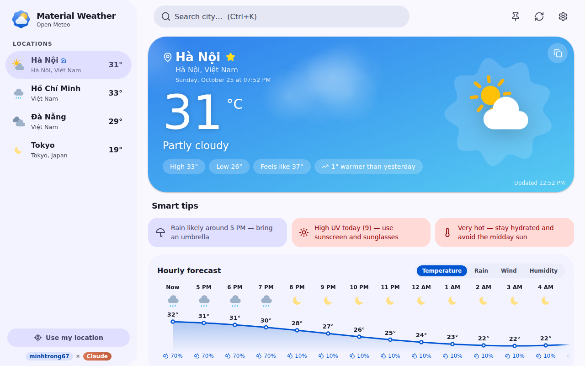
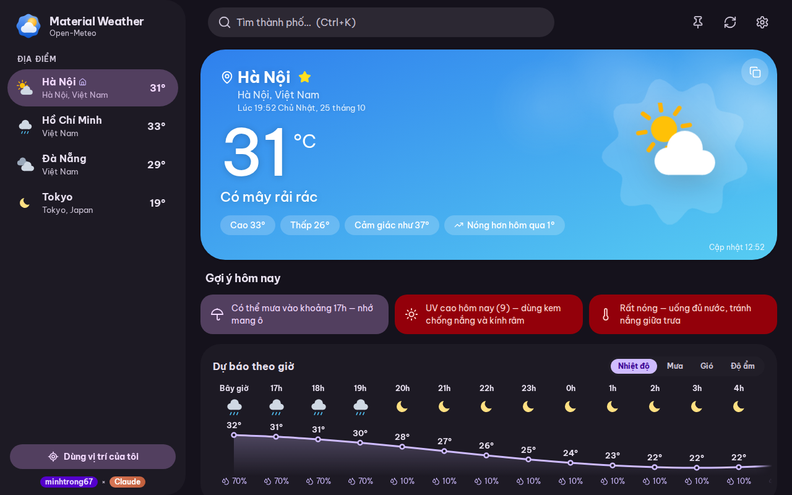
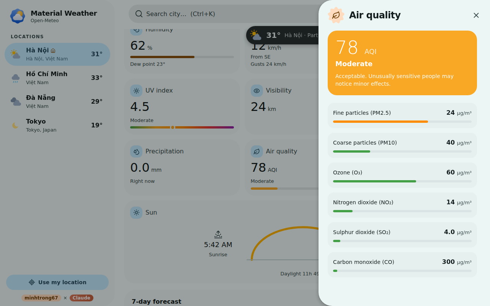
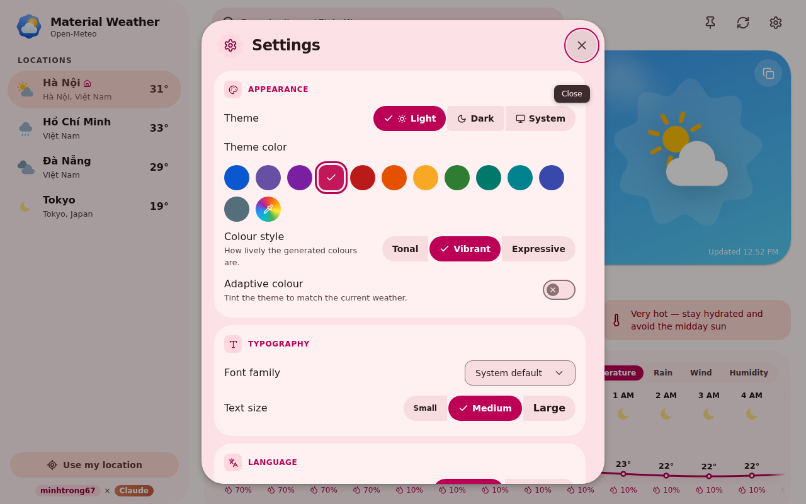

<div align="center">


# Material Weather

**A fast, beautiful desktop weather app — Material 3 Expressive, built with Tauri 2, React, TypeScript and Tailwind CSS.**


Created by **`minhtrong67`** with the support of **Claude** (Anthropic)

</div>

## Introduction

**Material Weather** is a lightweight cross-platform desktop app that shows live conditions, an hourly outlook, a 7-day forecast and air quality for any city. It follows **Material 3 Expressive**: colour generated from a seed colour (Tonal / Vibrant / Expressive styles), shape-morphing buttons, spring motion, wavy progress and a morphing loading indicator, light / dark / system themes and tonal surfaces. The UI is available in **English** and **Tiếng Việt**.

Weather data comes from [Open-Meteo](https://open-meteo.com/) — free, no API key required. A single-file landing page is included in [`index.html`](index.html) (open it in a browser or host it as a static site).

## Screenshots

| | |
|---|---|
|  |  |
|  |  |

> Screenshots are real renders of the UI with sample weather data.

## Features

- **Live weather** — temperature, feels-like, condition, humidity (+ dew point), wind (speed, direction, gusts), pressure, UV, visibility, cloud cover, precipitation, comparison with yesterday.
- **Hourly forecast** — next 24 hours with an animated chart you can switch between temperature, rain, wind and humidity.
- **7-day forecast** — range bars; click a day to open a **side sheet** with that day's details and hour-by-hour chart.
- **Air quality** — US AQI; click the tile for a pollutant breakdown (PM2.5, PM10, O₃, NO₂, SO₂, CO) and advice.
- **Smart tips** — umbrella, UV, heat/cold, wind and air-quality tips generated from the forecast.
- **Weather alerts** — optional desktop notifications when rain or a thunderstorm is coming.
- **Moon phase & sun arc** — computed locally; sunrise, sunset, daylight length.
- **Location with permission** — “Use my location” explains why and asks first; if blocked you get instructions and an approximate (IP-based) fallback.
- **Places** — search with autocomplete, saved places, a **home** place opened at startup, `Alt+↑/↓` to switch.
- **Weather effects** — animated rain, snow, clouds, stars, sun glow and lightning on the main card.
- **Settings** — light / dark / system; 12 Material colours + custom colour + adaptive colour + colour style (Tonal / Vibrant / Expressive); **5 fonts** (System UI, Roboto, Inter, Open Sans, Be Vietnam Pro) bundled offline; **text size** (small / medium / large); English / Tiếng Việt; °C/°F; km/h, m/s, mph; 12/24-hour; refresh interval; **window mode** (remember size or always maximized); always on top.
- **Backup & robustness** — copy / paste your settings and places as JSON, single running instance (relaunching focuses the open window), error screen instead of a blank window.
- **Polish** — custom tooltips, typed toasts (info / success / warning / error), custom dropdown selects, confirm dialogs, side sheets, ripples, skeleton loading, offline cache, reduced-motion support.
- **Keyboard** — `Ctrl+K` / `/` search · `F5` refresh · `Ctrl+,` settings · `?` help · `Esc` close.

## Installation

Download the installer from the build output (see [Build](#build)) or from the landing page and run it.

| Platform | File |
|---|---|
| Windows | `Material Weather_1.2.0_x64-setup.exe` (NSIS, English + Tiếng Việt installer) |
| macOS | `Material Weather_1.2.0_*.dmg` |
| Linux | `.deb` / `.AppImage` |

To publish the Windows installer on the landing page, put the file into [`download/`](download/) (see `download/README.txt`).

## Tech stack

| Layer | Technology |
|---|---|
| Shell | [Tauri 2](https://tauri.app/) (Rust) + notification, opener & single-instance plugins |
| UI | React 18 · TypeScript · Vite 6 · Tailwind CSS 4 · Zustand |
| Design | Material 3 Expressive (springs, shape morphing, tonal/vibrant/expressive palettes) via `@material/material-color-utilities`, `system-ui` default font, [Lucide](https://lucide.dev/) icons |
| Fonts | `@fontsource` (Roboto, Inter, Open Sans, Be Vietnam Pro — latin + vietnamese subsets) |
| Data | Open-Meteo (forecast, geocoding, air quality) · BigDataCloud (reverse geocoding) · ipwho.is / geojs.io / ipapi.co (approximate-location fallback) |

## Development

Requirements: [Node.js 18+](https://nodejs.org/), [Rust](https://rustup.rs/) and the [Tauri prerequisites](https://tauri.app/start/prerequisites/) for your OS.

This project lives inside a **Cargo workspace** (root `Cargo.toml` with `members = ["*/src-tauri"]`) and shares one `./target` build cache with the other Tauri projects.

```bash
cd material-weather
npm install      # install dependencies
npm run dev      # start Tauri in development mode (hot reload)
```

## Build

```bash
npm run build    # type-check, production build + installers
```

Installers are written to the **workspace root**: `../target/release/bundle/` (e.g. `nsis/Material Weather_1.2.0_x64-setup.exe`).

### Icons

Icon sources are in `design/` (app, setup and uninstall icons).

```bash
pip install cairosvg pillow
python design/gen_icons.py          # setup/uninstall .ico + installer images
npx tauri icon design/app-icon.png  # app icons for every platform
```

## Project structure

```
material-weather/
├── index.html               # single-file landing page (themes, EN/VI, SEO)
├── download/                # put the installer here
├── design/                  # icon sources (SVG) + generator script
├── public/                  # logo & favicon
├── screenshots/             # image01.png … image04.png
├── src/
│   ├── main.tsx · App.tsx
│   ├── components/          # Hero, Sections, Sheets, Dialogs, SettingsDialog, Drawer, TopBar …
│   │   └── ui/              # Tooltip, Button, Dialog/Sheet, Select, Controls, Toaster, ripple
│   ├── lib/                 # api, store, actions, i18n, theme, fonts, window, notify, insights, fx …
│   ├── locales/             # en.ts, vi.ts
│   └── styles/index.css     # Tailwind + Material 3 tokens + animations
├── src-tauri/               # Rust, capabilities, icons, installer assets
├── app.html                 # Vite entry of the desktop app (root index.html is the landing page)
├── package.json · vite.config.ts · tsconfig.json
```

## Privacy

No account and no tracking. Your precise location is requested only after you press **Use my location** (or on first launch) and you allow it; it is used to fetch the forecast and a place name and is kept only on your computer. Approximate IP-based location is used only if you choose it or if precise location is unavailable.

If location is blocked — **Windows:** Settings → Privacy & security → Location → turn on *Location services* and *Let desktop apps access your location*. **macOS:** System Settings → Privacy & Security → Location Services. **Linux:** precise location may be unavailable in WebKitGTK; the approximate fallback is used.

## License

Released under the [MIT License](LICENSE) — public and open source.

<div align="center">

Made with ♥ by **minhtrong67** × **Claude**

</div>
