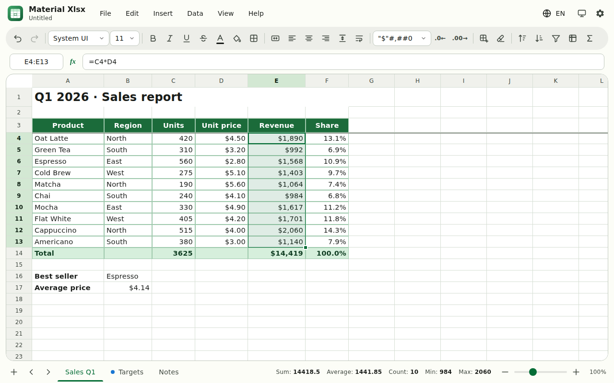
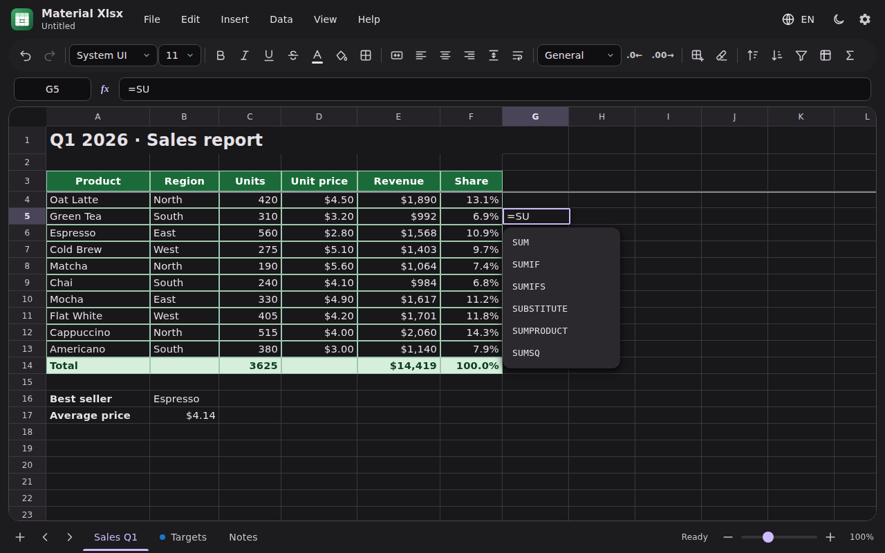
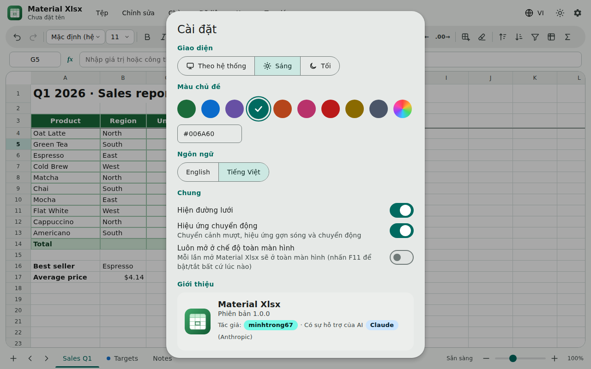
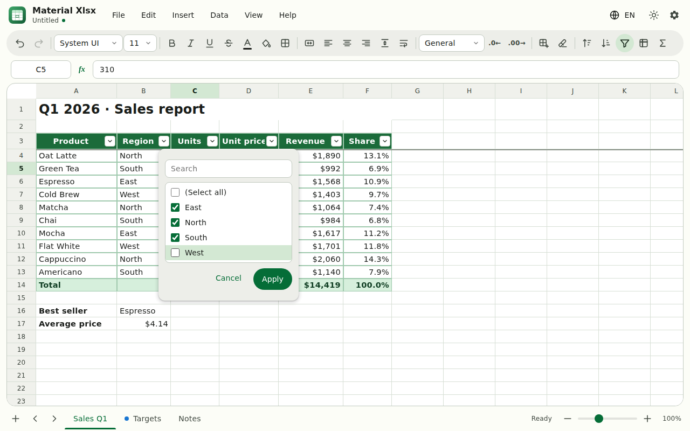
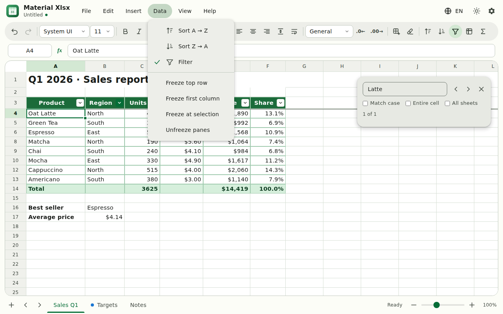

<div align="center">


# Material Xlsx

**A simple, fast and beautiful spreadsheet editor for `.xlsx` files — built with Tauri 2 and Material Design 3.**

English · [Tiếng Việt](README.vi.md)


Created by **`minhtrong67`** with the support of AI **`Claude`** (Anthropic)

</div>

---

## Introduction

Material Xlsx is a lightweight desktop alternative to Microsoft Excel for everyday work: open, edit and save `.xlsx` workbooks with formulas, formatting, sorting, filtering and multiple sheets — in a clean Google **Material Design 3** interface that follows your system theme and your own accent colour.

The whole spreadsheet engine (formula parser, evaluator, undo history, virtual grid) is written in plain JavaScript and runs inside Tauri's native WebView, so the installer is small and the app starts instantly. Rust handles file access, the system clipboard and window-state persistence.

## Screenshots

| | |
|---|---|
|  |  |
| *Light theme: formulas, number formats, merged title, frozen header* | *Dark theme with a custom colour and formula auto-complete* |
|  |  |
| *Settings in Vietnamese: theme, colour, language, window mode* | *Column filter with search and check-list* |
|  | |
| *Data menu and Find & Replace panel* | |

## Features

**Spreadsheet**
- Multiple sheets: add, rename (double-click), duplicate, reorder, colour tabs, delete
- **200+ functions** — math, statistics, **financial** (`PMT`, `FV`, `PV`, `NPV`, `IRR`, `RATE`, …), logic, text, date/time and lookup (`SUM`, `IFS`, `SUMIFS`, `COUNTIFS`, `VLOOKUP`, `XLOOKUP`, `XMATCH`, `OFFSET`, `INDEX/MATCH`, `SUBTOTAL`, `WORKDAY`, `NETWORKDAYS`, `PERCENTILE`, `CORREL`, `NORM.DIST`, `TEXTBEFORE`, …), cross-sheet references (`'My Sheet'!A1`), whole-column ranges (`A:A`), circular-reference detection and `#N/A`-style errors
- Function auto-complete with the most common functions first; click-to-insert cell references while typing a formula
- Cell formatting: font, size, bold / italic / underline / strike, text & fill colour, borders, alignment, wrap text, merge cells
- Number formats: general, number, thousands, currency (`$`, `₫`, `€`), percent, scientific, dates & times, text and **custom codes**; +/- decimals
- **Bundled fonts** (Inter, Roboto, Be Vietnam Pro, Noto Sans / Serif, Open Sans, Lora, Roboto Mono — Vietnamese-ready, work offline) plus the common fonts installed on your system; **AutoFit** of one or many columns / rows (double-click a border, like Excel)
- Sort A→Z / Z→A and **multi-level custom sort**, column **filter** with search, **freeze panes**, hide / unhide rows and columns, **Format as Table**, **cell styles**, **format painter**
- Fill handle with series (numbers, dates, `Item 1, Item 2…`) and relative formula copy, `Ctrl+D` / `Ctrl+R`
- Copy / cut / paste (also from and to Excel), paste values only, paste formatting only
- Insert / delete rows and columns with automatic formula and range adjustment
- Unlimited-style **undo / redo**, find & replace (match case, entire cell, all sheets), AutoSum, name box, status-bar statistics (sum, average, count, min, max)
- Smooth zoom 50–200 %, resizable rows / columns (double-click to auto-fit), print
- Virtualised grid — 100 000+ rows stay fluid

**Excel-style tools (new in 1.1)**
- **Conditional formatting** — highlight cells (greater / less / between / equal / text contains), duplicate or unique values, top / bottom N, above / below average, formula rules, **colour scales** and **data bars**; rule manager with priority, edit and delete
- **Data validation** — dropdown lists (typed or from a range), whole number, decimal, date, text length and custom formula; input message and Stop / Warning / Information alerts
- **Charts** — column, bar, line, area, pie, doughnut and scatter with live preview, stacked / data-label / legend options; drag, resize, edit and delete on the sheet; animated
- **Hyperlinks** (`Ctrl+K`, web / mail / jump to a cell) and **notes** with the red corner marker
- **Paste special** (values, formulas, formats, add / subtract / multiply / divide, skip blanks, transpose), **remove duplicates**, **text to columns**, show formulas (`Ctrl+\``), insert date / time (`Ctrl+;`)

**Files**
- Open / save **`.xlsx`** (styles, merges, widths, frozen panes, filters, formulas with cached values, conditional formats, data validation, notes, hyperlinks, hidden rows / columns), open and import **CSV / TSV**, export the current sheet to CSV
- Recent files, drag & drop a file onto the window, unsaved-changes protection, "Open with" support

**Design & experience**
- Material Design 3: navigation, menus, dialogs, chips, switches, snackbars, ripples; default font is **Roboto** (bundled, works offline); an **About** dialog (info button in the top bar) credits the author and the AI
- **Light / Dark / System** theme + any **custom theme colour** (generated with Material colour utilities)
- Motion: ripple effect, animated menus and dialogs, sliding sheet-tab indicator, circular-reveal theme switch, smooth selection movement, marching-ants copy marquee, flash on paste / fill / sort — can be turned off in Settings (and respects the OS "reduce motion" setting)
- **English and Vietnamese** interface (switch instantly)
- **Window option in Settings:** *remember the window size* (reopens exactly as you left it) **or** *always start maximized*; `F11` toggles full screen at any time
- Full icon set: app icon, installer (setup) icon and uninstaller icon

## Landing page

Live at **https://minhtrong67.github.io/material-xlsx/**. The page ships with full SEO and social-sharing metadata: title / description / keywords, canonical + `hreflang` (`?lang=en|vi`), robots, Open Graph and Twitter cards with a 1200×630 share image (`og-image.png`), JSON-LD (WebSite, SoftwareApplication, FAQPage), `sitemap.xml`, `robots.txt` and `site.webmanifest`.

`index.html` in the project root is a standalone, responsive, animated landing page (English / Vietnamese, light / dark, live colour demo, screenshot gallery and a Download button). After `npm run build`, copy `src-tauri/target/release/bundle/nsis/Material Xlsx_1.1.0_x64-setup.exe` into `download/` — the button already points to it. Open the file in a browser or host it on GitHub Pages.

## Download

Pre-built installers are published on the **[Releases](https://github.com/minhtrong67/material-xlsx/releases)** page.

| Platform | File |
|---|---|
| Windows 10 / 11 | `Material Xlsx_1.1.0_x64-setup.exe` (NSIS installer) or `.msi` |
| macOS | `.dmg` (build on a Mac) |
| Linux | `.deb` / `.AppImage` (build on Linux) |

## Install

1. Download the installer for your platform from Releases (or from the landing page `index.html` → `download/`).
2. Run it and follow the wizard (Windows needs the Microsoft WebView2 runtime, already included in Windows 10/11).
3. Launch **Material Xlsx** from the Start menu, then open or drag in an `.xlsx` file.

To uninstall use *Settings → Apps* or the **Uninstall Material Xlsx** shortcut.

## Tech stack

| Layer | Technology |
|---|---|
| Desktop shell | [Tauri 2](https://tauri.app) (Rust) + plugins `dialog`, `opener`, `window-state` |
| Rust crates | `serde`, `base64`, `arboard` (clipboard) |
| UI | HTML, CSS and vanilla JavaScript (ES modules, no bundler) |
| Design system | Material Design 3, colour roles by `@material/material-color-utilities` |
| Spreadsheet engine | Custom Pratt parser + evaluator, immutable-cell model with snapshot undo |
| XLSX I/O | [ExcelJS](https://github.com/exceljs/exceljs) |
| Rendering | Canvas gridlines + virtualised DOM cells in four panes (freeze support) |

## Development

Requirements: [Node.js 18+](https://nodejs.org), [Rust](https://rustup.rs) and the [Tauri prerequisites](https://tauri.app/start/prerequisites/) for your OS.

This project is a member of a Cargo workspace (`members = ["*/src-tauri"]`), so it is picked up automatically when the folder sits next to your other Tauri apps and shares one `./target` build cache.

```bash
cd material-xlsx
npm install        # installs the Tauri CLI
npm run dev        # runs the app with hot reload of the front-end
npm test           # unit tests for formulas, number formats and the data model
```

## Build

```bash
npm run build
```

Installers are written to `target/release/bundle/` of the workspace (for example `nsis/Material Xlsx_1.1.0_x64-setup.exe`). The setup and uninstall icons are configured in `src-tauri/tauri.conf.json` (`installerIcon`, `uninstallerIcon`).

## Project structure

```
material-xlsx/
├─ index.html              landing page (single file, bilingual, Material Design 3)
├─ og-image.png, robots.txt, sitemap.xml, site.webmanifest   SEO / social-sharing assets
├─ download/               put the Windows installer here (the landing page links to it)
├─ package.json            npm scripts: dev, build, test
├─ screenshots/            README images (image01 … image05)
├─ tests/                  unit tests (formulas, functions, formats, model, features, charts, xlsx round-trip, i18n)
├─ src/                    front-end
│  ├─ index.html           shell + SVG icon sprite
│  ├─ styles.css           Material Design 3 styles + motion
│  ├─ vendor/              ExcelJS, Material colour utilities (bundled, works offline)
│  └─ js/
│     ├─ main.js           entry point
│     ├─ app.js            toolbar, menus, tabs, dialogs, files, find & replace
│     ├─ grid.js           virtual grid, selection, editing, fill handle, clipboard
│     ├─ model.js          workbook / sheet / style model, history, structural edits
│     ├─ formula.js        parser + evaluator + function library
│     ├─ functions-ext.js  financial, statistics, date, lookup and text functions
│     ├─ features.js       conditional-format and data-validation engines
│     ├─ charts.js         chart data extraction + SVG renderer
│     ├─ app-ext.js        dialogs: rules, validation, charts, links, notes, data tools
│     ├─ refs.js           cell references, lexer, reference rewriting
│     ├─ numfmt.js         number / date formats and typed-input parsing
│     ├─ io.js             XLSX (ExcelJS), CSV / TSV, base64 helpers
│     ├─ i18n.js, i18n-more.js   English / Vietnamese strings
│     ├─ theme.js          Material 3 colour roles, light / dark / system
│     ├─ widgets.js        menus, dialogs, ripple, snackbar, colour palette
│     └─ tauri.js          bridge to Tauri (with browser fallbacks)
└─ src-tauri/              Rust backend
   ├─ Cargo.toml  tauri.conf.json  build.rs
   ├─ capabilities/        window / dialog permissions
   ├─ icons/               app, installer.ico, uninstaller.ico, Store logos
   └─ src/                 main.rs, lib.rs (file I/O, clipboard, window state)
```

## Keyboard shortcuts

| Shortcut | Action | Shortcut | Action |
|---|---|---|---|
| `Ctrl+N / O / S` | New / Open / Save | `Ctrl+Shift+S` | Save as |
| `Ctrl+Z / Y` | Undo / Redo | `Ctrl+C / X / V` | Copy / Cut / Paste |
| `Ctrl+B / I / U` | Bold / Italic / Underline | `Ctrl+F / H` | Find / Replace |
| `Ctrl+D / R` | Fill down / right | `Ctrl+Arrows` | Jump to data edge |
| `F2` | Edit cell | `Alt+Enter` | New line in cell |
| `Alt+=` | AutoSum | `Ctrl+= / − / 0` | Zoom in / out / reset |
| `F11` | Full screen | `Ctrl+,` | Settings |
| `Ctrl+K` | Hyperlink | `Shift+F2` | Note |
| `Ctrl+Alt+V` | Paste special | `Ctrl+Shift+L` | Toggle filter |
| `Ctrl+;` / `Ctrl+Shift+;` | Insert date / time | ``Ctrl+` `` | Show formulas |

## Known limitations

Images, pivot tables, sparklines and dynamic-array spills (`FILTER`, `SORT`, `UNIQUE`) are not supported. Conditional formats, data validation, notes and hyperlinks are written as real Excel features; **charts and data bars are stored in a hidden sheet** so Material Xlsx brings them back, but Excel itself will not display them. Shared formulas from other tools are imported as ordinary formulas; functions that Material Xlsx does not implement keep the value cached in the file.

## License

Released under the [MIT License](LICENSE) © 2026 **minhtrong67**.

<div align="center">

Made with ♥ by **minhtrong67** · AI assistant **Claude**

</div>
