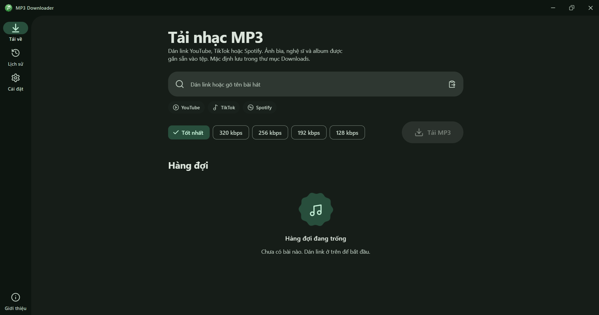
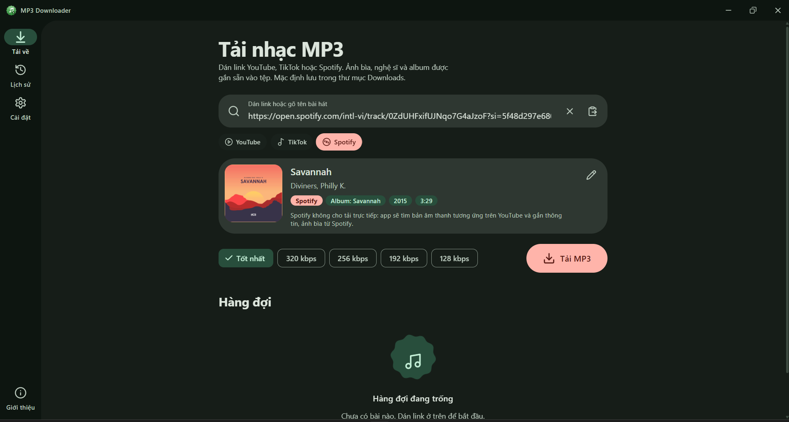
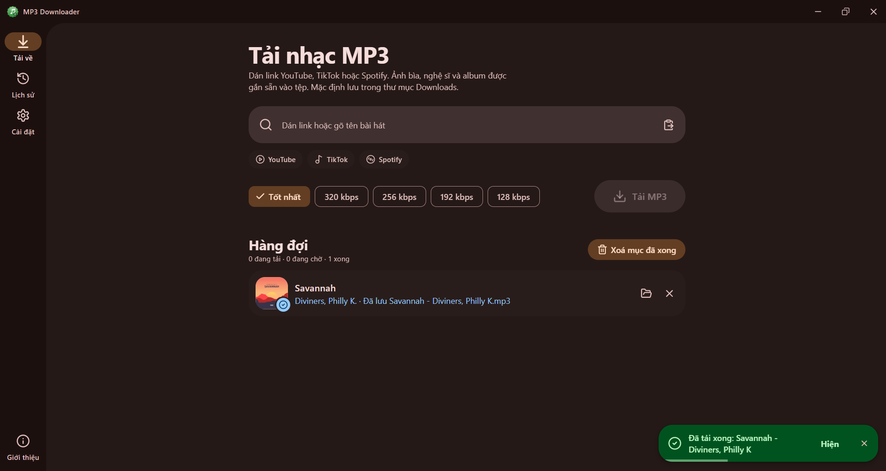
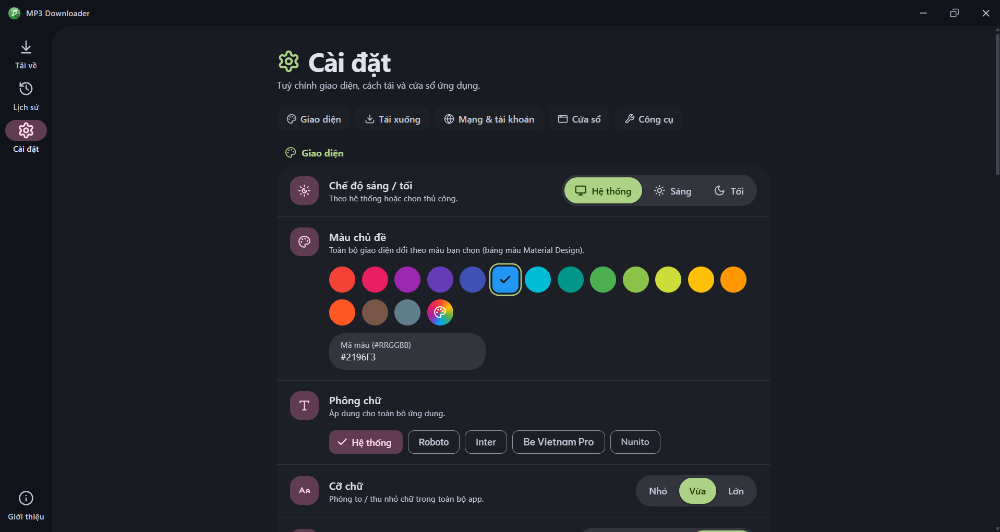

<div align="center">


# MP3 Downloader

**Tìm theo tên hoặc dán link — nhận file MP3 đầy đủ thông tin từ YouTube, TikTok và Spotify.**
Ứng dụng desktop miễn phí, mã nguồn mở, xây dựng bằng Tauri, React và Material 3 Expressive.

[Tải về](download/) · [Landing page](index.html) · [English](README.md)

   

</div>

## Giới thiệu

MP3 Downloader biến link (hoặc chỉ một tên bài hát) thành file MP3 có sẵn ảnh bìa, tên bài, nghệ sĩ, album và năm. Ứng dụng bọc [yt-dlp](https://github.com/yt-dlp/yt-dlp) và [ffmpeg](https://ffmpeg.org) trong giao diện **Material 3 Expressive (2026)**: icon hình "cookie", nút biến hình, chuyển động lò xo và thanh tiến độ gợn sóng.

## Ảnh chụp màn hình

| | |
|---|---|
|  |  |
|  |  |

> Hãy chụp 4 ảnh và đặt tên `image01.png` … `image04.png` trong thư mục [`screenshots/`](screenshots/) (Tải xuống, Playlist/Thông tin, Lịch sử, Cài đặt).

## Tính năng

- **Ba nguồn nhạc** — YouTube, TikTok và Spotify (Spotify được ghép với âm thanh tốt nhất trên YouTube và gắn thẻ theo dữ liệu Spotify). Hỗ trợ dán nhiều link.
- **Tìm theo tên** — gõ tên bài hát rồi chọn kết quả.
- **Playlist** — mở playlist, tick các bài cần tải rồi thêm vào hàng đợi.
- **Sửa thông tin bài hát** trước khi tải (tên, nghệ sĩ, album, năm).
- **Hàng đợi thông minh** — tải song song (1–4), giới hạn tốc độ, tự thử lại khi gặp HTTP 403, tiến độ gợn sóng, dừng tất cả.
- **Lịch sử** — tìm kiếm, mở thư mục, tải lại, xoá tệp.
- **Đặt tên tệp** — 4 mẫu, thư mục theo nghệ sĩ, xử lý trùng tên (giữ cả hai / bỏ qua / ghi đè).
- **Chất lượng** — tốt nhất hoặc 320 / 256 / 192 / 128 kbps, cắt ảnh bìa vuông tuỳ chọn.
- **Mạng** — cookie trình duyệt (cho lỗi "yêu cầu đăng nhập") và proxy.
- **An toàn** — công cụ tải về được kiểm tra SHA-256, CSP nghiêm ngặt, chỉ chạy một cửa sổ.
- **Luôn cập nhật** — cảnh báo khi yt-dlp cũ và cập nhật một chạm; thông báo trên màn hình.
- **Của riêng bạn** — sáng / tối / hệ thống, 16 màu Material + màu tuỳ chỉnh, 5 font (mặc định theo hệ thống, có Roboto…), 3 cỡ chữ, tiếng Anh & tiếng Việt, chế độ cửa sổ (nhớ kích thước / luôn phóng to).
- **Giao diện chỉn chu** — thanh tiêu đề tuỳ chỉnh, tooltip, toast (info / success / warning / error), dropdown riêng, dialog và side sheet có nút kèm nhãn, icon và màu.

## Cài đặt

1. Tải `MP3 Downloader_<phiên bản>_x64-setup.exe` trong thư mục [`download/`](download/) (Windows 10/11 64-bit).
2. Chạy bộ cài. Nếu SmartScreen cảnh báo, chọn **Thông tin thêm → Vẫn chạy** (bộ cài chưa được ký số).
3. Lần đầu mở app, ứng dụng sẽ đề nghị tải giúp **yt-dlp**, **ffmpeg** và (nên có) **Deno**.

macOS / Linux: build từ mã nguồn (xem bên dưới) và tự cài `yt-dlp`, `ffmpeg` (ví dụ bằng trình quản lý gói).

## Công nghệ

| Lớp | Công nghệ |
|---|---|
| Vỏ ứng dụng | Tauri 2 (Rust) + plugin: dialog, opener, notification, single-instance |
| Giao diện | React 18, TypeScript, Vite 5, Tailwind CSS 3 |
| Thiết kế | Material 3 Expressive, `@material/material-color-utilities` (bảng màu Expressive) |
| Icon | [lucide-react](https://lucide.dev) |
| State | Zustand (lưu cài đặt & lịch sử) |
| Engine | yt-dlp, ffmpeg, Deno (tuỳ chọn) |

## Phát triển

Yêu cầu: [Node.js 18+](https://nodejs.org), [Rust](https://rustup.rs) và [các điều kiện cần của Tauri](https://tauri.app/start/prerequisites/).

Dự án nằm trong **Cargo workspace** (`Cargo.toml` ở thư mục gốc có `members = ["*/src-tauri"]`), nên mọi project Tauri trong thư mục dùng chung một bộ nhớ đệm `target/`.

```bash
npm install
npm run dev
```

`npm run dev` chạy Vite và cửa sổ Tauri với hot reload.

## Build

```bash
npm run build
```

Bộ cài nằm trong `target/release/bundle/nsis/` của workspace. Chép vào [`download/`](download/) để nút **Tải về** của landing page hoạt động (link trỏ tới `MP3 Downloader_0.5.0_x64-setup.exe`).

Tạo lại toàn bộ icon (app, cài đặt, gỡ cài đặt, ảnh NSIS, favicon, ảnh chia sẻ): `pip install pillow && python scripts/generate-icons.py`.

## Cấu trúc dự án

```
mp3-downloader/
├─ index.html              # Landing page (1 file, Material 3 Expressive)
├─ assets/                 # Tài nguyên landing page (icon, favicon, og-image)
├─ download/               # Đặt file cài đặt (.exe) vào đây
├─ screenshots/            # image01.png … image04.png
├─ scripts/generate-icons.py
├─ app/                    # Thư mục gốc Vite của giao diện desktop
│  ├─ index.html
│  ├─ public/
│  └─ src/
│     ├─ components/       # thành phần ui (Button, Select, Overlay, Toast…) + thành phần tính năng
│     ├─ layout/           # TitleBar, NavRail
│     ├─ pages/            # Tải xuống, Lịch sử, Cài đặt
│     └─ lib/              # theme, i18n, stores, queue, tools, cầu nối tauri
└─ src-tauri/              # Backend Rust, cấu hình, quyền, icon
```

## Giấy phép

[MIT](LICENSE) © 2026 **minhtrong67** — với sự hỗ trợ của **Claude** (Anthropic).
Chỉ tải nội dung bạn sở hữu hoặc được phép sử dụng.
